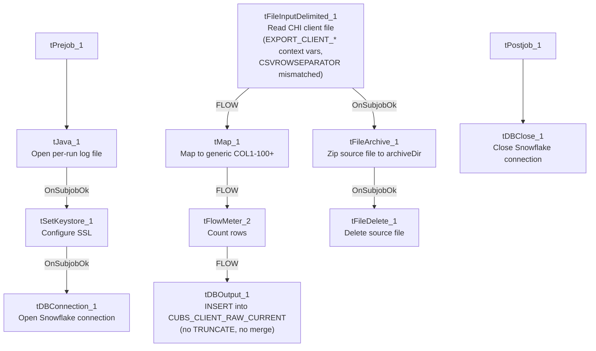

# Talend Job: CUBS_Raw_CHI_Client_Load

## Overview

Loads CUBS client master records (agency/creditor client accounts — name, address, phone, statement/invoice frequency settings, commission/interest rate fields, and a long tail of site- and client-level flags such as `CityOfChi`, `SCR_LTR_MIN`/`SCR_EML_MIN`/`SCR_TXT_MIN` thresholds) for the CHI site from a delimited export file into the Snowflake `CUBS_CLIENT_RAW_CURRENT` staging table. It is structurally identical to `CUBS_Raw_Activity_Load` (same setup/teardown, same archive-then-delete pattern, same missing truncate/merge step) — the only thing distinguishing this job as CHI-specific is its name; nothing CHI-specific appears in its own component parameters. See Issues observed.

## Detail table

| Field | Value |
|---|---|
| Job name | CUBS_Raw_CHI_Client_Load |
| Version | 0.1 |
| Project | EDW2SF |
| Author | jmach@harriscollect.com |
| Created | 2023-09-26T11:15:19.237-0700 |
| Last Modified | 2025-11-04T11:08:08.583-0800 |

## Step-by-step data flow

**Setup subjob:** `tPrejob_1` → `tJava_1` opens a per-run log file at `context.logDir + context.currentLogon + "_" + jobName + <timestamp> + ".log"` → on success, `tSetKeystore_1` configures SSL trust/keystore from `context.keystorePath` (passwords redacted) → `tDBConnection_1` opens the Snowflake connection.

**Main subjob:**

1. `tFileInputDelimited_1` reads `context.sourceDir + context.EXPORT_CLIENT_File`. Field separator, header flag, and encoding all correctly use the `EXPORT_CLIENT_*` context family (`EXPORT_CLIENT_FieldSeparator`, `EXPORT_CLIENT_Header`, `EXPORT_CLIENT_Encoding`, `EXPORT_CLIENT_RowSeparator`) — **except `CSVROWSEPARATOR`, which is set to `context.EXPORT_TRANS_RowSeparator`** instead of an `EXPORT_CLIENT_*` variable, a copy-paste inconsistency (see Issues observed; only relevant if `CSV_OPTION` is ever turned on — it is currently `false`, so `ROWSEPARATOR`, not `CSVROWSEPARATOR`, is the value actually applied). The main schema is labeled generically `"metadata"` in the repository (not a client-specific name), with ~165 client business columns (`LOGON`, `CLIENT`, `CLIENT_IDX`, `NAME`, `ADD1`/`ADD2`, `CITY`, `ST`, `ZIP`, rate/commission fields, statement/invoice settings, scoring thresholds, etc. — the extracted schema lists them twice, likely an artifact of how main+reject schema fields were captured together). Reject schema is labeled `CUBS_TRANSACTION` (same mislabeling pattern seen in `CUBS_Raw_Activity_Load`). `TRIMALL=true` here (vs. `false` in `CUBS_Raw_Activity_Load`) — all fields are whitespace-trimmed. `DIE_ON_ERROR=false`, with no reject flow wired.
2. On `FLOW`, `tMap_1` passes the row through to a generic output schema (`FILENAME`, `FILEDATE`, `COL1`–`COL100`+) — meaningful client column names are not preserved past this point.
3. `tFlowMeter_2` counts rows (label "MyLabel", not customized).
4. `tDBOutput_1` inserts the rows into Snowflake table `CUBS_CLIENT_RAW_CURRENT` (`INSERT`, `tableAction=NONE`) — no `TRUNCATE` step anywhere in this job and no merge call afterward, despite the `_RAW_CURRENT` table name.
5. Separately, off `tFileInputDelimited_1`'s own `SUBJOB_OK` (not the DB insert's success): `tFileArchive_1` zips the source file to `context.archiveDir + "/" + <date> + "/" + context.EXPORT_CLIENT_File + ".tar.gz"` (password redacted, `ENCRYPT_FILES=false`), then on success `tFileDelete_1` deletes the original source file.

**Teardown subjob:** `tPostjob_1` → `tDBClose_1` closes the Snowflake connection.

## Settings tables

### Source: `tFileInputDelimited_1`

| Setting | Value | What it means |
|---|---|---|
| FILENAME | `context.sourceDir + context.EXPORT_CLIENT_File` | Path built from the correctly-scoped `EXPORT_CLIENT_File` variable. |
| ROWSEPARATOR / FIELDSEPARATOR / HEADER / ENCODING | `context.EXPORT_CLIENT_RowSeparator` / `context.EXPORT_CLIENT_FieldSeparator` / `context.EXPORT_CLIENT_Header` / `context.EXPORT_CLIENT_Encoding` | Correctly scoped to the CLIENT export context group. |
| CSVROWSEPARATOR | `context.EXPORT_TRANS_RowSeparator` | **Mismatched** — references the Trans export's row separator instead of `EXPORT_CLIENT_RowSeparator`; only takes effect if `CSV_OPTION` is enabled (currently `false`). See Issues observed. |
| TRIMALL | `true` | Differs from `CUBS_Raw_Activity_Load` (`false`) — all field values are trimmed of leading/trailing whitespace. |
| Main schema | Repository `"metadata"` (generic label, ~165 client columns) | Not a client-specific schema name in the repository, unlike `CUBS_Raw_Activity_Load`'s correctly labeled `CUBS_ACTIVITY` schema. |
| Reject schema | Repository `CUBS_TRANSACTION` | Mislabeled, same issue class as `CUBS_Raw_Activity_Load`. |
| TEMP_DIR | `"C:/Talend-Studio-20211109_1610-V8.0.1/workspace"` | Hardcoded developer-workstation path. |

### Target: `tDBOutput_1` (`tSnowflakeOutput`)

| Setting | Value | What it means |
|---|---|---|
| Table | `CUBS_CLIENT_RAW_CURRENT` | Destination staging table. |
| Output action | `INSERT` | Appends rows; no `TRUNCATE` precedes it and no merge stored procedure follows it. |
| Table action | `NONE` | Table is not recreated/altered. |

### Archive/Delete: `tFileArchive_1` / `tFileDelete_1`

| Setting | Value | What it means |
|---|---|---|
| TARGET (`tFileArchive_1`) | `context.archiveDir + "/" + <CCYYMMDD> + "/" + context.EXPORT_CLIENT_File + ".tar.gz"` | Archives under a date-stamped subfolder. |
| Trigger | Off `tFileInputDelimited_1`'s `SUBJOB_OK`, not off `tDBOutput_1` | Archive+delete happens before the Snowflake insert is confirmed — see Issues observed. |

## Dependencies & configuration

- **Triggers/depends on other jobs:** none — `runjob_targets` is empty. This job also does not appear as a `tRunJob` target anywhere in `06_dependency_matrix.md`. Notably, the Debtor and ETL per-site job families **do** have a generic dispatcher (`CUBS_Raw_Debtor_Load` → `CUBS_Raw_CHI_Debtor_Load`, etc.; `CUBS_Raw_ETL_Load` → `CUBS_Raw_CHI_ETL_Load`, etc.), but no equivalent generic `CUBS_Raw_Client_Load` dispatcher calling this job is present in this export — its actual trigger mechanism (standalone schedule vs. an undocumented caller) is unclear.
- **Context variables used:** `EXPORT_CLIENT_Encoding`, `EXPORT_CLIENT_FieldSeparator`, `EXPORT_CLIENT_File`, `EXPORT_CLIENT_Header`, `EXPORT_CLIENT_RowSeparator`, `EXPORT_TRANS_RowSeparator` (mismatched — see Issues observed), `archiveDir`, `currentLogon`, `keystorePath`, `logDir`, `sourceDir`.
- **5 hardcoded developer-workstation path findings:** `tFileInputDelimited_1.TEMP_DIR`, `tFileArchive_1.SOURCE_FILE`, `tFileDelete_1.DIRECTORY`, `tFileDelete_1.PATH` (all `C:/Talend-Studio-20211109_1610-V8.0.1/workspace/...`), and `tSetKeystore_1.SSL_TRUSTSERVER_TRUSTSTORE` (`C:/clientTrustStore.trustStore`) — same project-wide pattern documented in `05_operational_runbook.md`.

## Glossary

| Component type | Plain-English meaning |
|---|---|
| `tFileInputDelimited` | Reads a delimited (CSV-style) text file according to a schema. |
| `tMap` | Maps/transforms columns from one schema to another. |
| `tFlowMeter` | Counts rows passing through a point in the flow, for logging/monitoring. |
| `tSnowflakeOutput` / `tSnowflakeConnection` / `tSnowflakeClose` | Write rows to a Snowflake table / open and close the shared Snowflake connection. |
| `tFileArchive` / `tFileDelete` | Zip a processed file to an archive location, then delete the original from the source directory. |
| `tSetKeystore` | Configures the SSL keystore/truststore used by subsequent secure connections. |
| `tPrejob` / `tPostjob` | Run once before/after the rest of the job. |
| `tJava` | Runs a block of custom Java code — here, opening a per-run log file. |

## Issues observed

- **`CSVROWSEPARATOR` on `tFileInputDelimited_1` references `context.EXPORT_TRANS_RowSeparator`**, not an `EXPORT_CLIENT_*` variable, while every other separator/header/encoding setting on the same component is correctly scoped to `EXPORT_CLIENT_*`. This looks like a copy-paste leftover from a Trans-load template. It only matters if `CSV_OPTION` is ever switched on (it is currently `false`, so `ROWSEPARATOR` — which is correctly `context.EXPORT_CLIENT_RowSeparator` — is the value actually used); flagging it now so it doesn't silently misbehave if that setting changes later.
- **The main input schema is labeled generically `"metadata"` in the repository**, not a client-specific name, and the reject schema is labeled `CUBS_TRANSACTION` — the same mislabeled-reject-schema pattern seen in `CUBS_Raw_Activity_Load` and `ADP_Payroll_Load`. Unable to determine whether a rejected client row would parse cleanly against a transaction-shaped schema.
- **Nothing in this job's own metadata (no hardcoded string, no site-specific parameter) actually identifies it as CHI-specific** beyond the job name itself. The site-specific behavior must come entirely from a per-job context override (e.g., a CHI-specific value bound to `context.sourceDir` or `context.EXPORT_CLIENT_File`) that is not captured in this extraction — verify directly in Talend Studio's context settings for this job before assuming what differentiates it from its CO/DC/HH/PRE/TOL siblings (not in this batch).
- **No visible caller.** Unlike the Debtor and ETL per-site job families, which are each dispatched by a generic umbrella job (`CUBS_Raw_Debtor_Load`, `CUBS_Raw_ETL_Load` — see `06_dependency_matrix.md`), there is no equivalent generic Client-load dispatcher calling `CUBS_Raw_CHI_Client_Load` in this export.
- **Archive and delete of the source file are triggered by the file read succeeding, not by the Snowflake insert succeeding** — same ordering risk as `CUBS_Raw_Activity_Load`: a downstream failure in `tMap_1`/`tFlowMeter_2`/`tDBOutput_1` would still result in the source file being archived and deleted.
- **No `TRUNCATE` step and no merge call anywhere in this job**, despite the target table being named `CUBS_CLIENT_RAW_CURRENT` — same missing-refresh-step concern as `CUBS_Raw_Activity_Load`.
