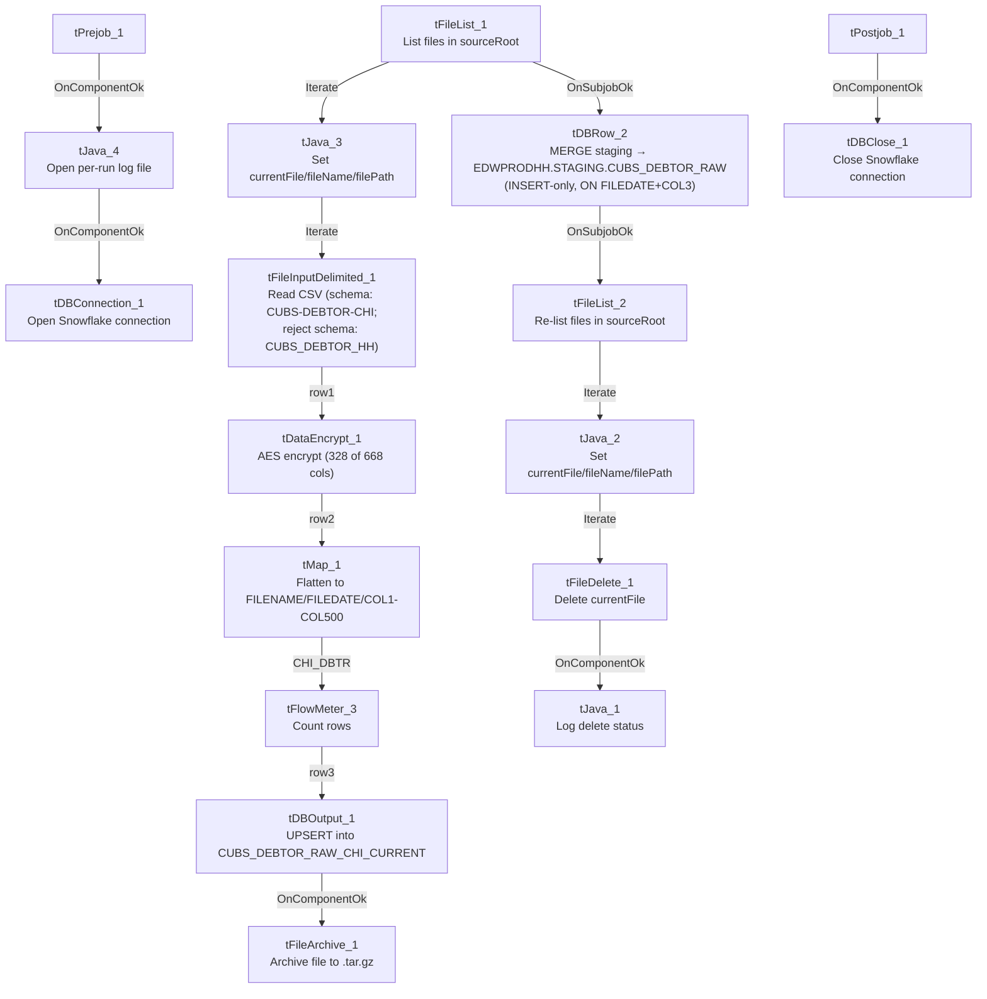

# Talend Job: CUBS_Raw_CHI_Debtor_Load_Upsert

## Overview

Loads CUBS collections debtor master-file extracts for the CHI site (per-debtor demographic and account fields — name, address, phone, DOB, desk assignment, letter/strategy history, etc., per the `CUBS-DEBTOR-CHI` repository schema) from a local drop directory into Snowflake. Each file's rows are encrypted (PII fields) in flight, flattened into a generic `COL1`-`COL500` staging schema, and loaded into `CUBS_DEBTOR_RAW_CHI_CURRENT` (`UPSERT` output action). Once every file in the batch has loaded, a single `MERGE` statement inserts any not-already-present rows from that staging table into the cross-site raw table `EDWPRODHH.STAGING.CUBS_DEBTOR_RAW`, after which processed source files are archived (as `.tar.gz`) and then deleted from the source directory.

## Detail table

| Field | Value |
|---|---|
| Job name | CUBS_Raw_CHI_Debtor_Load_Upsert |
| Version | 0.4 |
| Project | EDW2SF |
| Author | jmach@harriscollect.com |
| Created | 2024-07-11T11:58:20.802-0700 |
| Last Modified | 2025-09-24T11:06:55.926-0700 |

## Step-by-step data flow

**Setup subjob:** `tPrejob_1` →(`OnComponentOk`)→ `tJava_4` opens a per-run log file at `context.logDir + context.currentLogon + "_" + jobName + "_" + <timestamp> + ".log"` and redirects `System.out` to it (code truncated at 253 characters in the extracted metadata; remainder not recoverable from this JSON) →(`OnComponentOk`)→ `tDBConnection_1` opens the job's Snowflake connection.

**Main subjob — file-load loop (runs once per file in `context.sourceRoot`):**

1. `tFileList_1` lists files in `context.sourceRoot` (files only, no subdirectories, ordered by modified date ascending; `EXCLUDEFILEMASK="*.txt"` is configured but not evidenced as active here — no `IFEXCLUDE` flag was present in this component's captured parameters).
2. `tFileList_1` →(`ITERATE`)→ `tJava_3` copies the current iteration's file path/name/directory from `globalMap` into `context.currentFile` / `context.fileName` / `context.filePath` (code truncated in metadata after the `System.out.println("Proc...` line).
3. →(`ITERATE`)→ `tFileInputDelimited_1` reads the file as delimited text using repository schema `CUBS-DEBTOR-CHI` (668 business columns), with field/row separators, header-row count, and encoding all driven by context variables (`context.EXPORT_DEBTOR_*`); `DIE_ON_ERROR=false`. Its configured reject schema is labeled `CUBS_DEBTOR_HH` — see Issues observed.
4. →(`FLOW`, link `row1`)→ `tDataEncrypt_1` AES-encrypts the row (secret type, secret key, and password all `***REDACTED***` in source metadata). Its own schema carries only 328 of the 668 upstream columns — see Issues observed.
5. →(`FLOW`, link `row2`)→ `tMap_1` maps the row down to a generic 502-column output shape: `FILENAME`, `FILEDATE`, `COL1`...`COL500` (`DIE_ON_ERROR=true`, so a mapping failure fails the job).
6. →(`FLOW`, link `CHI_DBTR`)→ `tFlowMeter_3` counts rows passing this point (label left at the Talend default `"MyLabel"`).
7. →(`FLOW`, link `row3`)→ `tDBOutput_1` (`tSnowflakeOutput`) writes to table `CUBS_DEBTOR_RAW_CHI_CURRENT` with `outputAction=UPSERT`, `tableAction=NONE`.
8. →(`OnComponentOk`)→ `tFileArchive_1` archives the just-processed file to `context.archiveDir + "/" + <today's date CCYYMMDD> + "/" + context.fileName + ".tar.gz"`.

**After the entire file-load loop subjob completes successfully** (not per file): `tFileList_1` →(`OnSubjobOk`)→ `tDBRow_2` (`tSnowflakeRow`) runs a single `MERGE` from `STAGING.CUBS_DEBTOR_RAW_CHI_CURRENT` into `EDWPRODHH.STAGING.CUBS_DEBTOR_RAW`, matching on `FILEDATE` + `COL3`, inserting only rows with `WHEN NOT MATCHED` (no `WHEN MATCHED` clause — see Issues observed).

**Cleanup loop (runs after the merge, once per file in `context.sourceRoot` again):**

9. `tDBRow_2` →(`OnSubjobOk`)→ `tFileList_2` re-lists files in `context.sourceRoot` →(`ITERATE`)→ `tJava_2` re-sets `context.currentFile`/`fileName`/`filePath` from this second listing →(`ITERATE`)→ `tFileDelete_1` deletes `context.currentFile` →(`OnComponentOk`)→ `tJava_1` logs the delete status/path/error from `globalMap`.

**Teardown subjob:** `tPostjob_1` →(`OnComponentOk`)→ `tDBClose_1` closes the Snowflake connection.

## Settings tables

### Source listing: `tFileList_1` / `tFileList_2`

| Setting | Value | What it means |
|---|---|---|
| DIRECTORY | `context.sourceRoot` | Both loops (load and cleanup) scan the same source directory. |
| LIST_MODE | `FILES` | Only files, no subdirectories (`INCLUDSUBDIR=false`). |
| ORDER_BY_MODIFIEDDATE (ASC) | `true` | Files are processed oldest-modified first. |
| EXCLUDEFILEMASK | `"*.txt"` | An exclusion mask is configured, but no `IFEXCLUDE`/enable flag was present in this component's captured parameters to confirm it's active. |

### Source: `tFileInputDelimited_1`

| Setting | Value | What it means |
|---|---|---|
| FILENAME | `context.currentFile` | The current file from `tFileList_1`'s iteration. |
| FIELDSEPARATOR / ROWSEPARATOR / HEADER / ENCODING | `context.EXPORT_DEBTOR_FieldSeparator` / `context.EXPORT_DEBTOR_RowSeparator` / `context.EXPORT_DEBTOR_Header` / `context.EXPORT_DEBTOR_Encoding` | All format details are externalized to context variables rather than hardcoded (the shared `EXPORT_DEBTOR_0.1` context group defines these as tab-separated, `\n` row separator, 1 header row, `US-ASCII`). |
| SCHEMA (main) | Repository schema `CUBS-DEBTOR-CHI` | 668 business columns (name/address/phone/DOB/desk/strategy/letter-history fields) plus `errorCode`/`errorMessage` reject columns. |
| SCHEMA_REJECT | Repository schema `CUBS_DEBTOR_HH` | **Site mismatch** — this is the CHI job but its reject schema is labeled for HH. See Issues observed. |
| DIE_ON_ERROR | `false` | Malformed rows don't fail the job... |
| Reject flow | Not wired | ...but no connection in this job routes rejected rows anywhere — they are silently dropped. |
| TEMP_DIR | `"C:/Talend-Studio-20211109_1610-V8.0.1/workspace"` | Hardcoded developer-workstation path (see `hardcoded_path_findings`). |

### Transform: `tDataEncrypt_1`

| Setting | Value | What it means |
|---|---|---|
| CRYPTO_METHOD | `AES` | Symmetric encryption of column values. |
| SECRET_TYPE / SECRET_KEY / PASSWORD_M1 | `***REDACTED***` | Encryption key material — preserved as redacted, not guessable from this metadata. |
| CRYPTO_FILE_PATH | `context.cryptoPath` | Externalized crypto-config file path (variable not found in any extracted context group — see Issues observed). |
| Schema | 328 columns (`LOGON` ... `CLT_XFER_DT`) | Only the first 328 of the upstream 668 business columns are present in this component's schema — see Issues observed. |

### Transform: `tMap_1`

| Setting | Value | What it means |
|---|---|---|
| DIE_ON_ERROR | `true` | Any mapping/lookup error here fails the job outright (unlike the upstream file-read step). |
| Output schema | `FILENAME`, `FILEDATE`, `COL1`...`COL500` (502 columns) | Business field names are discarded in favor of a fixed, generically-numbered column layout — matches `tDBOutput_1`'s target schema exactly. |

### Target: `tDBOutput_1` (`tSnowflakeOutput`)

| Setting | Value | What it means |
|---|---|---|
| Table | `CUBS_DEBTOR_RAW_CHI_CURRENT` | Per-run staging table for this file batch. |
| Output action | `UPSERT` | Row-level upsert into the staging table (merge key not shown in this component's own metadata). |
| Table action | `NONE` | Table is not recreated/altered by this job. |
| Schema | `FILENAME`, `FILEDATE`, `COL1`...`COL500`, plus reject-flow columns (`columnName`, `rowNumber`, `category`, `character`, `errorMessage`, `byteOffset`, `line`, `sqlState`, `code`) | A reject schema exists on this component, but (per `connections`) no reject flow is wired out of it — see Issues observed. |

### Archive/cleanup: `tFileArchive_1` / `tFileDelete_1`

| Setting | Value | What it means |
|---|---|---|
| TARGET (`tFileArchive_1`) | `context.archiveDir + "/" + TalendDate.getDate("CCYYMMDD") + "/" + context.fileName + ".tar.gz"` | Archives each processed file into a date-stamped subfolder. |
| SOURCE_FILE (`tFileArchive_1`) | `"C:/Talend-Studio-20211109_1610-V8.0.1/workspace/source.csv"` | Hardcoded developer-workstation path (see `hardcoded_path_findings`); actual `SOURCE` param is `context.filePath`, so this hardcoded value appears to be an unused/default placeholder rather than the active source. |
| ENCRYPT_FILES / PASSWORD (`tFileArchive_1`) | `false` / `***REDACTED***` | Archive encryption is disabled, so the redacted password is configured but not currently used. |
| DIRECTORY / PATH (`tFileDelete_1`) | `"C:/Talend-Studio-20211109_1610-V8.0.1/workspace/delete_folder"` / `"...delete_folder or delete_file"` | Hardcoded developer-workstation paths (see `hardcoded_path_findings`); actual `FILENAME` param used is `context.currentFile`. |

### Merge step: `tDBRow_2` (`tSnowflakeRow`)

| Setting | Value | What it means |
|---|---|---|
| Query | `MERGE INTO EDWPRODHH.STAGING.CUBS_DEBTOR_RAW AS tgt USING STAGING.CUBS_DEBTOR_RAW_CHI_CURRENT AS src ON tgt.FILEDATE = src.FILEDATE AND tgt.COL3 = src.COL3 WHEN NOT MATCHED THEN INSERT (FILENAME, FILEDATE, COL1...COL500) VALUES (src.FILENAME, src.FILEDATE, src.COL1...src.COL500);` | Copies rows not already present (by `FILEDATE`+`COL3`) from the per-run CHI staging table into the shared cross-site raw table. There is **no `WHEN MATCHED THEN UPDATE`** clause — see Issues observed. |
| Runs when | `OnSubjobOk` from `tFileList_1` | Fires once after the entire file-load loop finishes successfully, not once per file. |

## Dependencies & configuration

- **Triggers/depends on other jobs:** none — `runjob_targets` is empty; this job contains no `tRunJob` components.
- **Called by:** not found as a `tRunJob` target anywhere in `06_dependency_matrix.md`. The matrix shows the `CUBS_Raw_Debtor_Load` orchestrator calling a differently-named job, `CUBS_Raw_CHI_Debtor_Load` (without the `_Upsert` suffix), for the CHI site. See Issues observed.
- **Context variables used:** `EXPORT_DEBTOR_Encoding`, `EXPORT_DEBTOR_FieldSeparator`, `EXPORT_DEBTOR_Header`, `EXPORT_DEBTOR_RowSeparator` (all defined in the shared `EXPORT_DEBTOR_0.1` context group), `archiveDir`, `logDir` (defined in `StandardFolders_0.1`, with two candidate values each — `/archive/`/`/logs/` vs. `C:/Data/`/`C:/Data/` — the metadata doesn't indicate which corresponds to which environment), `currentFile`, `fileName`, `filePath` (set internally by `tJava_2`/`tJava_3` from `tFileList_*` iteration state), and `sourceRoot`, `cryptoPath`, `currentLogon` — none of which appear in any context group in `_shared_context.json` (the closest named variable, `sourceDir`, is a different name than `sourceRoot`). See Issues observed.
- **4 hardcoded developer-workstation paths** (`C:/Talend-Studio-20211109_1610-V8.0.1/workspace/...`) in `tFileInputDelimited_1.TEMP_DIR`, `tFileArchive_1.SOURCE_FILE`, and `tFileDelete_1.DIRECTORY`/`PATH` — the same portability risk pattern documented project-wide in `05_operational_runbook.md`.

## Glossary

| Component type | Plain-English meaning |
|---|---|
| `tPrejob` / `tPostjob` | Marks the setup/teardown subjobs that run once before/after the rest of the job, regardless of how many times the main flow iterates. |
| `tSnowflakeConnection` / `tSnowflakeClose` | Opens / closes the Snowflake connection used throughout the job. |
| `tFileList` | Lists files in a directory for the job to iterate over one at a time. |
| `tJava` | Runs a block of custom Java code once (not per row). |
| `tFileInputDelimited` | Reads a delimited (CSV-style) text file according to a schema. |
| `tDataEncrypt` | Encrypts specified column values in the row using a configured algorithm/key. |
| `tMap` | Maps/transforms columns from one schema to another. |
| `tFlowMeter` | Counts rows passing through a point in the flow, for logging/monitoring. |
| `tSnowflakeOutput` | Writes rows to a Snowflake table (insert/update/upsert/etc., per `outputAction`). |
| `tSnowflakeRow` | Runs an arbitrary SQL statement (here, a `MERGE`) against Snowflake. |
| `tFileArchive` / `tFileDelete` | Archives a processed file to a compressed location, then deletes the original from the source directory. |

## Issues observed

- **Reject schema is labeled for the wrong site.** `tFileInputDelimited_1`'s `SCHEMA_REJECT` is the `CUBS_DEBTOR_HH` repository schema, not a CHI-specific one, even though this is `CUBS_Raw_CHI_Debtor_Load_Upsert`. This is the same kind of copy-paste-and-not-repointed pattern seen in other jobs in this project (e.g. `ADP_Payroll_Load`'s roster-labeled reject schema); given this project's per-site job template pattern (CHI/CO/DC/HH/PRE/TOL), it strongly suggests this job was cloned from an HH-site sibling. Combined with the fact that no reject flow is actually wired out of `tFileInputDelimited_1` (`DIE_ON_ERROR=false`, malformed rows are simply dropped with no record), a malformed CHI row's shape mismatch against the HH reject schema is unverifiable from this metadata — verify directly in the Talend repository.
- **Schema drift between `tFileInputDelimited_1` and `tDataEncrypt_1`.** The file-read schema carries 668 business columns (`CUBS-DEBTOR-CHI`), but `tDataEncrypt_1`'s schema stops at column 328 (`CLT_XFER_DT`) — the trailing ~340 source columns (`VAL_LTR_DT`, `LETTERABLE`, `EMAILABLE`, `TEXTABLE`, `WC_EMPLOY`, `CBC2_PHONE`, and everything between) are not present in `tDataEncrypt_1`'s schema and therefore not available to the downstream `tMap_1`. This looks like `tDataEncrypt_1`'s schema was not kept in sync when the source file format was extended. Since `tMap_1`'s output is a generic `COL1`-`COL500` layout anyway, it's unclear from this metadata alone which named source fields ultimately land in which `COLnn` — but the schema gap itself is a concrete, verifiable fact from the metadata.
- **Not referenced by any orchestrator job in this project's metadata.** `06_dependency_matrix.md` shows `CUBS_Raw_Debtor_Load` calling `CUBS_Raw_CHI_Debtor_Load` (without the `_Upsert` suffix) for the CHI site, not this job. Unable to determine from metadata whether `CUBS_Raw_CHI_Debtor_Load_Upsert` is a newer replacement not yet wired into that orchestrator, a manually/ad-hoc-triggered job, or an entirely separate job that happens to share almost the same name — verify with the team before assuming either job is dead code.
- **Job name says "Upsert," but the merge is insert-only.** `tDBRow_2`'s `MERGE` statement has a `WHEN NOT MATCHED THEN INSERT` clause and no `WHEN MATCHED THEN UPDATE` clause — rows already present in `EDWPRODHH.STAGING.CUBS_DEBTOR_RAW` (matched by `FILEDATE`+`COL3`) are left untouched, not updated. Functionally this is a dedup-insert/append pattern, not a true upsert. This may be intentional for an append-only raw table, but the job's own name may mislead anyone assuming existing rows get refreshed.
- **Several referenced context variables have no defined default anywhere in the extracted project context groups.** `context.sourceRoot`, `context.cryptoPath`, and `context.currentLogon` are all read by this job's components but do not appear in any of the 23 context groups captured in `_shared_context.json` (the closest match, `sourceDir`/`sourceDCDir` in `StandardFolders_0.1`, is a different variable name). Either this job carries its own job-level context defaults that weren't captured by this extraction, or these are unresolved references — verify with the team.
- **4 hardcoded developer-workstation paths** (`C:/Talend-Studio-20211109_1610-V8.0.1/workspace/...`) in `tFileInputDelimited_1.TEMP_DIR`, `tFileArchive_1.SOURCE_FILE`, and `tFileDelete_1.DIRECTORY`/`PATH` — the same project-wide portability risk already documented in `05_operational_runbook.md`; none of these override the actual active `FILENAME`/`SOURCE` parameters (which correctly use `context.currentFile`/`context.filePath`), so they appear to be inert leftover defaults rather than active bugs, but should still be cleaned up.
- **The merge's natural key (`FILEDATE` + `COL3`) is opaque.** Because `tMap_1`/`tDBOutput_1` use the generic `COL1`-`COL500` naming scheme instead of business field names, `COL3`'s real meaning (the only one of the 500 marked non-nullable in `tDBOutput_1`'s schema, suggesting it's a business key such as an account or debtor ID) cannot be determined from this metadata.
- No other project-wide risk patterns beyond those already covered above and in `05_operational_runbook.md` were found specific to this job.
