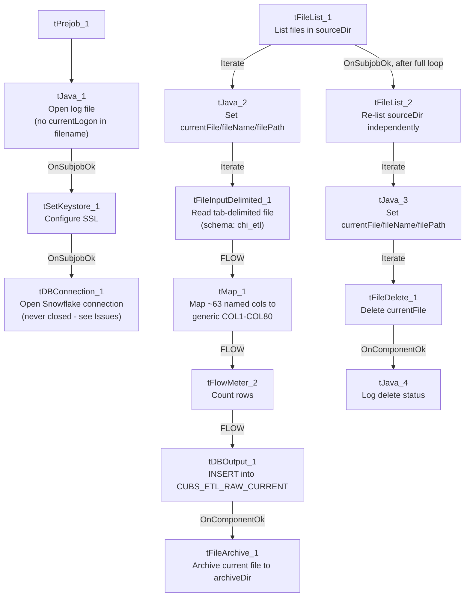

# Talend Job: CUBS_Raw_CHI_ETL_Load

## Overview

Loads CUBS "ETL" per-debtor scoring and attribute records (Attune/propensity scores, deciles/percentiles, bankruptcy-disposition flags, and revolving/installment/auto/mortgage/lease balance and credit-line fields) for the CHI site from tab-delimited files dropped in `context.sourceDir` into the Snowflake `CUBS_ETL_RAW_CURRENT` staging table. Unlike the single-file `CUBS_Raw_*_Client_Load` jobs, this job loops over every file currently sitting in the source directory (via `tFileList`), so it can process a batch of files in one run, then runs a second, separate pass over the same directory to delete whatever files are still there. It is one of the per-site jobs dispatched by the generic `CUBS_Raw_ETL_Load` job (see `06_dependency_matrix.md`).

## Detail table

| Field | Value |
|---|---|
| Job name | CUBS_Raw_CHI_ETL_Load |
| Version | 0.1 |
| Project | EDW2SF |
| Author | jmach@harriscollect.com |
| Created | 2022-12-15T10:12:24.866-0800 |
| Last Modified | 2025-11-11T22:54:21.810-0800 |

## Step-by-step data flow

**Setup subjob:** `tPrejob_1` → `tJava_1` opens a per-run log file at `context.logDir + jobName + "_" + <timestamp> + ".log"` (note: unlike sibling jobs' `tJava_1`, this filename does **not** include `context.currentLogon`) → on `SUBJOB_OK`, `tSetKeystore_1` configures SSL trust/keystore from `context.keystorePath` (passwords redacted) → on `SUBJOB_OK`, `tDBConnection_1` opens the Snowflake connection. **There is no `tPostjob`/`tDBClose` anywhere in this job** — see Issues observed.

**Main subjob — pass 1 (load, one file at a time):**

1. `tFileList_1` lists files in `context.sourceDir`, ordered by modified date ascending (`EXCLUDEFILEMASK="*.txt"` is configured but `IFEXCLUDE=false`, so the exclusion is not actually applied — every file is picked up, same non-functional-exclude pattern as `ADP_Payroll_Load`).
2. For each file (`ITERATE`), `tJava_2` sets `context.currentFile`/`context.fileName`/`context.filePath` from the current iteration.
3. `tFileInputDelimited_1` reads `context.currentFile` (tab-delimited, header row present, `ISO-8859-15` encoding, repository schema labeled `"chi_etl"` — correctly named for this job, unlike the generic `"metadata"` label seen on the sibling client-load jobs). `DIE_ON_ERROR=false`, and no reject flow is wired.
4. `tMap_1` maps the ~63 named business columns (`LOGON`, `DEBTOR`, `DEBTOR_IDX`, dollar/score/date attribute fields, bankruptcy disposition flags, balance/credit-line fields, `Attune_Score`, `Propen_Score`, `Decile`, `Percentile`, `Dialer_group`, etc.) to a generic output schema of `FILENAME`, `FILEDATE`, `COL1`…`COL80` — the meaningful column names are not preserved past this point.
5. `tFlowMeter_2` counts rows passing through (label "MyLabel", not customized for this job).
6. `tDBOutput_1` inserts the rows into Snowflake table `CUBS_ETL_RAW_CURRENT` (`INSERT`, `tableAction=NONE` — no `TRUNCATE` step anywhere in this job despite the `_RAW_CURRENT` table name).
7. On `tDBOutput_1`'s `COMPONENT_OK`, `tFileArchive_1` archives `context.filePath` (the current file) to `context.archiveDir + "/" + <CCYYMMDD> + "/" + context.fileName + ".tar.gz"` (password redacted, per-file, inside the same loop iteration).

**Main subjob — pass 2 (delete, after pass 1 has iterated every file):** once `tFileList_1`'s loop finishes (`SUBJOB_OK`), `tFileList_2` **re-lists `context.sourceDir` independently** → `ITERATE` → `tJava_3` sets `context.currentFile`/`fileName`/`filePath` again → `ITERATE` → `tFileDelete_1` deletes `context.currentFile` → on `COMPONENT_OK`, `tJava_4` logs the delete status/error message. See Issues observed regarding this second, independent directory listing.

## Settings tables

### Source loop: `tFileList_1` / `tFileList_2`

| Setting | Value | What it means |
|---|---|---|
| DIRECTORY | `context.sourceDir` (both) | Same directory listed twice, independently, in two separate passes. |
| ORDER_BY_MODIFIEDDATE / ASC | `true` / `true` | Processes (and later deletes) the oldest files first. |
| EXCLUDEFILEMASK / IFEXCLUDE | `"*.txt"` / `false` | Exclusion configured but not applied — every file in the directory is picked up by both passes. |

### Read: `tFileInputDelimited_1`

| Setting | Value | What it means |
|---|---|---|
| FILENAME | `context.currentFile` | The file currently being iterated by `tFileList_1`/`tJava_2`. |
| FIELDSEPARATOR / ROWSEPARATOR / HEADER | `"\t"` / `"\n"` / `1` | Tab-delimited, one header row. |
| ENCODING | `ISO-8859-15` | Fixed (not context-driven, unlike the client-load siblings' `context.EXPORT_CLIENT_Encoding`). |
| SCHEMA | Repository `"chi_etl"` (~63 business columns) | Correctly named for this job — LOGON/DEBTOR identifiers, scoring outputs, and balance/credit-line attribute fields. |
| DIE_ON_ERROR / reject flow | `false` / not wired | Malformed rows do not fail the job and are silently dropped (no reject file, log, or table). |
| TEMP_DIR | `"C:/Talend-Studio-20211109_1610-V8.0.1/workspace"` | Hardcoded developer-workstation path. |

### Transform: `tMap_1`

| Setting | Value | What it means |
|---|---|---|
| Output schema | `FILENAME`, `FILEDATE`, `COL1`–`COL80` (82 columns) | All 63 named source columns are flattened into generic positional columns — meaningful field names (`Attune_Score`, `Dialer_group`, etc.) are lost past this point; recovering them requires a separate column-position mapping. |
| DIE_ON_ERROR | `true` | A mapping/lookup failure here fails the job outright. |

### Target: `tDBOutput_1` (`tSnowflakeOutput`)

| Setting | Value | What it means |
|---|---|---|
| Table | `CUBS_ETL_RAW_CURRENT` | Destination staging table. |
| Output action / Table action | `INSERT` / `NONE` | Appends rows; table is not truncated or recreated by this job. |
| Schema width | 91 columns (82 from `tMap_1` + 9 Snowflake reject-metadata columns: `columnName`, `rowNumber`, `category`, `character`, `errorMessage`, `byteOffset`, `line`, `sqlState`, `code`) | The extra 9 columns are Snowflake-output reject/error metadata fields captured alongside the main schema. |

### Archive / Delete: `tFileArchive_1` / `tFileDelete_1`

| Setting | Value | What it means |
|---|---|---|
| SOURCE / TARGET (`tFileArchive_1`) | `context.filePath` / `context.archiveDir + "/" + <CCYYMMDD> + "/" + context.fileName + ".tar.gz"` | Archives the just-loaded file under a date-stamped subfolder; `PASSWORD` is set (`***REDACTED***`) but `ENCRYPT_FILES=false`, so the password isn't actually applied to the archive. |
| FILENAME (`tFileDelete_1`) | `context.currentFile` | The value actually used to identify what to delete — takes precedence over the component's own `DIRECTORY`/`PATH` fields. |
| DIRECTORY / PATH (`tFileDelete_1`) | `"C:/Talend-Studio-20211109_1610-V8.0.1/workspace/delete_folder"` / `"...delete_folder or delete_file"` | Hardcoded developer-workstation defaults left in place; not actually used since `FILENAME` drives the delete. |

### `tSetKeystore_1`

| Setting | Value | What it means |
|---|---|---|
| SSL_KEYSTORE | `context.keystorePath` | Context-driven keystore location. |
| SSL_TRUSTSERVER_TRUSTSTORE | `"C:/clientTrustStore.trustStore"` | Hardcoded developer-workstation path. |
| SSL_TRUSTSERVER_PASSWORD / SSL_KEYSTORE_PASSWORD / NEED_CLIENT_AUTH | `***REDACTED***` (all) | Preserved as redacted — not guessed here. |

## Dependencies & configuration

- **Called by:** `CUBS_Raw_ETL_Load`, the generic per-site ETL dispatcher (1 call — see `06_dependency_matrix.md`, alongside its `CO`, `DC`, and `HH` siblings).
- **Calls no other jobs** — `runjob_targets` is empty.
- **Context variables used:** `archiveDir`, `currentFile`, `fileName`, `filePath`, `keystorePath`, `logDir`, `sourceDir`.
- **5 hardcoded developer-workstation path findings** (`tFileInputDelimited_1.TEMP_DIR`, `tFileArchive_1.SOURCE_FILE`, `tFileDelete_1.DIRECTORY`/`PATH`, `tSetKeystore_1.SSL_TRUSTSERVER_TRUSTSTORE`) — same project-wide pattern documented in `05_operational_runbook.md` (210 of 289 jobs).

## Glossary

| Component type | Plain-English meaning |
|---|---|
| `tFileList` | Lists files in a directory for the job to iterate over one at a time. |
| `tFileInputDelimited` | Reads a delimited (CSV/TSV-style) text file according to a schema. |
| `tMap` | Maps/transforms columns from one schema to another. |
| `tFlowMeter` | Counts rows passing through a point in the flow, for logging/monitoring. |
| `tSnowflakeOutput` / `tSnowflakeConnection` | Write rows to a Snowflake table / open the shared Snowflake connection used by the job. |
| `tFileArchive` / `tFileDelete` | Zip a processed file to an archive location / delete a file from disk. |
| `tSetKeystore` | Configures the SSL keystore/truststore used by the job's secure connections. |
| `tPrejob` / `tJava` | Run once before the rest of the job / run a block of custom Java code. |

## Issues observed

- **No `tPostjob`/`tDBClose` anywhere in this job's metadata.** Every other job examined in this batch (and the reference docs) explicitly closes its Snowflake connection in a teardown subjob; here, `tDBConnection_1` is opened in the setup subjob and never explicitly closed within this job. This may be relied upon (e.g., independent-process JVM teardown implicitly releasing the connection), or it may be a genuine gap — unable to determine from metadata; verify with the team.
- **Pass 2's file list is independent of what pass 1 actually loaded.** `tFileList_2` re-lists `context.sourceDir` fresh rather than deleting specifically the files that were just archived in pass 1. If a new file lands in `sourceDir` after pass 1 starts but before pass 2 runs, `tFileDelete_1` could delete it before it is ever read by `tFileInputDelimited_1` — there is no visible guard against this race condition in the job's own metadata.
- **`EXCLUDEFILEMASK="*.txt"` is configured but inert** (`IFEXCLUDE=false`) on both `tFileList_1` and `tFileList_2` — same non-functional-exclude-mask pattern seen in `ADP_Payroll_Load`'s `tFileList_1`.
- **No reject flow wired on `tFileInputDelimited_1`** (`DIE_ON_ERROR=false`) — malformed rows are silently dropped with no record of how many or which ones failed to parse.
- **Named business columns do not survive past `tMap_1`.** `CUBS_ETL_RAW_CURRENT` only stores generic `COL1`–`COL80` positional columns, so interpreting any given column in that table requires an external mapping back to this job's `tMap_1` configuration (not itself queryable from the warehouse) — same generic-positional-column pattern used by the sibling `CUBS_Raw_*_Client_Load` jobs.
- **`tJava_1`'s log filename omits `context.currentLogon`**, unlike the equivalent `tJava_1`/`tJava_2` setup step in the client-load siblings (`context.logDir + context.currentLogon + "_" + jobName + ...`). Not a functional issue since a valid filename is still produced, but it's a naming inconsistency across otherwise-similar per-site job templates.
