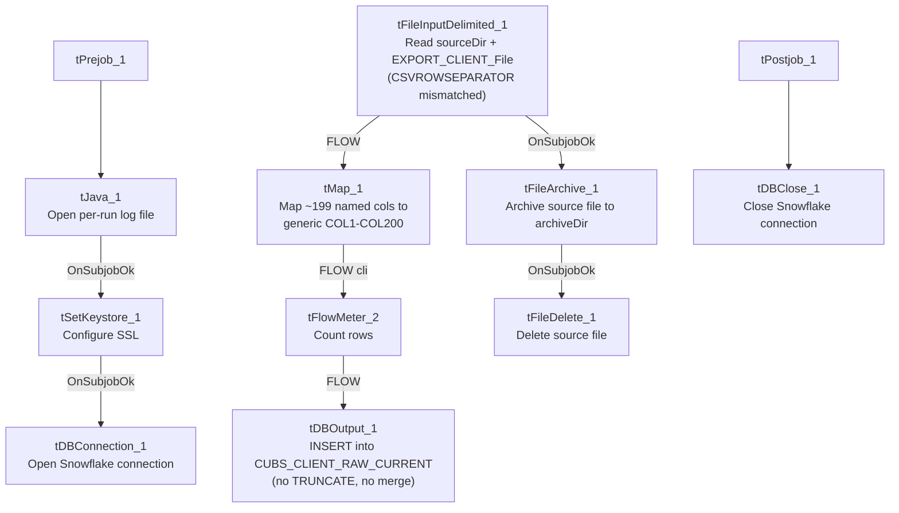

# Talend Job: CUBS_Raw_CO_Client_Load

## Overview

Loads CUBS client master records (agency/creditor client accounts — name, address, phone, statement/invoice-frequency settings, commission/interest-rate fields, scoring thresholds, and a long tail of client-level flags) for the CO site from a single delimited export file into the Snowflake `CUBS_CLIENT_RAW_CURRENT` staging table, then archives and deletes the source file. It is called by `CO_Master_Load` as the first step of that site's daily load chain (see `06_dependency_matrix.md`). This job is structurally and configurationally near-identical to `CUBS_Raw_CHI_Client_Load` — same components, same wiring, same context-variable names, same mismatched reject schema — see Issues observed for what (if anything) actually differs.

## Detail table

| Field | Value |
|---|---|
| Job name | CUBS_Raw_CO_Client_Load |
| Version | 0.1 |
| Project | EDW2SF |
| Author | jmach@harriscollect.com |
| Created | 2023-09-26T11:16:02.689-0700 |
| Last Modified | 2025-11-04T11:08:09.921-0800 |

## Step-by-step data flow

**Setup subjob:** `tPrejob_1` → `tJava_1` opens a per-run log file at `context.logDir + context.currentLogon + "_" + jobName + "_" + <timestamp> + ".log"` → on `SUBJOB_OK`, `tSetKeystore_1` configures SSL trust/keystore from `context.keystorePath` (passwords redacted) → on `SUBJOB_OK`, `tDBConnection_1` opens the Snowflake connection.

**Main subjob:**

1. `tFileInputDelimited_1` reads a single file at `context.sourceDir + context.EXPORT_CLIENT_File` (not a directory loop — this job processes one fixed export file per run, unlike `CUBS_Raw_CHI_ETL_Load`'s per-file iteration). Separators/header/encoding are all context-driven from the `EXPORT_CLIENT_*` group (`EXPORT_CLIENT_RowSeparator`, `EXPORT_CLIENT_FieldSeparator`, `EXPORT_CLIENT_Header`, `EXPORT_CLIENT_Encoding`), **except `CSVROWSEPARATOR`, which is set to `context.EXPORT_TRANS_RowSeparator`** instead of an `EXPORT_CLIENT_*` variable (only relevant if `CSV_OPTION` is ever turned on — currently `false`). `TRIMALL=true`. The main schema is labeled generically `"metadata"` in the repository (~199 unique client business columns: `LOGON`, `CLIENT`, `CLIENT_IDX`, `NAME`, address fields, rate/commission fields, statement/invoice settings, scoring thresholds, etc.). The reject schema is labeled `"CUBS_TRANSACTION"`. `DIE_ON_ERROR=false`, no reject flow wired.
2. On `SUBJOB_OK` (i.e., as soon as the file read succeeds — not gated on the Snowflake insert), `tFileArchive_1` archives `context.sourceDir` to `context.archiveDir + "/" + <CCYYMMDD> + "/" + context.EXPORT_CLIENT_File + ".tar.gz"` (password redacted, `ENCRYPT_FILES=false`), then on `SUBJOB_OK`, `tFileDelete_1` deletes `context.sourceDir + context.EXPORT_CLIENT_File`.
3. On `FLOW`, `tMap_1` maps the ~199 named business columns to a generic output schema of `FILENAME`, `FILEDATE`, `COL1`–`COL200` (202 columns) — meaningful column names are not preserved past this point.
4. `tFlowMeter_2` counts rows passing through (link labeled `"cli"`, one of the few flow labels in this batch that was actually renamed from the Talend default).
5. `tDBOutput_1` inserts the rows into Snowflake table `CUBS_CLIENT_RAW_CURRENT` (`INSERT`, `tableAction=NONE` — no `TRUNCATE` step anywhere in this job and no merge call afterward, despite the `_RAW_CURRENT` table name).

**Teardown subjob:** `tPostjob_1` → `tDBClose_1` closes the Snowflake connection.

## Settings tables

### Source: `tFileInputDelimited_1`

| Setting | Value | What it means |
|---|---|---|
| FILENAME | `context.sourceDir + context.EXPORT_CLIENT_File` | A single, fixed export file per run — no directory iteration. |
| ROWSEPARATOR / FIELDSEPARATOR / HEADER / ENCODING | `context.EXPORT_CLIENT_RowSeparator` / `context.EXPORT_CLIENT_FieldSeparator` / `context.EXPORT_CLIENT_Header` / `context.EXPORT_CLIENT_Encoding` | Correctly scoped to the CLIENT export context group. |
| CSVROWSEPARATOR | `context.EXPORT_TRANS_RowSeparator` | **Mismatched** — references the Trans export's row separator instead of an `EXPORT_CLIENT_*` variable; only takes effect if `CSV_OPTION` is enabled (currently `false`). Identical mismatch to `CUBS_Raw_CHI_Client_Load`. |
| TRIMALL | `true` | All field values are trimmed of leading/trailing whitespace. |
| Main schema | Repository `"metadata"` (~199 unique client columns) | Generic repository label, not client-specific — same as `CUBS_Raw_CHI_Client_Load`. |
| Reject schema | Repository `"CUBS_TRANSACTION"` | Mislabeled — same issue class as `CUBS_Raw_CHI_Client_Load` and `ADP_Payroll_Load`. |
| TEMP_DIR | `"C:/Talend-Studio-20211109_1610-V8.0.1/workspace"` | Hardcoded developer-workstation path. |

### Transform: `tMap_1`

| Setting | Value | What it means |
|---|---|---|
| Output schema | `FILENAME`, `FILEDATE`, `COL1`–`COL200` (202 columns) | Roughly 2.5x wider than `CUBS_Raw_CHI_ETL_Load`'s `COL1`–`COL80`, reflecting this job's larger ~199-column client schema. Named business columns are not preserved. |

### Target: `tDBOutput_1` (`tSnowflakeOutput`)

| Setting | Value | What it means |
|---|---|---|
| Table | `CUBS_CLIENT_RAW_CURRENT` | Destination staging table — the same table name used by `CUBS_Raw_CHI_Client_Load`; both CHI and CO client loads insert into it with no visible site-discriminator column in this metadata. |
| Output action / Table action | `INSERT` / `NONE` | Appends rows; no `TRUNCATE` precedes it and no merge stored procedure follows it. |
| Schema width | 211 columns (202 from `tMap_1` + 9 Snowflake reject-metadata columns: `columnName`, `rowNumber`, `category`, `character`, `errorMessage`, `byteOffset`, `line`, `sqlState`, `code`). | |

### Archive / Delete: `tFileArchive_1` / `tFileDelete_1`

| Setting | Value | What it means |
|---|---|---|
| SOURCE / TARGET (`tFileArchive_1`) | `context.sourceDir` / `context.archiveDir + "/" + <CCYYMMDD> + "/" + context.EXPORT_CLIENT_File + ".tar.gz"` | Archives under a date-stamped subfolder; `PASSWORD` redacted, `ENCRYPT_FILES=false` (password not actually applied). |
| Trigger | Off `tFileInputDelimited_1`'s `SUBJOB_OK`, not off `tDBOutput_1` | Archive+delete happens as soon as the file is read, before the Snowflake insert is confirmed — a downstream failure in `tMap_1`/`tFlowMeter_2`/`tDBOutput_1` would still result in the source file being archived and deleted. Same ordering as `CUBS_Raw_CHI_Client_Load`. |
| FILENAME (`tFileDelete_1`) | `context.sourceDir + context.EXPORT_CLIENT_File` | The actual value used; `DIRECTORY`/`PATH` hardcoded defaults (`.../workspace/delete_folder`) are present but not used. |

## Dependencies & configuration

- **Called by:** `CO_Master_Load`, as the first job in that orchestrator's client/debtor/reference-data chain (1 call — see `06_dependency_matrix.md` and `job_CO_Master_Load.md`).
- **Calls no other jobs** — `runjob_targets` is empty.
- **Context variables used:** `EXPORT_CLIENT_Encoding`, `EXPORT_CLIENT_FieldSeparator`, `EXPORT_CLIENT_File`, `EXPORT_CLIENT_Header`, `EXPORT_CLIENT_RowSeparator`, `EXPORT_TRANS_RowSeparator` (mismatched — see Issues observed), `archiveDir`, `currentLogon`, `keystorePath`, `logDir`, `sourceDir`.
- **5 hardcoded developer-workstation path findings** (`tFileInputDelimited_1.TEMP_DIR`, `tFileArchive_1.SOURCE_FILE`, `tFileDelete_1.DIRECTORY`/`PATH`, `tSetKeystore_1.SSL_TRUSTSERVER_TRUSTSTORE`) — same project-wide pattern documented in `05_operational_runbook.md` (210 of 289 jobs).

## Glossary

| Component type | Plain-English meaning |
|---|---|
| `tFileInputDelimited` | Reads a delimited (CSV-style) text file according to a schema. |
| `tMap` | Maps/transforms columns from one schema to another. |
| `tFlowMeter` | Counts rows passing through a point in the flow, for logging/monitoring. |
| `tSnowflakeOutput` / `tSnowflakeConnection` / `tSnowflakeClose` | Write rows to a Snowflake table / open and close the shared Snowflake connection. |
| `tFileArchive` / `tFileDelete` | Zip a processed file to an archive location, then delete the original from the source directory. |
| `tSetKeystore` | Configures the SSL keystore/truststore used by subsequent secure connections. |
| `tPrejob` / `tPostjob` | Run once before/after the rest of the job. |
| `tJava` | Runs a block of custom Java code — here, opening a per-run log file. |

## Issues observed

- **This job is a near-exact copy of `CUBS_Raw_CHI_Client_Load`**, down to identical context-variable names (`context.EXPORT_CLIENT_*`), an identical `CSVROWSEPARATOR` mismatch, an identical generically-labeled `"metadata"` main schema, and an identical mislabeled `"CUBS_TRANSACTION"` reject schema. Nothing in this job's own component parameters is CO-specific beyond the job name itself — the same observation made for `CUBS_Raw_CHI_Client_Load`. Site differentiation must come entirely from per-job context-value overrides (e.g., a CO-specific value bound to `context.sourceDir` or `context.EXPORT_CLIENT_File`) not captured in this extraction; verify directly in Talend Studio's context settings before assuming what actually differs between the CHI/CO/DC/HH/PRE/TOL siblings.
- **`CSVROWSEPARATOR` on `tFileInputDelimited_1` references `context.EXPORT_TRANS_RowSeparator`**, not an `EXPORT_CLIENT_*` variable, while every other separator/header/encoding setting on the same component is correctly scoped to `EXPORT_CLIENT_*`. Same copy-paste leftover as `CUBS_Raw_CHI_Client_Load`; only matters if `CSV_OPTION` is ever switched on (currently `false`).
- **The reject schema is labeled `"CUBS_TRANSACTION"`, not a client-shaped schema**, and the main schema is labeled generically `"metadata"` rather than something client-specific — same mislabeling pattern as `CUBS_Raw_CHI_Client_Load` and `ADP_Payroll_Load`. Unable to determine whether a rejected client row would parse cleanly against a transaction-shaped schema.
- **Both `CUBS_Raw_CO_Client_Load` and `CUBS_Raw_CHI_Client_Load` insert into the same table, `CUBS_CLIENT_RAW_CURRENT`**, with `INSERT`/`NONE` and no `TRUNCATE` in either job. There is no visible site-discriminator column in the extracted schema (no explicit `SITE`/`LOGON`-site column beyond the generic `LOGON` client-logon field) — if both jobs run against the same warehouse table without some external partitioning or a later merge/dedup step, rows from different sites could co-mingle indistinguishably in `CUBS_CLIENT_RAW_CURRENT`. Unable to confirm from metadata alone; verify with the team how (or whether) this table is expected to segregate site data.
- **No `TRUNCATE` step and no merge call anywhere in this job**, despite the target table being named `CUBS_CLIENT_RAW_CURRENT` — same missing-refresh-step concern as `CUBS_Raw_CHI_Client_Load`.
- **Archive and delete are triggered by the file read succeeding, not by the Snowflake insert succeeding** — a downstream failure after `tFileInputDelimited_1` would still result in the source file being archived and removed from `sourceDir`, potentially losing the only copy of an unprocessed file outside the archive.
- **Named business columns do not survive past `tMap_1`** — `CUBS_CLIENT_RAW_CURRENT` only stores generic `COL1`–`COL200` positional columns; interpreting any given column requires an external mapping back to this job's `tMap_1` configuration.
