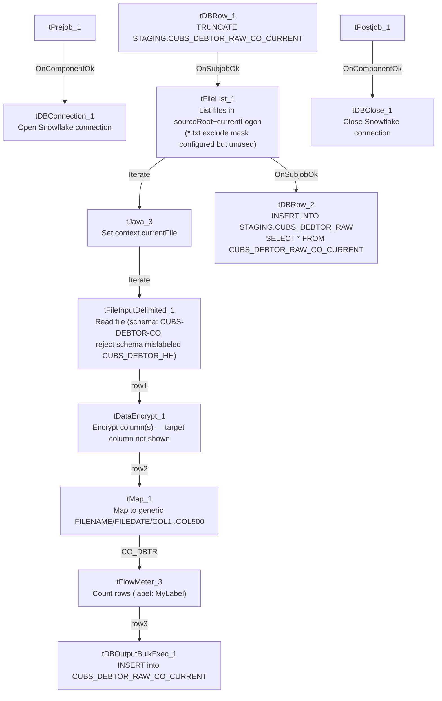

# Talend Job: CUBS_Raw_CO_Debtor_Load

## Overview

Loads raw debtor (collections-account) extract files for the "CO" site out of a source directory into the Snowflake staging table `CUBS_DEBTOR_RAW_CO_CURRENT`, then appends that batch into a shared cumulative table `STAGING.CUBS_DEBTOR_RAW`. The source rows carry debtor identity, address, phone, balance, legal/violation, and other collections-account fields from the legacy CUBS system, one file per iteration of `tFileList_1`, with one field passed through an encryption step before load (the specific column isn't named in this metadata — see Issues observed). This is one of (at least) five near-identical per-site siblings — `CUBS_Raw_CHI_Debtor_Load`, `CUBS_Raw_CO_Debtor_Load`, `CUBS_Raw_DC_Debtor_Load`, `CUBS_Raw_HH_Debtor_Load`, `CUBS_Raw_PRE_Debtor_Load` — but unlike its siblings, this CO variant is invoked from **two separate places**: once by the general `CUBS_Raw_Debtor_Load` orchestrator (alongside the other site variants) and again, independently, by `CO_Master_Load` (the only site with its own dedicated master orchestrator) — see Dependencies & configuration and Issues observed.

## Detail table

| Field | Value |
|---|---|
| Job name | CUBS_Raw_CO_Debtor_Load |
| Version | 0.1 |
| Project | EDW2SF |
| Author | jmach@harriscollect.com |
| Created | 2022-05-06T08:17:51.958-0700 |
| Last Modified | 2022-06-13T14:33:29.983-0700 |

## Step-by-step data flow

**Setup subjob:** `tPrejob_1` →(`OnComponentOk`)→ `tDBConnection_1` opens the job's Snowflake connection.

**Main subjob** (no explicit trigger link feeds `tDBRow_1`; it begins as soon as Talend's built-in prejob-then-everything-else ordering allows, i.e. after the setup subjob completes):

1. `tDBRow_1` runs `TRUNCATE TABLE STAGING.CUBS_DEBTOR_RAW_CO_CURRENT;` against Snowflake, clearing the CO-site staging table.
2. On `SUBJOB_OK`, `tFileList_1` lists files (non-recursive) in `context.sourceRoot+context.currentLogon`. An `EXCLUDEFILEMASK` of `"*.txt"` is configured but `IFEXCLUDE=false`, so the exclusion is **not actually applied** — every file in the directory is picked up, the same copy-paste pattern documented for `ADP_Payroll_Load` and the `CHI` sibling of this job.
3. For each file (`ITERATE`), `tJava_3` sets `context.currentFile` from `tFileList_1`'s current file path and prints `"Processing file " + context.currentFile"`.
4. `ITERATE` continues to `tFileInputDelimited_1`, which reads `context.currentFile` using the repository schema **"CUBS-DEBTOR-CO"**, with row/field separators, header flag, and encoding all driven by `context.EXPORT_DEBTOR_*` context variables. `DIE_ON_ERROR=false`. Its configured reject schema is the repository schema **"CUBS_DEBTOR_HH"** — a different site's schema than the one this job (CO) reads. The component's extracted `schema_columns` list contains 790 entries, but this appears to be the ~394-column debtor schema captured **twice** (394 unique names, each appearing exactly twice, consistent with the same main+reject-schema concatenation artifact documented in `ADP_Payroll_Load`) plus the two reject-info columns `errorCode`/`errorMessage`. Regardless, no connection wires the reject flow anywhere — see Issues observed.
5. `FLOW` (link `row1`) to `tDataEncrypt_1`, which passes a 394-column debtor schema through an encryption routine (`PASSWORD_M1` and `SECRET_TYPE` both `***REDACTED***`, `ALGO_VERSION=2`, crypto key file at `context.cryptoPath`). The metadata shows only the full pass-through schema, not which specific column(s) are targeted for encryption — likely a field such as SSN given the schema, but that can't be confirmed from this metadata.
6. `FLOW` (link `row2`) to `tMap_1`, which maps the (now partly encrypted) debtor row onto a fully generic 502-column target schema: `FILENAME`, `FILEDATE`, `COL1`...`COL500`. `DIE_ON_ERROR=true`, so a mapping/lookup failure here fails the job outright. The actual per-field mapping expressions (which named debtor column feeds which `COLn`) are not captured in this metadata — only the resulting column names are visible.
7. `FLOW` (link `CO_DBTR` — the only renamed link in this job; the others keep default `row1`/`row2`/`row3` names) to `tFlowMeter_3`, which counts rows passing through (`METTERLABEL="MyLabel"`, the unrenamed default, `ABSOLUTE` mode).
8. `FLOW` (link `row3`) to `tDBOutputBulkExec_1`, which bulk-inserts (`outputAction=INSERT`, `tableAction=NONE`) the generic-column rows into Snowflake table `CUBS_DEBTOR_RAW_CO_CURRENT` — the same table truncated in step 1.
9. After `tFileList_1` finishes iterating every file in the directory, `SUBJOB_OK` triggers `tDBRow_2`, which runs `INSERT INTO STAGING.CUBS_DEBTOR_RAW SELECT * FROM STAGING.CUBS_DEBTOR_RAW_CO_CURRENT;` — appending this run's full CO-site batch into the shared, cumulative `CUBS_DEBTOR_RAW` table.

**Teardown subjob:** `tPostjob_1` →(`OnComponentOk`)→ `tDBClose_1` closes the Snowflake connection.

## Settings tables

### Source: `tFileList_1`

| Setting | Value | What it means |
|---|---|---|
| DIRECTORY | `context.sourceRoot+context.currentLogon` | Directory scanned for debtor extract files; both variables are set outside this job (see Dependencies & configuration). |
| LIST_MODE | `FILES` | Lists files only, not subdirectories. |
| EXCLUDEFILEMASK / IFEXCLUDE | `"*.txt"` / `false` | The exclude mask is configured but `IFEXCLUDE=false` means it is never applied — every file in the directory is iterated, `.txt` or not. |
| CASE_SENSITIVE | `YES` | File name matching is case-sensitive (has no practical effect here since no mask is actually applied). |

### Source: `tFileInputDelimited_1`

| Setting | Value | What it means |
|---|---|---|
| FILENAME | `context.currentFile` | The file currently being iterated by `tFileList_1`, set by `tJava_3`. |
| SCHEMA (main) | Repository schema `"CUBS-DEBTOR-CO"` | The expected CO-site debtor column layout (name, address, phone, balances, legal/violation fields, agent-notes fields, etc. — 394 unique business columns, each appearing twice in the extracted list plus `errorCode`/`errorMessage`; see Step-by-step data flow). |
| ROWSEPARATOR / FIELDSEPARATOR / HEADER / ENCODING | `context.EXPORT_DEBTOR_RowSeparator` / `context.EXPORT_DEBTOR_FieldSeparator` / `context.EXPORT_DEBTOR_Header` / `context.EXPORT_DEBTOR_Encoding` | Driven by the `EXPORT_DEBTOR_0.1` context group — see `_shared_context.json`. |
| SCHEMA_REJECT | Repository schema `"CUBS_DEBTOR_HH"` | **Mislabeled for this job** — this is the CO debtor loader, but its reject schema points to the HH debtor schema. The CHI sibling of this job has the identical mislabeling (also pointing to `CUBS_DEBTOR_HH`), suggesting all site variants inherited this from a common HH-based template rather than each being individually miscopied. See Issues observed. |
| DIE_ON_ERROR | `false` | Malformed rows do not fail the job... |
| Reject flow | Not wired | ...but no connection carries rejected rows anywhere in this job — they are silently dropped with no record. |
| TEMP_DIR | `"C:/Talend-Studio-20211109_1610-V8.0.1/workspace"` | Hardcoded developer-workstation path — part of the 210/289-job project-wide pattern flagged in `05_operational_runbook.md`. |

### Transform: `tDataEncrypt_1`

| Setting | Value | What it means |
|---|---|---|
| PASSWORD_M1 | `***REDACTED***` | Encryption key/password — preserved as redacted; not guessable from metadata. |
| SECRET_TYPE | `***REDACTED***` | Encryption secret-type setting — also redacted in the source data. |
| CRYPTO_FILE_PATH | `context.cryptoPath` | Points to an external crypto key/config file; `context.cryptoPath` isn't defined in any context group visible in `_shared_context.json` — see Issues observed. |
| ALGO_VERSION | `2` | Encryption algorithm version used. |
| GEN_CRYPTO_FILE_CONTROLLER | `false` | Does not (re)generate the crypto controller file on this run. |
| Target column(s) | Not visible in metadata | The component's schema is a straight 394-column pass-through of the debtor schema; which specific column(s) it actually encrypts isn't captured by this extraction — verify directly in Talend Studio. |

### Transform: `tMap_1`

| Setting | Value | What it means |
|---|---|---|
| DIE_ON_ERROR | `true` | A mapping or lookup failure here fails the job outright (unlike the earlier file-read step). |
| Output schema | `FILENAME`, `FILEDATE`, `COL1`...`COL500` (502 columns) | The named/business debtor columns are mapped into fully generic column names. The mapping expressions themselves (which source field feeds which `COLn`) are not captured in this metadata. |
| ROWS_BUFFER_SIZE | `2000000` | tMap disk-mode buffer size setting; not evidence the job runs in disk mode, just the configured threshold. |

### Target: `tDBOutputBulkExec_1` (`tSnowflakeOutputBulkExec`)

| Setting | Value | What it means |
|---|---|---|
| Table | `CUBS_DEBTOR_RAW_CO_CURRENT` | Snowflake staging table for this run's CO-site batch — the same table truncated by `tDBRow_1` at job start. |
| outputAction | `INSERT` | Appends rows; relies on the prior `TRUNCATE` to avoid duplicate accumulation within a run. |
| tableAction | `NONE` | Table is not recreated/altered by this job. |
| Schema | `FILENAME`, `FILEDATE`, `COL1`...`COL500`, plus reject-flow error columns (`columnName`, `rowNumber`, `category`, `character`, `errorMessage`, `byteOffset`, `line`, `sqlState`, `code`) | The reject/error schema is defined on the component but, as with the file input above, **no `REJECT` connection is wired** — bulk-load rejects are not captured anywhere in this job. See Issues observed. |

### Truncate / append steps: `tDBRow_1` / `tDBRow_2` (`tSnowflakeRow`)

| Setting | Value | What it means |
|---|---|---|
| Query 1 (`tDBRow_1`) | `TRUNCATE TABLE STAGING.CUBS_DEBTOR_RAW_CO_CURRENT;` | Clears the CO-site staging table before the file loop starts. |
| Query 2 (`tDBRow_2`) | `INSERT INTO STAGING.CUBS_DEBTOR_RAW SELECT * FROM STAGING.CUBS_DEBTOR_RAW_CO_CURRENT;` | Appends this run's staged CO batch into the shared, cumulative `CUBS_DEBTOR_RAW` table — no explicit dedup/merge logic is visible; every run's rows are simply appended. |

## Dependencies & configuration

- **Called by two separate orchestrators**, per `06_dependency_matrix.md`:
  - `CUBS_Raw_Debtor_Load` (once), alongside sibling calls to `CUBS_Raw_CHI_Debtor_Load`, `CUBS_Raw_DC_Debtor_Load`, `CUBS_Raw_HH_Debtor_Load`, and `CUBS_Raw_PRE_Debtor_Load`.
  - `CO_Master_Load` (once), as the second step (`tRunJob_3`) in its client/debtor/reference-data chain (`CUBS_Raw_CO_Client_Load` → **`CUBS_Raw_CO_Debtor_Load`** → `CUBS_Raw_CO_ETL_Load` → `DimFiscal_CO_Load` → `CUBS_Raw_DeskInfo_Load`), per `job_CO_Master_Load.md`.
  
  This job's own `runjob_targets` list is empty — it does not call any other jobs itself. See Issues observed for the operational implication of being called from two independent orchestrators.
- **Context variables used:** `EXPORT_DEBTOR_Encoding`, `EXPORT_DEBTOR_FieldSeparator`, `EXPORT_DEBTOR_Header`, `EXPORT_DEBTOR_RowSeparator` (resolved via the `EXPORT_DEBTOR_0.1` context group in `_shared_context.json`), `cryptoPath`, `currentFile`, `currentLogon`, `sourceRoot`. **`sourceRoot` and `currentLogon` do not appear in any context group in `_shared_context.json`**, and `cryptoPath` doesn't match any variable there either — these are presumably set by whichever orchestrator calls this job, or by a CUBS-specific context group not captured in this extraction. Unable to determine from this job's own metadata — verify with team.
- **Hardcoded path:** `tFileInputDelimited_1.TEMP_DIR` = `"C:/Talend-Studio-20211109_1610-V8.0.1/workspace"` — part of the project-wide pattern (210 of 289 jobs) documented in `05_operational_runbook.md`.

## Glossary

| Component type | Plain-English meaning |
|---|---|
| `tFileList` | Lists files in a directory for the job to iterate over one at a time. |
| `tFileInputDelimited` | Reads a delimited (CSV-style) text file according to a schema. |
| `tDataEncrypt` | Encrypts one or more fields of a row using a configured algorithm/key before it continues downstream. |
| `tMap` | Maps/transforms columns from one schema to another. |
| `tFlowMeter` | Counts rows passing through a point in the flow, for logging/monitoring. |
| `tSnowflakeOutputBulkExec` | Bulk-loads rows into a Snowflake table (higher-throughput variant of a plain `tSnowflakeOutput`). |
| `tSnowflakeRow` | Runs an arbitrary SQL statement against Snowflake (here, `TRUNCATE` and a plain `INSERT ... SELECT`). |
| `tSnowflakeConnection` / `tSnowflakeClose` | Open and close the Snowflake connection shared by other components in the job. |
| `tJava` | Runs a block of custom Java code once (here, to capture the current file path into a context variable and log it). |

## Issues observed

- **This job is triggered from two independent orchestrators** (`CUBS_Raw_Debtor_Load` and `CO_Master_Load`), unlike its CHI/DC/HH/PRE siblings, which — as far as this metadata shows — are only called from `CUBS_Raw_Debtor_Load`. If both orchestrators run in the same operational window (e.g. one daily schedule for the general multi-site sweep and another as part of the CO-specific master pipeline), `CUBS_Raw_CO_Debtor_Load` could execute twice against the same source directory in a single day. Because the job truncates its `_CURRENT` staging table each run but only *appends* into the cumulative `STAGING.CUBS_DEBTOR_RAW` table (see below), a second same-day run driven by the other orchestrator would append a second, likely duplicate, batch of CO debtor rows into `STAGING.CUBS_DEBTOR_RAW`. Unable to determine from metadata whether the two orchestrators are scheduled to be mutually exclusive — verify with the team.
- **The reject schema on `tFileInputDelimited_1` is labeled for a different site.** This is the CO debtor loader, reading the `"CUBS-DEBTOR-CO"` main schema, but its `SCHEMA_REJECT` points to the repository schema `"CUBS_DEBTOR_HH"` — the same mismatch found in the CHI sibling job, indicating this is a shared template artifact across all site variants rather than a one-off copy-paste mistake in this job specifically. Whether this would cause an actual column-count/type mismatch if the reject flow were ever wired is unable to be determined from this metadata.
- **No reject flow is wired anywhere in this job** — neither from `tFileInputDelimited_1` (`DIE_ON_ERROR=false`, so malformed rows don't fail the job but are silently dropped) nor from `tDBOutputBulkExec_1` (which has a defined error-info schema — `columnName`, `rowNumber`, `category`, `errorMessage`, `sqlState`, `code`, etc. — but no `REJECT` connection routing rows to it). A parsing or bulk-load failure on individual rows leaves no record of how many rows, or which ones, were skipped.
- **`tFileList_1`'s exclude mask is configured but never applied.** `EXCLUDEFILEMASK="*.txt"` with `IFEXCLUDE=false` means every file in `context.sourceRoot+context.currentLogon` is picked up regardless of extension — the same non-functional-exclude pattern seen in `ADP_Payroll_Load` and the CHI sibling, confirming this is a shared job template pattern rather than a one-off mistake.
- **The final target schema uses fully generic `COL1`...`COL500` column names** rather than the 394 named business columns read from the source file. The actual field-to-`COLn` mapping performed inside `tMap_1` is not captured in this extraction (only column names are visible on both sides) — anyone querying `CUBS_DEBTOR_RAW_CO_CURRENT` or `STAGING.CUBS_DEBTOR_RAW` downstream would need to open `tMap_1` directly in Talend Studio to know what a given `COLn` actually contains.
- **`tDataEncrypt_1`'s target column(s) aren't identifiable from metadata.** The component carries the full 394-column debtor schema as a pass-through; without the underlying column-level encryption configuration (not part of this extraction), it's not possible to confirm which field is actually being encrypted, or whether any others are. Verify directly in Talend Studio.
- **`context.sourceRoot`, `context.currentLogon`, and `context.cryptoPath` are not defined in any context group present in `_shared_context.json`.** They are presumably supplied by whichever calling orchestrator runs this job, or by a CUBS-specific context group outside this extraction's scope, but that can't be confirmed from this job's own metadata — verify with the team, particularly for `cryptoPath`, since an unresolved encryption key path would fail the job at `tDataEncrypt_1`.
- **`tDBRow_2`'s append into `STAGING.CUBS_DEBTOR_RAW` has no visible dedup/merge logic** — it's a plain `INSERT ... SELECT *` from the just-loaded current-batch table. Since `CUBS_DEBTOR_RAW_CO_CURRENT` itself is truncated and reloaded each run, re-running this job is likely safe with respect to the `_CURRENT` table, but whether `STAGING.CUBS_DEBTOR_RAW` (the cumulative table) can end up with duplicate CO-site rows across reruns — or across the dual-orchestrator scenario noted above — is unable to determine from metadata; verify with the team before assuming a rerun (or a second same-day trigger) is safe.
