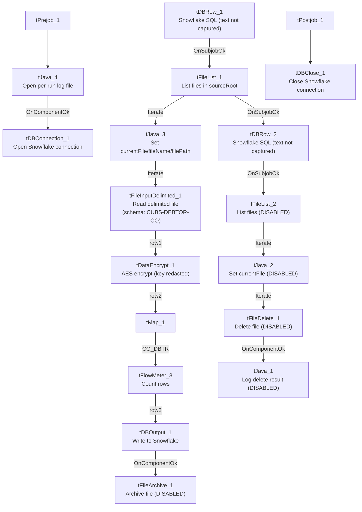

# Talend Job: CUBS_Raw_CO_Debtor_Load_No_Delete

## Overview

This job loads CUBS debtor extract files for the **CO** site code into Snowflake: it lists every file sitting in `context.sourceRoot`, reads each one as a delimited file against a repository schema labeled "CUBS-DEBTOR-CO", encrypts one or more fields with `tDataEncrypt`, maps the result through `tMap`, and writes it to a Snowflake table via `tSnowflakeOutput`, then runs a Snowflake stored-procedure/SQL call after all files are processed (presumably a merge from staging into the target debtor table, though the exact SQL text isn't captured in this job's own metadata). It is one of three CO-debtor-load variants in this project (the plain `CUBS_Raw_CO_Debtor_Load` and `CUBS_Raw_CO_Debtor_Load_Upsert`); as detailed below, this variant is distinguished not by its main load logic but by which post-load housekeeping steps are switched off.

## Detail table

| Field | Value |
|---|---|
| Job name | CUBS_Raw_CO_Debtor_Load_No_Delete |
| Version | 0.4 |
| Project | EDW2SF |
| Author | jmach@harriscollect.com |
| Created | 2022-12-06T12:04:35.276-0800 |
| Last Modified | 2025-09-24T11:08:31.455-0700 |

## Step-by-step data flow

**Setup subjob:** `tPrejob_1` → `tJava_4` opens a per-run log file at `context.logDir + context.currentLogon + "_" + jobName + "_" + <timestamp> + ".log"` and redirects `System.out` to it (code truncated at 253 characters in this extraction, so the full body — e.g. whether `System.err` is also redirected — can't be confirmed) → on success, `tDBConnection_1` opens the job's Snowflake connection (component has no captured parameters, so the connection label/target it's wired to is unable to determine from metadata — see Issues observed).

**Main subjob** — begins independently of the setup subjob (no incoming trigger to `tDBRow_1` is captured in this job's connection list):

1. `tDBRow_1` runs a Snowflake SQL statement (text not captured — parameters are empty in this job's metadata; based on the project-wide truncate-then-reload pattern documented in `05_operational_runbook.md`, this is likely a staging-table truncate, but that is not confirmed here).
2. On success (`OnSubjobOk`), `tFileList_1` lists every file in `context.sourceRoot` (see Settings table — its exclude-mask setting is effectively inert).
3. `tFileList_1` **iterates** into `tJava_3`, which copies the current file's path/name/directory from `globalMap` into `context.currentFile`, `context.fileName`, and `context.filePath` (code also truncated at 253 characters).
4. `tJava_3` iterates into `tFileInputDelimited_1`, which reads `context.currentFile` as a delimited file using the "CUBS-DEBTOR-CO" repository schema.
5. Each row flows (`FLOW`) into `tDataEncrypt_1`, which encrypts data using an AES cipher keyed from `context.cryptoPath` (secret type, secret key, and password all redacted in the source metadata).
6. `tDataEncrypt_1` flows into `tMap_1` (no field-level mapping expressions were captured in this metadata, only its engine settings).
7. `tMap_1`'s output (connector labeled `CO_DBTR`) flows into `tFlowMeter_3`, which counts rows passing through (still using the generic default label "MyLabel").
8. `tFlowMeter_3` flows into `tDBOutput_1` (`tSnowflakeOutput`), which writes the rows to a Snowflake table (component has no captured parameters — target table name, schema, and load action are unable to determine from metadata).
9. On success, `tDBOutput_1` would trigger `tFileArchive_1` to tar/gzip the just-loaded file into `context.archiveDir` — **but `tFileArchive_1` is deactivated (`ACTIVATE=false`)**, so this step does not actually run (see Issues observed).
10. Once the whole `tFileList_1` iteration completes, `tFileList_1` also triggers (`OnSubjobOk`, in parallel with the per-file loop above) `tDBRow_2`, a second Snowflake SQL call (text not captured) — by project convention this is likely the merge step following the load.
11. `tDBRow_2` would, on success, re-list `context.sourceRoot` (`tFileList_2`) and iterate into `tJava_2` → `tFileDelete_1` (deleting each processed file) → `tJava_1` (logs the delete result) — **but all four of these components (`tFileList_2`, `tJava_2`, `tFileDelete_1`, `tJava_1`) are deactivated (`ACTIVATE=false`)**, so no file deletion actually happens. This is the behavior the job's name refers to.

**Teardown subjob:** `tPostjob_1` → `tDBClose_1` closes the Snowflake connection.

## Settings tables

### Source listing: `tFileList_1`

| Setting | Value | What it means |
|---|---|---|
| DIRECTORY | `context.sourceRoot` | Directory scanned for input files each run. |
| LIST_MODE | `FILES` | Lists files only (no subdirectories). |
| INCLUDSUBDIR | `false` | Does not recurse into subfolders. |
| EXCLUDEFILEMASK / IFEXCLUDE | `"*.txt"` / `false` | An exclude mask of `*.txt` is configured, but `IFEXCLUDE=false` means it is **not actually applied** — every file in `sourceRoot` is listed regardless of extension. |
| GLOBEXPRESSIONS | `true` | Uses glob-style (not regex) matching for any active mask. |

### Read: `tFileInputDelimited_1`

| Setting | Value | What it means |
|---|---|---|
| FILENAME | `context.currentFile` | Reads whichever file `tJava_3` just set from the current `tFileList_1` iteration. |
| SCHEMA (main) | Repository schema `"CUBS-DEBTOR-CO"` | Well-formed rows are parsed against a CO-specific debtor schema. |
| SCHEMA_REJECT | Repository schema `"CUBS_DEBTOR_HH"` | **Mismatched** — this is a CO-site job but its reject schema is labeled for HH. See Issues observed. |
| FIELDSEPARATOR / ROWSEPARATOR / HEADER / ENCODING | `context.EXPORT_DEBTOR_FieldSeparator` / `context.EXPORT_DEBTOR_RowSeparator` / `context.EXPORT_DEBTOR_Header` / `context.EXPORT_DEBTOR_Encoding` | Format settings driven by the shared `EXPORT_DEBTOR` context group rather than hardcoded per-site values. |
| DIE_ON_ERROR | `false` | A malformed row does not abort the job; it is expected to be routed to the (mislabeled) reject flow, though no reject-row connection appears in this job's own `connections` list — unable to confirm a reject output is actually wired. |
| TEMP_DIR | `"C:/Talend-Studio-20211109_1610-V8.0.1/workspace"` | Hardcoded developer-workstation path — same project-wide pattern flagged in `05_operational_runbook.md` (210 of 289 jobs). |

### Field-level encryption: `tDataEncrypt_1`

| Setting | Value | What it means |
|---|---|---|
| CRYPTO_METHOD | `AES` | Symmetric encryption applied to one or more fields (which fields is defined in the component's internal mapping, not captured in this metadata). |
| SECRET_TYPE / SECRET_KEY / PASSWORD_M1 | `***REDACTED***` (all three) | Preserved as redacted — do not guess the real values. |
| CRYPTO_FILE_PATH | `context.cryptoPath` | Path to a supporting cryptographic file; `cryptoPath` is not defined in `_shared_context.json`'s captured context groups, so its actual default value is unable to determine from metadata. |
| ALGO_VERSION | `2` | Encryption algorithm version used by the component. |

### Transform: `tMap_1`

| Setting | Value | What it means |
|---|---|---|
| DIE_ON_ERROR | `true` | A mapping error fails the job outright (unlike the upstream file read, which is configured to tolerate errors). |
| ROWS_BUFFER_SIZE | `2000000` | Buffer size for large in-memory joins/lookups, if any are configured (no lookup inputs are visible in this job's component list). |
| Output row name | `CO_DBTR` | The mapped output flow is explicitly named for the CO debtor data, consistent with the job's purpose. |

### Load: `tDBOutput_1` (tSnowflakeOutput)

| Setting | Value | What it means |
|---|---|---|
| (all) | Not captured — parameters are empty in this job's metadata | Target table name, schema, and load action (insert/update/upsert) are unable to determine from metadata; verify directly in Talend Studio or the Snowflake target. |

### Post-load housekeeping (both disabled): `tFileArchive_1`, `tFileList_2` → `tJava_2` → `tFileDelete_1` → `tJava_1`

| Setting | Value | What it means |
|---|---|---|
| tFileArchive_1: ACTIVATE | `false` | Archiving the source file to `context.archiveDir + "/" + <date> + "/" + context.fileName + ".tar.gz"` is configured but does not run. |
| tFileArchive_1: SOURCE_FILE | `"C:/Talend-Studio-20211109_1610-V8.0.1/workspace/source.csv"` | Hardcoded developer-workstation path (component disabled, so not actually reached at runtime, but still present as dead configuration). |
| tFileDelete_1: ACTIVATE | `false` | Deleting the processed source file does not run — this is the behavior the job name refers to. |
| tFileDelete_1: DIRECTORY / PATH | `"C:/Talend-Studio-20211109_1610-V8.0.1/workspace/delete_folder"` / `"...delete_folder or delete_file"` | Hardcoded developer-workstation paths (also dead configuration since the component is disabled). |

### Merge/post steps: `tDBRow_1`, `tDBRow_2` (tSnowflakeRow)

| Setting | Value | What it means |
|---|---|---|
| (all) | Not captured — parameters are empty in this job's metadata | The actual SQL/stored-procedure text run before and after the file-load loop is unable to determine from metadata; verify directly in Talend Studio. |

## Dependencies & configuration

- **`runjob_targets` is empty** — this job does not call any other Talend job.
- **No job in `06_dependency_matrix.md` lists `CUBS_Raw_CO_Debtor_Load_No_Delete` as a `tRunJob` target.** The matrix shows `CO_Master_Load` and `CUBS_Raw_Debtor_Load` both calling the *plain* `CUBS_Raw_CO_Debtor_Load` instead. This job therefore appears to be an orphan in the extracted orchestration graph — likely a manually-triggered variant for ad hoc/backfill runs rather than part of the scheduled pipeline. See Issues observed.
- **Context variables referenced:** `EXPORT_DEBTOR_Encoding`, `EXPORT_DEBTOR_FieldSeparator`, `EXPORT_DEBTOR_Header`, `EXPORT_DEBTOR_RowSeparator` (from the shared `EXPORT_DEBTOR` context group), `archiveDir`, `cryptoPath`, `currentFile`, `currentLogon`, `fileName`, `filePath`, `logDir`, `sourceRoot`. Of these, `archiveDir`, `cryptoPath`, `currentLogon`, `fileName`, `filePath`, `logDir`, and `sourceRoot` do not appear in any context group captured in `_shared_context.json` — their default values are unable to determine from metadata.
- **Hardcoded paths found (4, all pointing at a developer workstation path):** `tFileInputDelimited_1.TEMP_DIR`, `tFileArchive_1.SOURCE_FILE`, `tFileDelete_1.DIRECTORY`, `tFileDelete_1.PATH` — all `C:/Talend-Studio-20211109_1610-V8.0.1/workspace/...`, matching the project-wide pattern in `05_operational_runbook.md`. The latter three sit inside components that are currently disabled, so they are dormant risk rather than active risk, unless someone re-enables archiving/deletion without updating these paths first.

## Glossary

| Component type | Plain-English meaning |
|---|---|
| `tPrejob` / `tPostjob` | Marks the setup/teardown subjobs that run once regardless of the main flow's outcome. |
| `tDBConnection` / `tDBClose` (Snowflake) | Opens/closes the Snowflake connection used throughout the job. |
| `tDBRow` (Snowflake) | Runs an arbitrary SQL statement or stored-procedure call against Snowflake. |
| `tFileList` | Lists files in a directory matching (optional) include/exclude criteria, for iteration. |
| `tJava` | Runs arbitrary Java code — here used to copy `tFileList` iteration variables into context variables, or to write log output. |
| `tFileInputDelimited` | Reads a delimited (e.g. CSV/TSV) file against a defined schema. |
| `tDataEncrypt` | Encrypts one or more fields in the data flow using a configured cipher and key. |
| `tMap` | Transforms/maps input columns to output columns, optionally joining against lookup flows. |
| `tFlowMeter` | Counts rows passing through a point in the flow, for logging/monitoring. |
| `tSnowflakeOutput` | Writes rows to a Snowflake table. |
| `tFileArchive` | Compresses a file (here, tar.gz) into an archive location. |
| `tFileDelete` | Deletes a file or folder. |

## Issues observed

- **Both post-load housekeeping steps are disabled, not just deletion.** The job's name (`_No_Delete`) implies files are simply not deleted after processing, but this job's own metadata shows `tFileArchive_1` is *also* deactivated (`ACTIVATE=false`), alongside the delete chain (`tFileList_2`, `tJava_2`, `tFileDelete_1`, `tJava_1`). Comparing this job's JSON to its `CUBS_Raw_CO_Debtor_Load_Upsert` sibling (where all of these same components are active) confirms this is a deliberate difference in this specific job, not a missing extraction. Net effect: processed files are left untouched in `context.sourceRoot` with no archive copy and no cleanup.
- **Because nothing removes, renames, or archives processed files, and `tFileList_1`'s exclude mask is inert (`IFEXCLUDE=false`), every run of this job will re-list and reprocess every file still sitting in `context.sourceRoot`, including files from previous runs.** Whether that's intentional (e.g., this job is meant for one-off reprocessing where re-ingesting the same file is fine because the target table is truncated first) or a gap depends on what `tDBRow_1`'s uncaptured SQL actually does — unable to determine from metadata; worth confirming with the team before scheduling this job to run unattended.
- **The reject schema on `tFileInputDelimited_1` is labeled `"CUBS_DEBTOR_HH"`, not a CO-specific schema.** This job is CO-site-specific (main schema is correctly labeled "CUBS-DEBTOR-CO"), but its reject schema appears to have been copied from an HH-site debtor job and never repointed. The same mismatch exists in the plain `CUBS_Raw_CO_Debtor_Load` job's own metadata, suggesting this is a copy-paste artifact carried through both variants rather than unique to this one. Whether this causes an actual column-mismatch on a rejected row is unable to determine from metadata; verify directly in the Talend repository. Note also that no reject-flow connection appears in this job's own `connections` list, so it's unclear a reject output is even wired downstream.
- **This job is not referenced anywhere in `06_dependency_matrix.md`, either as a caller or as a `tRunJob` target**, unlike the plain `CUBS_Raw_CO_Debtor_Load`, which both `CO_Master_Load` and `CUBS_Raw_Debtor_Load` call. This strongly suggests it is a manually-run, ad hoc variant (e.g., for backfills or reprocessing without disturbing already-archived files) rather than part of the regular scheduled pipeline — worth confirming its actual usage pattern with the team, since an unreferenced job with disabled cleanup steps left in a "runnable" state is an easy source of accidental duplicate loads if triggered by mistake.
- **`tDBRow_1`, `tDBRow_2`, `tDBConnection_1`, and `tDBOutput_1` all have empty captured parameters**, so the actual SQL text, connection label, and target table name are unable to determine from this metadata. This is a project-wide extraction limitation (confirmed against other jobs' metadata, e.g. `ADP_Payroll_Load`), not unique to this job — see `05_operational_runbook.md`'s note on connection labels living only in hand-set component labels, and verify these specifics directly in Talend Studio.
- Beyond the above, no other job-specific anomalies were found; the hardcoded-path pattern in the disabled archive/delete components is the same project-wide issue already documented in `05_operational_runbook.md`.
