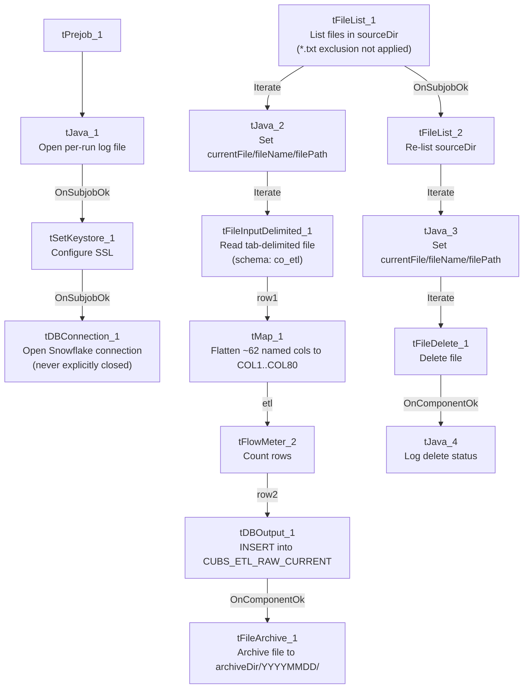

# Talend Job: CUBS_Raw_CO_ETL_Load

## Overview

Loads CUBS "ETL" credit/collections-scoring extract files — one row per debtor with bureau/collections attributes such as bankruptcy disposition codes (`BK7_DISP`, `BK11_DISP`, `BK13_DISP`), revolving/mortgage/auto trade balances, credit-card/available-credit fields, and scoring outputs (`Attune_Score`, `Propen_Score`, `Decile`, `Percentile`) — from `context.sourceDir` into the Snowflake raw landing table `CUBS_ETL_RAW_CURRENT`. All ~62 named business columns from the source file are flattened into generic `COL1`...`COL80` positions in the target table (see Issues observed). Every file found in the source directory is loaded, archived, and then deleted in a separate cleanup pass. Per `06_dependency_matrix.md`, this job is one step of the `CO_Master_Load` orchestrator and also appears to be called by a `CUBS_Raw_ETL_Load` parent job, consistent with the per-site `CUBS_Raw_<Site>_ETL_Load` family (CHI/CO/DC/HH/PRE/TOL) named in `01_system_architecture.md`.

## Detail table

| Field | Value |
|---|---|
| Job name | CUBS_Raw_CO_ETL_Load |
| Version | 0.1 |
| Project | EDW2SF |
| Author | jmach@harriscollect.com |
| Created | 2022-12-15T10:50:02.630-0800 |
| Last Modified | 2025-11-11T22:53:45.719-0800 |

## Step-by-step data flow

**Setup subjob:** `tPrejob_1` → `tJava_1` (`OnComponentOk`) opens a per-run log file at `context.logDir + jobName + "_" + <timestamp> + ".log"` and redirects `System.out`/`System.err` to it → `tSetKeystore_1` (`OnSubjobOk`) configures SSL trust/keystore from `context.keystorePath` (all passwords redacted) → `tDBConnection_1` (`OnSubjobOk`) opens the Snowflake connection. **This job has no `tPostjob_1`/`tDBClose` component at all** — unlike the other three jobs in this batch, the Snowflake connection is never explicitly closed within this job's own metadata (see Issues observed).

**Main load pass** (this branch has no incoming trigger connection to `tFileList_1`, so it runs as an independent top-level subjob per Talend's default parallel-subjob-start semantics, alongside the setup subjob above):

1. `tFileList_1` lists files in `context.sourceDir`, ordered by modified date ascending. An `EXCLUDEFILEMASK` of `"*.txt"` is configured but `IFEXCLUDE` is `false`, so the exclusion never applies — every file in the directory is picked up.
2. For each file (`Iterate`), `tJava_2` sets `context.currentFile`/`fileName`/`filePath` from the `tFileList_1` iteration globals.
3. `tFileInputDelimited_1` (`Iterate`) reads that file as tab-delimited, ISO-8859-15 encoded, header row present, using repository schema `"...- co_etl"` (~62 named columns of bureau/scoring attributes). `DIE_ON_ERROR=false`; `TRIMALL=false`.
4. `tMap_1` (`row1`, FLOW) re-maps every source column **positionally** onto a generic 80-column target shape (`FILENAME`, `FILEDATE`, `COL1`...`COL80`) — none of the ~62 business column names survive into the target schema.
5. `tFlowMeter_2` (`etl`, FLOW) counts rows passing through (label left at the default `"MyLabel"`).
6. `tDBOutput_1` (`row2`, FLOW) inserts the rows into Snowflake `CUBS_ETL_RAW_CURRENT` (`INSERT`, `tableAction=NONE` — no truncate/recreate from within this job).
7. On success (`OnComponentOk`), `tFileArchive_1` archives the just-processed file (`context.filePath`) to `context.archiveDir + "/" + <YYYYMMDD> + "/" + context.fileName + ".tar.gz"` (password redacted).

**Cleanup pass** (triggered by `tFileList_1`'s `OnSubjobOk`, i.e. only after every file from the main load pass has finished processing):

8. `tFileList_2` re-lists the same `context.sourceDir` directory (same unapplied `EXCLUDEFILEMASK`/`IFEXCLUDE` mismatch as step 1).
9. For each file found (`Iterate`), `tJava_3` sets `context.currentFile`/`fileName`/`filePath` again.
10. `tFileDelete_1` (`Iterate`) deletes that file from disk.
11. On success (`OnComponentOk`), `tJava_4` logs the delete outcome (`CURRENT_STATUS`, `DELETE_PATH`, error message).

## Settings tables

### Source: `tFileInputDelimited_1`

| Setting | Value | What it means |
|---|---|---|
| FILENAME | `context.currentFile` | The current file from `tFileList_1`'s iteration. |
| FIELDSEPARATOR / ENCODING | `\t` / ISO-8859-15 | Tab-delimited extract, ISO-8859-15 (Latin-9) encoded, unlike Cellphone_Load's UTF-8. |
| HEADER | `1` | One header row skipped. |
| SCHEMA (main) | Repository schema `"...- co_etl"` | ~62 named bureau/collections-scoring columns (e.g. `DEBTOR`, `MORT_BAL`, `REV_BAL`, `CCARD`, `AUTO_BAL`, `BK7_DISP`/`BK11_DISP`/`BK13_DISP`, `Attune_Score`, `Propen_Score`, `Decile`, `Percentile`). |
| DIE_ON_ERROR | `false` | Malformed rows don't fail the job... |
| Reject flow | Not wired | ...but no connection routes rejected rows anywhere — silently dropped, same pattern as `ADP_Payroll_Load`. |
| TEMP_DIR | `"C:/Talend-Studio-20211109_1610-V8.0.1/workspace"` | Hardcoded developer-workstation path — see Dependencies & configuration. |

### Target: `tDBOutput_1` (`tSnowflakeOutput`)

| Setting | Value | What it means |
|---|---|---|
| Table | `CUBS_ETL_RAW_CURRENT` | Destination raw landing table. |
| Output action | `INSERT` | Appends rows; no truncate step precedes it in this job. |
| Table action | `NONE` | Table structure is not altered by this job. |

### `tFileArchive_1`

| Setting | Value | What it means |
|---|---|---|
| SOURCE | `context.filePath` | The directory of the just-loaded file. |
| TARGET | `context.archiveDir + "/" + <YYYYMMDD> + "/" + context.fileName + ".tar.gz"` | Per-file, dated archive. |
| PASSWORD | `***REDACTED***` | Archive is password-protected; actual value not present in extracted metadata. |

### `tFileDelete_1` (cleanup pass)

| Setting | Value | What it means |
|---|---|---|
| FILENAME | `context.currentFile` | File found by the second `tFileList_2` listing. |
| DIRECTORY / PATH | `"C:/Talend-Studio-20211109_1610-V8.0.1/workspace/delete_folder"` / `"...delete_folder or delete_file"` | Hardcoded developer-workstation defaults — see Dependencies & configuration. |
| FAILON | `false` | A missing/already-deleted file does not fail the job. |

### `tSetKeystore_1`

| Setting | Value | What it means |
|---|---|---|
| SSL_KEYSTORE | `context.keystorePath` | Client keystore path is externalized to context. |
| SSL_TRUSTSERVER_TRUSTSTORE | `"C:/clientTrustStore.trustStore"` | Hardcoded truststore path — not context-driven, unlike the keystore itself. |
| SSL_TRUSTSERVER_PASSWORD / SSL_KEYSTORE_PASSWORD / NEED_CLIENT_AUTH | `***REDACTED***` | Preserved as redacted; real values not present in extracted metadata. |

## Dependencies & configuration

- **Triggers/depends on other jobs:** `runjob_targets` is empty — this job does not call any other job via `tRunJob`.
- **Called by:** `CO_Master_Load` (1 call) and `CUBS_Raw_ETL_Load` (1 call), per `06_dependency_matrix.md` — consistent with the per-site `CUBS_Raw_<Site>_ETL_Load` family documented in `01_system_architecture.md`.
- **Context variables used:** `archiveDir`, `currentFile`, `fileName`, `filePath`, `keystorePath`, `logDir`, `sourceDir`.
- **5 hardcoded developer-workstation paths** (`tFileInputDelimited_1.TEMP_DIR`, `tFileArchive_1.SOURCE_FILE`, `tFileDelete_1.DIRECTORY`/`PATH`, `tSetKeystore_1.SSL_TRUSTSERVER_TRUSTSTORE`), all under `C:/Talend-Studio-20211109_1610-V8.0.1/workspace/...` or `C:/clientTrustStore.trustStore` — same project-wide portability risk documented in `05_operational_runbook.md` (210 of 289 jobs share this pattern).

## Glossary

| Component type | Plain-English meaning |
|---|---|
| `tPrejob` / `tPostjob` | Talend's guaranteed-first / guaranteed-last subjobs for setup and teardown. |
| `tJava` | Runs a block of custom Java code once. |
| `tFileList` | Lists files in a directory for the job to iterate over one at a time. |
| `tFileInputDelimited` | Reads a delimited (CSV/TSV-style) text file according to a schema. |
| `tMap` | Maps/transforms columns from one schema to another. |
| `tFlowMeter` | Counts rows passing through a point in the flow, for logging/monitoring. |
| `tSnowflakeOutput` / `tSnowflakeConnection` | Write rows to a Snowflake table / open the Snowflake connection used throughout the job. |
| `tFileArchive` / `tFileDelete` | Zip a processed file to an archive location, then delete the original from the source directory. |
| `tSetKeystore` | Configures SSL client keystore/truststore settings ahead of an encrypted database connection. |

## Issues observed

- **No `tPostjob_1`/`tDBClose` in this job.** Unlike `CUBS_Raw_Cellphone_Load`, `CUBS_Raw_Client_Load`, and `CUBS_Raw_DC_Client_Load` — all documented alongside this job in the same batch — this job never explicitly closes the Snowflake connection opened by `tDBConnection_1`. Whether the Talend runtime closes it implicitly at job exit, or this represents a real gap, cannot be determined from this metadata; verify with the team.
- **`EXCLUDEFILEMASK="*.txt"` is configured but `IFEXCLUDE=false`** on both `tFileList_1` and `tFileList_2` — the mask is never applied, so every file in `context.sourceDir` is processed and later deleted, not just the intended extract format. The same unapplied-mask pattern is flagged in `ADP_Payroll_Load`.
- **Two-pass list-then-delete design.** `tFileList_2` re-lists `context.sourceDir` from scratch only after the entire main load loop finishes (`OnSubjobOk`), rather than deleting each file immediately after its own successful archive. If a new file lands in `context.sourceDir` in the window between the two listings, it would be picked up and deleted by the cleanup pass without ever having been loaded. Unable to confirm the exposure window or any external locking from this metadata; verify with the team.
- **`tMap_1` discards all ~62 business column names** from the `co_etl` schema, storing them only as generic `COL1`...`COL80` in `CUBS_ETL_RAW_CURRENT`. This may be an intentional generic-raw-landing-table pattern (mirrored in `CUBS_Raw_Client_Load`/`CUBS_Raw_DC_Client_Load` in this same batch), but it means any downstream consumer of `CUBS_ETL_RAW_CURRENT` must already know the column-position-to-business-field mapping from outside this job's own metadata.
- **`tFlowMeter_2`'s label is left at the default `"MyLabel"`**, not renamed for this job — cosmetic only, but makes its log output indistinguishable from any other unrenamed `tFlowMeter` in the project.
