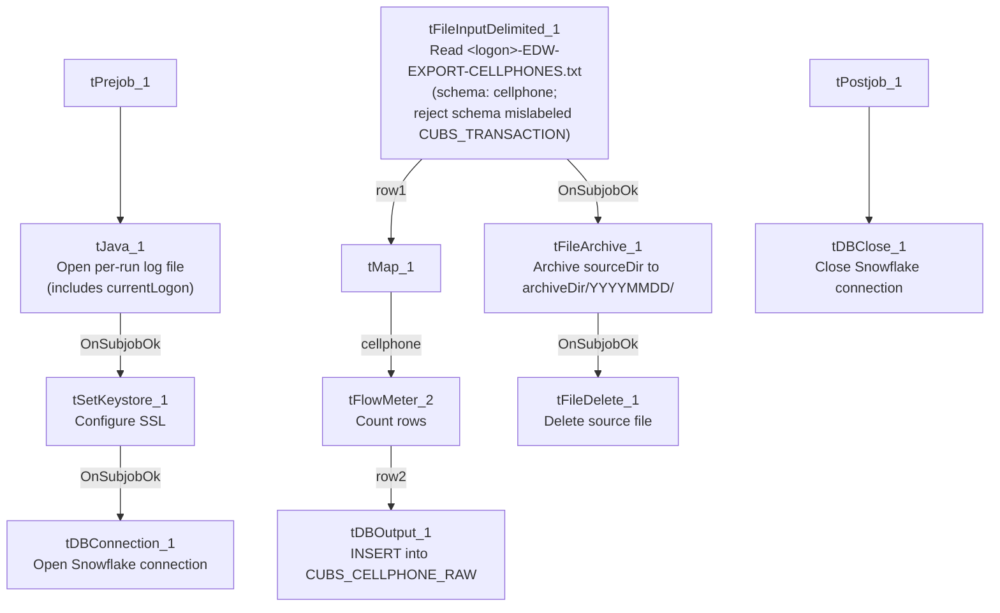

# Talend Job: CUBS_Raw_Cellphone_Load

## Overview

Loads a single per-logon CUBS cellphone-number export file — one row per debtor phone number, with dial-attempt counts, ownership-check codes/dates, and debtor authorization date/initials — into the Snowflake table `CUBS_CELLPHONE_RAW`, then archives and deletes the source file. Unlike `CUBS_Raw_CO_ETL_Load` (which iterates every file in a directory), this job is driven entirely by `context.currentLogon` and reads exactly one fixed-name file, implying it is invoked once per site/logon by its calling job(s) with a different context value each time.

## Detail table

| Field | Value |
|---|---|
| Job name | CUBS_Raw_Cellphone_Load |
| Version | 0.1 |
| Project | EDW2SF |
| Author | jmach@harriscollect.com |
| Created | 2023-03-23T20:16:15.139-0700 |
| Last Modified | 2026-01-28T09:27:06.855-0800 |

## Step-by-step data flow

**Setup subjob:** `tPrejob_1` → `tJava_1` (`OnComponentOk`) opens a per-run log file at `context.logDir + context.currentLogon + "_" + jobName + "_" + <timestamp> + ".log"` (note: includes `context.currentLogon` in the filename, unlike `CUBS_Raw_CO_ETL_Load`'s equivalent step) → `tSetKeystore_1` (`OnSubjobOk`) configures SSL trust/keystore from `context.keystorePath` (passwords redacted) → `tDBConnection_1` (`OnSubjobOk`) opens the Snowflake connection.

**Main subjob:**

1. `tFileInputDelimited_1` reads `context.sourceDir + context.currentLogon + "-EDW-EXPORT-CELLPHONES.txt"`, tab-delimited, header row present, UTF-8 encoded, with `CSVROWSEPARATOR` driven by `context.EXPORT_TRANS_RowSeparator` (borrowed from the `EXPORT_TRANS_0.1` context group, not a cellphone-specific one — see Issues observed). Uses repository schema `"...- cellphone"` (14 named columns: `LOGON`, `DEBTOR`, `DEBTOR_IDX`, `PHONE_NUMBER`, `SOURCE`, `CUR_STS`, `CUR_STS_CHG_DT`, `OWNER_CHK_DT`, `OWNER_CHK_CD`, `_UNATT_DIAL_ATT`, `FILL01`, `FILL02`, `DEBTOR_AUTH_DATE`, `DEBTOR_AUTH_INIT`). `DIE_ON_ERROR=false`; the reject schema is labeled `"...- CUBS_TRANSACTION"`, not cellphone-specific (see Issues observed).
2. `tMap_1` (`row1`, FLOW) maps to a same-shaped 16-column target (`FILENAME`, `FILEDATE`, plus the 14 business columns, renaming `_UNATT_DIAL_ATT` to `NUM_UNATT_DIAL_ATT`) — real column names are preserved here, unlike `CUBS_Raw_CO_ETL_Load`'s generic `COL1`...`COL80` flattening.
3. `tFlowMeter_2` (`cellphone`, FLOW) counts rows passing through.
4. `tDBOutput_1` (`row2`, FLOW) inserts the rows into Snowflake `CUBS_CELLPHONE_RAW` (`INSERT`, `tableAction=NONE`).
5. On the input file's `OnSubjobOk` (a parallel trigger off `tFileInputDelimited_1`, not chained from the DB insert), `tFileArchive_1` archives `context.sourceDir` (the whole directory, not the specific file — see Issues observed) to `context.archiveDir + "/" + <YYYYMMDD> + "/" + context.currentLogon + "-EDW-EXPORT-CELLPHONES.txt.tar.gz"` (password redacted).
6. On archive `OnSubjobOk`, `tFileDelete_1` deletes `context.sourceDir + context.currentLogon + "-EDW-EXPORT-CELLPHONES.txt"`.

**Teardown subjob:** `tPostjob_1` → `tDBClose_1` (`OnComponentOk`) closes the Snowflake connection.

## Settings tables

### Source: `tFileInputDelimited_1`

| Setting | Value | What it means |
|---|---|---|
| FILENAME | `context.sourceDir + context.currentLogon + "-EDW-EXPORT-CELLPHONES.txt"` | A fixed, single per-logon file — no directory iteration. |
| FIELDSEPARATOR / ENCODING | `\t` / UTF-8 | Tab-delimited, UTF-8 — differs from `CUBS_Raw_CO_ETL_Load`'s ISO-8859-15. |
| CSVROWSEPARATOR | `context.EXPORT_TRANS_RowSeparator` | Pulled from the transaction-export context group rather than a cellphone-specific variable — see Issues observed. |
| SCHEMA (main) | Repository schema `"...- cellphone"` | 14 named columns covering debtor phone number, source, status, dial-attempt count, and authorization fields. |
| SCHEMA_REJECT | Repository schema `"...- CUBS_TRANSACTION"` | Mislabeled — not a cellphone-specific reject schema. See Issues observed. |
| DIE_ON_ERROR | `false` | Malformed rows don't fail the job, but no reject flow is wired — rejected rows are silently dropped. |

### Target: `tDBOutput_1` (`tSnowflakeOutput`)

| Setting | Value | What it means |
|---|---|---|
| Table | `CUBS_CELLPHONE_RAW` | Destination table for the loaded phone-number rows. |
| Output action | `INSERT` | Appends rows; no truncate step in this job. |
| Table action | `NONE` | Table not recreated/altered by this job. |

### `tFileArchive_1`

| Setting | Value | What it means |
|---|---|---|
| SOURCE | `context.sourceDir` | Points at the whole source directory, not the specific cellphone file — see Issues observed. |
| TARGET | `context.archiveDir + "/" + <YYYYMMDD> + "/" + context.currentLogon + "-EDW-EXPORT-CELLPHONES.txt.tar.gz"` | Per-logon, dated archive filename. |
| ALL_FILES | `false` | Only files matching the archive component's own pattern are archived, mitigating the directory-level `SOURCE`. |
| PASSWORD | `***REDACTED***` | Preserved as redacted. |

### `tSetKeystore_1`

| Setting | Value | What it means |
|---|---|---|
| SSL_KEYSTORE | `context.keystorePath` | Externalized to context. |
| SSL_TRUSTSERVER_TRUSTSTORE | `"C:/clientTrustStore.trustStore"` | Hardcoded truststore path. |
| SSL_TRUSTSERVER_PASSWORD / SSL_KEYSTORE_PASSWORD / NEED_CLIENT_AUTH | `***REDACTED***` | Preserved as redacted. |

## Dependencies & configuration

- **Triggers/depends on other jobs:** `runjob_targets` is empty — this job does not call any other job.
- **Called by:** `DimCellphone_Load` (6 calls) and `CO_Master_Load` (1 call), per `06_dependency_matrix.md` — this same job apparently services two different orchestrators, presumably parameterized by a different `context.currentLogon` value per call.
- **Context variables used:** `EXPORT_TRANS_RowSeparator`, `archiveDir`, `currentLogon`, `keystorePath`, `logDir`, `sourceDir`.
- **5 hardcoded developer-workstation paths**, same pattern and locations as `CUBS_Raw_CO_ETL_Load` — see `05_operational_runbook.md`.

## Glossary

| Component type | Plain-English meaning |
|---|---|
| `tPrejob` / `tPostjob` | Guaranteed-first / guaranteed-last setup and teardown subjobs. |
| `tJava` | Runs a block of custom Java code once. |
| `tFileInputDelimited` | Reads a delimited text file according to a schema. |
| `tMap` | Maps/transforms columns from one schema to another. |
| `tFlowMeter` | Counts rows passing a point in the flow for logging/monitoring. |
| `tSnowflakeOutput` / `tSnowflakeConnection` / `tSnowflakeClose` | Write rows to Snowflake / open and close the shared Snowflake connection. |
| `tFileArchive` / `tFileDelete` | Zip a processed file to an archive location, then delete the original. |
| `tSetKeystore` | Configures SSL client keystore/truststore ahead of an encrypted database connection. |

## Issues observed

- **Reject schema mislabeled `"...- CUBS_TRANSACTION"` instead of a cellphone-specific reject schema** — the same mislabeling pattern documented in `ADP_Payroll_Load` (roster vs. payroll). Whether this causes an actual column-mismatch on a rejected row depends on schema similarity, which can't be determined from this metadata; verify directly in the Talend repository.
- **No reject flow is wired despite `DIE_ON_ERROR=false`** — malformed cellphone rows are silently dropped with no record of how many or which ones failed to parse.
- **`CSVROWSEPARATOR` is set from `context.EXPORT_TRANS_RowSeparator`** (the transaction-export context group) rather than a cellphone-specific row-separator variable. Both currently default to `"\n"` in `_shared_context.json`, so this is functionally harmless today, but the naming suggests this job's input parsing was copied from a transaction-file-loading job and never fully repointed to its own context group.
- **`tFileArchive_1.SOURCE` is `context.sourceDir`** (the entire directory) rather than a specific file or `filePath` variable, unlike the pattern used elsewhere in this batch (`CUBS_Raw_CO_ETL_Load` points `SOURCE` at `context.filePath`, the specific file's directory). `ALL_FILES=false` limits actual archiving to files matching the component's own target pattern, but this is a looser configuration than its siblings; unable to confirm from metadata whether it behaves identically in practice.
- **Called by two different orchestrators** (`DimCellphone_Load` and `CO_Master_Load`) with no evidence in this job's own metadata of how `context.currentLogon` differs per call — verify the call-site context overrides directly in Talend Studio.
