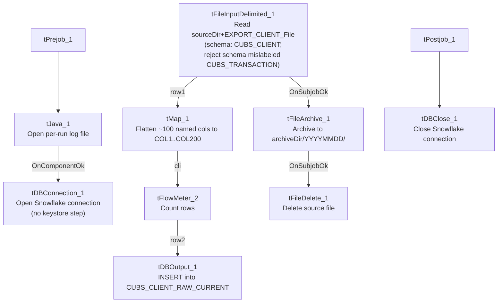

# Talend Job: CUBS_Raw_Client_Load

## Overview

Loads a single CUBS client master-file export — one row per collection-agency client, with ~100 columns covering client ID, name/address, billing and statement settings, commission/interest rates, collection-status flags, and dialer/skip-trace routing flags — into the Snowflake table `CUBS_CLIENT_RAW_CURRENT`, then archives and deletes the source file. The filename comes entirely from `context.EXPORT_CLIENT_File`, which defaults to `"HH-EDW-EXPORT-CLIENT.txt"` per `_shared_context.json`'s `EXPORT_CLIENT_0.1` group — meaning this job is normally run against the HH site's client export even though its own name carries no site suffix (see Issues observed). It has a near-duplicate sibling in this batch, `CUBS_Raw_DC_Client_Load`, which loads into the exact same target table.

## Detail table

| Field | Value |
|---|---|
| Job name | CUBS_Raw_Client_Load |
| Version | 0.1 |
| Project | EDW2SF |
| Author | jmach@harriscollect.com |
| Created | 2022-09-15T12:02:14.269-0700 |
| Last Modified | 2025-09-24T11:09:23.572-0700 |

## Step-by-step data flow

**Setup subjob:** `tPrejob_1` → `tJava_1` (`OnComponentOk`) opens a per-run log file at `context.logDir + context.currentLogon + "_" + jobName + "_" + <timestamp> + ".log"` → `tDBConnection_1` (`OnComponentOk`, not `OnSubjobOk` — see Issues observed) opens the Snowflake connection **directly**. **This job has no `tSetKeystore_1` component at all**, unlike its sibling `CUBS_Raw_DC_Client_Load` and the other two jobs in this batch, all of which configure SSL trust/keystore before connecting (see Issues observed).

**Main subjob:**

1. `tFileInputDelimited_1` reads `context.sourceDir + context.EXPORT_CLIENT_File`, with `RowSeparator`/`FieldSeparator`/`Header`/`Encoding` all driven by the `EXPORT_CLIENT_0.1` context group. Uses repository schema `"...- CUBS_CLIENT"` (~100 named columns, all with a leading-underscore naming convention, e.g. `_LOGON`, `_CLIENT`, `_NAME`, `_ADD1`, `_ZIP`, `_STATUS`, `_CLI_TYPE`, `_DLR_GROUP`, `_ON_DIALER`). `DIE_ON_ERROR=false`; reject schema mislabeled `"...- CUBS_TRANSACTION"` (same pattern as the other three jobs in this batch — see Issues observed).
2. `tMap_1` (`row1`, FLOW) re-maps every business column **positionally** onto a generic 202-column target shape (`FILENAME`, `FILEDATE`, `COL1`...`COL200`) — same "flatten to generic columns" pattern used in `CUBS_Raw_CO_ETL_Load`.
3. `tFlowMeter_2` (`cli`, FLOW) counts rows passing through.
4. `tDBOutput_1` (`row2`, FLOW) inserts the rows into Snowflake `CUBS_CLIENT_RAW_CURRENT` (`INSERT`, `tableAction=NONE`).
5. On the input file's `OnSubjobOk`, `tFileArchive_1` archives `context.sourceDir` to `context.archiveDir + "/" + <YYYYMMDD> + "/" + context.EXPORT_CLIENT_File + ".tar.gz"` (password redacted).
6. On archive `OnSubjobOk`, `tFileDelete_1` deletes `context.sourceDir + context.EXPORT_CLIENT_File`.

**Teardown subjob:** `tPostjob_1` → `tDBClose_1` (`OnComponentOk`) closes the Snowflake connection.

## Settings tables

### Source: `tFileInputDelimited_1`

| Setting | Value | What it means |
|---|---|---|
| FILENAME | `context.sourceDir + context.EXPORT_CLIENT_File` | `EXPORT_CLIENT_File` defaults to `"HH-EDW-EXPORT-CLIENT.txt"` per `_shared_context.json`. |
| ROWSEPARATOR / FIELDSEPARATOR / HEADER / ENCODING | All from `EXPORT_CLIENT_0.1` context group | Defaults: `\n`, `\t`, header row 1, `US-ASCII`. |
| SCHEMA (main) | Repository schema `"...- CUBS_CLIENT"` | ~100 named columns, leading-underscore naming convention (e.g. `_CLIENT`, `_NAME`, `_STATUS`). |
| SCHEMA_REJECT | Repository schema `"...- CUBS_TRANSACTION"` | Mislabeled — not a client-specific reject schema. See Issues observed. |
| DIE_ON_ERROR | `false` | Malformed rows don't fail the job, but no reject flow is wired — rejected rows are silently dropped. |

### Target: `tDBOutput_1` (`tSnowflakeOutput`)

| Setting | Value | What it means |
|---|---|---|
| Table | `CUBS_CLIENT_RAW_CURRENT` | Destination raw landing table — **identical to `CUBS_Raw_DC_Client_Load`'s target**. See Issues observed. |
| Output action | `INSERT` | Appends rows; no truncate step precedes it in this job. |
| Table action | `NONE` | Table not recreated/altered by this job. |

### `tFileArchive_1` / `tFileDelete_1`

| Setting | Value | What it means |
|---|---|---|
| TARGET (archive) | `context.archiveDir + "/" + <YYYYMMDD> + "/" + context.EXPORT_CLIENT_File + ".tar.gz"` | Per-run, dated archive named after the export file. |
| PASSWORD | `***REDACTED***` | Preserved as redacted. |
| FILENAME (delete) | `context.sourceDir + context.EXPORT_CLIENT_File` | Deletes the exact file that was loaded. |

## Dependencies & configuration

- **Triggers/depends on other jobs:** `runjob_targets` is empty — this job does not call any other job.
- **Called by:** not found as a `tRunJob` target anywhere in `06_dependency_matrix.md` — no orchestrator in the captured metadata calls this job. It may be scheduled independently or called by a Master job not present in this export; see that doc's own caveat that only `CO` has a documented `_Master_Load` orchestrator even though the same per-site pattern repeats elsewhere.
- **Context variables used:** `EXPORT_CLIENT_Encoding`, `EXPORT_CLIENT_FieldSeparator`, `EXPORT_CLIENT_File`, `EXPORT_CLIENT_Header`, `EXPORT_CLIENT_RowSeparator`, `EXPORT_TRANS_RowSeparator`, `archiveDir`, `currentLogon`, `logDir`, `sourceDir`.
- **4 hardcoded developer-workstation paths** (`tFileInputDelimited_1.TEMP_DIR`, `tFileArchive_1.SOURCE_FILE`, `tFileDelete_1.DIRECTORY`/`PATH`) — one fewer than its siblings since there is no `tSetKeystore_1` component (and therefore no hardcoded truststore path) in this job.

## Glossary

| Component type | Plain-English meaning |
|---|---|
| `tPrejob` / `tPostjob` | Guaranteed-first / guaranteed-last setup and teardown subjobs. |
| `tJava` | Runs a block of custom Java code once. |
| `tFileInputDelimited` | Reads a delimited text file according to a schema. |
| `tMap` | Maps/transforms columns from one schema to another. |
| `tFlowMeter` | Counts rows passing a point in the flow for logging/monitoring. |
| `tSnowflakeOutput` / `tSnowflakeConnection` / `tSnowflakeClose` | Write rows to Snowflake / open and close the Snowflake connection. |
| `tFileArchive` / `tFileDelete` | Zip a processed file to an archive location, then delete the original. |

## Issues observed

- **No `tSetKeystore_1` component in this job**, unlike `CUBS_Raw_DC_Client_Load` (its otherwise near-identical sibling) and the other two jobs in this batch, all of which configure SSL trust/keystore before opening the Snowflake connection. `tJava_1` connects directly to `tDBConnection_1` via `OnComponentOk`. Unable to determine from metadata whether this job's Snowflake connection profile requires mutual-TLS/keystore auth the way the others do — if it does, this job may rely on a different auth path, or the keystore step may have been dropped by omission; verify with the team.
- **`tJava_1 → tDBConnection_1` uses an `OnComponentOk` trigger**, not `OnSubjobOk` like the equivalent step in the other three jobs in this batch — functionally equivalent here since `tJava_1` is a single component, but an inconsistent wiring style across otherwise near-identical jobs.
- **This job and `CUBS_Raw_DC_Client_Load` both write to the same target table**, `CUBS_CLIENT_RAW_CURRENT`, with `INSERT`/`tableAction=NONE` (no truncate). If both jobs can run against the same table without either one clearing it first, rows from both site exports accumulate together on every run cycle rather than being replaced. No site/source identifier column is visible in the generic `COL1`...`COL202` target schema, so it's unclear from metadata alone whether a downstream merge step can distinguish rows by site of origin; verify with the team.
- **The job name carries no explicit site suffix** (unlike the CHI/CO/DC/HH/PRE/TOL pattern documented in `01_system_architecture.md` for other `CUBS_Raw_*` families), but its context default (`EXPORT_CLIENT_File = "HH-EDW-EXPORT-CLIENT.txt"`) points at the HH site specifically. The job's actual scope is not obvious from its name alone.
- **Reject schema mislabeled `"...- CUBS_TRANSACTION"`**, not a client-specific reject schema — same pattern flagged in the other three jobs in this batch and in `ADP_Payroll_Load`. No reject flow is wired despite `DIE_ON_ERROR=false`.
- **Not found as a `tRunJob` target anywhere in `06_dependency_matrix.md`** — what schedules or triggers this job is unclear from the captured metadata; verify with the team so its pipeline isn't assumed to be dormant.
