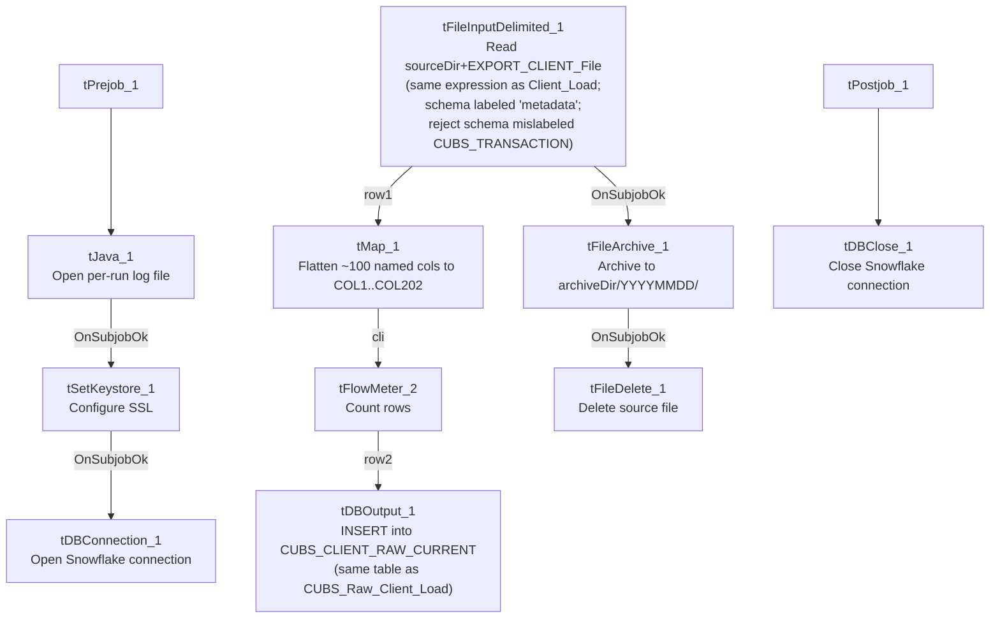

# Talend Job: CUBS_Raw_DC_Client_Load

## Overview

Near-duplicate of `CUBS_Raw_Client_Load`: same client master-file load pattern, same target table `CUBS_CLIENT_RAW_CURRENT`, same overall load-archive-delete flow. It differs from its sibling in three concrete ways visible in the metadata: (1) it includes an SSL/keystore setup step (`tSetKeystore_1`) before opening its Snowflake connection, which `CUBS_Raw_Client_Load` lacks; (2) its input repository schema is labeled generically `"...- metadata"` rather than `"...- CUBS_CLIENT"`; and (3) its column-naming convention has no leading underscore (`NAME`, `CLIENT`, `ZIP`) versus `CUBS_Raw_Client_Load`'s (`_NAME`, `_CLIENT`, `_ZIP`). Despite the "DC" in its name, **nothing else in this job's own metadata — its source path expression, filename, or a DC-specific context variable — actually differentiates it from the generic Client_Load job** (see Issues observed).

## Detail table

| Field | Value |
|---|---|
| Job name | CUBS_Raw_DC_Client_Load |
| Version | 0.1 |
| Project | EDW2SF |
| Author | jmach@harriscollect.com |
| Created | 2023-09-26T11:16:22.325-0700 |
| Last Modified | 2025-11-04T11:08:04.185-0800 |

## Step-by-step data flow

**Setup subjob:** `tPrejob_1` → `tJava_1` (`OnComponentOk`) opens a per-run log file at `context.logDir + context.currentLogon + "_" + jobName + "_" + <timestamp> + ".log"` → `tSetKeystore_1` (`OnSubjobOk`) configures SSL trust/keystore from `context.keystorePath` (settings identical to `CUBS_Raw_CO_ETL_Load`/`CUBS_Raw_Cellphone_Load`, passwords redacted) → `tDBConnection_1` (`OnSubjobOk`) opens the Snowflake connection.

**Main subjob:**

1. `tFileInputDelimited_1` reads `context.sourceDir + context.EXPORT_CLIENT_File` — **byte-for-byte identical to `CUBS_Raw_Client_Load`'s FILENAME expression**, not `context.sourceDCDir` or any DC-prefixed filename (see Issues observed). `RowSeparator`/`FieldSeparator`/`Header`/`Encoding` are all driven by the same `EXPORT_CLIENT_0.1` context group. Uses repository schema `"...- metadata"` (a generic, non-descriptive label — see Issues observed) with ~100 named columns representing the same business fields as `CUBS_Raw_Client_Load`'s schema but without the leading-underscore naming convention (e.g. `LOGON`, `CLIENT`, `CLIENT_IDX`, `NAME`, `ADD1`, `ZIP`, `STATUS`, `DIALER_GRP`, `HAL_ACTIVE`). `DIE_ON_ERROR=false`; reject schema mislabeled `"...- CUBS_TRANSACTION"` (same pattern as the other three jobs in this batch).
2. `tMap_1` (`row1`, FLOW) maps to the same generic 202-column `COL1`...`COL202` target shape used by `CUBS_Raw_Client_Load`.
3. `tFlowMeter_2` (`cli`, FLOW) counts rows passing through.
4. `tDBOutput_1` (`row2`, FLOW) inserts the rows into Snowflake `CUBS_CLIENT_RAW_CURRENT` (`INSERT`, `tableAction=NONE`) — **the same target table as `CUBS_Raw_Client_Load`**.
5. On the input file's `OnSubjobOk`, `tFileArchive_1` archives `context.sourceDir` to `context.archiveDir + "/" + <YYYYMMDD> + "/" + context.EXPORT_CLIENT_File + ".tar.gz"` (password redacted).
6. On archive `OnSubjobOk`, `tFileDelete_1` deletes `context.sourceDir + context.EXPORT_CLIENT_File`.

**Teardown subjob:** `tPostjob_1` → `tDBClose_1` (`OnComponentOk`) closes the Snowflake connection.

## Settings tables

### Source: `tFileInputDelimited_1`

| Setting | Value | What it means |
|---|---|---|
| FILENAME | `context.sourceDir + context.EXPORT_CLIENT_File` | Identical expression to `CUBS_Raw_Client_Load` — does not use `context.sourceDCDir` or a DC-prefixed filename. See Issues observed. |
| SCHEMA (main) | Repository schema `"...- metadata"` | ~100 named columns, no leading-underscore naming (e.g. `CLIENT`, `NAME`, `ZIP`) — same business fields as `CUBS_Raw_Client_Load` but a differently-named, less descriptive repository schema. |
| SCHEMA_REJECT | Repository schema `"...- CUBS_TRANSACTION"` | Mislabeled — same pattern as the other three jobs in this batch. |
| DIE_ON_ERROR | `false` | Malformed rows don't fail the job, but no reject flow is wired — rejected rows are silently dropped. |

### Target: `tDBOutput_1` (`tSnowflakeOutput`)

| Setting | Value | What it means |
|---|---|---|
| Table | `CUBS_CLIENT_RAW_CURRENT` | Identical target table to `CUBS_Raw_Client_Load`. See Issues observed. |
| Output action | `INSERT` | Appends rows; no truncate step in this job. |
| Table action | `NONE` | Table not recreated/altered by this job. |

### `tSetKeystore_1`

| Setting | Value | What it means |
|---|---|---|
| SSL_KEYSTORE | `context.keystorePath` | Externalized to context — present in this job but absent from `CUBS_Raw_Client_Load`. |
| SSL_TRUSTSERVER_TRUSTSTORE | `"C:/clientTrustStore.trustStore"` | Hardcoded truststore path. |
| SSL_TRUSTSERVER_PASSWORD / SSL_KEYSTORE_PASSWORD / NEED_CLIENT_AUTH | `***REDACTED***` | Preserved as redacted. |

## Dependencies & configuration

- **Triggers/depends on other jobs:** `runjob_targets` is empty — this job does not call any other job.
- **Called by:** not found as a `tRunJob` target anywhere in `06_dependency_matrix.md` — like `CUBS_Raw_Client_Load`, no orchestrator in the captured metadata calls this job.
- **Context variables used:** `EXPORT_CLIENT_Encoding`, `EXPORT_CLIENT_FieldSeparator`, `EXPORT_CLIENT_File`, `EXPORT_CLIENT_Header`, `EXPORT_CLIENT_RowSeparator`, `EXPORT_TRANS_RowSeparator`, `archiveDir`, `currentLogon`, `keystorePath`, `logDir`, `sourceDir`.
- **5 hardcoded developer-workstation paths**, same pattern and locations as `CUBS_Raw_CO_ETL_Load`/`CUBS_Raw_Cellphone_Load` (includes the truststore path, since `tSetKeystore_1` is present here).

## Glossary

| Component type | Plain-English meaning |
|---|---|
| `tPrejob` / `tPostjob` | Guaranteed-first / guaranteed-last setup and teardown subjobs. |
| `tJava` | Runs a block of custom Java code once. |
| `tFileInputDelimited` | Reads a delimited text file according to a schema. |
| `tMap` | Maps/transforms columns from one schema to another. |
| `tFlowMeter` | Counts rows passing a point in the flow for logging/monitoring. |
| `tSnowflakeOutput` / `tSnowflakeConnection` / `tSnowflakeClose` | Write rows to Snowflake / open and close the Snowflake connection. |
| `tFileArchive` / `tFileDelete` | Zip a processed file to an archive location, then delete the original. |
| `tSetKeystore` | Configures SSL client keystore/truststore ahead of an encrypted database connection. |

## Issues observed

- **Despite the "DC" in its name, this job's `tFileInputDelimited_1.FILENAME` expression is byte-for-byte identical to `CUBS_Raw_Client_Load`'s** (`context.sourceDir + context.EXPORT_CLIENT_File`). It does not reference `context.sourceDCDir` — a distinct DC-specific path variable defined in the `StandardFolders_0.1` context group and referenced elsewhere in this project (e.g. `Semaphore_Check`'s DC-specific check) — nor any DC-prefixed filename. Any site differentiation must come entirely from a job-level context override supplying a different `EXPORT_CLIENT_File` value at runtime, which is not visible in this job's own metadata; verify directly in Talend Studio which context set(s) this job actually runs under.
- **Writes to the exact same target table (`CUBS_CLIENT_RAW_CURRENT`) as `CUBS_Raw_Client_Load`**, with the same `INSERT`/no-truncate behavior. See the corresponding issue in `CUBS_Raw_Client_Load`'s doc regarding whether both jobs' output rows can be reliably distinguished downstream.
- **Input repository schema is labeled `"...- metadata"`** — a generic, non-descriptive name — unlike `CUBS_Raw_Client_Load`'s `"...- CUBS_CLIENT"`. The column-naming convention also differs (no leading underscore), even though the same business fields appear to be represented and the `tMap_1` output shape (202 generic columns) matches `CUBS_Raw_Client_Load`'s exactly. This appears functionally compatible, but the schema-naming and column-naming inconsistency between two jobs that load into the same table is worth reconciling.
- **Reject schema mislabeled `"...- CUBS_TRANSACTION"`**, no reject flow wired — same pattern as the other three jobs in this batch.
- **Not found as a `tRunJob` target anywhere in `06_dependency_matrix.md`** — what schedules or triggers this job is unclear from the captured metadata; verify with the team.
