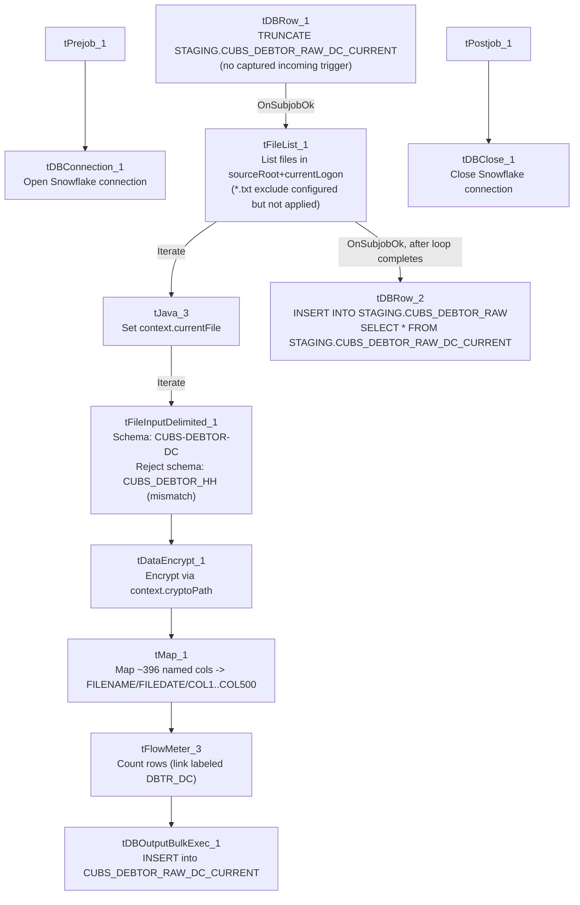

# Talend Job: CUBS_Raw_DC_Debtor_Load

## Overview

Loads the "DC" site's debtor-master export file (a fixed CUBS-collections-system flat-file extract, ~396 business columns covering debtor identity, balances, contacts, legal/skip-trace and misc client-specific fields) from a per-logon source folder into the Snowflake staging table `STAGING.CUBS_DEBTOR_RAW_DC_CURRENT`, encrypting sensitive fields along the way, then appends the freshly loaded rows into a shared, multi-site combined table `STAGING.CUBS_DEBTOR_RAW`. It is one of several near-identical per-site debtor-load jobs (CHI/CO/DC/HH/PRE/TOL) invoked by the `CUBS_Raw_Debtor_Load` orchestrator (see `06_dependency_matrix.md`).

## Detail table

| Field | Value |
|---|---|
| Job name | CUBS_Raw_DC_Debtor_Load |
| Version | 0.1 |
| Project | EDW2SF |
| Author | jmach@harriscollect.com |
| Created | 2022-05-05T11:15:55.555-0700 |
| Last Modified | 2022-06-13T14:33:33.184-0700 |

## Step-by-step data flow

**Setup subjob:** `tPrejob_1` → `tDBConnection_1` opens the Snowflake connection (no host/label/context parameters are captured on this component in this job's own metadata — see Issues observed).

**Main subjob:**

1. `tDBRow_1` runs `TRUNCATE TABLE STAGING.CUBS_DEBTOR_RAW_DC_CURRENT;`. This component has no incoming trigger link in the extracted `connections` array — it appears to be the entry point of the main subjob, starting automatically once the Prejob subjob completes (standard Talend behavior for a component with no incoming trigger), but this could not be explicitly confirmed from metadata.
2. On success (`OnSubjobOk`), `tFileList_1` lists files (not subdirectories) in `context.sourceRoot + context.currentLogon`. An `EXCLUDEFILEMASK` of `"*.txt"` is configured, but `IFEXCLUDE` is `false`, so the exclusion is **not actually applied** — every file in the directory is picked up regardless of extension (same specific misconfiguration pattern seen in `ADP_Payroll_Load`).
3. For each file (`Iterate`), `tJava_3` sets `context.currentFile` from `globalMap.get("tFileList_1_CURRENT_FILEPATH")` and logs `"Processing file " + context.currentFile"` to stdout.
4. `tFileInputDelimited_1` reads the file using repository schema **"CUBS-DEBTOR-DC"** for well-formed rows (separators/header/encoding all driven by the `EXPORT_DEBTOR_*` context group — see Settings table). `DIE_ON_ERROR` is `false`, and its `SCHEMA_REJECT` repository reference is **"CUBS_DEBTOR_HH"** — a different site code than this job's own DC — see Issues observed. No reject-flow connection is wired.
5. `tFileInputDelimited_1` → (`FLOW`) → `tDataEncrypt_1` encrypts data using `context.cryptoPath` as the key-file location (`PASSWORD_M1` and `SECRET_TYPE` both `***REDACTED***`, `ALGO_VERSION` 2). Which of the pass-through columns are actually targeted for encryption is not captured in this metadata beyond these global algorithm/key settings.
6. `tDataEncrypt_1` → (`FLOW`) → `tMap_1` remaps the ~396 named business columns onto a generic, positional target schema: `FILENAME`, `FILEDATE`, `COL1`…`COL500`. This "genericize the columns" pattern lets one wide raw staging table support source files whose exact column layout can vary by site/vendor without needing a matching physical warehouse column for every named field.
7. `tMap_1` → (`FLOW`, canvas link labeled `DBTR_DC`) → `tFlowMeter_3` counts rows passing through. Its `METTERLABEL` parameter is still the unmodified default `"MyLabel"` even though the link itself was renamed to `DBTR_DC` — cosmetic only.
8. `tFlowMeter_3` → (`FLOW`) → `tDBOutputBulkExec_1` bulk-loads the rows into Snowflake table `CUBS_DEBTOR_RAW_DC_CURRENT` (`INSERT`, `tableAction` = `NONE`). Its schema additionally carries Snowflake bulk-load error metadata columns (`columnName`, `rowNumber`, `category`, `character`, `errorMessage`, `byteOffset`, `line`, `sqlState`, `code`) appended after the 502 business/meta columns — see Issues observed regarding whether bulk-load errors are actually captured anywhere.
9. Separately, once the entire file-iteration loop finishes (`tFileList_1` → `OnSubjobOk`), `tDBRow_2` runs `INSERT INTO STAGING.CUBS_DEBTOR_RAW SELECT * FROM STAGING.CUBS_DEBTOR_RAW_DC_CURRENT;`, appending this run's DC-site rows into the shared, multi-site `STAGING.CUBS_DEBTOR_RAW` table used by the other site variants of this job.

**Teardown subjob:** `tPostjob_1` → `tDBClose_1` closes the Snowflake connection.

## Settings tables

### Control: `tFileList_1`

| Setting | Value | What it means |
|---|---|---|
| DIRECTORY | `context.sourceRoot + context.currentLogon` | Source folder is built from two context variables; neither has a default captured in `_shared_context.json`'s context groups — likely job-local context parameters. |
| LIST_MODE | `FILES` | Subdirectories are not listed. |
| EXCLUDEFILEMASK / IFEXCLUDE | `"*.txt"` / `false` | Exclusion mask is configured but disabled, so it has no effect — every file in the directory is iterated. |
| CASE_SENSITIVE | `YES` | File-mask matching (if it were active) would be case-sensitive. |

### Source: `tFileInputDelimited_1`

| Setting | Value | What it means |
|---|---|---|
| SCHEMA (main) | Repository `"CUBS-DEBTOR-DC"` | ~396 unique named business columns (debtor identity, balances, contact, legal/skip-trace, client-specific misc fields); the extracted metadata lists them twice consecutively plus `errorCode`/`errorMessage` — most likely a schema-capture/extraction artifact rather than an intentional duplicate schema. |
| SCHEMA_REJECT | Repository `"CUBS_DEBTOR_HH"` | **Site mismatch** — this is the DC job but its reject schema is labeled for site HH. See Issues observed. |
| FILENAME | `context.currentFile` | Current file from `tFileList_1`'s iteration. |
| FIELDSEPARATOR / ROWSEPARATOR / HEADER / ENCODING | `context.EXPORT_DEBTOR_FieldSeparator` / `context.EXPORT_DEBTOR_RowSeparator` / `context.EXPORT_DEBTOR_Header` / `context.EXPORT_DEBTOR_Encoding` | Driven by the shared `EXPORT_DEBTOR_0.1` context group. Default values in that group are tab field-separator, `\n` row-separator, 1 header row, `US-ASCII` encoding — though that group's own `EXPORT_DEBTOR_File` default points to an HH-site path, reinforcing that this context group appears HH-oriented and reused across sites. |
| DIE_ON_ERROR | `false` | Malformed rows do not fail the job... |
| Reject flow | Not wired | ...but no connection routes rejected rows anywhere — they are silently dropped, with no record of how many or which rows failed to parse. |
| TEMP_DIR | `"C:/Talend-Studio-20211109_1610-V8.0.1/workspace"` | Hardcoded developer-workstation path — same project-wide portability risk documented in `05_operational_runbook.md`. |

### Transform: `tDataEncrypt_1`

| Setting | Value | What it means |
|---|---|---|
| PASSWORD_M1 | `***REDACTED***` | Encryption password — preserved as redacted, not guessable from metadata. |
| CRYPTO_FILE_PATH | `context.cryptoPath` | Key-file location supplied via context variable; job-local, no default captured. |
| SECRET_TYPE | `***REDACTED***` | Also redacted in source metadata. |
| ALGO_VERSION | `2` | Encryption algorithm version used by the component. |
| Target field(s) | Unable to determine from metadata | The component's parameters only capture global algorithm/key settings, not which specific columns (e.g. SSN, DOB) are actually encrypted — verify directly in Talend Studio. |

### Target: `tDBOutputBulkExec_1` (`tSnowflakeOutputBulkExec`)

| Setting | Value | What it means |
|---|---|---|
| Table | `CUBS_DEBTOR_RAW_DC_CURRENT` | Per-run staging table for this site's raw debtor extract (truncated at the start of the job by `tDBRow_1`). |
| Output action | `INSERT` | Appends rows; safe because the table was truncated earlier in the same run. |
| Table action | `NONE` | Table is not recreated/altered by this job. |
| Schema tail columns | `columnName, rowNumber, category, character, errorMessage, byteOffset, line, sqlState, code` | Snowflake bulk-load error/reject metadata fields built into this component's schema; whether these are actually captured (e.g. via a reject output) or simply unused is unable to determine from metadata — no separate reject connection appears in the `connections` array. |

### Combine step: `tDBRow_2` (`tSnowflakeRow`)

| Setting | Value | What it means |
|---|---|---|
| Query | `INSERT INTO STAGING.CUBS_DEBTOR_RAW SELECT * FROM STAGING.CUBS_DEBTOR_RAW_DC_CURRENT;` | Appends this run's DC-site rows into a shared, multi-site combined raw table. Fires once, after the whole file-iteration loop completes — not per file. |

## Dependencies & configuration

- **Triggered by:** `CUBS_Raw_Debtor_Load` (per `06_dependency_matrix.md`, which calls this job alongside sibling per-site jobs `CUBS_Raw_CHI_Debtor_Load`, `CUBS_Raw_CO_Debtor_Load`, `CUBS_Raw_HH_Debtor_Load`, `CUBS_Raw_PRE_Debtor_Load`). A related sibling, `CUBS_Raw_DC_Debtor_Load_No_Delete`, is triggered separately by `CUBS_Raw_Debtor_Load_Test` — not part of this job's own metadata, but worth knowing it exists as a variant.
- **Triggers/depends on other jobs:** none — `runjob_targets` is empty; this job does not call other jobs itself.
- **Context variables used:** `EXPORT_DEBTOR_Encoding`, `EXPORT_DEBTOR_FieldSeparator`, `EXPORT_DEBTOR_Header`, `EXPORT_DEBTOR_RowSeparator` (from the shared `EXPORT_DEBTOR_0.1` context group — see `_shared_context.json`), `cryptoPath`, `currentFile`, `currentLogon`, `sourceRoot` (none of these last four appear in the extracted shared context groups — likely job-local context parameters whose DC-specific default values could not be verified from available metadata).
- **Hardcoded path finding:** `tFileInputDelimited_1.TEMP_DIR` = `"C:/Talend-Studio-20211109_1610-V8.0.1/workspace"` — one of the 210 project-wide occurrences of this developer-workstation path documented in `05_operational_runbook.md`.

## Glossary

| Component type | Plain-English meaning |
|---|---|
| `tPrejob` / `tPostjob` | Standard Talend bookend components that run setup/teardown logic before and after the job's main subjobs. |
| `tSnowflakeConnection` / `tSnowflakeClose` | Open/close a Snowflake database connection shared by other components in the job. |
| `tSnowflakeRow` | Runs an arbitrary SQL statement (here, a `TRUNCATE` and an `INSERT...SELECT`) against Snowflake with no result set returned to the flow. |
| `tFileList` | Lists files in a directory for the job to iterate over one at a time. |
| `tJava` | Runs a block of custom Java code once (here, used to capture the current file path from `tFileList`'s iteration and log it). |
| `tFileInputDelimited` | Reads a delimited (CSV/TSV-style) text file according to a schema. |
| `tDataEncrypt` | Encrypts one or more fields in the flow using a key file and configured algorithm. |
| `tMap` | Maps/transforms columns from one schema to another. |
| `tFlowMeter` | Counts rows passing a point in the flow for logging/monitoring. |
| `tSnowflakeOutputBulkExec` | Bulk-loads rows into a Snowflake table (typically faster than row-by-row `tSnowflakeOutput` for large volumes), with built-in schema fields for capturing bulk-load errors. |

## Issues observed

- **Reject-schema site mismatch on `tFileInputDelimited_1`.** The main input schema is correctly labeled `"CUBS-DEBTOR-DC"`, but its `SCHEMA_REJECT` repository reference is `"CUBS_DEBTOR_HH"` — a different site code. This looks like a copy-paste artifact from an HH-site template job that was never repointed. Whether this actually causes a column-mismatch problem on a rejected row depends on how similar the two repository schemas are — unable to determine from this metadata; verify directly in the Talend repository.
- **No reject flow is wired from `tFileInputDelimited_1`.** `DIE_ON_ERROR` is `false`, so malformed rows don't fail the job, but there is also no connection carrying rejected rows anywhere — they are silently dropped with no record of how many rows, or which ones, failed to parse. This is the same pattern flagged in `ADP_Payroll_Load` and documented as a project-wide risk in `05_operational_runbook.md`.
- **`tFileList_1`'s file exclusion mask is configured but not enabled.** `EXCLUDEFILEMASK` is `"*.txt"` but `IFEXCLUDE` is `false`, so the exclusion has no effect and every file in the source directory is picked up and fed into the DC-schema parser — the identical specific misconfiguration seen in `ADP_Payroll_Load`, suggesting this may be a shared job-template defect rather than isolated to one job.
- **`tDBRow_1` (the job's `TRUNCATE`) has no captured incoming trigger.** It is presumably the root component of the main subjob (auto-starting once the Prejob subjob finishes), but the `connections` array doesn't show an explicit link into it — worth a quick visual check in Studio if this job's start sequencing is ever in question.
- **Bulk-load error columns on `tDBOutputBulkExec_1` don't appear to be routed anywhere.** The component's schema carries Snowflake bulk-load error metadata fields (`columnName`, `rowNumber`, `errorMessage`, `sqlState`, `code`, etc.), but no separate reject/error connection exists in this job's `connections` array — unable to determine from metadata whether bulk-load errors are surfaced anywhere or simply cause the whole bulk operation to fail.
- **Encryption target fields are not specified in the extracted metadata.** `tDataEncrypt_1`'s captured parameters cover only algorithm version and key-file location; which of the ~396 pass-through columns (e.g., `SSN`, `DOB`) are actually encrypted cannot be confirmed from this metadata alone.
- No other job-specific error handling (`tDie`/`tWarn`/`tSendMail`) is present — a failure in this job surfaces only as a generic Talend execution error, consistent with the majority of non-orchestrator jobs described in `05_operational_runbook.md`.
