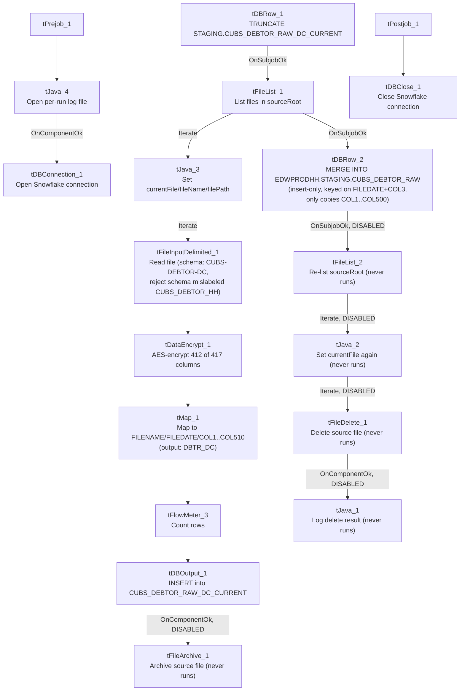

# Talend Job: CUBS_Raw_DC_Debtor_Load_No_Delete

## Overview

Loads a raw debtor-account export file for the "DC" site (see `01_system_architecture.md` on site codes) from a local/mounted source directory into Snowflake. The job reads a delimited file against a 417-column `CUBS-DEBTOR-DC` repository schema (debtor name, address, phone, balance/collection amounts, legal/court/warrant fields, letter/notice tracking, strategy-test fields, etc.), encrypts most of those columns, remaps everything down to a generic `FILENAME`/`FILEDATE`/`COL1`...`COL510` layout, inserts it into the Snowflake staging table `CUBS_DEBTOR_RAW_DC_CURRENT`, then merges the new rows (insert-only, no update/delete) into the shared `EDWPRODHH.STAGING.CUBS_DEBTOR_RAW` table used by all site loads. It is one of several parallel job variants for DC debtor loading (the plain `CUBS_Raw_DC_Debtor_Load` and this `_No_Delete` variant) that differ in staging-load mechanics and whether post-load file cleanup runs — see Issues observed. Unlike its `CUBS_Raw_HH_Debtor_Load_No_Delete` sibling (whose reject schema is genuinely self-referential), this DC job's reject schema is labeled for the HH site's repository schema even though its main schema is DC's own — see Issues observed.

## Detail table

| Field | Value |
|---|---|
| Job name | CUBS_Raw_DC_Debtor_Load_No_Delete |
| Version | 0.4 |
| Project | EDW2SF |
| Author | jmach@harriscollect.com |
| Created | 2022-12-06T16:13:53.034-0800 |
| Last Modified | 2025-09-24T11:08:15.218-0700 |

## Step-by-step data flow

**Setup subjob:** `tPrejob_1` → `tJava_4` opens a per-run log file at `context.logDir + context.currentLogon + "_" + jobName + "_" + <timestamp> + ".log"` and redirects `System.out` to it → on success (`COMPONENT_OK`), `tDBConnection_1` opens the job's Snowflake connection (its own parameters are not captured in this job's metadata — see Dependencies & configuration).

**Main subjob:**

1. `tDBRow_1` runs `TRUNCATE TABLE STAGING.CUBS_DEBTOR_RAW_DC_CURRENT;` — clears the DC-specific current-load staging table before this run.
2. On success (`SUBJOB_OK`), `tFileList_1` lists files in `context.sourceRoot` (`FILES` mode, no sub-directories; an `EXCLUDEFILEMASK` of `"*.txt"` is configured but `IFEXCLUDE=false`, so it is not actually applied — every file in the directory is picked up).
3. For each file (`ITERATE`), `tJava_3` sets `context.currentFile`, `context.fileName`, and `context.filePath` from the `tFileList_1` iteration variables.
4. `tFileInputDelimited_1` reads the current file using the repository schema `CUBS-DEBTOR-DC` (417 columns) for the main flow, but a reject schema labeled `CUBS_DEBTOR_HH` (`DIE_ON_ERROR=false` — malformed rows do not fail the job, but no connection carries rejected rows anywhere, so they are silently dropped regardless of what schema the reject side is configured with).
5. `tDataEncrypt_1` receives 412 of the 417 input columns (5 are dropped at this step: `CLT_XFR_DT`, `VAL_LTR_DT`, `LETTERABLE`, `EMAILABLE`, `TEXTABLE`) and encrypts them using AES, writing its crypto-controller file to `context.cryptoPath`. Secret type, secret key, and password are all `***REDACTED***`.
6. `tMap_1` maps the 412 encrypted columns into a generic 512-column target schema (`FILENAME`, `FILEDATE`, `COL1`...`COL510`); the `FLOW` connector out of `tMap_1` is labeled `DBTR_DC`. `DIE_ON_ERROR=true` here, so a mapping failure fails the job outright. Exact column-to-`COLn` mapping expressions are not captured in this metadata.
7. `tFlowMeter_3` counts rows passing through (labeled `"MyLabel"`, not renamed for this job).
8. `tDBOutput_1` inserts the mapped rows into Snowflake table `CUBS_DEBTOR_RAW_DC_CURRENT` (`INSERT`, `tableAction=NONE`).
9. On success (`COMPONENT_OK`), `tFileArchive_1` would zip the source file to `context.archiveDir + "/" + <CCYYMMDD> + "/" + context.fileName + ".tar.gz"` — **but this component is disabled (`ACTIVATE=false`)**, so archiving does not actually happen. See Issues observed.
10. After the entire `tFileList_1` iteration subjob completes (`SUBJOB_OK`), `tDBRow_2` runs a `MERGE INTO EDWPRODHH.STAGING.CUBS_DEBTOR_RAW` from `STAGING.CUBS_DEBTOR_RAW_DC_CURRENT`, matching on `FILEDATE` + `COL3`, with a single `WHEN NOT MATCHED THEN INSERT` clause listing only `FILENAME`, `FILEDATE`, `COL1`...`COL500` (502 columns) — rows already present in the target (by that key) are left untouched; there is no update or delete branch. See Issues observed regarding the `COL501`-`COL510` gap.
11. On success (`SUBJOB_OK`), `tFileList_2` would re-list `context.sourceRoot`, iterate (`tJava_2`) and delete each file (`tFileDelete_1`), with `tJava_1` logging the delete result afterward (`COMPONENT_OK`) — **the entire second listing/delete subjob (`tFileList_2`, `tJava_2`, `tFileDelete_1`, `tJava_1`) is disabled.** See Issues observed.

**Teardown subjob:** `tPostjob_1` → `tDBClose_1` closes the Snowflake connection.

## Settings tables

### Setup: `tFileList_1`

| Setting | Value | What it means |
|---|---|---|
| DIRECTORY | `context.sourceRoot` | Source directory scanned each run. `sourceRoot` does not appear in the `StandardFolders_0.1` shared context group (which defines `sourceDir`/`sourceDCDir` instead) — unable to confirm its actual default value from the extracted shared context; verify with team. |
| LIST_MODE | `FILES` | Lists files only (no subdirectories; `INCLUDSUBDIR=false`). |
| ORDER_BY | None set (`ORDER_BY_NOTHING=true`) | Files are processed in whatever order the filesystem/API returns them — no explicit sort. |
| EXCLUDEFILEMASK / IFEXCLUDE | `"*.txt"` / `false` | An exclusion mask is configured but `IFEXCLUDE=false` means it is **not actually applied** — every file in the directory is picked up regardless of extension. |

### Source: `tFileInputDelimited_1`

| Setting | Value | What it means |
|---|---|---|
| FILENAME | `context.currentFile` | The file currently being iterated by `tFileList_1`. |
| FIELDSEPARATOR / ROWSEPARATOR / HEADER / ENCODING | `context.EXPORT_DEBTOR_FieldSeparator` / `context.EXPORT_DEBTOR_RowSeparator` / `context.EXPORT_DEBTOR_Header` / `context.EXPORT_DEBTOR_Encoding` | Per the shared `EXPORT_DEBTOR_0.1` context group these default to tab-separated, `\n` row separator, 1 header row, `US-ASCII` encoding. |
| SCHEMA (main) | Repository schema `CUBS-DEBTOR-DC` (417 columns) | Full raw debtor-record layout for the DC site. |
| SCHEMA_REJECT | Repository schema `CUBS_DEBTOR_HH` (by label) | **Mismatched label** — this is a DC-site job but its reject schema is labeled for HH. Notably, the actual reject column list captured in this job's metadata (417 columns + `errorCode`/`errorMessage`) matches the DC main schema, not HH's true 537-column layout — whether that reflects the real Talend Studio configuration or an artifact of how this extraction resolved the reject schema is unable to determine from metadata; verify directly in Talend Studio. See Issues observed. |
| DIE_ON_ERROR | `false` | Malformed rows do not fail the job... |
| Reject flow | Not wired | ...but no connection routes rejected rows anywhere in this job's `connections` list — they are silently dropped with no count or record. |
| TEMP_DIR | `"C:/Talend-Studio-20211109_1610-V8.0.1/workspace"` | Hardcoded developer-workstation path — see Dependencies & configuration. |

### Transform: `tDataEncrypt_1`

| Setting | Value | What it means |
|---|---|---|
| SECRET_TYPE / SECRET_KEY / PASSWORD_M1 | `***REDACTED***` | Encryption key material is redacted in the source metadata and preserved as-is here — do not guess actual values. |
| CRYPTO_METHOD / ALGO_VERSION | `AES` / `2` | AES encryption, algorithm version 2. |
| CRYPTO_FILE_PATH | `context.cryptoPath` | Where the crypto-controller file is written. |
| Schema | 412 of the 417 input columns | This component silently drops 5 input columns before encrypting the rest: `CLT_XFR_DT`, `VAL_LTR_DT`, `LETTERABLE`, `EMAILABLE`, `TEXTABLE`. Which specific column(s) among the remaining 412 are actually encrypted (vs merely passed through) is not distinguishable from this metadata — likely `SSN` given the schema, but that is an inference, not a confirmed fact. |

### Transform: `tMap_1`

| Setting | Value | What it means |
|---|---|---|
| Target schema | `FILENAME`, `FILEDATE`, `COL1`...`COL510` (512 columns) | Generic, site-agnostic landing layout shared by the whole `CUBS_Raw_*_Debtor_Load` job family, letting different sites' differently-shaped source files land in the same staging table structure. |
| Output name | `DBTR_DC` | The `FLOW` connector out of `tMap_1` is labeled `DBTR_DC` (site-specific naming, unlike `tFlowMeter_3`'s generic `"MyLabel"`). |
| DIE_ON_ERROR | `true` | A mapping/lookup error here fails the job (unlike the upstream file-read step). |
| ROWS_BUFFER_SIZE | `2000000` | Large in-memory row buffer, consistent with a wide (400+ column) schema. |

### Target: `tDBRow_1` / `tDBOutput_1` (staging load)

| Setting | Value | What it means |
|---|---|---|
| `tDBRow_1` query | `TRUNCATE TABLE STAGING.CUBS_DEBTOR_RAW_DC_CURRENT;` | Clears the DC current-load staging table at the start of each run. |
| `tDBOutput_1` table / outputAction / tableAction | `CUBS_DEBTOR_RAW_DC_CURRENT` / `INSERT` / `NONE` | Appends the mapped rows into the just-truncated staging table (a plain `INSERT`, not `UPSERT`). |

### Final merge: `tDBRow_2`

| Setting | Value | What it means |
|---|---|---|
| Query | `MERGE INTO EDWPRODHH.STAGING.CUBS_DEBTOR_RAW AS tgt USING STAGING.CUBS_DEBTOR_RAW_DC_CURRENT AS src ON tgt.FILEDATE = src.FILEDATE AND tgt.COL3 = src.COL3 WHEN NOT MATCHED THEN INSERT (FILENAME, FILEDATE, COL1...COL500) VALUES (src.FILENAME, src.FILEDATE, src.COL1...src.COL500);` | Inserts rows from the DC staging table into the shared, all-sites `CUBS_DEBTOR_RAW` table only when no existing row matches on `FILEDATE`+`COL3`. There is no `WHEN MATCHED` clause, so existing rows are never updated or deleted by this job — consistent with the "No_Delete" job name. |
| Column coverage | Insert list stops at `COL500`; staged data (from `tMap_1`/`tDBOutput_1`) carries `COL1`...`COL510` | `COL501`-`COL510` (10 columns) are present in `CUBS_DEBTOR_RAW_DC_CURRENT` but are **never copied** into the final `CUBS_DEBTOR_RAW` table by this query — see Issues observed. |
| Target qualification | `EDWPRODHH.STAGING.CUBS_DEBTOR_RAW` (fully qualified, database+schema+table) vs. unqualified `STAGING.CUBS_DEBTOR_RAW_DC_CURRENT` (source, schema+table only) | Suggests the job's active Snowflake connection's default database is not `EDWPRODHH`, requiring the target to be explicitly qualified — same inconsistent-qualification pattern noted in `CO_Master_Load`'s merge steps and in the HH sibling job. Note also that `EDWPRODHH` here is a **Snowflake database name**, distinct from the MSSQL `EDWProdHH` connection/database referenced by context variables in other jobs (e.g. `i3_CallDetail_40_Load`) — same name, two different physical systems. |

### Disabled cleanup: `tFileArchive_1`, `tFileList_2` / `tJava_2` / `tFileDelete_1` / `tJava_1`

| Setting | Value | What it means |
|---|---|---|
| `tFileArchive_1.ACTIVATE` | `false` | Configured to zip the processed file to `context.archiveDir + "/" + <CCYYMMDD> + "/" + context.fileName + ".tar.gz"`, but disabled — no archive is produced. |
| `tFileList_2.ACTIVATE` / `tJava_2.ACTIVATE` / `tFileDelete_1.ACTIVATE` / `tJava_1.ACTIVATE` | all `false` | The entire second file-listing-and-delete subjob (which would delete the processed source file from `context.sourceRoot` and log the result) is disabled. |
| `tFileArchive_1.PASSWORD` | `***REDACTED***` | Archive password redacted in source metadata; preserved as-is. |
| `tFileDelete_1.DIRECTORY` / `PATH` | `"C:/Talend-Studio-20211109_1610-V8.0.1/workspace/delete_folder"` / `"...delete_folder or delete_file"` | Hardcoded developer-workstation paths on a currently-disabled component — see Dependencies & configuration. |

## Dependencies & configuration

- **Triggers/depends on other jobs:** `runjob_targets` is empty for this job (no `tRunJob` components) — it does not call any other job. Per `06_dependency_matrix.md`, it **is** referenced as an orchestration target: `CUBS_Raw_Debtor_Load_Test` calls this `_No_Delete` variant, not the plain `CUBS_Raw_DC_Debtor_Load` that the main `CUBS_Raw_Debtor_Load` orchestrator calls. This suggests this job is part of a test/alternate pipeline (`CUBS_Raw_Debtor_Load_Test`) rather than the production orchestration chain — verify with the team which pipeline is actually scheduled to run for the DC site.
- **Context variables used:** `EXPORT_DEBTOR_Encoding`, `EXPORT_DEBTOR_FieldSeparator`, `EXPORT_DEBTOR_Header`, `EXPORT_DEBTOR_RowSeparator` (all defined in the shared `EXPORT_DEBTOR_0.1` context group, whose values default to a "HH" export file path — `EXPORT_DEBTOR_File = Z:/EDW/2021-11-27/HH/HH-EDW-EXPORT-DEBTOR1.txt` — even though this variable is not itself referenced by this job), `archiveDir`, `logDir` (defined in `StandardFolders_0.1`, which carries two different sets of values in the extracted shared context — the one actually applied at runtime is not determinable from this job's own metadata), `cryptoPath`, `currentFile`, `currentLogon`, `fileName`, `filePath`, and `sourceRoot` (this last one is **not found** in any shared context group captured in `_shared_context.json` — likely a job-local context default; verify with the team). Note that `StandardFolders_0.1` does define a DC-specific `sourceDCDir` (`/mnt/cubs_dc/` or `W:/`), but this job references `sourceRoot`, not `sourceDCDir` — unable to determine from metadata whether `sourceRoot` is set to the same value as `sourceDCDir` at runtime or points elsewhere.
- **4 hardcoded developer-workstation paths**, all `C:/Talend-Studio-20211109_1610-V8.0.1/workspace/...`: `tFileInputDelimited_1.TEMP_DIR`, `tFileArchive_1.SOURCE_FILE`, `tFileDelete_1.DIRECTORY`, `tFileDelete_1.PATH` — same project-wide portability risk documented in `05_operational_runbook.md`. The latter two sit on components that are currently disabled, so they pose no immediate runtime risk, but would need correcting if the archive/delete subjobs are ever re-enabled.

## Glossary

| Component type | Plain-English meaning |
|---|---|
| `tFileList` | Lists files in a directory for the job to iterate over one at a time. |
| `tFileInputDelimited` | Reads a delimited (CSV/TSV-style) text file according to a schema. |
| `tDataEncrypt` | Encrypts the values of selected columns (here, using AES) before they continue downstream. |
| `tMap` | Maps/transforms columns from one schema to another. |
| `tFlowMeter` | Counts rows passing a point in the flow, for logging/monitoring. |
| `tSnowflakeOutput` / `tSnowflakeRow` / `tSnowflakeConnection` / `tSnowflakeClose` | Write rows to a Snowflake table / run an arbitrary SQL statement (including `MERGE`) against Snowflake / open and close the Snowflake connection used throughout the job. |
| `tFileArchive` / `tFileDelete` | Zip a processed file to an archive location, then delete the original from the source directory (both disabled in this job — see Issues observed). |
| `tJava` | Runs custom Java code at a point in the flow (here, used to set context variables from file-list iteration state and to open the per-run log file). |
| `tPrejob` / `tPostjob` | Run once before/after the rest of the job, regardless of which main subjobs exist. |

## Issues observed

- **The entire post-load file-cleanup path is disabled.** Both `tFileArchive_1` (archive the processed file) and the second `tFileList_2`/`tJava_2`/`tFileDelete_1`/`tJava_1` subjob (delete the processed file) have `ACTIVATE=false`. Since `tFileList_1` re-lists every file in `context.sourceRoot` on each run with no ordering or filter that would exclude already-processed files, **every run will re-read, re-encrypt, and re-map every historical file still sitting in that directory into the staging table** — the final `MERGE`'s insert-only, `FILEDATE`+`COL3`-keyed logic should prevent duplicate rows from accumulating in the final `CUBS_DEBTOR_RAW` table, but the job still repeats the full read/encrypt/map/insert work for every old file on every run, and the source directory will grow unbounded over time. Given the job's name (`_No_Delete`), this looks like an intentional "don't remove source files" design — but doing so by disabling the *entire* archive-and-delete subjob rather than just the delete step means archiving is also skipped, which may not be intended. Verify with the team.
- **The reject schema on `tFileInputDelimited_1` is labeled `"CUBS_DEBTOR_HH"`, not a DC-specific schema.** This job is DC-site-specific (main schema is correctly labeled "CUBS-DEBTOR-DC"), but its reject schema appears to have been copied from an HH-site debtor job and never repointed — the same copy-paste artifact documented in the `CHI`/`CO` `_No_Delete` siblings. Whether this causes an actual column-mismatch on a rejected row is unable to determine from metadata; verify directly in the Talend repository. In any case, no reject-flow connection appears in this job's own `connections` list, so it's unclear a reject output is even wired downstream regardless of the label.
- **This job is called by `CUBS_Raw_Debtor_Load_Test`, a differently-named orchestrator from the `CUBS_Raw_Debtor_Load` job that the main pipeline uses (and which calls the plain `CUBS_Raw_DC_Debtor_Load` instead).** This is a meaningful difference from the `CO`/`CHI` `_No_Delete` siblings, which are not referenced by any orchestrator at all. Whether `CUBS_Raw_Debtor_Load_Test` is an active test harness, a staging/QA pipeline, or a legacy leftover is unable to determine from this job's own metadata; verify with the team which of the DC pipelines (production `CUBS_Raw_DC_Debtor_Load` vs. this `_No_Delete` variant under the "Test" orchestrator) is actually scheduled and current.
- **The final `MERGE`'s `INSERT` column list stops at `COL500`, but the staging table it reads from (and the `tMap_1`/`tDBOutput_1` schema that populates it) carries columns through `COL510`.** `COL501`-`COL510` (10 columns) are loaded into `CUBS_DEBTOR_RAW_DC_CURRENT` every run but are never copied into the shared `CUBS_DEBTOR_RAW` table by this query — any data mapped into those 10 columns is effectively write-only to the per-site current table and invisible downstream. Unable to determine from metadata whether `COL501`-`COL510` are ever populated with real data by `tMap_1`'s (uncaptured) mapping expressions, or whether this is a known/intentional limit; verify with the team.
- **No reject flow is wired from `tFileInputDelimited_1`.** `DIE_ON_ERROR=false`, so malformed rows don't fail the job, but there is also no connection carrying rejected rows anywhere — they are silently dropped with no record of how many, or which, rows failed to parse.
- **`tDataEncrypt_1` silently drops 5 of the 417 input columns** (`CLT_XFR_DT`, `VAL_LTR_DT`, `LETTERABLE`, `EMAILABLE`, `TEXTABLE`) before mapping. Unable to determine from metadata whether this is intentional column pruning or an out-of-date schema not yet reconciled with the source file layout; verify with the team whether those dropped fields are needed downstream.
- **`context.sourceRoot`, referenced by both `tFileList_1` and `tFileList_2`, is not defined in any context group captured in `_shared_context.json`** (which has a DC-specific `sourceDCDir` under `StandardFolders_0.1` instead). It may be a job-local context default not visible in this extraction — verify its actual value with the team before assuming it matches `sourceDCDir` or another job's `sourceDir`.
- No other notable job-specific issues beyond the project-wide hardcoded-path pattern already documented in `05_operational_runbook.md`.
