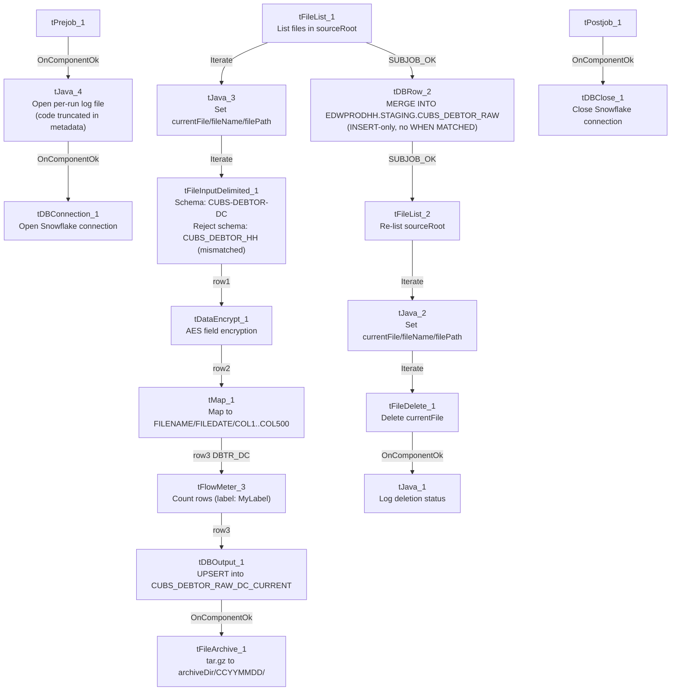

# Talend Job: CUBS_Raw_DC_Debtor_Load_Upsert

## Overview

This job loads the CUBS collections-system debtor extract file(s) for the **DC** site from a local source directory into Snowflake. Each row is a debtor record (name, address, phone, SSN, balances, assignment dates, etc.); sensitive fields are AES-encrypted before the row is flattened into a generic, wide landing schema (`COL1`...`COL500`) and staged into a DC-specific Snowflake table. A subsequent `MERGE` moves the newly staged rows into a shared, cross-site raw debtor table, after which the source file is archived and deleted. It follows the same overall `CUBS_Raw_<site>_Debtor_Load_Upsert` template used for the project's other site codes (CHI, CO, HH, PRE — see `01_system_architecture.md`'s site-code glossary entry).

## Detail table

| Field | Value |
|---|---|
| Job name | CUBS_Raw_DC_Debtor_Load_Upsert |
| Version | 0.4 |
| Project | EDW2SF |
| Author | jmach@harriscollect.com |
| Created | 2024-07-11T11:59:19.311-0700 |
| Last Modified | 2025-09-24T11:06:57.198-0700 |

## Step-by-step data flow

**Setup subjob:** `tPrejob_1` →(`OnComponentOk`)→ `tJava_4` builds a per-run log file path (`context.logDir + context.currentLogon + "_" + jobName + "_" + <timestamp> + ".log"`) and redirects output to it (code is truncated in the extracted metadata beyond this point — see Issues observed) →(`OnComponentOk`)→ `tDBConnection_1` opens the job's Snowflake connection.

**Main subjob — load, encrypt, land, merge:**

1. `tFileList_1` lists files in `context.sourceRoot`.
2. For each file (`Iterate`), `tJava_3` sets `context.currentFile` / `context.fileName` / `context.filePath` from `tFileList_1`'s `globalMap` iteration variables (code truncated mid-statement past this point in the metadata).
3. (`Iterate`) `tFileInputDelimited_1` reads the file using the repository schema `CUBS-DEBTOR-DC` (≈419 named debtor columns), with field/row separators, header flag, and encoding all driven by `context.EXPORT_DEBTOR_*` variables rather than hardcoded. `DIE_ON_ERROR=false`, and its configured reject schema is `CUBS_DEBTOR_HH` — see Issues observed.
4. (`FLOW`, label `row1`) `tDataEncrypt_1` AES-encrypts fields in the row using a key file at `context.cryptoPath` (secret/key/password fields are `***REDACTED***` in the metadata). Output schema narrows to 413 columns.
5. (`FLOW`, label `row2`) `tMap_1` maps the encrypted row into a generic wide schema: `FILENAME`, `FILEDATE`, `COL1`...`COL500`. `DIE_ON_ERROR=true` here, so a mapping failure fails the job outright.
6. (`FLOW`, label `DBTR_DC`) `tFlowMeter_3` counts rows passing through (label left at its default, `"MyLabel"`).
7. (`FLOW`, label `row3`) `tDBOutput_1` (`tSnowflakeOutput`) UPSERTs the rows into the DC-specific staging table `CUBS_DEBTOR_RAW_DC_CURRENT`.
8. (`OnComponentOk`) `tFileArchive_1` tar-gzips the source file to `context.archiveDir + "/" + <CCYYMMDD> + "/" + context.fileName + ".tar.gz"`.

**Then, once the whole `tFileList_1` iteration subjob completes successfully** (`SUBJOB_OK` from `tFileList_1`):

9. `tDBRow_2` (`tSnowflakeRow`) runs a `MERGE INTO EDWPRODHH.STAGING.CUBS_DEBTOR_RAW` from `STAGING.CUBS_DEBTOR_RAW_DC_CURRENT`, matching on `FILEDATE` and `COL3`, with a `WHEN NOT MATCHED THEN INSERT` clause only — see Issues observed.
10. (`SUBJOB_OK`) `tFileList_2` independently re-lists `context.sourceRoot`.
11. For each file (`Iterate`), `tJava_2` sets `context.currentFile` / `context.fileName` / `context.filePath` from `tFileList_2`'s iteration variables.
12. (`Iterate`) `tFileDelete_1` deletes the file identified by `context.currentFile`.
13. (`OnComponentOk`) `tJava_1` logs the deletion status and path from `globalMap` (code truncated in metadata past this point).

**Teardown subjob:** `tPostjob_1` →(`OnComponentOk`)→ `tDBClose_1` closes the Snowflake connection.

## Settings tables

### Source: `tFileInputDelimited_1`

| Setting | Value | What it means |
|---|---|---|
| FILENAME | `context.currentFile` | The current file path from `tFileList_1`'s iteration (set by `tJava_3`). |
| SCHEMA (main) | Repository schema `CUBS-DEBTOR-DC` (id `_GDvAIMyiEey68bfiIIIBcg`) | ~419 named debtor columns (`LOGON`, `DEBTOR`, `NAME1`/`NAME2`, `ADD1`/`ADD2`, `SSN`, balance/date fields, etc.) expected for a well-formed DC debtor row. |
| SCHEMA_REJECT | Repository schema `CUBS_DEBTOR_HH` (id `_P5bI4GQVEeyyeeshWCVUmg`) | **Mislabeled for a different site (HH, not DC)** — see Issues observed. |
| FIELDSEPARATOR / ROWSEPARATOR / HEADER / ENCODING | `context.EXPORT_DEBTOR_FieldSeparator` / `_RowSeparator` / `_Header` / `_Encoding` | Delimiter and header handling are driven entirely by context values rather than hardcoded; actual runtime values aren't present in this job's own metadata. |
| ESCAPE_CHAR / TEXT_ENCLOSURE | `"` / `"` | Standard double-quote text qualifier. |
| DIE_ON_ERROR | `false` | Malformed rows do not fail the job. |
| Reject flow | Not wired | No connection carries rejected rows anywhere in this job — they are silently dropped. See Issues observed. |
| TEMP_DIR | `"C:/Talend-Studio-20211109_1610-V8.0.1/workspace"` | Hardcoded developer-workstation path — project-wide risk documented in `05_operational_runbook.md`. |

### Transform: `tDataEncrypt_1`

| Setting | Value | What it means |
|---|---|---|
| CRYPTO_METHOD | `AES` | Symmetric encryption applied to the row's fields. |
| SECRET_TYPE / SECRET_KEY / PASSWORD_M1 | `***REDACTED***` | Key material — preserved exactly as redacted in the source metadata, not guessable. |
| CRYPTO_FILE_PATH | `context.cryptoPath` | Key/config file location supplied via context, not hardcoded. |
| ALGO_VERSION | `2` | Encryption algorithm version identifier. |
| Which columns are encrypted | Not captured in this component's extracted parameters | Only algorithm-level settings were captured; the per-column encryption selection isn't visible in this metadata. Output schema narrows from ~419 to 413 columns between the file read and this step — unable to fully reconcile the exact column-level change from metadata alone. Verify directly in Talend Studio. |

### Transform: `tMap_1`

| Setting | Value | What it means |
|---|---|---|
| DIE_ON_ERROR | `true` | Any mapping/lookup failure fails the job outright (unlike the upstream file-read step). |
| Output schema | `FILENAME`, `FILEDATE`, `COL1`...`COL500` (500 generic columns) | Flattens the ~413 named, encrypted debtor columns positionally into a generic wide landing schema — a raw-dump pattern rather than a business-named target schema. |
| ROWS_BUFFER_SIZE | `2000000` | In-memory row buffer size used by the map's lookup/join processing. |

### Monitor: `tFlowMeter_3`

| Setting | Value | What it means |
|---|---|---|
| METTERLABEL | `"MyLabel"` | Left at its Talend default, not renamed for this job — cosmetic only. |

### Target: `tDBOutput_1` (`tSnowflakeOutput`)

| Setting | Value | What it means |
|---|---|---|
| Table | `CUBS_DEBTOR_RAW_DC_CURRENT` | DC-site-specific staging table that receives this run's parsed file rows. |
| Output action | `UPSERT` | Talend-level upsert into the staging table itself — distinct from the cross-site `MERGE` that follows. |
| Table action | `NONE` | Table is not recreated/altered by this job. |

### Merge step: `tDBRow_2` (`tSnowflakeRow`)

| Setting | Value | What it means |
|---|---|---|
| Query | `MERGE INTO EDWPRODHH.STAGING.CUBS_DEBTOR_RAW AS tgt USING STAGING.CUBS_DEBTOR_RAW_DC_CURRENT AS src ON tgt.FILEDATE = src.FILEDATE AND tgt.COL3 = src.COL3 WHEN NOT MATCHED THEN INSERT (FILENAME, FILEDATE, COL1...COL500) VALUES (src.FILENAME, src.FILEDATE, src.COL1...src.COL500);` | Merges this run's staged DC rows into the shared, cross-site `CUBS_DEBTOR_RAW` table. **No `WHEN MATCHED` clause is present** — see Issues observed. |
| Match keys | `FILEDATE`, `COL3` | `COL3` is a positionally-mapped generic column from `tMap_1`'s `COL1`...`COL500` scheme; its real business meaning isn't stated anywhere in this job's own metadata. |
| Result schema | `errorCode`, `errorMessage` only | No `RETVALUE`/row-count capture is wired after this step, unlike the `RETVALUE` → `context.mergeResult` pattern seen in `ADP_Payroll_Load`. |

### Archive & cleanup: `tFileArchive_1` / `tFileDelete_1`

| Setting | Value | What it means |
|---|---|---|
| TARGET (tFileArchive_1) | `context.archiveDir+"/"+TalendDate.getDate("CCYYMMDD")+"/"+context.fileName+".tar.gz"` | Archives the source file into a date-stamped subfolder. |
| SOURCE_FILE (tFileArchive_1) | `"C:/Talend-Studio-20211109_1610-V8.0.1/workspace/source.csv"` | Hardcoded default value that coexists with the real `SOURCE=context.filePath` parameter — likely an inert leftover template value. See Issues observed. |
| PASSWORD (tFileArchive_1) | `***REDACTED***` | Present but `ENCRYPT_FILES=false`, so it is not actually applied to the archive. |
| DIRECTORY / PATH (tFileDelete_1) | `"C:/Talend-Studio-20211109_1610-V8.0.1/workspace/delete_folder"` / `".../delete_folder or delete_file"` | Hardcoded, placeholder-looking default text; `FILENAME=context.currentFile` is the value that actually drives which file is deleted. See Issues observed. |

## Dependencies & configuration

- **No `tRunJob` components in this job** (`runjob_targets` is empty), and this job does not appear as a target anywhere in `06_dependency_matrix.md` either — it does not appear to be triggered by, or trigger, any other Talend job in this project's captured metadata. Its scheduling/trigger mechanism is external to Talend orchestration — verify with the team.
- **Context variables used:** `EXPORT_DEBTOR_Encoding`, `EXPORT_DEBTOR_FieldSeparator`, `EXPORT_DEBTOR_Header`, `EXPORT_DEBTOR_RowSeparator`, `archiveDir`, `cryptoPath`, `currentFile`, `currentLogon`, `fileName`, `filePath`, `logDir`, `sourceRoot`.
- **4 hardcoded developer-workstation paths** — `tFileInputDelimited_1.TEMP_DIR`, `tFileArchive_1.SOURCE_FILE`, `tFileDelete_1.DIRECTORY`, `tFileDelete_1.PATH` (all `C:/Talend-Studio-20211109_1610-V8.0.1/workspace/...`) — same project-wide portability risk documented in `05_operational_runbook.md`.
- The target database `EDWPRODHH` is used across many site-specific jobs (CHI, CO, DC, HH, PRE, TOL), so it is the shared production Snowflake database, not something specific to the "HH" site code — no naming conflict there despite the coincidental initials.

## Glossary

| Component type | Plain-English meaning |
|---|---|
| `tPrejob` / `tPostjob` | Bracket the job's real setup and teardown logic; run once before/after everything else. |
| `tJava` | Runs a block of custom Java code once. |
| `tFileList` | Lists files in a directory for the job to iterate over one at a time. |
| `tFileInputDelimited` | Reads a delimited (CSV-style) text file according to a schema. |
| `tDataEncrypt` | Encrypts one or more fields in the row using a configured algorithm and key. |
| `tMap` | Maps/transforms columns from one schema to another. |
| `tFlowMeter` | Counts rows passing through a point in the flow, for logging/monitoring. |
| `tSnowflakeOutput` / `tSnowflakeRow` / `tSnowflakeConnection` / `tSnowflakeClose` | Write rows to a Snowflake table / run an arbitrary SQL statement (including `MERGE`) against Snowflake / open and close the Snowflake connection used throughout the job. |
| `tFileArchive` / `tFileDelete` | Archive a processed file to a target location, then delete a file from the source directory. |

## Issues observed

- **The reject schema on `tFileInputDelimited_1` is labeled `CUBS_DEBTOR_HH`, not `CUBS_DEBTOR_DC`.** This is the DC variant of the job template, but its reject schema appears to reference the HH site's schema instead — the same kind of copy-paste-and-not-repointed pattern documented for `ADP_Payroll_Load`'s roster/payroll mismatch. Compounding this, **no reject flow is actually wired** from `tFileInputDelimited_1` (`DIE_ON_ERROR=false`, but no connection carries rejected rows anywhere), so malformed rows are silently dropped with no record of how many or which ones failed to parse.
- **The final `MERGE INTO EDWPRODHH.STAGING.CUBS_DEBTOR_RAW` has only a `WHEN NOT MATCHED THEN INSERT` clause — no `WHEN MATCHED THEN UPDATE`.** Despite the job's name ending in `_Upsert`, this specific SQL statement is insert-only for any `(FILEDATE, COL3)` combination that already exists in the target table; the "upsert" behavior only happens one step earlier, at the Talend-level `UPSERT` action into the DC staging table (`tDBOutput_1`). If a row for an existing `(FILEDATE, COL3)` needs to be corrected after its first load, this merge step as written would not update it — verify with the team whether that is intentional.
- **Two-phase list-then-delete introduces a possible race window.** `tFileList_1` captures the file listing used for load + archive; independently, `tFileList_2` re-lists the same `context.sourceRoot` directory afterward, and every file it finds is deleted via `tFileDelete_1`. Any file that lands in `sourceRoot` between the two listing passes would be picked up by `tFileList_2` and deleted without ever having been loaded into Snowflake.
- **The merge's join key `COL3` is not traceable to a business column name from this job's own metadata.** Because `tMap_1` flattens all named debtor columns into generic `COL1`...`COL500` positions, confirming what `COL3` actually represents (e.g., a debtor ID) requires checking `tMap_1`'s actual column mapping order directly in Talend Studio — unable to determine from metadata alone.
- **`tJava_1`, `tJava_3`, and `tJava_4`'s `CODE` values are all truncated at exactly 253 characters in the extracted metadata**, cutting off mid-statement in each case. The full logic of the per-file processing message, the file-deletion status logging, and the log-file setup code beyond what's shown here is not available — unable to determine from metadata; verify directly in Talend Studio if the exact logic matters.
- **`tFileArchive_1.SOURCE_FILE` and `tFileDelete_1.DIRECTORY`/`PATH` hold hardcoded, template-looking default values** (`.../workspace/source.csv`, `.../workspace/delete_folder`) that coexist with the real, context-driven parameters that appear to actually govern behavior (`SOURCE=context.filePath`, `FILENAME=context.currentFile`). These are very likely inert leftover defaults rather than active settings, but that can't be fully confirmed from metadata alone — flagged here per the project-wide hardcoded-path pattern in `05_operational_runbook.md`.
