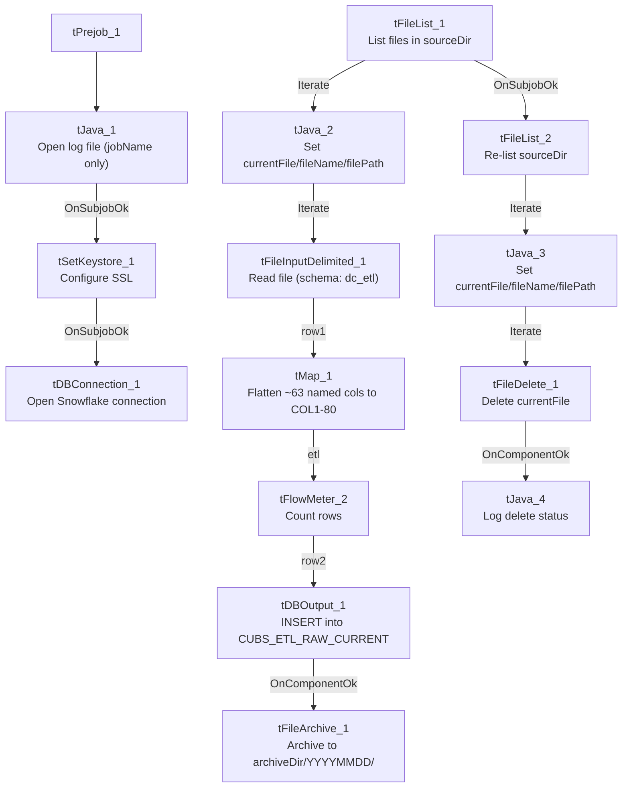

# Talend Job: CUBS_Raw_DC_ETL_Load

## Overview

Loads the DC site's daily CUBS "ETL" extract — a wide, generic collections/scoring feed (dollar-score fields, bankruptcy-disposition flags, balance/credit-line fields, propensity/decile scoring, dialer-group assignment, etc., ~63 named columns) — from every file sitting in `context.sourceDir` into the shared Snowflake staging table `CUBS_ETL_RAW_CURRENT`, then archives and deletes each processed file. Unlike the single-file, `context.EXPORT_*_File`-driven loaders in this project (e.g. `CUBS_Raw_EM_Load`), this job scans the whole source directory with `tFileList` and processes every file it finds, one at a time. It is one of six near-identical site-specific ETL loaders (CHI/CO/DC/HH/PRE/TOL) dispatched by the orchestrator `CUBS_Raw_ETL_Load`, which is also in this batch.

## Detail table

| Field | Value |
|---|---|
| Job name | CUBS_Raw_DC_ETL_Load |
| Version | 0.1 |
| Project | EDW2SF |
| Author | jmach@harriscollect.com |
| Created | 2022-12-15T16:47:44.050-0800 |
| Last Modified | 2025-11-11T22:53:05.839-0800 |

## Step-by-step data flow

**Setup subjob:** `tPrejob_1` → `tJava_1` (`OnComponentOk`) opens a per-run log file at `context.logDir + jobName + "_" + <timestamp> + ".log"` (no `currentLogon` in the filename, unlike the single-file loaders — consistent with this job processing a whole directory rather than one site's named export) → on success, `tSetKeystore_1` configures SSL trust/keystore from `context.keystorePath` (passwords redacted) → `tDBConnection_1` opens the Snowflake connection.

**Load loop** — starts independently of the setup subjob:

1. `tFileList_1` lists every file in `context.sourceDir` (non-recursive, excludes `*.txt`, ordered by modified date ascending).
2. `tJava_2` (`ITERATE`) captures the current file's path/name/directory into `context.currentFile`/`context.fileName`/`context.filePath`.
3. `tFileInputDelimited_1` (`ITERATE`) reads the current file against the repository schema `"dc_etl"` — tab-separated, header row 1, `ISO-8859-15` encoding, `DIE_ON_ERROR=false`. The schema lists ~63 named business columns (`LOGON`, `DEBTOR`, dollar-score fields, `BK7_DISP`/`BK11_DISP`/`BK13_DISP`, balance/credit fields, `Attune_Score`/`Propen_Score`/`Decile`/`Percentile`, `Dialer_group`, etc.) — the extracted metadata lists them twice, likely an artifact of how main+reject schema fields were captured together, not an actual doubled column set.
4. `tMap_1` (`row1`, FLOW) flattens the named columns onto a generic `FILENAME`, `FILEDATE`, `COL1`...`COL80` shape — 80 generic slots for ~63 source columns, so a number of `COL*` positions are unused for this particular file layout.
5. `tFlowMeter_2` (`etl`, FLOW) counts rows.
6. `tDBOutput_1` (`row2`, FLOW) inserts the rows into Snowflake `CUBS_ETL_RAW_CURRENT` (`INSERT`, `tableAction=NONE`) — this job itself never truncates or merges that table; the orchestrator (`CUBS_Raw_ETL_Load`) does both around the whole six-site run.
7. On the DB insert's `OnComponentOk`, `tFileArchive_1` archives `context.filePath` to `context.archiveDir + "/" + <YYYYMMDD> + "/" + context.fileName + ".tar.gz"` (password redacted).

**Delete loop** — a second, separate pass over the same directory, chained after the first `tFileList_1` finishes (`OnSubjobOk`):

8. `tFileList_2` re-lists `context.sourceDir`.
9. `tJava_3` (`ITERATE`) re-captures `context.currentFile`/`fileName`/`filePath`.
10. `tFileDelete_1` (`ITERATE`) deletes `context.currentFile`.
11. `tJava_4` (`OnComponentOk`) logs the delete status/error message.

**Teardown:** no `tPostjob`/`tDBClose` components are present in this job's own metadata (see Issues observed).

## Settings tables

### Source loop: `tFileList_1` / `tFileInputDelimited_1`

| Setting | Value | What it means |
|---|---|---|
| DIRECTORY | `context.sourceDir` | Whole directory scanned, not a single named export file. |
| EXCLUDEFILEMASK | `"*.txt"` | Text files are skipped — the DC extract must arrive under a different extension. |
| ORDER_BY_MODIFIEDDATE (ASC) | `true` | Processes oldest files first. |
| FILENAME (`tFileInputDelimited_1`) | `context.currentFile` | Set per iteration by `tJava_2`. |
| FIELDSEPARATOR / ENCODING | `"\t"` / `ISO-8859-15` | Tab-delimited, Latin-1-variant encoding — no context-group indirection (unlike the `EXPORT_*` family used by other loaders). |
| DIE_ON_ERROR | `false` | Malformed rows don't fail the job; no reject flow is wired, so rejects are silently dropped. |
| TEMP_DIR | `"C:/Talend-Studio-20211109_1610-V8.0.1/workspace"` | Hardcoded developer-workstation path. |

### Target: `tDBOutput_1` (`tSnowflakeOutput`)

| Setting | Value | What it means |
|---|---|---|
| Table | `CUBS_ETL_RAW_CURRENT` | Shared staging table — also written by the other five site ETL loaders (CHI/CO/HH/PRE/TOL, not in this batch). |
| Output action | `INSERT` | Appends; no truncate/merge in this job itself. |
| Table action | `NONE` | Table not recreated/altered here. |

### Archive/Delete: `tFileArchive_1` / `tFileDelete_1`

| Setting | Value | What it means |
|---|---|---|
| TARGET (archive) | `context.archiveDir + "/" + <YYYYMMDD> + "/" + context.fileName + ".tar.gz"` | Dated archive, named after the processed file. |
| PASSWORD | `***REDACTED***` | Preserved as redacted. |
| Delete trigger | Second, independent `tFileList_2` pass over `sourceDir`, chained off the first list's completion | Deletes are not tied 1:1 to a specific file's successful load — see Issues observed. |

### `tSetKeystore_1`

| Setting | Value | What it means |
|---|---|---|
| SSL_KEYSTORE | `context.keystorePath` | Client keystore path from shared context. |
| SSL_TRUSTSERVER_TRUSTSTORE | `"C:/clientTrustStore.trustStore"` | Hardcoded developer-workstation path. |
| Passwords (KEYSTORE/TRUSTSERVER/NEED_CLIENT_AUTH) | `***REDACTED***` | Preserved as redacted. |

## Dependencies & configuration

- **Called by:** `CUBS_Raw_ETL_Load` (also in this batch), once, as part of its 6-way parallel site rollout — see `06_dependency_matrix.md`.
- **Triggers/depends on other jobs:** none — `runjob_targets` is empty.
- **Context variables used:** `archiveDir`, `currentFile`, `fileName`, `filePath`, `keystorePath`, `logDir`, `sourceDir`.
- **5 hardcoded developer-workstation paths:** `tFileInputDelimited_1.TEMP_DIR`, `tFileArchive_1.SOURCE_FILE`, `tFileDelete_1.DIRECTORY`/`PATH`, `tSetKeystore_1.SSL_TRUSTSERVER_TRUSTSTORE` — same project-wide pattern documented in `05_operational_runbook.md`.

## Glossary

| Component type | Plain-English meaning |
|---|---|
| `tFileList` | Lists files in a directory, one at a time, for a downstream loop to process. |
| `tFileInputDelimited` | Reads a delimited text file according to a schema. |
| `tMap` | Maps/transforms columns from one schema to another. |
| `tFlowMeter` | Counts rows passing a point in the flow. |
| `tSnowflakeOutput` / `tSnowflakeConnection` | Write rows to Snowflake / open the shared Snowflake connection. |
| `tFileArchive` / `tFileDelete` | Zip a processed file to an archive location, then delete the original. |
| `tSetKeystore` | Configures the SSL keystore/truststore for the Snowflake connection. |
| `tPrejob` | Runs once before the rest of the job. |
| `tJava` | Runs a block of custom Java code. |

## Issues observed

- **No `tPostjob`/`tDBClose` component in this job's metadata** — every other CUBS_Raw_* file-loader in this batch explicitly closes its Snowflake connection in a `tPostjob` subjob; this one does not appear to, based on the extracted component list. Unable to determine from metadata whether the connection is closed some other way (e.g. implicitly at JVM exit) or simply left open — verify with the team.
- **Delete pass is decoupled from the load pass's per-file success.** The delete loop is a second, independent `tFileList_2` scan of the same directory chained off the *first* `tFileList_1`'s overall completion (`OnSubjobOk`), not off each individual file's successful DB insert. If a file fails to load partway through the iteration (e.g. a later file in the list causes a fatal error), files that loaded successfully earlier in the run could still be deleted correctly, but there's no per-file linkage visible in this metadata tying "deleted" to "confirmed loaded" — a file that failed to parse (with `DIE_ON_ERROR=false`, so the job would continue) would still be deleted here even though it never made it into `CUBS_ETL_RAW_CURRENT`.
- **80-column generic target vs. ~63 named source columns** — `tMap_1` flattens onto `COL1`...`COL80`, leaving roughly 17 slots unused for this file layout. Not necessarily a bug (other site ETL files may use more columns against the same shared table), but it means `CUBS_ETL_RAW_CURRENT`'s generic column positions don't have a fixed, single meaning across all six site loaders without checking each one's own `tMap`.
- **No reject flow wired** despite `DIE_ON_ERROR=false` on the input — malformed rows are silently dropped, consistent with the broader project pattern flagged in `05_operational_runbook.md`.
- **This job never truncates or merges `CUBS_ETL_RAW_CURRENT` itself** — that only happens in the orchestrator `CUBS_Raw_ETL_Load` (`TRUNCATE TABLE STAGING.CUBS_ETL_RAW_CURRENT;` then `CALL STAGING.MERGE_INTO_CUBS_ETL_RAW();`). Running `CUBS_Raw_DC_ETL_Load` standalone, outside the orchestrator, would append rows to whatever is currently in the staging table rather than starting from a clean slate — worth knowing before running this job in isolation for a manual reload.
