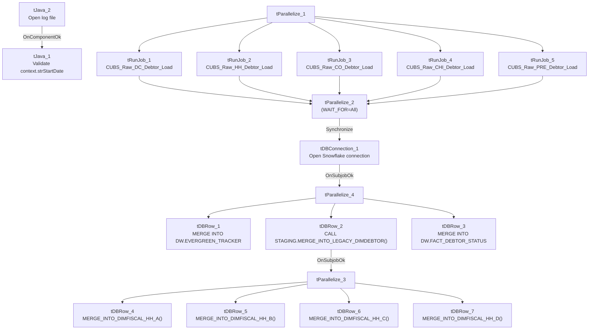

# Talend Job: CUBS_Raw_Debtor_Load

## Overview

An orchestrator job that fans out debtor-data loading across all five non-CO site codes (DC, HH, CO, CHI, PRE — note "CO" is included here too, despite `CO_Master_Load` also calling `CUBS_Raw_CO_Debtor_Load` directly elsewhere), running all five site loaders in parallel, then performing three Snowflake merge/upsert steps once they all finish: tagging "Evergreen" desk-transferred debtors, merging staged debtor data into the main `LEGACY_DIMDEBTOR` dimension, and merging current debtor status into `FACT_DEBTOR_STATUS`. It finishes with four `DIMFISCAL_HH` merge calls, which — despite this job's name being about debtors — appear to be fiscal-calendar maintenance for the HH site bundled into this job's teardown.

## Detail table

| Field | Value |
|---|---|
| Job name | CUBS_Raw_Debtor_Load |
| Version | 0.1 |
| Project | EDW2SF |
| Author | jmach@harriscollect.com |
| Created | 2022-05-05T16:16:04.828-0700 |
| Last Modified | 2022-06-17T09:01:22.754-0700 |

## Step-by-step data flow

**Setup subjob:** `tJava_2` opens a per-run log file → on success, `tJava_1` validates `context.strStartDate` (parses it as `yyyy-MM-dd`; the exact fallback behavior in the catch block is truncated in this job's metadata — see Issues observed).

**Main subjob (independent start):** `tParallelize_1` fans out to 5 `tRunJob` components, each calling a site-specific debtor loader (`DIE_ON_CHILD_ERROR=true`, `USE_INDEPENDENT_PROCESS=true` on all 5):

- `tRunJob_1` → **CUBS_Raw_DC_Debtor_Load**
- `tRunJob_2` → **CUBS_Raw_HH_Debtor_Load**
- `tRunJob_3` → **CUBS_Raw_CO_Debtor_Load**
- `tRunJob_4` → **CUBS_Raw_CHI_Debtor_Load**
- `tRunJob_5` → **CUBS_Raw_PRE_Debtor_Load**

All 5 converge on `tParallelize_2` (`WAIT_FOR=All`), which then (`SYNCHRONIZE`) triggers `tDBConnection_1` to open the Snowflake connection — notably, the connection is opened only *after* all 5 site loads finish, not before (see Issues observed, since the 5 `tRunJob`s presumably open their own connections independently).

`tDBConnection_1`'s subjob-ok fires `tParallelize_4`, which fans out to three merge steps run in parallel:

1. `tDBRow_1` — `MERGE INTO DW.EVERGREEN_TRACKER` from `STAGING.LEGACY_DIMDEBTOR` for debtors whose desk is/was `'EVG'` or client code ends in `'EV'`.
2. `tDBRow_2` — `CALL STAGING.MERGE_INTO_LEGACY_DIMDEBTOR();`, which on success (`SUBJOB_OK`) triggers `tParallelize_3`, fanning out to four parallel `DIMFISCAL_HH` merge calls: `tDBRow_4` (`MERGE_INTO_DIMFISCAL_HH_A`), `tDBRow_5` (`_B`), `tDBRow_6` (`_C`), `tDBRow_7` (`_D`).
3. `tDBRow_3` — `MERGE INTO DW.FACT_DEBTOR_STATUS` from `STAGING.DEBTOR_STATUS_CURRENT`, deriving a `DIMLOGON` numeric code per site (`CHI`→400, `CO`→200, `DC`→600, `HH`→100, `PRE`→300, else 0).

## Settings tables

### Orchestration: `tRunJob_1` through `tRunJob_5`

| Setting | Value | What it means |
|---|---|---|
| DIE_ON_CHILD_ERROR | `true` (all 5) | If any one site's debtor load fails, this job fails too. |
| USE_INDEPENDENT_PROCESS | `true` (all 5) | Each site loader runs in its own JVM, in parallel with the others. |
| TRANSMIT_ORIGINAL_CONTEXT | `true` (all 5) | Each child receives this job's context values. |

### Merge: `tDBRow_1` — Evergreen desk tracker

| Setting | Value | What it means |
|---|---|---|
| Query | `MERGE INTO DW.EVERGREEN_TRACKER TGT USING (SELECT DEBTOR_IDX, CLIENT, DESK AS CURR_DESK, OLD_DSK_NAME AS PREV_DESK, OLD_DSK_DT AS DESK_CHANGE_DT FROM STAGING.LEGACY_DIMDEBTOR WHERE (DESK='EVG' OR OLD_DSK_NAME='EVG' OR RIGHT(TRIM(CLIENT),2)='EV') AND LENGTH(TRIM(DEBTOR_IDX))>10 AND COALESCE(CHARINDEX('-',DEBTOR_IDX),0) > 0) SRC ON TGT.DEBTOR_IDX = SRC.DEBTOR_IDX WHEN NOT MATCHED THEN INSERT ...` | Flags debtors currently or previously assigned to the `'EVG'` (Evergreen) desk, or whose client code ends in `'EV'`, into a dedicated tracking table — insert-only (no update branch), so once tracked a debtor's `EVERGREEN_TRACKER` row is never refreshed by this query. |

### Merge: `tDBRow_2` — Debtor dimension

| Setting | Value | What it means |
|---|---|---|
| Query | `CALL STAGING.MERGE_INTO_LEGACY_DIMDEBTOR();` | Merges staged debtor data (loaded by the 5 site jobs) into the main `LEGACY_DIMDEBTOR` dimension table. |

### Merges: `tDBRow_4`–`tDBRow_7` — HH fiscal calendar

| Setting | Value | What it means |
|---|---|---|
| Queries | `CALL STAGING.MERGE_INTO_DIMFISCAL_HH_A();` / `_B();` / `_C();` / `_D();` | Four separate stored-procedure calls, run in parallel, apparently splitting HH fiscal-dimension maintenance into 4 parts — why fiscal-calendar maintenance for one site lives inside a debtor-load job is not explained in this metadata (see Issues observed). |

### Merge: `tDBRow_3` — Debtor status fact

| Setting | Value | What it means |
|---|---|---|
| Query | `MERGE INTO DW.FACT_DEBTOR_STATUS AS TGT USING (SELECT ... CASE LEFT(DEBTOR_IDX,...) WHEN 'CHI' THEN 400 WHEN 'CO' THEN 200 WHEN 'DC' THEN 600 WHEN 'HH' THEN 100 WHEN 'PRE' THEN 300 ELSE 0 END AS DIMLOGON ... FROM STAGING.DEBTOR_STATUS_CURRENT) AS SRC ON (DEBTOR_IDX, CLIENT, STATUS, STATUS_DATE match) WHEN NOT MATCHED THEN INSERT ...` | Derives a numeric `DIMLOGON` site code from the `DEBTOR_IDX` prefix and inserts new debtor-status rows — insert-only, so an existing status row's other columns are never updated if the same key combination recurs. Note **`TOL` is not one of the mapped site prefixes** here (falls through to `ELSE 0`) — see Issues observed. |

## Dependencies & configuration

- **This job calls 5 other jobs via `tRunJob`:** `CUBS_Raw_DC_Debtor_Load`, `CUBS_Raw_HH_Debtor_Load`, `CUBS_Raw_CO_Debtor_Load`, `CUBS_Raw_CHI_Debtor_Load`, `CUBS_Raw_PRE_Debtor_Load` (each once, in parallel) — see `06_dependency_matrix.md`.
- **Not called by any other job** in the extracted `tRunJob` metadata — despite the strong naming parallel to `CUBS_Raw_ETL_Load` (which is itself called... actually neither `CUBS_Raw_Debtor_Load` nor `CUBS_Raw_ETL_Load` is shown as being called by another job either). How/when this orchestrator itself is triggered is unable to determine from metadata — verify with the team (likely an external scheduler entry, same gap noted for `CO_Master_Load` sub-pipelines in `05_operational_runbook.md`).
- **Context variables used:** `logDir`, `rootDir`, `strStartDate`.
- No hardcoded developer-workstation paths found in this job's own components (though the 5 site loaders it calls may have their own — see each site loader's own doc).

## Glossary

| Component type | Plain-English meaning |
|---|---|
| `tRunJob` | Runs another Talend job as a sub-process, optionally waiting for it to finish before continuing. |
| `tParallelize` | Runs its downstream branches at the same time instead of one after another. |
| `tSnowflakeRow` | Runs an arbitrary SQL statement or stored-procedure call against Snowflake. |
| `tSnowflakeConnection` | Opens a Snowflake database connection shared by other components in the job. |
| `tJava` | Runs a block of custom Java code once (not per row). |

## Issues observed

- **The Snowflake connection (`tDBConnection_1`) is opened only after all 5 site debtor loads finish** (`tParallelize_2` → `Synchronize` → `tDBConnection_1`), not before. Since the merge steps that follow depend on this connection, and the 5 `tRunJob`s each presumably open (and close) their own independent connections, this ordering looks intentional rather than accidental — but it does mean this job's own connection isn't available for use until quite late in its run, unlike most other jobs in this project that open their connection during the setup subjob. Unable to determine from metadata whether this is deliberate design or an artifact of how the job evolved.
- **Four `DIMFISCAL_HH` (fiscal calendar) merge calls are bundled into a job named `CUBS_Raw_Debtor_Load`,** and are gated behind the debtor-dimension merge (`tDBRow_2`) succeeding rather than running independently. This is the same "unrelated jobs chained by sequencing convenience, not data dependency" pattern flagged in `CO_Master_Load`'s Issues section — a transient failure in `MERGE_INTO_LEGACY_DIMDEBTOR()` would also block the HH fiscal-calendar merges from running this cycle, even though they don't appear related to debtor data. Verify with the team whether this coupling is intentional.
- **`FACT_DEBTOR_STATUS`'s `DIMLOGON` site-code mapping (`tDBRow_3`) does not include `TOL`** — of the six site codes named in `01_system_architecture.md` (CHI, CO, DC, HH, PRE, TOL), only 5 are mapped, and `TOL` debtor-status rows would fall through to `DIMLOGON = 0`. Whether TOL debtors ever appear in `STAGING.DEBTOR_STATUS_CURRENT` for this table is unable to determine from metadata — worth confirming with the team, since a `0` code could either be intentional (TOL not yet onboarded to this fact table) or a gap.
- **Two of the three main merges (`EVERGREEN_TRACKER` and `FACT_DEBTOR_STATUS`) are insert-only (`WHEN NOT MATCHED THEN INSERT`, no `WHEN MATCHED` update branch).** If a debtor's desk/status legitimately changes after its first tracked row, that change would not be reflected by these merges — unable to determine from metadata whether that's the intended "first occurrence only" design or a gap; verify with the team.
- **`tJava_1`'s validation logic for `context.strStartDate` is truncated in this metadata** (the catch-block behavior when the date is null, empty, or unparseable is not fully visible) — unable to determine what value `strStartDate` falls back to on a bad/missing input; verify directly in Talend Studio before assuming a default.
