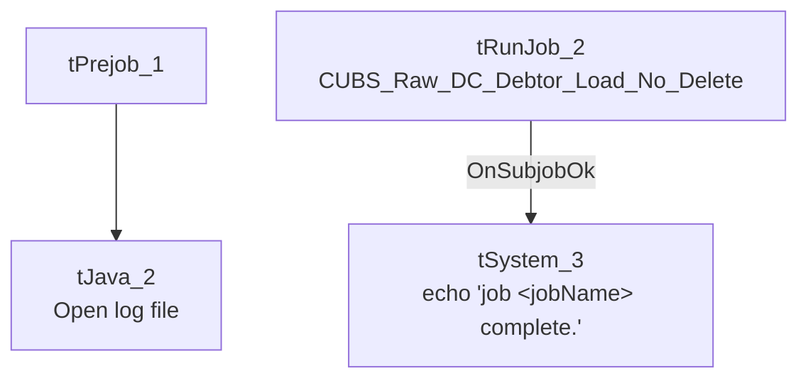

# Talend Job: CUBS_Raw_Debtor_Load_Test

## Overview

A minimal test/wrapper job that does not load any business data itself — it exists solely to call **`CUBS_Raw_DC_Debtor_Load_No_Delete`** (a `_No_Delete` variant of the DC-site debtor loader, not part of this batch) via `tRunJob` and print a completion message. Based on its name and the single job it triggers, this appears to be a developer test harness for exercising the DC debtor load without the file-deletion side effect of the production job, rather than a job that runs as part of the regular pipeline.

## Detail table

| Field | Value |
|---|---|
| Job name | CUBS_Raw_Debtor_Load_Test |
| Version | 0.4 |
| Project | EDW2SF |
| Author | jmach@harriscollect.com |
| Created | 2022-12-05T17:12:25.316-0800 |
| Last Modified | 2025-08-28T08:57:13.850-0700 |

## Step-by-step data flow

**Setup subjob:** `tPrejob_1` → `tJava_2` opens a per-run log file at `context.logDir + jobName + "_" + <timestamp> + ".log"` and redirects `System.out`/`System.err` to it.

**Main subjob:** `tRunJob_2` calls **`CUBS_Raw_DC_Debtor_Load_No_Delete`** (`DIE_ON_CHILD_ERROR=true`, `USE_INDEPENDENT_PROCESS=true`, `TRANSMIT_ORIGINAL_CONTEXT=true`). On success, `tSystem_3` runs a shell `echo` command printing `"job <jobName> complete."` to the console — a no-op confirmation step with no real system effect.

## Settings tables

### Orchestration: `tRunJob_2`

| Setting | Value | What it means |
|---|---|---|
| PROCESS | `CUBS_Raw_DC_Debtor_Load_No_Delete` | The only job this wrapper calls — a DC-site debtor loader variant that (per its name) skips a delete step present in the standard `CUBS_Raw_DC_Debtor_Load`. |
| DIE_ON_CHILD_ERROR | `true` | If the child job fails, this job fails too. |
| USE_INDEPENDENT_PROCESS | `true` | Child runs in its own JVM. |
| TRANSMIT_ORIGINAL_CONTEXT | `true` | Child receives this job's context values. |

### Confirmation: `tSystem_3`

| Setting | Value | What it means |
|---|---|---|
| DIRECTORY | `"C:/Talend-Studio-20211109_1610-V8.0.1/workspace"` | Hardcoded developer workspace path — see Issues observed and `05_operational_runbook.md`. |
| COMMAND | `"echo 'job " + jobName + " complete.'"` | Purely cosmetic console output; does not affect any file or database. |

## Dependencies & configuration

- **Triggers/depends on other jobs:** calls `CUBS_Raw_DC_Debtor_Load_No_Delete` (once). This job itself is not called by any other job in the extracted `tRunJob` metadata (see `06_dependency_matrix.md`) — consistent with it being a standalone test harness.
- **Context variables used:** `logDir` only.
- **1 hardcoded developer-workstation path** (`tSystem_3.DIRECTORY`, `C:/Talend-Studio-20211109_1610-V8.0.1/workspace`) — same project-wide risk documented in `05_operational_runbook.md`.

## Glossary

| Component type | Plain-English meaning |
|---|---|
| `tRunJob` | Runs another Talend job as a sub-process, optionally waiting for it to finish before continuing. |
| `tSystem` | Runs an arbitrary OS shell command — here used only to print a completion message to the console. |

## Issues observed

- **This job's name suggests it belongs to the `CUBS_Raw_Debtor_Load` family, but it does not call any of the same jobs `CUBS_Raw_Debtor_Load` calls** (that job triggers 5 site debtor loaders: DC, HH, CO, CHI, PRE). Instead it calls a single, differently-named variant (`CUBS_Raw_DC_Debtor_Load_No_Delete`) that isn't called by `CUBS_Raw_Debtor_Load` or any other job in this metadata. This looks like a one-off test/debug job kept in the repository alongside the production orchestrator rather than a part of the regular pipeline — worth confirming with the team whether it is still needed or safe to remove.
- **No actual data movement, error handling, or logging beyond a log file and a cosmetic echo** — if `CUBS_Raw_DC_Debtor_Load_No_Delete` fails, this job's own error message will not add any diagnostic detail beyond what that child job already reports.
- No other job-specific risks beyond the project-wide patterns already documented in `05_operational_runbook.md`.
