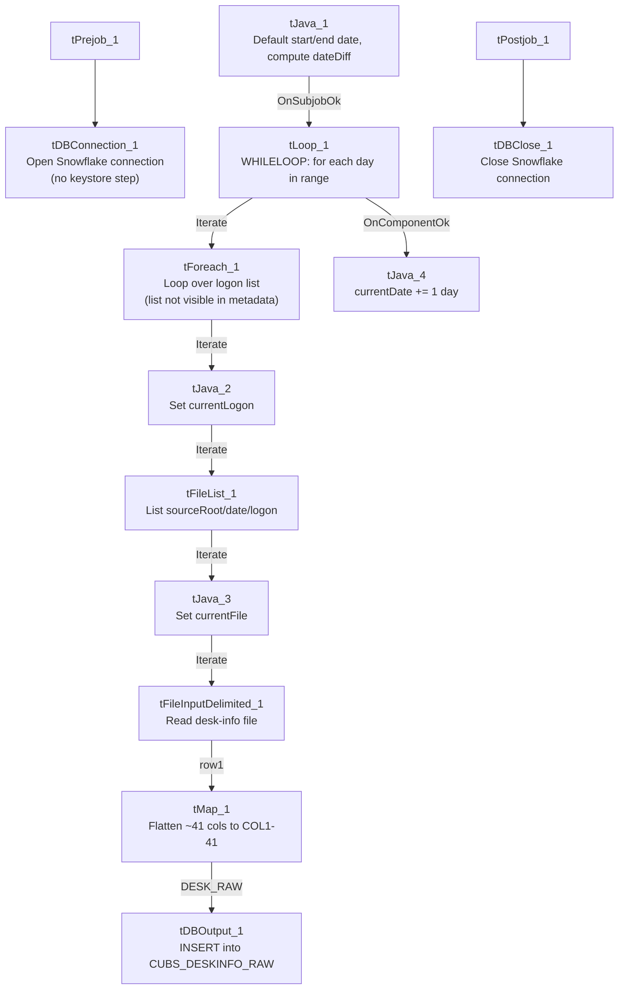

# Talend Job: CUBS_Raw_DeskInfo_Load

## Overview

Backfills CUBS "desk" (collector workstation/team) configuration and month-to-date/year-to-date performance data — desk names, WIP limits, assignment/collection routing rules, and MTD/YTD assignment-and-collection counts and dollar amounts — into the Snowflake table `CUBS_DESKINFO_RAW`. Unlike the single-file-per-run loaders elsewhere in this project, this job walks a date range (`context.startDate` through `context.endDate`, defaulting to "today" for both if unset) and, for each day, loops over a list of logons, reading one file per day-per-logon from `context.sourceRoot/<yyyy-MM-dd>/<logon>/`. It is called once by `CO_Master_Load` (see `06_dependency_matrix.md`).

## Detail table

| Field | Value |
|---|---|
| Job name | CUBS_Raw_DeskInfo_Load |
| Version | 0.1 |
| Project | EDW2SF |
| Author | jmach@harriscollect.com |
| Created | 2022-04-08T10:14:27.817-0700 |
| Last Modified | 2022-04-11T13:39:02.160-0700 |

## Step-by-step data flow

**Setup subjob:** `tPrejob_1` → `tDBConnection_1` (`OnComponentOk`) opens the Snowflake connection directly — **no `tSetKeystore_1` component in this job** (see Issues observed).

**Date-range subjob** — starts independently (no incoming connection into `tJava_1`):

1. `tJava_1` defaults `context.startDate`/`context.endDate` to today if either is null, sets `context.currentDate = context.startDate`, and computes `context.dateDiff = TalendDate.diffDate(endDate, startDate, "dd")`.
2. On success, `tLoop_1` (a `WHILELOOP`, `i` from 0 while `i<=context.dateDiff`) iterates once per day in the range.
3. Each iteration, `tForeach_1` (`ITERATE`) loops over a fixed list of values (the logon list itself is not captured in this metadata — same limitation noted in `Semaphore_Check`).
4. `tJava_2` sets `context.currentLogon` from the current `tForeach_1` value.
5. `tFileList_1` lists files (non-recursive) in `context.sourceRoot + <currentDate as yyyy-MM-dd> + "/" + context.currentLogon`.
6. `tJava_3` (`ITERATE`) sets `context.currentFile` to the listed file's path.
7. `tFileInputDelimited_1` (`ITERATE`) reads that file against repository schema `"metadata"` — tab-separated, header row 1, `ISO-8859-15`, `TRIMALL=true`, `DIE_ON_ERROR=false`. ~41 named desk-configuration/performance columns (`LOGON`, `DESK`, `NAME`, `MAX_WIP_PRINT`, `MIN_WIP`, `BEGIN_TIME`/`END_TIME`, `MTD_NUM_ASGN`/`YTD_NUM_ASGN`, `MTD_AMT_PMTS`/`YTD_AMT_PMTS`, etc.), listed twice in the extracted metadata (main+reject capture artifact).
8. `tMap_1` (`row1`, FLOW) flattens onto a generic `FILENAME`, `FILEDATE`, `COL1`...`COL41` shape.
9. `tDBOutput_1` (`DESK_RAW`, FLOW) inserts the rows into Snowflake `CUBS_DESKINFO_RAW` (`INSERT`, `tableAction=NONE`).
10. When `tLoop_1`'s loop body finishes for the day, `tJava_4` (`OnComponentOk`) advances `context.currentDate` by one day, and the loop re-evaluates its while-condition.

**Teardown:** `tPostjob_1` → `tDBClose_1` (`OnComponentOk`) closes the Snowflake connection.

**Not present in this job:** no per-run log-file setup (`tJava` writing to `context.logDir`), no `tSetKeystore_1`, and no `tFileArchive`/`tFileDelete` step — source files are never archived or deleted after load. See Issues observed.

## Settings tables

### Date range: `tJava_1` / `tLoop_1`

| Setting | Value | What it means |
|---|---|---|
| Default start/end | `TalendDate.getCurrentDate()` if unset | If not overridden by the caller's context, this job processes only "today". |
| `tLoop_1` condition | `i<=context.dateDiff` | Runs once per calendar day from `startDate` to `endDate` inclusive. |

### Source: `tFileList_1` / `tFileInputDelimited_1`

| Setting | Value | What it means |
|---|---|---|
| DIRECTORY | `context.sourceRoot + <yyyy-MM-dd> + "/" + context.currentLogon` | Per-day, per-logon subdirectory structure — a backfill-friendly layout distinct from the flat `sourceDir` used by the single-file loaders. |
| Main schema | Repository `"metadata"` (generic label, ~41 desk columns) | Not a desk-specific schema name in the repository. |
| TRIMALL | `true` | All fields trimmed of whitespace. |
| DIE_ON_ERROR | `false` | Malformed rows don't fail the job; no reject flow is wired. |
| TEMP_DIR | `"C:/Talend-Studio-20211109_1610-V8.0.1/workspace"` | Hardcoded developer-workstation path. |

### Target: `tDBOutput_1` (`tSnowflakeOutput`)

| Setting | Value | What it means |
|---|---|---|
| Table | `CUBS_DESKINFO_RAW` | Note: no `_CURRENT` suffix, unlike most sibling staging tables in this project (`CUBS_EM_RAW_CURRENT`, `CUBS_EMPINFO_RAW_CURRENT`, `CUBS_ETL_RAW_CURRENT`, `CUBS_CLIENT_RAW_CURRENT`). |
| Output action | `INSERT` | Appends; no truncate precedes it in this job. |
| Table action | `NONE` | Table not recreated/altered here. |

## Dependencies & configuration

- **Called by:** `CO_Master_Load`, once — see `06_dependency_matrix.md`.
- **Triggers/depends on other jobs:** none — `runjob_targets` is empty.
- **Context variables used:** `currentDate`, `currentFile`, `currentLogon`, `dateDiff`, `endDate`, `sourceRoot`, `startDate`. Note `sourceRoot` is distinct from the `sourceDir` variable used by most other `StandardFolders_0.1`-driven jobs in this project — this job appears to use its own root-directory variable for the date/logon folder structure.
- **1 hardcoded developer-workstation path:** `tFileInputDelimited_1.TEMP_DIR`.

## Glossary

| Component type | Plain-English meaning |
|---|---|
| `tLoop` | Repeats its downstream branch a fixed or conditional number of times — here, a while-loop over a date range. |
| `tForeach` | Loops over a fixed list of values, running the same downstream steps once per value. |
| `tFileList` | Lists files in a directory, one at a time, for a downstream loop to process. |
| `tFileInputDelimited` | Reads a delimited text file according to a schema. |
| `tMap` | Maps/transforms columns from one schema to another. |
| `tSnowflakeOutput` / `tSnowflakeConnection` / `tSnowflakeClose` | Write rows to Snowflake / open and close the Snowflake connection. |
| `tPrejob` / `tPostjob` | Guaranteed-first / guaranteed-last setup and teardown subjobs. |
| `tJava` | Runs a block of custom Java code. |

## Issues observed

- **No per-run log file is opened anywhere in this job.** Every other `CUBS_Raw_*` file-loader in this batch (and most of the project) opens a `context.logDir`-based log file via a dedicated `tJava` component early in the run; this job has no such component. Diagnosing a failed run would rely entirely on the Talend Studio/scheduler's own execution log rather than this job's own per-run file.
- **No `tSetKeystore_1` component**, unlike `CUBS_Raw_EM_Load`, `CUBS_Raw_Empinfo_Load`, `CUBS_Raw_HH_Client_Load`, and `CUBS_Raw_DC_ETL_Load` in this same batch, all of which configure SSL trust/keystore before opening the Snowflake connection. `tPrejob_1` connects to `tDBConnection_1` directly. Unable to determine from metadata whether this job's Snowflake connection profile requires mutual-TLS the way the others do; verify with the team (same open question already flagged for `CUBS_Raw_Client_Load`).
- **No archive/delete step for processed source files** — unlike every single-file loader in this batch, this job never wires a `tFileArchive`/`tFileDelete` after the load. Combined with the date-range/backfill design, source files under `sourceRoot/<date>/<logon>/` accumulate indefinitely unless cleaned up by some process outside this job.
- **The `tForeach_1` logon list is not captured in this metadata** (same limitation as `Semaphore_Check`) — unable to determine which or how many logons are processed per day; verify directly in Talend Studio.
- **Target table `CUBS_DESKINFO_RAW` has no `_CURRENT` suffix and no visible truncate/merge step**, unlike the `_RAW_CURRENT` naming and orchestrator-level truncate/merge pattern seen in the ETL family (`CUBS_Raw_DC_ETL_Load` → `CUBS_Raw_ETL_Load`). Because this job also defaults to processing only "today" if no explicit date range is supplied, and always appends (`INSERT`, no truncate), re-running it for the same day/logon combination would very likely duplicate rows in `CUBS_DESKINFO_RAW` — worth confirming with the team whether a downstream process deduplicates, or whether reruns need to be handled carefully.
