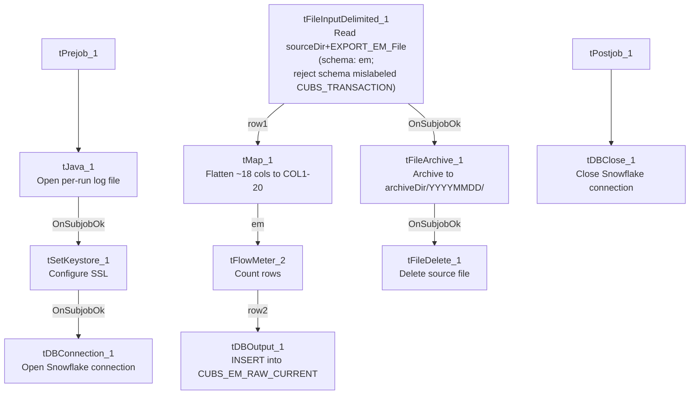

# Talend Job: CUBS_Raw_EM_Load

## Overview

Loads a single CUBS "electronic media" export — letter/notice status records per debtor account (letter name, status/status-type/status-text, series and waterfall tracking, source of the status update) — for one site logon into the Snowflake staging table `CUBS_EM_RAW_CURRENT`, then archives and deletes the source file. It follows the same single-file, `context.EXPORT_EM_*`-context-group-driven template used by `CUBS_Raw_Empinfo_Load` in this same batch. It is called once by `CO_Master_Load` (see `06_dependency_matrix.md`).

## Detail table

| Field | Value |
|---|---|
| Job name | CUBS_Raw_EM_Load |
| Version | 0.1 |
| Project | EDW2SF |
| Author | jmach@harriscollect.com |
| Created | 2022-10-06T10:20:12.441-0700 |
| Last Modified | 2025-11-04T11:08:13.798-0800 |

## Step-by-step data flow

**Setup subjob:** `tPrejob_1` → `tJava_1` (`OnComponentOk`) opens a per-run log file at `context.logDir + context.currentLogon + "_" + jobName + "_" + <timestamp> + ".log"` → on success, `tSetKeystore_1` configures SSL trust/keystore from `context.keystorePath` (passwords redacted) → `tDBConnection_1` opens the Snowflake connection.

**Main subjob** — starts independently of the setup subjob:

1. `tFileInputDelimited_1` reads `context.sourceDir + context.EXPORT_EM_File`, with row/field separator, header flag, and encoding all driven by the `EXPORT_EM_0.1` context group (defaults: `\n` row separator, `\t` field separator, header row 1, `US-ASCII` encoding, default filename `Q:/HH-EDW-EXPORT-EM.txt` per `_shared_context.json`). Uses repository schema `"em"` (~18 named columns: `LOGON`, `EMID`, `LETTER_NAME`, `STATUS_DATE`, `STATUS`, `STATUS_TEXT`, `STATUS_TYPE`, `WATERFALL`, `UPDATE_DT`, `CURR_SERIES`/`NEW_SERIES`, `SOURCE`, `SRC_NAME`, etc.). `CSVROWSEPARATOR` is set to `context.EXPORT_TRANS_RowSeparator` rather than an `EXPORT_EM_*` variable (only relevant if `CSV_OPTION` is turned on — currently `false` — same copy-paste pattern flagged in the CHI/HH Client Load siblings). `DIE_ON_ERROR=false`; reject schema mislabeled `"CUBS_TRANSACTION"`.
2. `tMap_1` (`row1`, FLOW) flattens the ~18 named columns onto a generic `FILENAME`, `FILEDATE`, `COL1`...`COL20` shape.
3. `tFlowMeter_2` (`em`, FLOW) counts rows.
4. `tDBOutput_1` (`row2`, FLOW) inserts the rows into Snowflake `CUBS_EM_RAW_CURRENT` (`INSERT`, `tableAction=NONE`).
5. On the input file's `OnSubjobOk`, `tFileArchive_1` archives `context.sourceDir` to `context.archiveDir + "/" + <YYYYMMDD> + "/" + context.EXPORT_EM_File + ".tar.gz"` (password redacted).
6. On archive `OnSubjobOk`, `tFileDelete_1` deletes `context.sourceDir + context.EXPORT_EM_File`.

**Teardown subjob:** `tPostjob_1` → `tDBClose_1` (`OnComponentOk`) closes the Snowflake connection.

## Settings tables

### Source: `tFileInputDelimited_1`

| Setting | Value | What it means |
|---|---|---|
| FILENAME | `context.sourceDir + context.EXPORT_EM_File` | `EXPORT_EM_File` defaults to `Q:/HH-EDW-EXPORT-EM.txt` per `_shared_context.json`. |
| ROWSEPARATOR / FIELDSEPARATOR / HEADER / ENCODING | All from `EXPORT_EM_0.1` context group | Defaults: `\n`, `\t`, header row 1, `US-ASCII`. |
| CSVROWSEPARATOR | `context.EXPORT_TRANS_RowSeparator` | Mismatched context family (only applies if `CSV_OPTION=true`, currently `false`) — same class of copy-paste artifact as in `CUBS_Raw_HH_Client_Load`. |
| SCHEMA (main) | Repository `"em"` | ~18 electronic-media status columns. |
| SCHEMA_REJECT | Repository `"CUBS_TRANSACTION"` | Mislabeled — not an EM-specific reject schema, same pattern seen throughout this project. |
| DIE_ON_ERROR | `false` | Malformed rows don't fail the job; no reject flow is wired. |
| TEMP_DIR | `"C:/Talend-Studio-20211109_1610-V8.0.1/workspace"` | Hardcoded developer-workstation path. |

### Target: `tDBOutput_1` (`tSnowflakeOutput`)

| Setting | Value | What it means |
|---|---|---|
| Table | `CUBS_EM_RAW_CURRENT` | Destination raw landing table. |
| Output action | `INSERT` | Appends rows; no truncate step precedes it in this job. |
| Table action | `NONE` | Table not recreated/altered by this job. |

### `tFileArchive_1` / `tFileDelete_1`

| Setting | Value | What it means |
|---|---|---|
| TARGET (archive) | `context.archiveDir + "/" + <YYYYMMDD> + "/" + context.EXPORT_EM_File + ".tar.gz"` | Per-run, dated archive named after the export file. |
| PASSWORD | `***REDACTED***` | Preserved as redacted. |
| FILENAME (delete) | `context.sourceDir + context.EXPORT_EM_File` | Deletes the exact file that was loaded. |

## Dependencies & configuration

- **Called by:** `CO_Master_Load`, once — see `06_dependency_matrix.md`.
- **Triggers/depends on other jobs:** none — `runjob_targets` is empty.
- **Context variables used:** `EXPORT_EM_Encoding`, `EXPORT_EM_FieldSeparator`, `EXPORT_EM_File`, `EXPORT_EM_Header`, `EXPORT_EM_RowSeparator`, `EXPORT_TRANS_RowSeparator` (mismatched — see Issues observed), `archiveDir`, `currentLogon`, `keystorePath`, `logDir`, `sourceDir`.
- **5 hardcoded developer-workstation paths:** `tFileInputDelimited_1.TEMP_DIR`, `tFileArchive_1.SOURCE_FILE`, `tFileDelete_1.DIRECTORY`/`PATH`, `tSetKeystore_1.SSL_TRUSTSERVER_TRUSTSTORE` — same project-wide pattern documented in `05_operational_runbook.md`.

## Glossary

| Component type | Plain-English meaning |
|---|---|
| `tFileInputDelimited` | Reads a delimited text file according to a schema. |
| `tMap` | Maps/transforms columns from one schema to another. |
| `tFlowMeter` | Counts rows passing a point in the flow. |
| `tSnowflakeOutput` / `tSnowflakeConnection` / `tSnowflakeClose` | Write rows to Snowflake / open and close the Snowflake connection. |
| `tFileArchive` / `tFileDelete` | Zip a processed file to an archive location, then delete the original. |
| `tSetKeystore` | Configures the SSL keystore/truststore used by the Snowflake connection. |
| `tPrejob` / `tPostjob` | Guaranteed-first / guaranteed-last setup and teardown subjobs. |
| `tJava` | Runs a block of custom Java code. |

## Issues observed

- **`CSVROWSEPARATOR` references `context.EXPORT_TRANS_RowSeparator`**, not an `EXPORT_EM_*` variable, while every other separator/header/encoding setting on the same component is correctly scoped to `EXPORT_EM_*`. Same copy-paste-from-a-Trans-template pattern already flagged in `CUBS_Raw_HH_Client_Load`/`CUBS_Raw_CHI_Client_Load`; only matters if `CSV_OPTION` is ever switched on (currently `false`).
- **Reject schema mislabeled `"CUBS_TRANSACTION"`**, not an EM-specific reject schema — same pattern flagged across most `CUBS_Raw_*` file loaders in this project. No reject flow is wired despite `DIE_ON_ERROR=false`, so malformed rows are silently dropped.
- **No `TRUNCATE` step and no merge call anywhere in this job**, despite the target table being named `CUBS_EM_RAW_CURRENT` — same missing-refresh-step concern flagged for the Client-load family. Re-running this job for the same logon/day would append duplicate rows rather than replace them, unless a downstream process (not visible in this job's own metadata) truncates or merges `CUBS_EM_RAW_CURRENT`.
- **Archive and delete are triggered by the file read's own `SUBJOB_OK`, not by the Snowflake insert's success** — a failure downstream in `tMap_1`/`tFlowMeter_2`/`tDBOutput_1` would still result in the source file being archived and deleted, same ordering risk flagged in `CUBS_Raw_CHI_Client_Load`.
