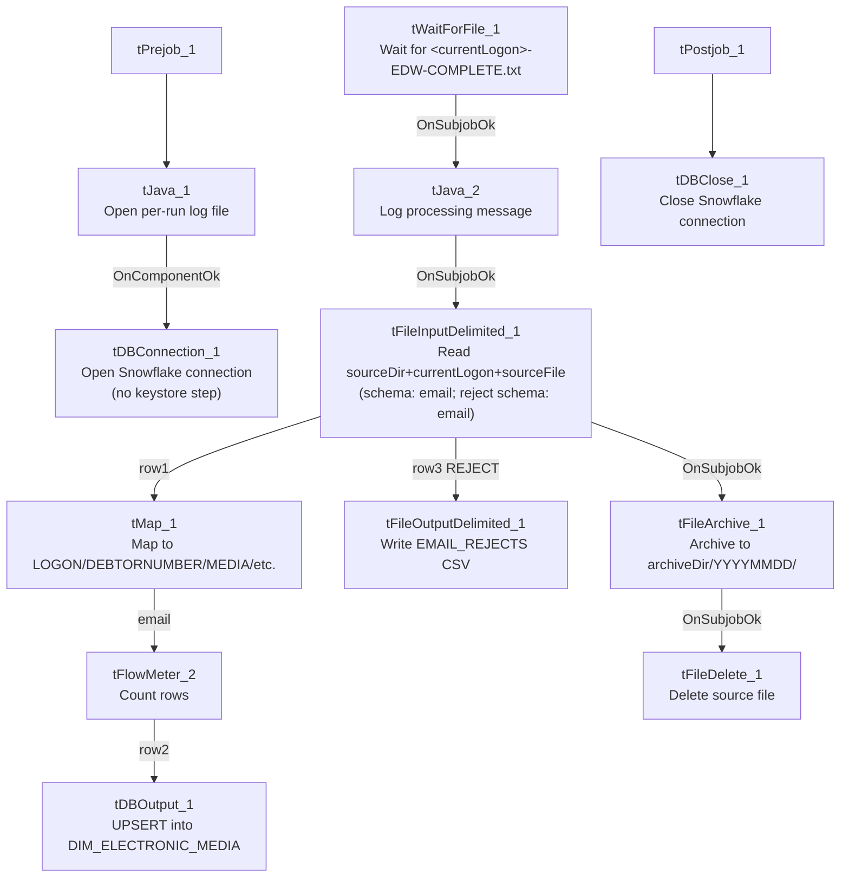

# Talend Job: CUBS_Raw_EMail_Address_Load

## Overview

Loads per-debtor email/electronic-media address records (media type, address, authorization status/date, source, notes, and balance) for one site logon directly into the Snowflake dimension table `DIM_ELECTRONIC_MEDIA` via `UPSERT` — unlike most other `CUBS_Raw_*` loaders in this project, which land rows into a generic `*_RAW_CURRENT` staging table with a plain `INSERT`. It waits for a per-logon completion semaphore file before reading, and it is the only job in this batch with a correctly-wired reject-row output. Per `06_dependency_matrix.md`, a generic dispatcher job named `EMail_Address_Load` calls this job 6 times — almost certainly once per site logon (CHI/CO/DC/HH/PRE/TOL).

## Detail table

| Field | Value |
|---|---|
| Job name | CUBS_Raw_EMail_Address_Load |
| Version | 0.1 |
| Project | EDW2SF |
| Author | jmach@harriscollect.com |
| Created | 2023-02-06T15:10:49.463-0800 |
| Last Modified | 2024-02-22T09:02:20.996-0800 |

## Step-by-step data flow

**Setup subjob:** `tPrejob_1` → `tJava_1` (`OnComponentOk`) opens a per-run log file at `context.logDir + context.currentLogon + "_" + jobName + "_" + <timestamp> + ".log"` → on success, `tDBConnection_1` opens the Snowflake connection directly (no `tSetKeystore_1` in this job — see Issues observed).

**Main subjob** — starts independently of the setup subjob:

1. `tWaitForFile_1` polls `context.sourceDir` every 30 seconds, up to `context.loopCount` iterations, for a file named `context.currentLogon + "-EDW-COMPLETE.txt"` (or proceeds immediately if already present, `INCLUDE_PRESENT=true`) — the same semaphore-gate pattern used by `CO_Master_Load`'s `tWaitForFile_4`, but scoped per logon here rather than per fixed site name.
2. On success, `tJava_2` logs "Processing `<sourceDir><currentLogon><sourceFile>`" then, on `OnSubjobOk`, `tFileInputDelimited_1` reads `context.sourceDir + context.currentLogon + context.sourceFile` — note this uses the generic `context.sourceFile` variable, **not** an `EXPORT_EMAIL_*`-family variable, even though a matching `EXPORT_EMAIL_0.1` context group exists in `_shared_context.json` (see Issues observed). Comma-separated, header row 1, `US-ASCII`, `CHECK_FIELDS_NUM=true`, `DIE_ON_ERROR=false`. Schema `"email"` (18 columns: `Account_Media_Address`, `Media`, `Add_Type`, `Address`, `Source`, `Src_Name`, `Authorization`, `Auth_Dt`, `Status`, `Status_Dt`, `Entry_Dt`, `Inherit_From`, `Nt_Date`/`Nt_Time`/`Nt_Who`, `Note_Text`, `PL_GROUP`, `TOTAL_BAL`, `DNUM`); the **reject schema is also correctly `"email"`**, not the mislabeled `CUBS_TRANSACTION` schema seen elsewhere in this project.
3. On the input's `FLOW`, `tMap_1` maps the named columns to `LOGON`, `DEBTORNUMBER`, `DEBTOR_IDX`, `MEDIA`, `ADDRESS_TYPE`, `MEDIA_ADDRESS`, `ADDR_SOURCE`, `SRC_NAME`, `AUTH_STATUS`, `AUTH_DATE`, `STATUS`, `STATUS_DT`, `ENTRY_DT`, `NT_DATE`/`NT_TIME`/`NT_WHO`, `NOTE_TEXT`, `PL_GROUP`, `TOTAL_BAL` — a real business-name target schema, not a generic `COL1...COLn` flatten.
4. On the input's `REJECT` output, rejected rows are written to `tFileOutputDelimited_1` at `context.logDir + context.currentLogon + "_EMAIL_REJECTS_" + <date> + ".csv"` — **the only reject flow actually wired to a file in this batch of 7 jobs.**
5. `tFlowMeter_2` (`email`, FLOW) counts accepted rows.
6. `tDBOutput_1` (`row2`, FLOW) **upserts** the rows into Snowflake `DIM_ELECTRONIC_MEDIA` (`UPSERT`, `tableAction=NONE`) — writing directly to a dimension table rather than a raw staging table.
7. On the input's `SUBJOB_OK`, `tFileArchive_1` archives `context.sourceDir` to `context.archiveDir + "/" + <YYYYMMDD> + "/" + context.currentLogon + context.sourceFile + ".tar.gz"` (password redacted), then on success `tFileDelete_1` deletes `context.sourceDir + context.currentLogon + context.sourceFile`.

**Teardown subjob:** `tPostjob_1` → `tDBClose_1` (`OnComponentOk`) closes the Snowflake connection.

## Settings tables

### Gate: `tWaitForFile_1`

| Setting | Value | What it means |
|---|---|---|
| DIRECTORY / FILEMASK | `context.sourceDir` / `context.currentLogon + "-EDW-COMPLETE.txt"` | Per-logon completion semaphore, checked before reading the actual data file. |
| WAIT / MAX_ITERATIONS | 30 (seconds) / `context.loopCount` | Total wait time depends on `loopCount`, not fixed in this job's own metadata. |

### Source: `tFileInputDelimited_1`

| Setting | Value | What it means |
|---|---|---|
| FILENAME | `context.sourceDir + context.currentLogon + context.sourceFile` | Uses generic `sourceFile`, not an `EXPORT_EMAIL_*` variable — see Issues observed. |
| FIELDSEPARATOR / HEADER / ENCODING | `","` / `1` / `US-ASCII` | Comma-separated, unlike the tab-separated `EXPORT_*` family used elsewhere. |
| CHECK_FIELDS_NUM | `true` | Rejects rows whose field count doesn't match the schema — stricter than most other loaders in this project (`false` elsewhere). |
| SCHEMA (main) / SCHEMA_REJECT | Both repository `"email"` | Correctly matched main/reject schema — unlike the mislabeled-reject pattern in most sibling jobs. |
| DIE_ON_ERROR | `false` | Malformed rows are rejected (to the wired reject flow) rather than failing the job. |
| TEMP_DIR | `"C:/Talend-Studio-20211109_1610-V8.0.1/workspace"` | Hardcoded developer-workstation path. |

### Reject output: `tFileOutputDelimited_1`

| Setting | Value | What it means |
|---|---|---|
| FILENAME | `context.logDir + context.currentLogon + "_EMAIL_REJECTS_" + <CCYY-MM-DD> + ".csv"` | Dated, per-logon reject file written alongside the log directory. |
| INCLUDEHEADER | `true` | Reject file includes a header row for readability. |

### Target: `tDBOutput_1` (`tSnowflakeOutput`)

| Setting | Value | What it means |
|---|---|---|
| Table | `DIM_ELECTRONIC_MEDIA` | A dimension table, not a `*_RAW_CURRENT` staging table. |
| Output action | `UPSERT` | Inserts new rows and updates existing ones — the only `UPSERT` target in this batch of 7 jobs. |
| Table action | `NONE` | Table not recreated/altered here. |

### `tFileArchive_1` / `tFileDelete_1`

| Setting | Value | What it means |
|---|---|---|
| TARGET (archive) | `context.archiveDir + "/" + <YYYYMMDD> + "/" + context.currentLogon + context.sourceFile + ".tar.gz"` | Per-logon, dated archive. |
| PASSWORD | `***REDACTED***` | Preserved as redacted. |

## Dependencies & configuration

- **Called by:** `EMail_Address_Load`, 6 times — see `06_dependency_matrix.md`. This strongly suggests one call per site logon (CHI/CO/DC/HH/PRE/TOL), each presumably passing a different `context.currentLogon` value, though the calling job's own context-override values are outside this job's metadata.
- **Triggers/depends on other jobs:** none — `runjob_targets` is empty.
- **Context variables used:** `archiveDir`, `currentLogon`, `logDir`, `loopCount`, `sourceDir`, `sourceFile`.
- **4 hardcoded developer-workstation paths:** `tFileInputDelimited_1.TEMP_DIR`, `tFileArchive_1.SOURCE_FILE`, `tFileDelete_1.DIRECTORY`/`PATH` — one fewer than most siblings since there is no `tSetKeystore_1` component (and therefore no hardcoded truststore path) in this job.

## Glossary

| Component type | Plain-English meaning |
|---|---|
| `tWaitForFile` | Polls a directory for a specific file to appear, for up to a configured number of attempts, before letting the job continue. |
| `tFileInputDelimited` | Reads a delimited text file according to a schema. |
| `tMap` | Maps/transforms columns from one schema to another. |
| `tFileOutputDelimited` | Writes rows to a delimited text file — here, rejected input rows. |
| `tFlowMeter` | Counts rows passing a point in the flow. |
| `tSnowflakeOutput` / `tSnowflakeConnection` / `tSnowflakeClose` | Write rows to Snowflake / open and close the Snowflake connection. |
| `tFileArchive` / `tFileDelete` | Zip a processed file to an archive location, then delete the original. |
| `tPrejob` / `tPostjob` | Guaranteed-first / guaranteed-last setup and teardown subjobs. |
| `tJava` | Runs a block of custom Java code. |

## Issues observed

- **This job uses the generic `context.sourceFile` variable rather than an `EXPORT_EMAIL_*` context variable**, even though `_shared_context.json` defines a matching `EXPORT_EMAIL_0.1` group (with `EXPORT_EMAIL_File` defaulting to `Z:/EDW/2021-11-27/HH/HH-EDW-EXPORT-EM.txt`) that this job's `context_vars_referenced` list never touches. Every other `EXPORT_*`-pattern loader in this project (Client, EM, Empinfo) consistently uses its own matching `EXPORT_<TYPE>_*` family. Unable to determine from metadata whether `EXPORT_EMAIL_0.1` is simply unused/orphaned, or whether `context.sourceFile` is meant to be set per-call by the `EMail_Address_Load` dispatcher to the same effective value — verify with the team.
- **No `tSetKeystore_1` component**, unlike `CUBS_Raw_EM_Load`, `CUBS_Raw_Empinfo_Load`, `CUBS_Raw_HH_Client_Load`, and `CUBS_Raw_DC_ETL_Load` in this same batch. Same open question already flagged for `CUBS_Raw_Client_Load` and `CUBS_Raw_DeskInfo_Load` about whether this job's Snowflake profile needs mutual-TLS.
- **This is the only job in this 7-job batch with a correctly-wired reject flow and a matching main/reject schema** — a notable positive contrast to the mislabeled-`CUBS_TRANSACTION`-reject-schema pattern seen in `CUBS_Raw_EM_Load`, `CUBS_Raw_Empinfo_Load`, and the Client-load family. No further action needed here; flagged only for contrast when reviewing the rest of the project.
- **Writing directly to `DIM_ELECTRONIC_MEDIA` via `UPSERT`** (rather than to a `*_RAW_CURRENT` staging table with a separate merge step) means there is no raw/staging copy of this data preserved for reprocessing or audit within this job — if the upsert logic or source file has an error, there's no intermediate staging table to inspect before it lands in the dimension table.
