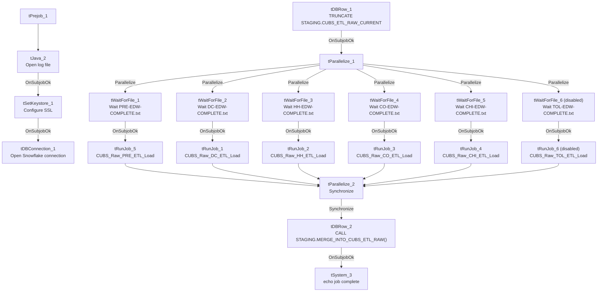

# Talend Job: CUBS_Raw_ETL_Load

## Overview

This is the orchestrator for the site-specific "ETL" extract family: it waits for each site's completion semaphore file, runs that site's `CUBS_Raw_<SITE>_ETL_Load` job (DC, HH, CO, CHI, PRE, and — currently disabled — TOL), and once all of them finish, merges the shared `STAGING.CUBS_ETL_RAW_CURRENT` staging table into its final target via a stored procedure. Unlike `CO_Master_Load` (which chains many *different* job types together), this job fans out to six near-identical site loaders and re-converges before a single merge step — it's the ETL family's counterpart to `CUBS_Raw_Debtor_Load`'s per-site dispatch pattern (see `06_dependency_matrix.md`). `CUBS_Raw_DC_ETL_Load`, one of the six site loaders it calls, is also documented in this batch.

## Detail table

| Field | Value |
|---|---|
| Job name | CUBS_Raw_ETL_Load |
| Version | 0.4 |
| Project | EDW2SF |
| Author | jmach@harriscollect.com |
| Created | 2022-12-12T15:13:07.135-0800 |
| Last Modified | 2026-08-07T14:16:23.103-0700 |

## Step-by-step data flow

**Setup subjob:** `tPrejob_1` → `tJava_2` (`OnComponentOk`) opens a per-run log file at `context.logDir + jobName + "_" + <timestamp> + ".log"` → on success, `tSetKeystore_1` configures SSL trust/keystore (passwords redacted) → `tDBConnection_1` opens the Snowflake connection.

**Main orchestration subjob** — starts independently of the setup subjob:

1. `tDBRow_1` runs `TRUNCATE TABLE STAGING.CUBS_ETL_RAW_CURRENT;` — clears the shared staging table before any site loads begin.
2. On success, `tParallelize_1` fires six branches at once (`WAIT_FOR=All`, `DIE_ON_ERROR=false`), each a `tWaitForFile` gate on a different site's completion marker in a site-specific directory:
   - `tWaitForFile_1` — `context.rootDir` / `"PRE-EDW-COMPLETE.txt"` → on success, `tRunJob_5` (**CUBS_Raw_PRE_ETL_Load**)
   - `tWaitForFile_2` — `context.rootDCDir` / `"DC-EDW-COMPLETE.txt"` → on success, `tRunJob_1` (**CUBS_Raw_DC_ETL_Load**)
   - `tWaitForFile_3` — `context.rootDir` / `"HH-EDW-COMPLETE.txt"` → on success, `tRunJob_2` (**CUBS_Raw_HH_ETL_Load**)
   - `tWaitForFile_4` — `context.rootDir` / `"CO-EDW-COMPLETE.txt"` → on success, `tRunJob_3` (**CUBS_Raw_CO_ETL_Load**)
   - `tWaitForFile_5` — `context.rootDir` / `"CHI-EDW-COMPLETE.txt"` → on success, `tRunJob_4` (**CUBS_Raw_CHI_ETL_Load**)
   - `tWaitForFile_6` (`ACTIVATE=false`, i.e. disabled) — `context.rootDir` / `"TOL-EDW-COMPLETE.txt"` → would trigger `tRunJob_6` (**CUBS_Raw_TOL_ETL_Load**, also `ACTIVATE=false`) if enabled
3. All six `tRunJob` branches (`DIE_ON_CHILD_ERROR=true`, `USE_INDEPENDENT_PROCESS=true` each) converge on `tParallelize_2` (`SUBJOB_OK` from each), which waits for all of them (`WAIT_FOR=All`, `DIE_ON_ERROR=true`) before proceeding.
4. On `SYNCHRONIZE`, `tDBRow_2` runs `CALL STAGING.MERGE_INTO_CUBS_ETL_RAW();` — merges the now-populated staging table into its downstream target.
5. On success, `tSystem_3` runs a shell `echo` confirming the job name completed (output to console).

## Settings tables

### Gates: `tWaitForFile_1`...`tWaitForFile_6`

| Setting | Value | What it means |
|---|---|---|
| WAIT / MAX_ITERATIONS | 30 (seconds) / 720 | Fixed timeout of up to 6 hours per site (720 x 30s), unlike `CO_Master_Load`'s context-driven `loopCount`. |
| DIRECTORY | `context.rootDir` (5 of 6) / `context.rootDCDir` (DC only) | DC uses its own root directory variable, distinct from the other five sites. |
| `tWaitForFile_6` (TOL) | `ACTIVATE=false` | Disabled — TOL's wait-and-load branch does not currently run. |

### Orchestration: `tRunJob_1`...`tRunJob_6`

| Setting | Value | What it means |
|---|---|---|
| DIE_ON_CHILD_ERROR | `true` (all 6) | Any site's ETL load failing fails this orchestrator too. |
| USE_INDEPENDENT_PROCESS | `true` (all 6) | Each site load runs in its own JVM, unlike `CO_Master_Load`'s one exception (`DimFiscal_CO_Load`). |
| `tRunJob_6` (TOL) | `ACTIVATE=false` | Disabled, matching its gating `tWaitForFile_6`. |

### Truncate/Merge: `tDBRow_1` / `tDBRow_2`

| Setting | Value | What it means |
|---|---|---|
| Query 1 | `TRUNCATE TABLE STAGING.CUBS_ETL_RAW_CURRENT;` | Clears the shared staging table before any site load runs — the truncate step that the six individual site loaders (e.g. `CUBS_Raw_DC_ETL_Load`) don't perform themselves. |
| Query 2 | `CALL STAGING.MERGE_INTO_CUBS_ETL_RAW();` | Runs once, after all six sites have loaded, merging the combined staging data into its final target. |

## Dependencies & configuration

- **Calls 6 jobs via `tRunJob`:** `CUBS_Raw_DC_ETL_Load`, `CUBS_Raw_HH_ETL_Load`, `CUBS_Raw_CO_ETL_Load`, `CUBS_Raw_CHI_ETL_Load`, `CUBS_Raw_PRE_ETL_Load`, `CUBS_Raw_TOL_ETL_Load` (disabled) — see `06_dependency_matrix.md` for the full project-wide table.
- **Context variables used:** `keystorePath`, `logDir`, `rootDCDir`, `rootDir`.
- **2 hardcoded developer-workstation paths:** `tSystem_3.DIRECTORY`, `tSetKeystore_1.SSL_TRUSTSERVER_TRUSTSTORE`.

## Glossary

| Component type | Plain-English meaning |
|---|---|
| `tParallelize` | Runs its downstream branches at the same time rather than one after another; can also act as a synchronization/fan-in point (`SYNCHRONIZE`). |
| `tWaitForFile` | Polls a directory for a specific file to appear, for up to a configured number of attempts. |
| `tRunJob` | Runs another Talend job as a sub-process, optionally waiting for it to finish. |
| `tSnowflakeRow` | Runs an arbitrary SQL statement or stored-procedure call against Snowflake. |
| `tSystem` | Runs an arbitrary OS shell command from within the Talend job. |
| `tSetKeystore` | Configures the SSL keystore/truststore for the Snowflake connection. |

## Issues observed

- **The TOL site branch (`tWaitForFile_6` / `tRunJob_6`) is explicitly disabled (`ACTIVATE=false`)** while the other five sites are active. `01_system_architecture.md` lists CHI/CO/DC/HH/PRE/TOL as the project's six recognized site codes, so TOL's ETL load currently never runs as part of this orchestrator — either TOL doesn't produce this particular extract, or its pipeline is intentionally paused/decommissioned. Unable to determine which from metadata; verify with the team so a genuinely-needed TOL ETL load isn't silently skipped.
- **If any of the five active site loads fails, this orchestrator's own error won't say which one** — same diagnostic gap already flagged for `CO_Master_Load`; with five parallel branches gated by independent semaphore waits, isolating the actual failure point requires checking each site load's own log.
- **DC uses a different root-directory context variable (`context.rootDCDir`) than the other five sites (`context.rootDir`)** — consistent with DC having its own dedicated source path elsewhere in the project (e.g. `sourceDCDir` in `StandardFolders_0.1`), but it does mean this job has two directory variables to keep in sync rather than one, and a future new site would need to decide which pattern to follow.
- **A 6-hour fixed timeout (30s x 720 iterations) per site**, rather than a context-configurable `loopCount` like `CO_Master_Load` uses — if any site's extract runs unusually late, this orchestrator would keep polling for up to 6 hours per gate before giving up, with no visible alerting on that specific timeout condition within this job's own components.
- **No hardcoded hint of which `STAGING.MERGE_INTO_CUBS_ETL_RAW()`'s actual downstream target is** — the stored procedure's own logic (what table it writes to, whether it's additive or replace) is outside this job's metadata; verify against the procedure definition itself.
