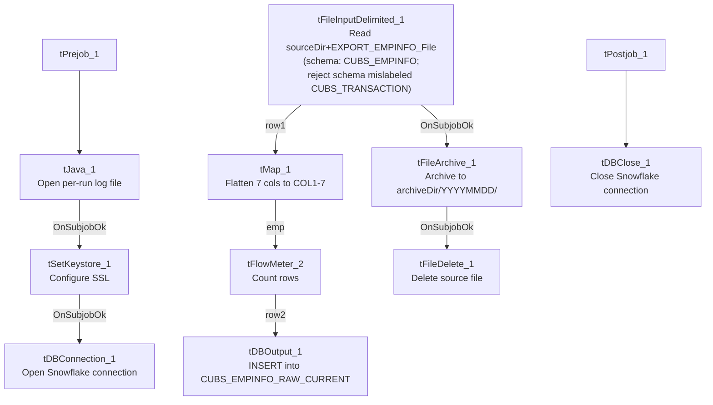

# Talend Job: CUBS_Raw_Empinfo_Load

## Overview

Loads a single CUBS "employee info" export — collector/employee login credentials and account metadata (`LOGON`, `EMPPWD`, `EMP_NAME`, `EMP_INIT`, `LST_LOGIN`, `DISABLED`) — for one site logon into the Snowflake staging table `CUBS_EMPINFO_RAW_CURRENT`, then archives and deletes the source file. It is structurally identical to `CUBS_Raw_EM_Load` in this same batch (same setup/teardown, same `EXPORT_<TYPE>_*` context-group pattern, same archive-then-delete flow), differing only in its schema, target table, and the fact that `EMPPWD` — an employee password/credential field — flows through this pipeline unmasked at the metadata level. It is called once by `CO_Master_Load` (see `06_dependency_matrix.md`).

## Detail table

| Field | Value |
|---|---|
| Job name | CUBS_Raw_Empinfo_Load |
| Version | 0.1 |
| Project | EDW2SF |
| Author | jmach@harriscollect.com |
| Created | 2022-09-27T16:20:31.190-0700 |
| Last Modified | 2025-11-04T11:08:13.503-0800 |

## Step-by-step data flow

**Setup subjob:** `tPrejob_1` → `tJava_1` (`OnComponentOk`) opens a per-run log file at `context.logDir + context.currentLogon + "_" + jobName + "_" + <timestamp> + ".log"` → on success, `tSetKeystore_1` configures SSL trust/keystore from `context.keystorePath` (passwords redacted) → `tDBConnection_1` opens the Snowflake connection.

**Main subjob** — starts independently of the setup subjob:

1. `tFileInputDelimited_1` reads `context.sourceDir + context.EXPORT_EMPINFO_File`, with row/field separator, header flag, and encoding driven by the `EXPORT_EMPINFO_0.1` context group (default filename `Z:/EDW/2021-11-27/HH/HH-EDW-EXPORT-EMPINFO.txt` per `_shared_context.json`). Uses repository schema `"CUBS_EMPINFO"` (7 columns: `LOGON`, `EMPPWD`, `EMP_IDX`, `EMP_NAME`, `EMP_INIT`, `LST_LOGIN`, `DISABLED`). `CSVROWSEPARATOR` again set to `context.EXPORT_TRANS_RowSeparator` (same mismatch pattern as the EM/HH-Client jobs; inert unless `CSV_OPTION` is enabled — currently `false`). `DIE_ON_ERROR=false`; reject schema mislabeled `"CUBS_TRANSACTION"`.
2. `tMap_1` (`row1`, FLOW) flattens the 7 named columns onto a generic `FILENAME`, `FILEDATE`, `COL1`...`COL7` shape.
3. `tFlowMeter_2` (`emp`, FLOW) counts rows.
4. `tDBOutput_1` (`row2`, FLOW) inserts the rows into Snowflake `CUBS_EMPINFO_RAW_CURRENT` (`INSERT`, `tableAction=NONE`).
5. On the input file's `OnSubjobOk`, `tFileArchive_1` archives `context.sourceDir` to `context.archiveDir + "/" + <YYYYMMDD> + "/" + context.EXPORT_EMPINFO_File + ".tar.gz"` (password redacted).
6. On archive `OnSubjobOk`, `tFileDelete_1` deletes `context.sourceDir + context.EXPORT_EMPINFO_File`.

**Teardown subjob:** `tPostjob_1` → `tDBClose_1` (`OnComponentOk`) closes the Snowflake connection.

## Settings tables

### Source: `tFileInputDelimited_1`

| Setting | Value | What it means |
|---|---|---|
| FILENAME | `context.sourceDir + context.EXPORT_EMPINFO_File` | `EXPORT_EMPINFO_File` defaults to `Z:/EDW/2021-11-27/HH/HH-EDW-EXPORT-EMPINFO.txt`. |
| ROWSEPARATOR / FIELDSEPARATOR / HEADER / ENCODING | All from `EXPORT_EMPINFO_0.1` context group | Defaults: `\n`, `\t`, header row 1, `US-ASCII`. |
| CSVROWSEPARATOR | `context.EXPORT_TRANS_RowSeparator` | Mismatched context family (inert unless `CSV_OPTION=true`, currently `false`) — same recurring copy-paste artifact. |
| SCHEMA (main) | Repository `"CUBS_EMPINFO"` | 7 columns: `LOGON`, `EMPPWD`, `EMP_IDX`, `EMP_NAME`, `EMP_INIT`, `LST_LOGIN`, `DISABLED`. |
| SCHEMA_REJECT | Repository `"CUBS_TRANSACTION"` | Mislabeled, same pattern seen throughout this project. |
| DIE_ON_ERROR | `false` | Malformed rows don't fail the job; no reject flow is wired. |
| TEMP_DIR | `"C:/Talend-Studio-20211109_1610-V8.0.1/workspace"` | Hardcoded developer-workstation path. |

### Target: `tDBOutput_1` (`tSnowflakeOutput`)

| Setting | Value | What it means |
|---|---|---|
| Table | `CUBS_EMPINFO_RAW_CURRENT` | Destination raw landing table. |
| Output action | `INSERT` | Appends rows; no truncate step precedes it in this job. |
| Table action | `NONE` | Table not recreated/altered by this job. |

### `tFileArchive_1` / `tFileDelete_1`

| Setting | Value | What it means |
|---|---|---|
| TARGET (archive) | `context.archiveDir + "/" + <YYYYMMDD> + "/" + context.EXPORT_EMPINFO_File + ".tar.gz"` | Per-run, dated archive named after the export file. |
| PASSWORD | `***REDACTED***` | Preserved as redacted. |
| FILENAME (delete) | `context.sourceDir + context.EXPORT_EMPINFO_File` | Deletes the exact file that was loaded. |

## Dependencies & configuration

- **Called by:** `CO_Master_Load`, once — see `06_dependency_matrix.md`.
- **Triggers/depends on other jobs:** none — `runjob_targets` is empty.
- **Context variables used:** `EXPORT_EMPINFO_Encoding`, `EXPORT_EMPINFO_FieldSeparator`, `EXPORT_EMPINFO_File`, `EXPORT_EMPINFO_Header`, `EXPORT_EMPINFO_RowSeparator`, `EXPORT_TRANS_RowSeparator` (mismatched — see Issues observed), `archiveDir`, `currentLogon`, `keystorePath`, `logDir`, `sourceDir`.
- **5 hardcoded developer-workstation paths:** `tFileInputDelimited_1.TEMP_DIR`, `tFileArchive_1.SOURCE_FILE`, `tFileDelete_1.DIRECTORY`/`PATH`, `tSetKeystore_1.SSL_TRUSTSERVER_TRUSTSTORE` — same project-wide pattern documented in `05_operational_runbook.md`.

## Glossary

| Component type | Plain-English meaning |
|---|---|
| `tFileInputDelimited` | Reads a delimited text file according to a schema. |
| `tMap` | Maps/transforms columns from one schema to another. |
| `tFlowMeter` | Counts rows passing a point in the flow. |
| `tSnowflakeOutput` / `tSnowflakeConnection` / `tSnowflakeClose` | Write rows to Snowflake / open and close the Snowflake connection. |
| `tFileArchive` / `tFileDelete` | Zip a processed file to an archive location, then delete the original. |
| `tSetKeystore` | Configures the SSL keystore/truststore used by the Snowflake connection. |
| `tPrejob` / `tPostjob` | Guaranteed-first / guaranteed-last setup and teardown subjobs. |
| `tJava` | Runs a block of custom Java code. |

## Issues observed

- **`EMPPWD` (an employee password field) is loaded, mapped, and staged as a plain string with no masking or redaction visible anywhere in this job's own components** — the schema, `tMap_1`, and `tDBOutput_1` all pass it through unchanged into `CUBS_EMPINFO_RAW_CURRENT`. Whether this field is meant to be a live credential, a hashed value, or already-defunct legacy data is not determinable from this job's metadata; given the sensitivity of a field literally named "password", this is worth confirming with the team and checking whether `CUBS_EMPINFO_RAW_CURRENT` has appropriate access restrictions in Snowflake.
- **`CSVROWSEPARATOR` references `context.EXPORT_TRANS_RowSeparator`**, not an `EXPORT_EMPINFO_*` variable — same recurring copy-paste artifact seen in `CUBS_Raw_EM_Load` and the Client-load family; inert unless `CSV_OPTION` is ever enabled.
- **Reject schema mislabeled `"CUBS_TRANSACTION"`**, with no reject flow wired despite `DIE_ON_ERROR=false` — malformed rows are silently dropped, consistent with the project-wide pattern in `05_operational_runbook.md`.
- **No `TRUNCATE` step and no merge call anywhere in this job**, despite the `_RAW_CURRENT` naming — re-running this job for the same logon/day would append duplicate rows rather than replace them, unless handled by an unseen downstream process.
- **Archive and delete are triggered by the file read's own `SUBJOB_OK`, not by the Snowflake insert's success** — same ordering risk flagged across this batch: a downstream failure in `tMap_1`/`tFlowMeter_2`/`tDBOutput_1` would still result in the source file being archived and deleted.
