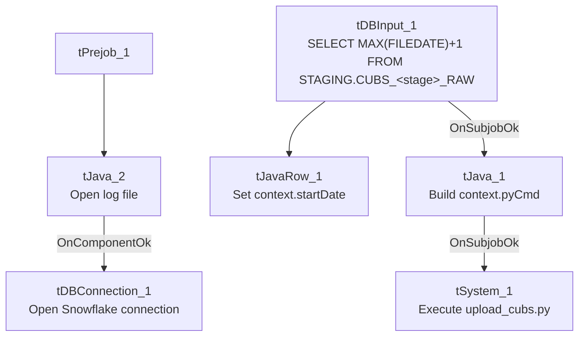

# Talend Job: CUBS_Raw_File_Load

## Overview

A shared utility job used by several other jobs in this project: it looks up the latest date already loaded into a given `STAGING.CUBS_<stage>_RAW` Snowflake table, then shells out to run a Python script (`upload_cubs.py`) that presumably performs the actual file upload for that stage, starting from the day after the last-loaded date. Unlike the `CUBS_Raw_*_Load` jobs that read files directly with Talend's own file components, this job delegates the real work to an external Python process — the file-reading/parsing logic itself is not visible in this metadata.

## Detail table

| Field | Value |
|---|---|
| Job name | CUBS_Raw_File_Load |
| Version | 0.2 |
| Project | EDW2SF |
| Author | jmach@harriscollect.com |
| Created | 2022-04-13T15:40:05.213-0700 |
| Last Modified | 2022-05-24T09:48:40.105-0700 |

## Step-by-step data flow

**Setup subjob:** `tPrejob_1` → `tJava_2` opens a per-run log file at `context.logDir + jobName + "_" + context.stage + "_" + <timestamp> + ".log"` → on success, `tDBConnection_1` opens the Snowflake connection.

**Main subjob** — starts independently of the setup subjob:

1. `tDBInput_1` runs `SELECT CAST(DATEADD(DAY,1,MAX(FILEDATE)) AS VARCHAR(10)) AS START_DATE FROM STAGING.CUBS_"+StringHandling.UPCASE(context.stage)+"_RAW;` — finds the day after the most recent file date already loaded, for whichever `stage` (subject area) this run is invoked with.
2. `tJavaRow_1` captures that value into `context.startDate`.
3. On success (`tDBInput_1` → `tJava_1` via `SUBJOB_OK`), `tJava_1` builds `context.pyCmd`, a Python 3 command line: `python3 <scriptDir>upload_cubs.py --stage <stage> --file <file> --path <path> --date <startDate> --tempdir <tempDir>`, and prints it to the log.
4. `tSystem_1` executes that command as a single shell command, streaming its stdout/stderr to the console (and therefore into the per-run log file, since `tJava_2` redirected `System.out`/`System.err` earlier).

## Settings tables

### Source: `tDBInput_1` (`tSnowflakeInput`)

| Setting | Value | What it means |
|---|---|---|
| Query | `SELECT CAST(DATEADD(DAY,1,MAX(FILEDATE)) AS VARCHAR(10)) AS START_DATE FROM STAGING.CUBS_"+StringHandling.UPCASE(context.stage)+"_RAW;` | Table name is built dynamically from `context.stage`, so this job is a reusable, parameterized loader rather than being hardcoded to one subject area. |

### External process: `tSystem_1`

| Setting | Value | What it means |
|---|---|---|
| DIRECTORY | `"C:/Talend-Studio-20211109_1610-V8.0.1/workspace"` | Working directory for the shell command — hardcoded developer path (see Issues observed). |
| COMMAND | `context.pyCmd` (built in `tJava_1`) | `python3 <scriptDir>upload_cubs.py --stage <stage> --file <file> --path <path> --date <startDate> --tempdir <tempDir>` |
| OUTPUT / ERROROUTPUT | `OUTPUT_TO_CONSOLE` (both) | Both stdout and stderr from the Python script are streamed to the console/log — there is no explicit capture of the script's exit code within this job's own components. |

## Dependencies & configuration

- **Called by 4 other jobs** per `06_dependency_matrix.md`: `DimDeskInfo_Load`, `DimEmployeeInfo_Load`, `Fact_Electronic_Media_Load`, and `PaymentPlan_Load` (each 1 time) — making this one of the more widely reused utility jobs in the project, despite its own metadata showing no `tRunJob` links out.
- **Context variables used:** `file`, `logDir`, `path`, `pyCmd` (set internally), `scriptDir`, `stage`, `startDate` (set internally), `tempDir`.
- **1 hardcoded developer-workstation path** (`tSystem_1.DIRECTORY`) — same project-wide risk noted in `05_operational_runbook.md`.

## Glossary

| Component type | Plain-English meaning |
|---|---|
| `tSnowflakeInput` | Runs a query against Snowflake and returns its result rows — here used once to compute a starting date. |
| `tJavaRow` | Runs custom Java code once per input row — here used to unpack a single query result into a context variable. |
| `tJava` | Runs a block of custom Java code once (not per row) — here used to build a shell command string. |
| `tSystem` | Runs an arbitrary OS shell command from within the Talend job — here used to hand off the actual file upload to an external Python script. |

## Issues observed

- **The actual file-loading logic lives entirely outside Talend**, in an external `upload_cubs.py` script not captured in this metadata. This job's own components only compute a start date and invoke that script — verifying what the script actually does (which files it reads, which table it writes, how it handles errors) requires reviewing the script itself, not just this job.
- **No explicit success/failure check on the Python script's exit code.** `tSystem_1` streams output to the console but this job has no visible `tDie`/`tWarn` component reacting to whether `upload_cubs.py` succeeded or failed — a script failure would likely only surface as non-zero output in the log, not as an obvious job failure, unless Talend's own `tSystem` component fails the job on a non-zero exit code by default (not confirmed from this metadata; verify with the team).
- **`context.file` and `context.path` are referenced in the constructed Python command but neither is set anywhere within this job's own components** — both must be supplied by the calling job's context (consistent with this being a shared parameterized utility), but that dependency is not self-documenting from this job alone. Unable to determine their expected values from this job's metadata; verify with the calling jobs (`DimDeskInfo_Load`, `DimEmployeeInfo_Load`, `Fact_Electronic_Media_Load`, `PaymentPlan_Load`).
