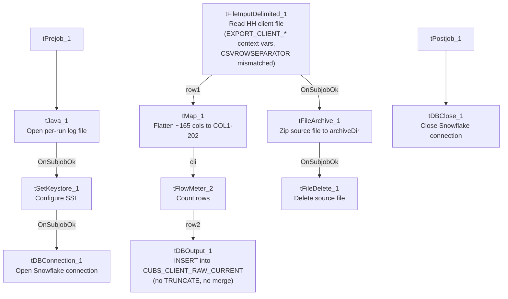

# Talend Job: CUBS_Raw_HH_Client_Load

## Overview

Loads the HH site's CUBS client master-file export — one row per collection-agency client, with ~165 columns covering client ID, name/address, billing/statement settings, commission/interest rates, collection-status flags, scoring thresholds, and dialer/skip-trace routing flags — into the Snowflake staging table `CUBS_CLIENT_RAW_CURRENT`, then archives and deletes the source file. It is structurally identical to `CUBS_Raw_CHI_Client_Load` (same setup/teardown with `tSetKeystore_1`, same `CSVROWSEPARATOR` mismatch, same generically-labeled `"metadata"` schema, same missing truncate/merge step) — the site-specific behavior comes entirely from the caller's context values, not from anything in this job's own component parameters. Notably, its `EXPORT_CLIENT_File` default (`"HH-EDW-EXPORT-CLIENT.txt"`) is identical to the default used by the unsuffixed `CUBS_Raw_Client_Load` job, and both write to the same target table — see Issues observed.

## Detail table

| Field | Value |
|---|---|
| Job name | CUBS_Raw_HH_Client_Load |
| Version | 0.1 |
| Project | EDW2SF |
| Author | jmach@harriscollect.com |
| Created | 2023-09-26T11:17:31.689-0700 |
| Last Modified | 2025-11-04T11:08:10.082-0800 |

## Step-by-step data flow

**Setup subjob:** `tPrejob_1` → `tJava_1` (`OnComponentOk`) opens a per-run log file at `context.logDir + context.currentLogon + "_" + jobName + "_" + <timestamp> + ".log"` → on success, `tSetKeystore_1` configures SSL trust/keystore from `context.keystorePath` (passwords redacted) → `tDBConnection_1` opens the Snowflake connection.

**Main subjob** — starts independently of the setup subjob:

1. `tFileInputDelimited_1` reads `context.sourceDir + context.EXPORT_CLIENT_File`. `ROWSEPARATOR`/`FIELDSEPARATOR`/`HEADER`/`ENCODING` are correctly scoped to the `EXPORT_CLIENT_0.1` context group, but `CSVROWSEPARATOR` is set to `context.EXPORT_TRANS_RowSeparator` instead (same copy-paste inconsistency as `CUBS_Raw_CHI_Client_Load`; inert unless `CSV_OPTION` is enabled — currently `false`). The main schema is labeled generically `"metadata"` in the repository (not client-specific), with ~165 client business columns (`LOGON`, `CLIENT`, `CLIENT_IDX`, `NAME`, `ADD1`/`ADD2`, `CITY`, `ST`, `ZIP`, rate/commission fields, statement/invoice settings, scoring thresholds like `SCR_LTR_MIN`/`SCR_EML_MIN`/`SCR_TXT_MIN`, `CityOfChi`, `PL_GROUP`, `ON_DIALER`, etc. — listed twice in the extracted metadata, a main+reject capture artifact). Reject schema is mislabeled `"CUBS_TRANSACTION"`. `TRIMALL=true`; `DIE_ON_ERROR=false`, with no reject flow wired.
2. `tMap_1` (`row1`, FLOW) flattens the ~165 named columns onto a generic `FILENAME`, `FILEDATE`, `COL1`...`COL202` shape (202 schema columns on `tMap_1`) — meaningful client column names are not preserved past this point.
3. `tFlowMeter_2` (`cli`, FLOW) counts rows (label "MyLabel", not customized).
4. `tDBOutput_1` (`row2`, FLOW) inserts the rows into Snowflake `CUBS_CLIENT_RAW_CURRENT` (`INSERT`, `tableAction=NONE`) — no `TRUNCATE` step anywhere in this job and no merge call afterward, despite the `_RAW_CURRENT` table name.
5. On `tFileInputDelimited_1`'s own `SUBJOB_OK` (not the DB insert's success), `tFileArchive_1` zips the source file to `context.archiveDir + "/" + <YYYYMMDD> + "/" + context.EXPORT_CLIENT_File + ".tar.gz"` (password redacted), then on success `tFileDelete_1` deletes the original source file.

**Teardown subjob:** `tPostjob_1` → `tDBClose_1` (`OnComponentOk`) closes the Snowflake connection.

## Settings tables

### Source: `tFileInputDelimited_1`

| Setting | Value | What it means |
|---|---|---|
| FILENAME | `context.sourceDir + context.EXPORT_CLIENT_File` | `EXPORT_CLIENT_File` defaults to `"HH-EDW-EXPORT-CLIENT.txt"` per `_shared_context.json` — matching this job's own site. |
| ROWSEPARATOR / FIELDSEPARATOR / HEADER / ENCODING | `context.EXPORT_CLIENT_RowSeparator` / `context.EXPORT_CLIENT_FieldSeparator` / `context.EXPORT_CLIENT_Header` / `context.EXPORT_CLIENT_Encoding` | Correctly scoped to the CLIENT export context group. |
| CSVROWSEPARATOR | `context.EXPORT_TRANS_RowSeparator` | Mismatched — references the Trans export's row separator instead of `EXPORT_CLIENT_RowSeparator`; only takes effect if `CSV_OPTION` is enabled (currently `false`). |
| TRIMALL | `true` | All fields whitespace-trimmed. |
| Main schema | Repository `"metadata"` (generic label, ~165 client columns) | Not a client-specific schema name in the repository. |
| Reject schema | Repository `"CUBS_TRANSACTION"` | Mislabeled, same pattern as `CUBS_Raw_CHI_Client_Load`. |
| TEMP_DIR | `"C:/Talend-Studio-20211109_1610-V8.0.1/workspace"` | Hardcoded developer-workstation path. |

### Target: `tDBOutput_1` (`tSnowflakeOutput`)

| Setting | Value | What it means |
|---|---|---|
| Table | `CUBS_CLIENT_RAW_CURRENT` | Destination staging table — **identical target to `CUBS_Raw_Client_Load` and `CUBS_Raw_DC_Client_Load`**. See Issues observed. |
| Output action | `INSERT` | Appends rows; no `TRUNCATE` precedes it and no merge stored procedure follows it. |
| Table action | `NONE` | Table is not recreated/altered. |

### Archive/Delete: `tFileArchive_1` / `tFileDelete_1`

| Setting | Value | What it means |
|---|---|---|
| TARGET (`tFileArchive_1`) | `context.archiveDir + "/" + <CCYYMMDD> + "/" + context.EXPORT_CLIENT_File + ".tar.gz"` | Archives under a date-stamped subfolder. |
| Trigger | Off `tFileInputDelimited_1`'s `SUBJOB_OK`, not off `tDBOutput_1` | Archive+delete happens before the Snowflake insert is confirmed — see Issues observed. |

## Dependencies & configuration

- **Triggers/depends on other jobs:** none — `runjob_targets` is empty. Not found as a `tRunJob` target anywhere in `06_dependency_matrix.md` either — same "no visible caller" situation as `CUBS_Raw_Client_Load` and `CUBS_Raw_CHI_Client_Load`. Unlike the Debtor and ETL per-site families, which each have a generic umbrella dispatcher, there is no equivalent generic Client-load dispatcher calling this job in this export.
- **Context variables used:** `EXPORT_CLIENT_Encoding`, `EXPORT_CLIENT_FieldSeparator`, `EXPORT_CLIENT_File`, `EXPORT_CLIENT_Header`, `EXPORT_CLIENT_RowSeparator`, `EXPORT_TRANS_RowSeparator` (mismatched — see Issues observed), `archiveDir`, `currentLogon`, `keystorePath`, `logDir`, `sourceDir`.
- **5 hardcoded developer-workstation path findings:** `tFileInputDelimited_1.TEMP_DIR`, `tFileArchive_1.SOURCE_FILE`, `tFileDelete_1.DIRECTORY`/`PATH`, and `tSetKeystore_1.SSL_TRUSTSERVER_TRUSTSTORE` — same project-wide pattern documented in `05_operational_runbook.md`.

## Glossary

| Component type | Plain-English meaning |
|---|---|
| `tFileInputDelimited` | Reads a delimited (CSV-style) text file according to a schema. |
| `tMap` | Maps/transforms columns from one schema to another. |
| `tFlowMeter` | Counts rows passing through a point in the flow, for logging/monitoring. |
| `tSnowflakeOutput` / `tSnowflakeConnection` / `tSnowflakeClose` | Write rows to a Snowflake table / open and close the shared Snowflake connection. |
| `tFileArchive` / `tFileDelete` | Zip a processed file to an archive location, then delete the original from the source directory. |
| `tSetKeystore` | Configures the SSL keystore/truststore used by subsequent secure connections. |
| `tPrejob` / `tPostjob` | Run once before/after the rest of the job. |
| `tJava` | Runs a block of custom Java code — here, opening a per-run log file. |

## Issues observed

- **`CUBS_Raw_HH_Client_Load` and `CUBS_Raw_Client_Load` (the unsuffixed job, not in this batch's naming but already documented) share the same `EXPORT_CLIENT_File` default (`"HH-EDW-EXPORT-CLIENT.txt"`) and the same target table (`CUBS_CLIENT_RAW_CURRENT`, `INSERT`/`tableAction=NONE`, no truncate).** If both jobs are ever run against the same default context in the same environment, they would load the same file into the same table twice, doubling HH's client rows for that run cycle — the same "two jobs, one table, no truncate" concern already flagged for `CUBS_Raw_Client_Load` vs. `CUBS_Raw_DC_Client_Load`, now extended to a third job pointing at the identical default file. Unable to determine from metadata whether per-environment context overrides prevent this in practice; verify with the team.
- **`CSVROWSEPARATOR` references `context.EXPORT_TRANS_RowSeparator`**, not an `EXPORT_CLIENT_*` variable — same copy-paste-from-a-Trans-template pattern as `CUBS_Raw_CHI_Client_Load`; inert unless `CSV_OPTION` is ever switched on.
- **Main schema labeled generically `"metadata"`, reject schema mislabeled `"CUBS_TRANSACTION"`** — same issue class as `CUBS_Raw_CHI_Client_Load` and `ADP_Payroll_Load`. No reject flow is wired despite `DIE_ON_ERROR=false`, so malformed rows are silently dropped.
- **No visible caller** — unlike the Debtor and ETL per-site job families (each dispatched by a generic umbrella job), there is no equivalent generic Client-load dispatcher calling `CUBS_Raw_HH_Client_Load` in this export; its actual trigger mechanism is unclear from the captured metadata.
- **Archive and delete of the source file are triggered by the file read succeeding, not by the Snowflake insert succeeding** — a downstream failure in `tMap_1`/`tFlowMeter_2`/`tDBOutput_1` would still result in the source file being archived and deleted, same ordering risk as `CUBS_Raw_CHI_Client_Load`.
- **No `TRUNCATE` step and no merge call anywhere in this job**, despite the target table being named `CUBS_CLIENT_RAW_CURRENT` — same missing-refresh-step concern as its siblings.
