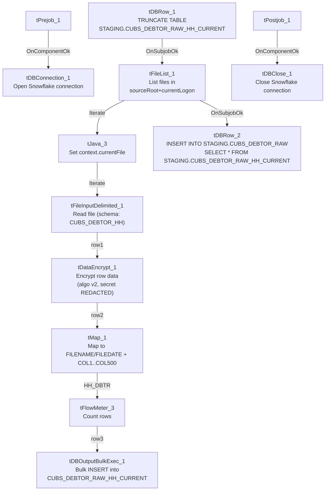

# Talend Job: CUBS_Raw_HH_Debtor_Load

## Overview

Loads debtor records for the "HH" site out of one or more delimited text files delivered to a per-logon source folder, encrypts the row data in transit, and bulk-inserts it into the Snowflake staging table `CUBS_DEBTOR_RAW_HH_CURRENT`, then appends that freshly loaded batch into a shared, multi-site raw table `CUBS_DEBTOR_RAW`. This is one job in a per-site family of debtor loaders (site codes CHI/CO/DC/HH/PRE — see `01_system_architecture.md` and `04_data_lineage_map.md`) triggered from the shared orchestrator `CUBS_Raw_Debtor_Load`, and is itself the "plain" member of an HH-specific trio of near-identical jobs (`CUBS_Raw_HH_Debtor_Load`, `CUBS_Raw_HH_Debtor_Load_No_Delete`, `CUBS_Raw_HH_Debtor_Load_Upsert` — per `04_data_lineage_map.md`, all three target `CUBS_DEBTOR_RAW_HH_CURRENT`); the sibling jobs' own JSON wasn't in this batch, so their specific differences aren't verified here.

## Detail table

| Field | Value |
|---|---|
| Job name | CUBS_Raw_HH_Debtor_Load |
| Version | 0.1 |
| Project | EDW2SF |
| Author | jmach@harriscollect.com |
| Created | 2022-05-02T08:40:17.876-0700 |
| Last Modified | 2022-06-13T14:33:36.072-0700 |

## Step-by-step data flow

**Setup subjob:** `tPrejob_1` → `tDBConnection_1` opens the job's Snowflake connection. Unlike `ADP_Payroll_Load`/`CO_Master_Load`, there is no `tJava` step here opening a per-run log file — see Issues observed.

**Main subjob** — runs independently of the setup subjob (its root component, `tDBRow_1`, has no incoming trigger from the setup chain in this job's metadata):

1. `tDBRow_1` runs `TRUNCATE TABLE STAGING.CUBS_DEBTOR_RAW_HH_CURRENT;`, clearing the HH staging table before this run's load.
2. On success, `tFileList_1` lists files (not subdirectories) in `context.sourceRoot + context.currentLogon`, excluding nothing in practice (`EXCLUDEFILEMASK="*.txt"` is set but `IFEXCLUDE=false`, so the exclusion doesn't actually apply — every file in the directory is picked up, same pattern flagged in `ADP_Payroll_Load`).
3. For each file (`ITERATE`), `tJava_3` sets `context.currentFile` from `tFileList_1`'s current filepath and prints `"Processing file " + context.currentFile"` to the log.
4. `tFileInputDelimited_1` reads that file using the repository schema `CUBS_DEBTOR_HH` (984 columns) for both its main and reject schema (same repository schema ID for both — unlike `ADP_Payroll_Load`'s mismatched reject schema). Field/row separators, header-row count, and encoding are all driven by context variables (`EXPORT_DEBTOR_FieldSeparator`, `EXPORT_DEBTOR_RowSeparator`, `EXPORT_DEBTOR_Header`, `EXPORT_DEBTOR_Encoding`) rather than hardcoded. `DIE_ON_ERROR=false`.
5. `tDataEncrypt_1` encrypts the row data (algorithm version 2; secret type and password both `***REDACTED***` in the source metadata) before it reaches the map, reading its crypto key/file from `context.cryptoPath`.
6. `tMap_1` maps the row into a differently-shaped target schema: `FILENAME`, `FILEDATE`, and 500 generically-named columns `COL1`...`COL500` (502 columns total). `DIE_ON_ERROR=true`, so a mapping failure fails the job outright.
7. `tFlowMeter_3` counts rows passing through, labeled `"HH_DBTR"` (site-specific label, unlike the unrenamed `"MyLabel"` seen in some other jobs in this project).
8. `tDBOutputBulkExec_1` bulk-inserts the rows into Snowflake table `CUBS_DEBTOR_RAW_HH_CURRENT` (`INSERT`, `tableAction=NONE`).
9. After `tFileList_1`'s iteration completes over all files (`OnSubjobOk`), `tDBRow_2` runs `INSERT INTO STAGING.CUBS_DEBTOR_RAW SELECT * FROM STAGING.CUBS_DEBTOR_RAW_HH_CURRENT;`, appending the just-loaded HH batch into the shared, multi-site raw debtor table.

**Teardown subjob:** `tPostjob_1` → `tDBClose_1` closes the Snowflake connection.

## Settings tables

### Staging reset: `tDBRow_1` (`tSnowflakeRow`)

| Setting | Value | What it means |
|---|---|---|
| Query | `TRUNCATE TABLE STAGING.CUBS_DEBTOR_RAW_HH_CURRENT;` | Clears the HH staging table at the start of every run, before any file is loaded. |

### Source directory: `tFileList_1`

| Setting | Value | What it means |
|---|---|---|
| DIRECTORY | `context.sourceRoot + context.currentLogon` | Both parts are context variables — actual resolved path is unable to determine from this job's own metadata (not defined in `_shared_context.json`'s context groups either). |
| LIST_MODE | `FILES` (no subdirectories) | Only top-level files in that directory are picked up. |
| EXCLUDEFILEMASK / IFEXCLUDE | `"*.txt"` / `false` | The exclusion mask is configured but not applied (`IFEXCLUDE=false`), so `.txt` files are **not** actually excluded — every file in the directory is listed. |
| CASE_SENSITIVE | `YES` | Filename matching is case-sensitive. |

### Per-file setup: `tJava_3`

| Setting | Value | What it means |
|---|---|---|
| CODE | `context.currentFile = (String)globalMap.get("tFileList_1_CURRENT_FILEPATH")` + a log line | Captures the current iteration's full file path into a context variable used by the next component. |

### Source: `tFileInputDelimited_1`

| Setting | Value | What it means |
|---|---|---|
| FILENAME | `context.currentFile` | The file set by `tJava_3` for the current iteration. |
| FIELDSEPARATOR / ROWSEPARATOR / HEADER / ENCODING | `context.EXPORT_DEBTOR_FieldSeparator` (tab, `"\t"`) / `context.EXPORT_DEBTOR_RowSeparator` (`"\n"`) / `context.EXPORT_DEBTOR_Header` (1 header row) / `context.EXPORT_DEBTOR_Encoding` (`US-ASCII`) | All driven by the shared `EXPORT_DEBTOR_*` context group (values confirmed in `_shared_context.json`) rather than hardcoded per job. |
| SCHEMA (main) | Repository schema `CUBS_DEBTOR_HH` (984 columns) | The expected wide debtor-record layout for this site's export file. |
| SCHEMA_REJECT | Same repository schema ID (`CUBS_DEBTOR_HH`) as the main schema | Correctly matches this job's own data, unlike the mismatched reject schema found in `ADP_Payroll_Load`. |
| DIE_ON_ERROR | `false` | Malformed rows don't fail the job... |
| Reject flow | Not wired | ...but no connection routes rejected rows anywhere — they are silently dropped with no count or record, same unwired-reject pattern as `ADP_Payroll_Load`. |
| TEMP_DIR | `"C:/Talend-Studio-20211109_1610-V8.0.1/workspace"` | Hardcoded developer-workstation path — part of the 210-job project-wide pattern documented in `05_operational_runbook.md`. |

### Transform: `tDataEncrypt_1`

| Setting | Value | What it means |
|---|---|---|
| PASSWORD_M1 | `***REDACTED***` | Encryption password/key material — preserved as redacted; not guessable from metadata. |
| SECRET_TYPE | `***REDACTED***` | The type of secret/key used — also redacted in the source metadata. |
| CRYPTO_FILE_PATH | `context.cryptoPath` | Points to a crypto key/config file via a context variable not defined in the shared context groups available to this generation run. |
| ALGO_VERSION | `2` | Encryption algorithm version 2 (specific algorithm not shown in this metadata). |

### Transform: `tMap_1`

| Setting | Value | What it means |
|---|---|---|
| Input columns | 491 named debtor columns (from `tDataEncrypt_1`) | Business-named fields (`LOGON`, `DEBTOR`, `CLIENT`, `NAME1`, ... `OLD_CLIENT_ID4`, etc.). |
| Output columns | `FILENAME`, `FILEDATE`, `COL1`...`COL500` (502 total) | Renames/re-maps the named source fields into generic, positional column names — presumably matching the target staging table's own generic column layout. The actual per-field mapping expressions aren't captured in this metadata, and the column counts don't line up 1:1 (491 in → 500 generic columns out) — unable to determine from metadata exactly which source field maps to which `COLn`, or why the counts differ; verify directly in Talend Studio. |
| DIE_ON_ERROR | `true` | A mapping/lookup failure here fails the job outright (unlike the upstream file-read step). |

### Row counter: `tFlowMeter_3`

| Setting | Value | What it means |
|---|---|---|
| METTERLABEL | `"HH_DBTR"` | Site-specific label for this job's row count in the flow-meter log — correctly customized, unlike some sibling jobs' unrenamed `"MyLabel"`. |

### Target: `tDBOutputBulkExec_1` (`tSnowflakeOutputBulkExec`)

| Setting | Value | What it means |
|---|---|---|
| Table | `CUBS_DEBTOR_RAW_HH_CURRENT` | Destination staging table — no explicit schema prefix shown in this component's own metadata (unlike the `STAGING.`-prefixed SQL text in `tDBRow_1`/`tDBRow_2`); presumably resolves to the same `STAGING` schema via the connection's default schema. |
| Output action | `INSERT` | Appends rows — relies on the earlier `TRUNCATE` (`tDBRow_1`) to prevent duplicate accumulation within `CUBS_DEBTOR_RAW_HH_CURRENT` itself across runs. |
| Table action | `NONE` | Table is not recreated/altered by this job. |
| Reject schema | Present (`columnName`, `rowNumber`, `category`, `character`, `errorMessage`, `byteOffset`, `line`, `sqlState`, `code`) but not wired | Bulk-load row errors have a defined error schema but no connection captures them anywhere — same unwired-reject pattern as the file-read step. |

### Append step: `tDBRow_2` (`tSnowflakeRow`)

| Setting | Value | What it means |
|---|---|---|
| Query | `INSERT INTO STAGING.CUBS_DEBTOR_RAW SELECT * FROM STAGING.CUBS_DEBTOR_RAW_HH_CURRENT;` | Appends this run's entire HH staging batch into the shared, multi-site `CUBS_DEBTOR_RAW` table. Runs once, after the full file-iteration loop finishes. See Issues observed regarding duplicate accumulation. |

## Dependencies & configuration

- **Triggered by:** `CUBS_Raw_Debtor_Load` (orchestrator), per `06_dependency_matrix.md`'s job-to-job table (`CUBS_Raw_Debtor_Load` → `CUBS_Raw_HH_Debtor_Load`, count 1).
- **Triggers other jobs:** none — `runjob_targets` is empty in this job's own metadata.
- **Context variables used:** `sourceRoot`, `currentLogon` (combine to form the source directory — neither is defined in the shared context groups available to this run), `currentFile` (set internally by `tJava_3`), `cryptoPath` (encryption key/config path), `EXPORT_DEBTOR_Encoding`, `EXPORT_DEBTOR_FieldSeparator`, `EXPORT_DEBTOR_Header`, `EXPORT_DEBTOR_RowSeparator` (all defined in the shared `EXPORT_DEBTOR_0.1` context group — see `_shared_context.json`).
- **1 hardcoded developer-workstation path**: `tFileInputDelimited_1.TEMP_DIR = "C:/Talend-Studio-20211109_1610-V8.0.1/workspace"` — part of the 210-job project-wide pattern documented in `05_operational_runbook.md`.
- **Connection label:** `tDBConnection_1` (`tSnowflakeConnection`) has no captured parameters (empty in this job's metadata — no hand-set `LABEL` value to cross-reference against `01_system_architecture.md`'s connection-label table). Unable to determine which of the project's named Snowflake connections (`LEGACY_STAGING`, `SF_CXN`, etc.) this job actually uses — verify directly in Talend Studio.

## Glossary

| Component type | Plain-English meaning |
|---|---|
| `tSnowflakeConnection` / `tSnowflakeClose` | Open/close the Snowflake database connection shared by other components in the job. |
| `tSnowflakeRow` | Runs an arbitrary SQL statement against Snowflake (here, a `TRUNCATE` and an `INSERT ... SELECT`). |
| `tFileList` | Lists files in a directory for the job to iterate over one at a time. |
| `tJava` | Runs custom Java code once (here, capturing the current file path from `tFileList`'s iteration into a context variable). |
| `tFileInputDelimited` | Reads a delimited (CSV/tab-style) text file according to a schema. |
| `tDataEncrypt` | Encrypts row data using a configured algorithm and key/secret before it continues downstream. |
| `tMap` | Maps/transforms columns from one schema to another. |
| `tFlowMeter` | Counts rows passing a point in the flow, for logging/monitoring. |
| `tSnowflakeOutputBulkExec` | Bulk-loads rows into a Snowflake table (higher-throughput variant of a standard row-by-row output). |

## Issues observed

- **No per-run log-file setup in the setup subjob.** Unlike `ADP_Payroll_Load` and `CO_Master_Load`, `tPrejob_1` here goes straight to `tDBConnection_1` with no `tJava` step opening a dedicated log file. Combined with the absence of any `tDie`/`tWarn` component in this job (it isn't in the 16-job list in `05_operational_runbook.md`), a failure here would surface only as a generic Talend execution error with no job-specific log output.
- **Two unwired reject/error paths.** `tFileInputDelimited_1` has `DIE_ON_ERROR=false` with no reject connection (malformed source rows are silently dropped), and `tDBOutputBulkExec_1` has a defined bulk-load error schema (`columnName`, `rowNumber`, `errorMessage`, `sqlState`, etc.) that also isn't wired to anything. Neither a bad input row nor a bad bulk-load row would leave any trace in this job's own flow.
- **`tFileList_1`'s exclusion filter is configured but inactive.** `EXCLUDEFILEMASK="*.txt"` is set, but `IFEXCLUDE=false` means it's never applied — every file in `context.sourceRoot + context.currentLogon` is picked up and processed, regardless of extension. If stray or non-data files land in that directory, they would be fed straight into `tFileInputDelimited_1`.
- **The final append step has no corresponding dedup/delete against the target.** `tDBRow_2`'s `INSERT INTO STAGING.CUBS_DEBTOR_RAW SELECT * FROM STAGING.CUBS_DEBTOR_RAW_HH_CURRENT;` is a plain append with no `DELETE`/`MERGE` against `CUBS_DEBTOR_RAW` first. While `CUBS_DEBTOR_RAW_HH_CURRENT` itself is truncated and reloaded every run (so it can't self-duplicate), each successful run of this job adds another full copy of that batch into the shared `CUBS_DEBTOR_RAW` table — if the same source file(s) are reprocessed on a subsequent run (e.g., a rerun after a partial failure, since nothing here deletes/archives the source file), `CUBS_DEBTOR_RAW` would accumulate duplicate rows for that batch. Whether something downstream (a merge/dedup step in another job) accounts for this is unable to determine from this job's own metadata — verify with the team, especially given the existence of a same-target `_Upsert` sibling job that may exist specifically to handle this case.
- **`tMap_1`'s column counts don't reconcile.** 491 named business columns come in from `tDataEncrypt_1`, but the output schema has 500 generic `COL1`...`COL500` columns (plus `FILENAME`/`FILEDATE`). The actual field-to-field mapping expressions aren't present in the extracted metadata, so it's unable to determine from metadata which source fields land in which output column, or what (if anything) populates the 9 extra `COL` slots that have no obvious source counterpart — verify directly in Talend Studio before relying on this job's column semantics.
- **`context.sourceRoot`, `context.currentLogon`, and `context.cryptoPath` are not defined in any context group visible to this generation run** (`_shared_context.json`'s `context_groups`, nor referenced elsewhere in the project docs supplied). Their actual resolved values/paths are unable to determine from available metadata — verify with the team.
- **Which specific debtor fields are encrypted by `tDataEncrypt_1` is not visible in this metadata.** The component's schema lists all 491 passthrough columns uniformly (no per-column encryption flag captured), and its `SECRET_TYPE`/`PASSWORD_M1` are redacted. It is unable to determine from metadata whether the component encrypts the entire row, specific PII columns only, or something else — this should not be guessed and must be confirmed directly in Talend Studio if it matters for a compliance review.
