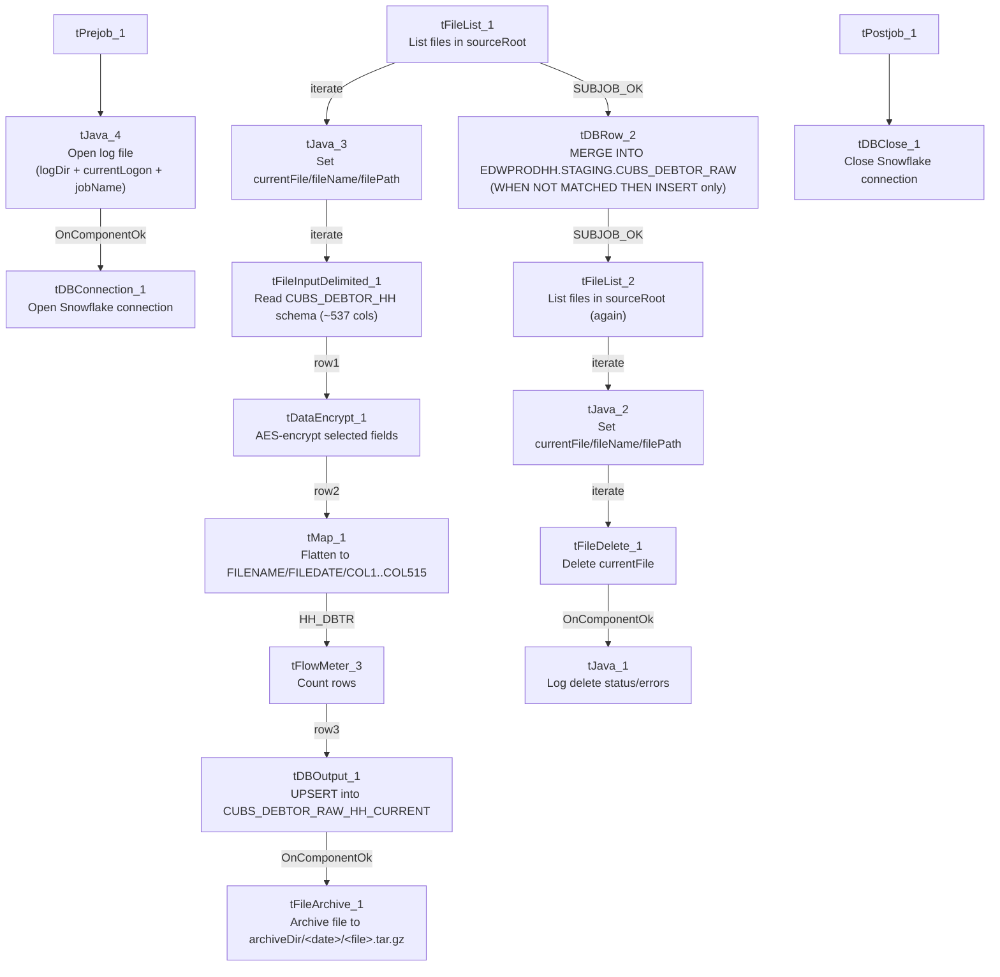

# Talend Job: CUBS_Raw_HH_Debtor_Load_Upsert

## Overview

Loads the "HH" site's debtor master-file extract (one row per debtor account: name, address, SSN, balances, collector/desk assignment, and roughly 530 other legacy CUBS fields) from a delimited file in `context.sourceRoot` into the Snowflake staging table `CUBS_DEBTOR_RAW_HH_CURRENT`, then merges newly-seen rows into the warehouse table `EDWPRODHH.STAGING.CUBS_DEBTOR_RAW`. The source's ~537 named business columns are encrypted (selected fields) and then flattened into a generic `COL1`…`COL515` schema before loading — the same "raw" positional-column pattern used elsewhere in this project rather than a business-named target table. This is one of three near-identical HH debtor-load job variants in the project (`CUBS_Raw_HH_Debtor_Load`, `CUBS_Raw_HH_Debtor_Load_No_Delete`, and this one); see Issues observed for what actually differs between them.

## Detail table

| Field | Value |
|---|---|
| Job name | CUBS_Raw_HH_Debtor_Load_Upsert |
| Version | 0.4 |
| Project | EDW2SF |
| Author | jmach@harriscollect.com |
| Created | 2024-07-11T11:59:48.643-0700 |
| Last Modified | 2026-03-24T10:17:05.158-0700 |

## Step-by-step data flow

**Setup subjob:** `tPrejob_1` →`tJava_4` builds a per-run log file at `context.logDir + context.currentLogon + "_" + jobName + "_" + <timestamp> + ".log"` and redirects `System.out`/`System.err` to it (code truncated at 253 characters in the extracted metadata) → on success, `tDBConnection_1` opens the job's Snowflake connection.

**Main subjob — pass 1 (load + archive):**

1. `tFileList_1` lists files in `context.sourceRoot` (`EXCLUDEFILEMASK="*.txt"` is configured but `IFEXCLUDE=false`, so nothing is actually excluded).
2. For each file (`ITERATE`), `tJava_3` sets `context.currentFile`/`fileName`/`filePath` from `tFileList_1`'s globalMap entries and prints a status line (code also truncated in the metadata).
3. `tFileInputDelimited_1` reads the file against the repository schema `CUBS_DEBTOR_HH` (~537 named business columns), using `context.EXPORT_DEBTOR_*` for its row/field separators, header row count, and encoding.
4. `tDataEncrypt_1` encrypts selected fields using AES (secret type, secret key, and password all `***REDACTED***` in the metadata — which specific fields, e.g. `SSN`, are encrypted is not visible since only component-level parameters were captured, not the per-field mapping).
5. `tMap_1` maps the ~537 named source columns down to a generic target schema of `FILENAME`, `FILEDATE`, and `COL1`…`COL515` (515 positional columns) — `DIE_ON_ERROR=true`, so a mapping failure here fails the job outright.
6. `tFlowMeter_3` counts rows passing through (labeled `"MyLabel"`, not renamed for this job).
7. `tDBOutput_1` (`tSnowflakeOutput`) upserts the rows into staging table `CUBS_DEBTOR_RAW_HH_CURRENT`.
8. On success, `tFileArchive_1` archives the current source file to `context.archiveDir + "/" + <CCYYMMDD> + "/" + context.fileName + ".tar.gz"`.

**Main subjob — merge (runs once, after the entire pass-1 loop finishes):**

`tFileList_1` also has a separate `SUBJOB_OK` link straight to `tDBRow_2`, so once *all* files in `context.sourceRoot` have been iterated and loaded, `tDBRow_2` runs a single `MERGE INTO EDWPRODHH.STAGING.CUBS_DEBTOR_RAW` statement (keyed on `FILEDATE` + `COL3`) against the staging table — see the Settings table below for why this only ever inserts, never updates.

**Main subjob — pass 2 (cleanup, runs after the merge):**

9. On the merge's `SUBJOB_OK`, `tFileList_2` lists `context.sourceRoot` again (same exclude-mask-not-applied configuration as `tFileList_1`).
10. For each file (`ITERATE`), `tJava_2` re-sets `context.currentFile`/`fileName`/`filePath`, then `tFileDelete_1` deletes `context.currentFile`.
11. On `tFileDelete_1`'s `COMPONENT_OK`, `tJava_1` logs the delete status, the path that was (or wasn't) deleted, and any error message.

**Teardown subjob:** `tPostjob_1` → `tDBClose_1` closes the Snowflake connection.

## Settings tables

### Source: `tFileInputDelimited_1`

| Setting | Value | What it means |
|---|---|---|
| SCHEMA / SCHEMA_REJECT | Repository schema `CUBS_DEBTOR_HH` (same schema for both) | Both the main and reject schema point at the identical repository schema (~537 named columns) — the extracted `schema_columns` array for this component lists that column set twice in sequence plus `errorCode`/`errorMessage`, consistent with main+reject both being captured. |
| FILENAME | `context.currentFile` | The file `tFileList_1`'s current iteration is pointing at. |
| ROWSEPARATOR / FIELDSEPARATOR / HEADER / ENCODING | `context.EXPORT_DEBTOR_RowSeparator` / `FieldSeparator` / `Header` / `Encoding` | Sourced from the `EXPORT_DEBTOR_0.1` context group — per `_shared_context.json` these resolve (in the sample environment captured) to `\n` row separator, `\t` field separator, header row count 1, and `US-ASCII` encoding. |
| TEMP_DIR | `"C:/Talend-Studio-20211109_1610-V8.0.1/workspace"` | Hardcoded developer-workstation path — see Issues observed and `05_operational_runbook.md`. |
| DIE_ON_ERROR | `false` | Malformed rows do not fail the job... |
| Reject flow | Not wired | ...but no connection in this job routes rejected rows anywhere — they are silently dropped. |

### Transform: `tDataEncrypt_1`

| Setting | Value | What it means |
|---|---|---|
| SECRET_TYPE / SECRET_KEY / PASSWORD_M1 | `***REDACTED***` (all three) | Encryption secret configuration — preserved as redacted, not guessable from this metadata. |
| CRYPTO_METHOD / ALGO_VERSION | `AES` / `2` | Encryption algorithm and version used. |
| CRYPTO_FILE_PATH | `context.cryptoPath` | Where the crypto key/config file is read from; `cryptoPath`'s actual value isn't set in any of the 23 project context groups captured in `_shared_context.json` — likely a job-level default not captured here. |

### Transform: `tMap_1`

| Setting | Value | What it means |
|---|---|---|
| Output schema | `FILENAME`, `FILEDATE`, `COL1`…`COL515` (517 columns total) | The ~537 named source business columns (post-encryption) are flattened into generic positional columns — the original column names (`LOGON`, `NAME1`, `SSN`, etc.) are not preserved in the target schema or in this job's own metadata's mapping expressions (tMap's per-field expressions aren't captured by this extraction, only its schema). |
| DIE_ON_ERROR | `true` | A mapping/lookup failure here fails the job outright, unlike the upstream file-read step. |

### Target (staging): `tDBOutput_1` (`tSnowflakeOutput`)

| Setting | Value | What it means |
|---|---|---|
| Table | `CUBS_DEBTOR_RAW_HH_CURRENT` | Staging table this run's data lands in. |
| Output action | `UPSERT` | Rows are upserted into the staging table (this is the behavior the "_Upsert" job-name suffix refers to — it applies here, at the staging step, not at the final-table merge below). |
| Table action | `NONE` | Table is not recreated/altered by this job. |

### Merge: `tDBRow_2` (`tSnowflakeRow`)

| Setting | Value | What it means |
|---|---|---|
| Target / source | `EDWPRODHH.STAGING.CUBS_DEBTOR_RAW` (tgt) / `STAGING.CUBS_DEBTOR_RAW_HH_CURRENT` (src) | Merges the just-loaded staging rows into the final raw table. |
| Match key | `tgt.FILEDATE = src.FILEDATE AND tgt.COL3 = src.COL3` | `COL3` corresponds to the source's `DEBTOR_IDX` column (third mapped field, and the only source column in this job explicitly marked non-nullable) — so the natural key is effectively (file date, debtor index). |
| Merge clauses | `WHEN NOT MATCHED THEN INSERT` only — **no `WHEN MATCHED` clause** | Despite the job's "_Upsert" name, this final merge never updates an existing matching row — it only inserts rows whose (FILEDATE, COL3) key doesn't already exist in the target. See Issues observed. |
| Inserted/selected columns | `FILENAME`, `FILEDATE`, `COL1`…`COL510` (510 of the 515 mapped columns) | The insert list stops at `COL510`; `COL511`–`COL515`, which are loaded into the staging table by `tDBOutput_1`, are **not** included in this INSERT's column list. See Issues observed. |

### File handling: `tFileList_1` / `tFileList_2`, `tFileArchive_1`, `tFileDelete_1`

| Setting | Value | What it means |
|---|---|---|
| DIRECTORY (`tFileList_1`/`_2`) | `context.sourceRoot` | Both listing passes scan the same directory. |
| EXCLUDEFILEMASK / IFEXCLUDE | `"*.txt"` / `false` | An exclusion mask is configured but never applied (`IFEXCLUDE=false`), so every file in the directory is picked up regardless of extension — same copy-paste pattern seen in `ADP_Payroll_Load`. |
| TARGET (`tFileArchive_1`) | `context.archiveDir + "/" + TalendDate.getDate("CCYYMMDD") + "/" + context.fileName + ".tar.gz"` | Archives the just-loaded file to a date-stamped subfolder. |
| SOURCE_FILE (`tFileArchive_1`) | `"C:/Talend-Studio-20211109_1610-V8.0.1/workspace/source.csv"` | Hardcoded developer-workstation path — see Issues observed. |
| ENCRYPT_FILES / PASSWORD (`tFileArchive_1`) | `false` / `***REDACTED***` | Archive encryption is disabled, yet a (redacted) password value is still configured — likely unused leftover configuration. |
| DIRECTORY / PATH (`tFileDelete_1`) | Both `"C:/Talend-Studio-20211109_1610-V8.0.1/workspace/delete_folder..."` | Hardcoded developer-workstation paths; the component's actual delete target is `context.currentFile` (`FILENAME` parameter), so these two fields appear to be unused leftover defaults rather than the live delete path — see Issues observed. |

## Dependencies & configuration

- **Triggers/depends on other jobs:** none — `runjob_targets` is empty, and this job does not appear as a target anywhere in `06_dependency_matrix.md`'s `tRunJob` table. Its sibling `CUBS_Raw_HH_Debtor_Load` (the base, non-upsert variant) *is* called by `CUBS_Raw_Debtor_Load`; this "_Upsert" variant's own trigger mechanism (manual run, separate schedule, etc.) is unable to determine from metadata.
- **Context variables used:** `EXPORT_DEBTOR_Encoding`, `EXPORT_DEBTOR_FieldSeparator`, `EXPORT_DEBTOR_Header`, `EXPORT_DEBTOR_RowSeparator` (from the `EXPORT_DEBTOR_0.1` context group), `archiveDir`, `logDir` (from `StandardFolders_0.1`), and `sourceRoot`, `cryptoPath`, `currentFile`, `currentLogon`, `fileName`, `filePath` — none of these last six appear in any of the 23 context groups captured in `_shared_context.json`, so they are presumably job-level context defaults not visible in this extraction.
- **Hardcoded path findings (4):** `tFileInputDelimited_1.TEMP_DIR`, `tFileArchive_1.SOURCE_FILE`, `tFileDelete_1.DIRECTORY`, `tFileDelete_1.PATH` — all under `C:/Talend-Studio-20211109_1610-V8.0.1/workspace/...`, the same project-wide developer-workstation path issue documented for 210 of 289 jobs in `05_operational_runbook.md`.

## Glossary

| Component type | Plain-English meaning |
|---|---|
| `tPrejob` / `tPostjob` | Run once before/after the rest of the job, regardless of how many times the main flow iterates. |
| `tSnowflakeConnection` / `tSnowflakeClose` | Open/close the Snowflake connection shared by other components in the job. |
| `tFileList` | Lists files in a directory for the job to iterate over one at a time. |
| `tJava` | Runs a block of custom Java code once (here, used to set context variables from a file-list iteration, or to open a log file). |
| `tFileInputDelimited` | Reads a delimited (CSV-style) text file according to a schema. |
| `tDataEncrypt` | Encrypts selected field values using a configured algorithm/key before they continue downstream. |
| `tMap` | Maps/transforms columns from one schema to another. |
| `tFlowMeter` | Counts rows passing a point in the flow, for logging/monitoring. |
| `tSnowflakeOutput` | Writes rows to a Snowflake table (insert/update/upsert, per its configured output action). |
| `tSnowflakeRow` | Runs an arbitrary SQL statement (here, a `MERGE`) against Snowflake. |
| `tFileArchive` / `tFileDelete` | Zip a processed file to an archive location, and separately delete a file from the source directory. |

## Issues observed

- **The final-table merge (`tDBRow_2`) drops columns `COL511`–`COL515`.** The staging table `CUBS_DEBTOR_RAW_HH_CURRENT` receives all 515 mapped `COL` fields via `tDBOutput_1`, but the `MERGE ... THEN INSERT` statement's column list stops at `COL510` — the last 5 mapped fields are loaded into staging every run and then never carried into `EDWPRODHH.STAGING.CUBS_DEBTOR_RAW`. Since which 5 source business fields these correspond to isn't visible (tMap's per-field mapping expressions aren't captured in this metadata), this should be verified directly in Talend Studio — if those fields carry meaningful data, this is a silent, ongoing data-loss point in the final table.
- **The merge has no `WHEN MATCHED` clause, despite the job's "_Upsert" name.** The `UPSERT` behavior only applies to the intermediate `tDBOutput_1` step into the staging table; the actual merge into `EDWPRODHH.STAGING.CUBS_DEBTOR_RAW` only ever inserts rows with a new (`FILEDATE`, `COL3`/`DEBTOR_IDX`) key combination — it never updates an existing row. If a source file needs to be corrected and re-run for the same file date, previously loaded debtor rows sharing that date would not be refreshed by this job.
- **`context.currentLogon` is referenced in `tJava_4` (used to build the setup subjob's log filename) but is never assigned anywhere in this job's own components** — the same pattern found in `ADP_Payroll_Load` with `context.fileName`. It's presumably a job-level context default not captured by this extraction; verify its actual value with the team.
- **`context.sourceRoot` and `context.cryptoPath` do not appear in any of this project's 23 documented context groups** (`_shared_context.json`), unlike `archiveDir`/`logDir` which resolve to `StandardFolders_0.1`. Their runtime values are unable to determine from metadata.
- **No reject-row handling is wired from `tFileInputDelimited_1`** — `DIE_ON_ERROR=false` means malformed rows won't fail the job, but there's also no connection routing rejected rows anywhere, so they're silently dropped with no count or record.
- **This job is not part of the documented `tRunJob` orchestration chain** (`06_dependency_matrix.md`), unlike its sibling `CUBS_Raw_HH_Debtor_Load`. Three near-identical HH debtor-load jobs exist in this project (base, `_No_Delete`, and this `_Upsert` variant); only the base is confirmed to run as part of `CUBS_Raw_Debtor_Load`'s pipeline. How and when this variant runs is unable to determine from metadata — worth confirming with the team so it isn't assumed to be dead code or, conversely, silently double-loading data alongside the base job.
- **The sibling `CUBS_Raw_HH_Debtor_Load_No_Delete` job actually contains a `tFileDelete_1` component** (it deletes source files in a second pass, exactly like this job does) — so its "No_Delete" name doesn't describe its own behavior. Worth knowing when comparing these two variants, since the name alone is misleading about which one deletes its source files (both do).
- **`tFileArchive_1` has `ENCRYPT_FILES=false` but still carries a configured (redacted) `PASSWORD` value** — likely unused leftover configuration rather than a functional risk, but worth confirming it isn't a sign the archive was meant to be encrypted and isn't.
