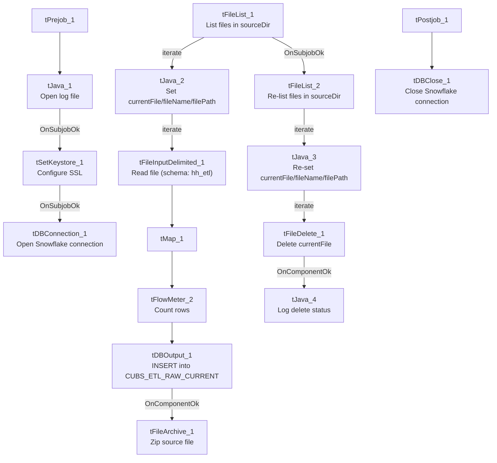

# Talend Job: CUBS_Raw_HH_ETL_Load

## Overview

Loads a HH-site (site code, see `01_system_architecture.md`) collections/credit-scoring extract file into the Snowflake staging table `CUBS_ETL_RAW_CURRENT`. The source columns are debtor-level attributes used for collections prioritization and dialer routing — bankruptcy dispositions (`BK7_DISP`/`BK11_DISP`/`BK13_DISP`), revolving/auto/mortgage/lease balances and credit lines, payment-history flags, inquiry counts, and a set of scoring fields (`Attune_Score`, `Propen_Score`, `Decile`, `Percentile`, `Dialer_group`). This job is one of six near-identical site variants (CHI, CO, DC, HH, PRE, TOL) called by the orchestrator `CUBS_Raw_ETL_Load`, which truncates the shared staging table and calls the merge procedure after all six have run — see Dependencies & configuration.

## Detail table

| Field | Value |
|---|---|
| Job name | CUBS_Raw_HH_ETL_Load |
| Version | 0.1 |
| Project | EDW2SF |
| Author | jmach@harriscollect.com |
| Created | 2022-12-14T09:06:26.338-0800 |
| Last Modified | 2025-11-11T22:52:34.037-0800 |

## Step-by-step data flow

**Setup subjob:** `tPrejob_1` → `tJava_1` opens a per-run log file at `context.logDir + jobName + "_" + <timestamp> + ".log"` and redirects `System.out`/`System.err` to it → on subjob-ok, `tSetKeystore_1` configures SSL trust/keystore from `context.keystorePath` (all keystore/truststore passwords `***REDACTED***`) → `tDBConnection_1` opens the Snowflake connection.

**Main subjob (file processing, runs independently of setup):**

1. `tFileList_1` lists files in `context.sourceDir` (an `EXCLUDEFILEMASK` of `*.txt` is configured but `IFEXCLUDE` is `false`, so nothing is actually excluded — every file in the directory is picked up, same as the pattern seen in `ADP_Payroll_Load`).
2. For each file (`ITERATE`), `tJava_2` sets `context.currentFile`, `context.fileName`, and `context.filePath` from the iteration's global-map values.
3. `tFileInputDelimited_1` reads the file (tab-delimited, 1 header row, `DIE_ON_ERROR=false`) using repository schema `"hh_etl"` — a schema unique to this job among its site siblings (see Issues observed for how this compares to the other site variants).
4. `tMap_1` passes the row through to a generic 80-column (`COL1`...`COL80`) plus `FILENAME`/`FILEDATE` target schema.
5. `tFlowMeter_2` counts rows passing through (label "MyLabel", not renamed for this job).
6. `tDBOutput_1` inserts the rows into Snowflake table `CUBS_ETL_RAW_CURRENT` (`INSERT`, no table-recreate action).
7. On success (`OnComponentOk`), `tFileArchive_1` tars/gzips the file from `context.filePath` to `context.archiveDir + "/" + <today's date> + "/" + context.fileName + ".tar.gz"` (AES-256 encrypted, password `***REDACTED***`).

**Cleanup subjob (also independent, its own `tFileList_2` re-lists the directory):**

8. `tFileList_2` re-lists `context.sourceDir` (same unused `*.txt` exclusion mask), and for each file (`ITERATE`) `tJava_3` re-sets `context.currentFile`/`fileName`/`filePath` from `tFileList_2`'s own iteration.
9. `tFileDelete_1` deletes `context.currentFile`.
10. On success, `tJava_4` prints the delete status, the deleted path, and any error message to the log.

**Teardown subjob:** `tPostjob_1` → `tDBClose_1` closes the Snowflake connection.

## Settings tables

### Source: `tFileInputDelimited_1`

| Setting | Value | What it means |
|---|---|---|
| FILENAME | `context.currentFile` | The file currently being iterated by `tFileList_1`. |
| FIELDSEPARATOR / HEADER | `"\t"` / 1 header row | Tab-delimited, header row skipped. |
| SCHEMA | Repository schema `"hh_etl"` | HH-specific schema label, distinct from the other five site variants' own schema GUIDs (each site has its own schema entry — see Issues observed). |
| DIE_ON_ERROR | `false` | Malformed rows don't fail the job... |
| Reject flow | Not wired | ...but there is no `SCHEMA_REJECT` configured and no reject connection out of this component — rejected rows are silently dropped with no record. |
| ENCODING | `ISO-8859-15` | Fixed encoding, not driven by a context variable (unlike the `EXPORT_CLIENT_*`-style jobs). |

### Target: `tDBOutput_1` (`tSnowflakeOutput`)

| Setting | Value | What it means |
|---|---|---|
| Table | `CUBS_ETL_RAW_CURRENT` | Shared staging table — all six site variants of this job template (CHI/CO/DC/HH/PRE/TOL) insert into the same table name. |
| Output action | `INSERT` | Appends rows; the orchestrator `CUBS_Raw_ETL_Load` truncates this table before calling any of the six site jobs (see Dependencies & configuration). |
| Table action | `NONE` | This job itself does not recreate/alter the table. |
| Reject schema fields present but unwired | `columnName`/`rowNumber`/`category`/`character`/`errorMessage`/`byteOffset`/`line`/`sqlState`/`code` appear in the captured output schema | These are `tSnowflakeOutput`'s reject-row fields; no reject connector is wired in this job's `connections`, so any row-level DB insert error would not be caught by a dedicated reject flow here. |

### Archive/cleanup: `tFileArchive_1` / `tFileDelete_1`

| Setting | Value | What it means |
|---|---|---|
| SOURCE / TARGET (`tFileArchive_1`) | `context.filePath` / `context.archiveDir+"/"+<CCYYMMDD>+"/"+context.fileName+".tar.gz"` | Archives the just-loaded file into a date-stamped subfolder, named after the actual source filename (not a job-specific name). |
| PASSWORD | `***REDACTED***` | Archive encryption password — value withheld in source metadata, preserved as redacted here. |
| `tFileDelete_1` FILENAME | `context.currentFile` (re-derived by the separate `tFileList_2`/`tJava_3` cleanup pass) | Deletes the source file — see Issues observed regarding the two independent file-listing passes. |

## Dependencies & configuration

- **Triggered by:** `CUBS_Raw_ETL_Load`, which (per `06_dependency_matrix.md`) truncates `STAGING.CUBS_ETL_RAW_CURRENT` and calls `CALL STAGING.MERGE_INTO_CUBS_ETL_RAW();` after running this job and its five siblings (`CUBS_Raw_CHI_ETL_Load`, `CUBS_Raw_CO_ETL_Load`, `CUBS_Raw_DC_ETL_Load`, `CUBS_Raw_PRE_ETL_Load`, `CUBS_Raw_TOL_ETL_Load`) via `tRunJob`.
- **Triggers/depends on other jobs:** none of its own — `runjob_targets` is empty in this job's metadata.
- **Context variables used:** `sourceDir`, `archiveDir`, `logDir`, `keystorePath` (from `StandardFolders_0.1` per `06_dependency_matrix.md`), plus `currentFile`, `fileName`, `filePath` (all set internally by `tJava_2`/`tJava_3` from the two `tFileList` iterations).
- **5 hardcoded developer-workstation paths**, all `C:/Talend-Studio-20211109_1610-V8.0.1/workspace/...`, in `tFileInputDelimited_1.TEMP_DIR`, `tFileArchive_1.SOURCE_FILE`, `tFileDelete_1.DIRECTORY`/`PATH`, and `tSetKeystore_1.SSL_TRUSTSERVER_TRUSTSTORE` — same portability risk documented project-wide in `05_operational_runbook.md`.

## Glossary

| Component type | Plain-English meaning |
|---|---|
| `tFileList` | Lists files in a directory for the job to iterate over one at a time. |
| `tFileInputDelimited` | Reads a delimited text file according to a schema. |
| `tMap` | Maps/transforms columns from one schema to another. |
| `tFlowMeter` | Counts rows passing a point in the flow, for logging/monitoring. |
| `tSnowflakeOutput` / `tSnowflakeConnection` / `tSnowflakeClose` | Write rows to Snowflake / open and close the shared Snowflake connection. |
| `tFileArchive` / `tFileDelete` | Zip a processed file to an archive location, then delete the original from the source directory. |
| `tSetKeystore` | Configures SSL trust/keystore settings used by the Snowflake connection. |

## Issues observed

- **Two independent `tFileList` passes over the same directory** (`tFileList_1` for reading/loading, `tFileList_2` for deleting) rather than deleting the file right after it's archived in the same iteration. If a new file lands in `context.sourceDir` between the two passes (e.g. another process drops a file while this job is running), `tFileList_2`'s delete pass could pick up and delete a file that was never actually loaded by `tFileList_1` in this run. Unable to determine from metadata whether the source directory is exclusively used by this job's own extract-drop process (which would make this safe) — verify with the team.
- **No reject flow wired from either `tFileInputDelimited_1` (malformed source rows) or `tDBOutput_1` (rejected Snowflake insert rows)**, despite `DIE_ON_ERROR=false` on the input. Both failure paths are effectively silent — a bad row disappears with no file, log entry, or table record of what was dropped.
- **This job's repository schema is labeled `"hh_etl"`, distinct per site** (each of the six site-variant ETL jobs has its own schema GUID/label — e.g. `co_etl`, `chi_etl`), which is consistent here; however, `CUBS_Raw_TOL_ETL_Load` (a sibling job, not in this batch) actually reuses `CO_ETL_Load`'s schema GUID (`co_etl`) rather than having its own `tol_etl` schema — worth flagging to the team as a likely copy-paste artifact in that sibling, even though it does not affect this HH job directly.
- **`EXCLUDEFILEMASK: "*.txt"` is configured on both `tFileList_1` and `tFileList_2` but `IFEXCLUDE` is `false`**, so the mask has no actual effect — every file in `context.sourceDir` is processed, not just non-`.txt` files. Likely a leftover/no-op setting rather than an intentional filter.
- No `tWarn`/`tDie`/`tSendMail` logic exists in this job — a load failure here would only surface as a generic Talend execution error, consistent with the majority of jobs noted in `05_operational_runbook.md`. No further job-specific risk pattern beyond what's listed above was found in this job's metadata.
