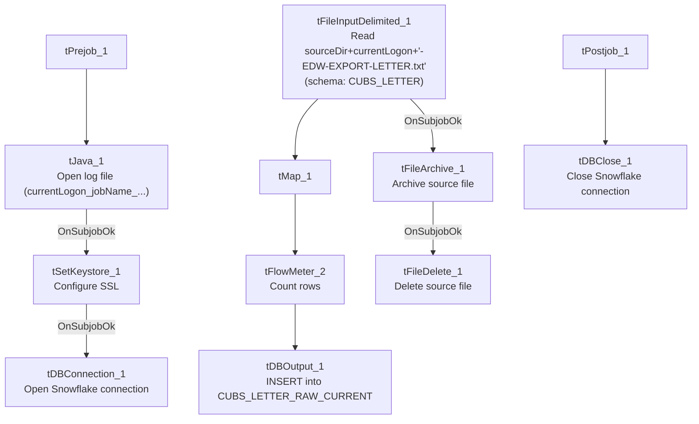

# Talend Job: CUBS_Raw_Letter_Load

## Overview

Loads a per-logon CUBS collections-letter export file (letter ID, debtor, amount, pay-by date, print/override flags, notice sequencing) into the Snowflake staging table `CUBS_LETTER_RAW_CURRENT`, then archives and deletes the source file. Unlike the site-specific `_Client_Load`/`_ETL_Load` job families, this job is not itself split into per-site variants in the extracted metadata — it is a single job driven by `context.currentLogon`, and per `06_dependency_matrix.md` it is called exactly once, by `CO_Master_Load`. Whether it is also invoked for other sites/logons through a mechanism outside this metadata is unclear — see Issues observed.

## Detail table

| Field | Value |
|---|---|
| Job name | CUBS_Raw_Letter_Load |
| Version | 0.1 |
| Project | EDW2SF |
| Author | jmach@harriscollect.com |
| Created | 2022-12-20T10:17:35.422-0800 |
| Last Modified | 2025-11-04T11:08:14.137-0800 |

## Step-by-step data flow

**Setup subjob:** `tPrejob_1` → `tJava_1` opens a per-run log file at `context.logDir + context.currentLogon + "_" + jobName + "_" + <timestamp> + ".log"` (note the log filename is prefixed with `currentLogon`, unlike `CUBS_Raw_HH_ETL_Load`'s job-name-only log filename) → on subjob-ok, `tSetKeystore_1` configures SSL trust/keystore from `context.keystorePath` (passwords `***REDACTED***`) → `tDBConnection_1` opens the Snowflake connection.

**Main subjob:**

1. `tFileInputDelimited_1` reads `context.sourceDir + context.currentLogon + "-EDW-EXPORT-LETTER.txt"` (tab-delimited, 1 header row, `DIE_ON_ERROR=false`) using repository schema `"CUBS_LETTER"`.
2. On success (`OnSubjobOk`), `tFileArchive_1` archives the same source file (independent of whether the load/insert below succeeded — see Issues observed).
3. `tMap_1` passes the row through to a 28-column (`FILENAME`/`FILEDATE`/`COL1`...`COL26`) target schema.
4. `tFlowMeter_2` counts rows passing through (label "MyLabel").
5. `tDBOutput_1` inserts the rows into Snowflake table `CUBS_LETTER_RAW_CURRENT` (`INSERT`, no table-recreate action).
6. Separately, once `tFileArchive_1` completes (`OnSubjobOk`), `tFileDelete_1` deletes the original source file.

**Teardown subjob:** `tPostjob_1` → `tDBClose_1` closes the Snowflake connection.

## Settings tables

### Source: `tFileInputDelimited_1`

| Setting | Value | What it means |
|---|---|---|
| FILENAME | `context.sourceDir + context.currentLogon + "-EDW-EXPORT-LETTER.txt"` | Per-logon filename pattern — `currentLogon` must be set by whatever calls this job (see Issues observed, it is not set within this job's own metadata). |
| FIELDSEPARATOR / HEADER | `"\t"` / 1 header row | Tab-delimited, header row skipped. |
| SCHEMA | Repository schema `"CUBS_LETTER"` | Well-formed letter-row layout: letter ID/index, debtor, letter amount, pay-by date, print/override flags, notice sequence/rate/pay-days, series, employee initials. |
| DIE_ON_ERROR | `false` | Malformed rows do not fail the job... |
| Reject flow | Not wired | ...but there is no `SCHEMA_REJECT` configured and no reject connection — rejected rows are silently dropped, with no file, log, or table record of what failed. |
| ENCODING | `ISO-8859-15` | Fixed encoding, not context-driven. |

### Target: `tDBOutput_1` (`tSnowflakeOutput`)

| Setting | Value | What it means |
|---|---|---|
| Table | `CUBS_LETTER_RAW_CURRENT` | Destination staging table for raw letter export rows. |
| Output action | `INSERT` | Appends rows — there is no `TRUNCATE` step in this job itself; any truncate/merge into a downstream fact table would have to happen in a separate job or procedure not visible in this metadata. |
| Table action | `NONE` | Table is not recreated/altered by this job. |
| Reject schema fields present but unwired | `columnName`/`rowNumber`/`category`/`character`/`errorMessage`/`byteOffset`/`line`/`sqlState`/`code` | `tSnowflakeOutput`'s built-in reject-row fields are present in the captured schema but no reject connector is wired — a row-level DB insert error is not caught by a dedicated reject flow here either. |

### Archive/cleanup: `tFileArchive_1` / `tFileDelete_1`

| Setting | Value | What it means |
|---|---|---|
| SOURCE / TARGET (`tFileArchive_1`) | `context.sourceDir` / `context.archiveDir+"/"+<CCYYMMDD>+"/"+context.currentLogon+"-EDW-EXPORT-LETTER.txt.tar.gz"` | Archives into a date-stamped subfolder, named after the per-logon source filename. |
| PASSWORD | `***REDACTED***` | Archive encryption password — withheld in source metadata, preserved as redacted here. |
| Trigger for archive | `tFileInputDelimited_1` `OnSubjobOk`, not downstream of `tDBOutput_1` | The archive step runs as soon as the *read* subjob succeeds — it does not wait for the Snowflake insert to actually complete. See Issues observed. |
| `tFileDelete_1` FILENAME | `context.sourceDir + context.currentLogon + "-EDW-EXPORT-LETTER.txt"` | Re-derives the same filename expression as the input step, rather than reusing a variable set once — functionally equivalent here since `currentLogon`/`sourceDir` don't change mid-run, but a second, independent point where the same string has to stay in sync if either component's path logic is ever edited. |

## Dependencies & configuration

- **Triggered by:** `CUBS_Raw_Letter_Load` is called once by `CO_Master_Load`, in Branch B of that job's transaction chain (after `CUBS_Raw_Trans_Load` succeeds — see `job_CO_Master_Load.md` and `06_dependency_matrix.md`). No other calling job is recorded in the dependency matrix.
- **Triggers/depends on other jobs:** none — `runjob_targets` is empty in this job's own metadata.
- **Context variables used:** `sourceDir`, `archiveDir`, `logDir`, `keystorePath` (from `StandardFolders_0.1`), and `currentLogon` — see Issues observed regarding where `currentLogon`'s value actually comes from at runtime.
- **5 hardcoded developer-workstation paths**, all `C:/Talend-Studio-20211109_1610-V8.0.1/workspace/...`, in `tFileInputDelimited_1.TEMP_DIR`, `tFileDelete_1.DIRECTORY`/`PATH`, `tFileArchive_1.SOURCE_FILE`, and `tSetKeystore_1.SSL_TRUSTSERVER_TRUSTSTORE` — same portability risk documented project-wide in `05_operational_runbook.md`.

## Glossary

| Component type | Plain-English meaning |
|---|---|
| `tFileInputDelimited` | Reads a delimited text file according to a schema. |
| `tMap` | Maps/transforms columns from one schema to another. |
| `tFlowMeter` | Counts rows passing a point in the flow, for logging/monitoring. |
| `tSnowflakeOutput` / `tSnowflakeConnection` / `tSnowflakeClose` | Write rows to Snowflake / open and close the Snowflake connection used throughout the job. |
| `tFileArchive` / `tFileDelete` | Zip a processed file to an archive location, then delete the original from the source directory. |
| `tSetKeystore` | Configures SSL trust/keystore settings used by the Snowflake connection. |

## Issues observed

- **`context.currentLogon` is used throughout this job (log filename, source filename, archive filename, delete filename) but is never set anywhere within this job's own metadata**, and it is not one of the context variables checked in `_shared_context.json`'s context groups (no group defines a `currentLogon` default). This job's only recorded caller, `CO_Master_Load`, also does not reference or set `currentLogon` in its own metadata (per `job_CO_Master_Load.md`). Where this value is actually supplied at runtime — a scheduler-level context override, a job-level default not captured in this extraction, or something else — is unable to determine from metadata; if it is genuinely unset, every path built from it would resolve with a blank/null substitution, which would very likely make the source file lookup fail outright rather than silently misbehave. Verify directly with the team before assuming this job runs successfully as configured.
- **`tFileArchive_1` runs as soon as the file read subjob succeeds, not after the Snowflake insert (`tDBOutput_1`) succeeds.** If the insert into `CUBS_LETTER_RAW_CURRENT` were to fail after the read but before commit, the source file would still be archived (and then deleted by `tFileDelete_1`), leaving no easy way to identify or re-obtain the original file for a retry. This differs from `ADP_Payroll_Load`'s pattern, where archiving is gated behind a successful merge result.
- **No reject flow wired from either `tFileInputDelimited_1` or `tDBOutput_1`**, despite `DIE_ON_ERROR=false` on the input — malformed source rows and any rejected Snowflake insert rows are both silently dropped with no record.
- **This job has no site-code variant** (unlike the `_Client_Load`/`_ETL_Load`/`_Debtor_Load` families), and is instead parameterized entirely by `currentLogon`. Given the `currentLogon`-sourcing question above, it's worth confirming with the team whether this job is meant to be called once per logon (looped by some caller not captured here) or is only ever invoked once per `CO_Master_Load` run as the dependency matrix currently shows.
