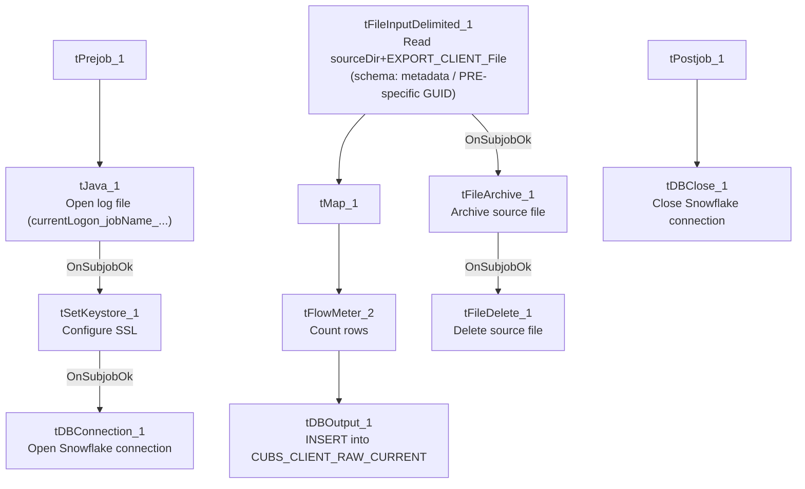

# Talend Job: CUBS_Raw_PRE_Client_Load

## Overview

Loads a PRE-site (site code, see `01_system_architecture.md`) CUBS client-master export file — client identifiers, name/address, billing rates, statement/invoice frequency preferences, credit-reporting flags, and a large block of client-configuration/billing options (~170 business columns) — into the Snowflake staging table `CUBS_CLIENT_RAW_CURRENT`. It is one of six near-identical site variants (CHI, CO, DC, HH, PRE, TOL) of the same job template, plus a seventh, non-site-specific `CUBS_Raw_Client_Load`. Unlike its `_ETL_Load` and `_Debtor_Load` counterparts, no orchestrator job is recorded anywhere in the extracted metadata as calling this specific job — see Issues observed.

## Detail table

| Field | Value |
|---|---|
| Job name | CUBS_Raw_PRE_Client_Load |
| Version | 0.1 |
| Project | EDW2SF |
| Author | jmach@harriscollect.com |
| Created | 2023-09-26T11:18:33.398-0700 |
| Last Modified | 2025-11-04T11:08:09.399-0800 |

## Step-by-step data flow

**Setup subjob:** `tPrejob_1` → `tJava_1` opens a per-run log file at `context.logDir + context.currentLogon + "_" + jobName + "_" + <timestamp> + ".log"` → on subjob-ok, `tSetKeystore_1` configures SSL trust/keystore from `context.keystorePath` (passwords `***REDACTED***`) → `tDBConnection_1` opens the Snowflake connection.

**Main subjob:**

1. `tFileInputDelimited_1` reads `context.sourceDir + context.EXPORT_CLIENT_File` — all of its delimiter/header/encoding settings (`ROWSEPARATOR`, `FIELDSEPARATOR`, `HEADER`, `ENCODING`) are driven by the `EXPORT_CLIENT_*` context group rather than hardcoded, using repository schema `"metadata"` (a PRE-specific schema GUID; see Issues observed on the schema label itself) and `TRIMALL=true` (trims all field values — not seen as an explicit setting in the `HH_ETL_Load`/`Letter_Load` jobs in this batch).
2. On success (`OnSubjobOk`), `tFileArchive_1` archives the source file to `context.archiveDir + "/" + <today's date> + "/" + context.EXPORT_CLIENT_File + ".tar.gz"`.
3. `tMap_1` passes the row through to a 202-column (`FILENAME`/`FILEDATE`/`COL1`...`COL200`) target schema.
4. `tFlowMeter_2` counts rows passing through (label "MyLabel", stream labeled `"cli"`).
5. `tDBOutput_1` inserts the rows into Snowflake table `CUBS_CLIENT_RAW_CURRENT` (`INSERT`, no table-recreate action).
6. Separately, once `tFileArchive_1` completes (`OnSubjobOk`), `tFileDelete_1` deletes `context.sourceDir + context.EXPORT_CLIENT_File`.

**Teardown subjob:** `tPostjob_1` → `tDBClose_1` closes the Snowflake connection.

## Settings tables

### Source: `tFileInputDelimited_1`

| Setting | Value | What it means |
|---|---|---|
| FILENAME | `context.sourceDir + context.EXPORT_CLIENT_File` | Filename is entirely context-driven — see Issues observed regarding `EXPORT_CLIENT_File`'s stored default value. |
| ROWSEPARATOR / FIELDSEPARATOR / HEADER / ENCODING | `context.EXPORT_CLIENT_RowSeparator` / `context.EXPORT_CLIENT_FieldSeparator` / `context.EXPORT_CLIENT_Header` / `context.EXPORT_CLIENT_Encoding` | All read-format settings come from the shared `EXPORT_CLIENT_0.1` context group rather than being fixed per job — this job is more context-parameterized than `CUBS_Raw_HH_ETL_Load` or `CUBS_Raw_Letter_Load` in this batch, both of which hardcode their delimiter/encoding values. |
| CSVROWSEPARATOR | `context.EXPORT_TRANS_RowSeparator` | Uses the **transaction** export group's row separator, not a client-specific one — likely a copy-paste artifact from a transaction-load job template, though this parameter only applies when `CSV_OPTION=true`, which is `false` here, so it appears to have no actual effect. |
| SCHEMA | Repository schema `"metadata"` (GUID `_u_wNUFMkEe6koubybprAWA`) | Same GUID/label as `CUBS_Raw_HH_Client_Load`? No — each site variant in this family has its own schema GUID even when the label text shown is generic (`"metadata"`); this job's specific GUID differs from CHI's, CO's/TOL's (which share one GUID), DC's, and HH's own schema entries. See Issues observed. |
| SCHEMA_REJECT | Repository schema `"CUBS_TRANSACTION"` | **Mislabeled** — this is a client-load job but its reject schema is a transaction schema, the same reject-schema mismatch pattern documented in `ADP_Payroll_Load`, and shared identically across all six site variants of this job family (see Issues observed). |
| DIE_ON_ERROR | `false` | Malformed rows do not fail the job... |
| Reject flow | Not wired | ...but there is no connection carrying rejected rows anywhere — they are silently dropped, same as `CUBS_Raw_HH_ETL_Load` and `CUBS_Raw_Letter_Load` in this batch. |
| TRIMALL | `true` | All field values are trimmed of leading/trailing whitespace on read. |

### Target: `tDBOutput_1` (`tSnowflakeOutput`)

| Setting | Value | What it means |
|---|---|---|
| Table | `CUBS_CLIENT_RAW_CURRENT` | Shared staging table — identical table name used by all six site variants (CHI/CO/DC/HH/PRE/TOL) and the non-site-specific `CUBS_Raw_Client_Load`. |
| Output action | `INSERT` | Appends rows; no `TRUNCATE` step exists in this job itself. |
| Table action | `NONE` | Table is not recreated/altered by this job. |

### Archive/cleanup: `tFileArchive_1` / `tFileDelete_1`

| Setting | Value | What it means |
|---|---|---|
| SOURCE / TARGET (`tFileArchive_1`) | `context.sourceDir` / `context.archiveDir+"/"+<CCYYMMDD>+"/"+context.EXPORT_CLIENT_File+".tar.gz"` | Archives into a date-stamped subfolder, named after the context-driven export filename. |
| PASSWORD | `***REDACTED***` | Archive encryption password — withheld in source metadata, preserved as redacted here. |
| `tFileDelete_1` FILENAME | `context.sourceDir + context.EXPORT_CLIENT_File` | Same expression as the input filename, re-derived independently. |

## Dependencies & configuration

- **Triggers/depends on other jobs:** none — `runjob_targets` is empty in this job's own metadata.
- **No calling job is recorded anywhere in `06_dependency_matrix.md`.** This stands out because its sibling job families do have documented orchestrators: `CUBS_Raw_ETL_Load` calls all six site `_ETL_Load` jobs, and `CUBS_Raw_Debtor_Load` calls five of the six site `_Debtor_Load` jobs. No equivalent `CUBS_Raw_Client_Load → CUBS_Raw_<site>_Client_Load` orchestration exists in the extracted metadata (the base `CUBS_Raw_Client_Load` job is itself a leaf/file-loader job, not an orchestrator — it has the same tFileInputDelimited/tMap/tDBOutput shape as this job, just without a site suffix). The only Client_Load-family job with a known caller is `CUBS_Raw_CO_Client_Load`, called once by `CO_Master_Load`. How `CUBS_Raw_PRE_Client_Load` is actually triggered (a separate PRE-specific scheduler entry, a master job not present in this export, or something else) is unable to determine from metadata — verify with the team.
- **Context variables used:** `sourceDir`, `archiveDir`, `logDir`, `keystorePath` (from `StandardFolders_0.1`), `currentLogon`, and the full `EXPORT_CLIENT_0.1` group (`EXPORT_CLIENT_File`, `EXPORT_CLIENT_Header`, `EXPORT_CLIENT_FieldSeparator`, `EXPORT_CLIENT_RowSeparator`, `EXPORT_CLIENT_Encoding`), plus `EXPORT_TRANS_RowSeparator` from the separate `EXPORT_TRANS_0.1` group (see Settings tables).
- **5 hardcoded developer-workstation paths**, all `C:/Talend-Studio-20211109_1610-V8.0.1/workspace/...`, in `tFileInputDelimited_1.TEMP_DIR`, `tFileArchive_1.SOURCE_FILE`, `tFileDelete_1.DIRECTORY`/`PATH`, and `tSetKeystore_1.SSL_TRUSTSERVER_TRUSTSTORE` — same portability risk documented project-wide in `05_operational_runbook.md`.

## Glossary

| Component type | Plain-English meaning |
|---|---|
| `tFileInputDelimited` | Reads a delimited text file according to a schema. |
| `tMap` | Maps/transforms columns from one schema to another. |
| `tFlowMeter` | Counts rows passing a point in the flow, for logging/monitoring. |
| `tSnowflakeOutput` / `tSnowflakeConnection` / `tSnowflakeClose` | Write rows to Snowflake / open and close the Snowflake connection used throughout the job. |
| `tFileArchive` / `tFileDelete` | Zip a processed file to an archive location, then delete the original from the source directory. |
| `tSetKeystore` | Configures SSL trust/keystore settings used by the Snowflake connection. |

## Issues observed

- **`context.EXPORT_CLIENT_File`'s stored default in `_shared_context.json` is `"HH-EDW-EXPORT-CLIENT.txt"` — a hardcoded HH filename — not a PRE (or generic) one.** The `EXPORT_CLIENT_0.1` context group has no per-site override captured anywhere in this project's metadata; every site variant of this job (CHI, CO, DC, HH, PRE, TOL) reads its filename from the same single `context.EXPORT_CLIENT_File` variable. If this job runs with that group's stored default rather than a job-level or execution-level override supplied at runtime (a scheduler-level context set, not visible in this metadata), it would attempt to read the **HH** file instead of a PRE-specific one. This could not be confirmed or ruled out from the available metadata — it is a high-priority item to verify directly with the team, since a wrong-file read would either fail outright (file not found) or, worse, silently reload HH's client data under a PRE job run.
- **The `SCHEMA_REJECT` on `tFileInputDelimited_1` is labeled `"CUBS_TRANSACTION"`, not a client-reject schema** — the exact same mismatch pattern as `ADP_Payroll_Load`'s reject-schema issue, and identically present across all six site variants of this job (CHI/CO/DC/HH/PRE/TOL), which suggests it was copied once into a shared job template and never corrected in any of them, rather than being specific to this job. Combined with `DIE_ON_ERROR=false` and no reject connector wired at all, this schema mislabeling has no actual effect today (no rows ever flow through it), but it would need to be fixed before anyone tries to wire up a real reject-row destination.
- **`CSVROWSEPARATOR` is set to `context.EXPORT_TRANS_RowSeparator`** (the transaction-export group's separator) rather than `context.EXPORT_CLIENT_RowSeparator`. Since `CSV_OPTION=false`, this parameter is not actually used by the CSV parser in this configuration, so it currently has no functional effect — but it is inconsistent with the rest of the component's settings, which otherwise consistently reference `EXPORT_CLIENT_*` variables, and would produce wrong behavior if `CSV_OPTION` were ever turned on without also fixing this field.
- **No job in the extracted metadata calls `CUBS_Raw_PRE_Client_Load`.** Its `_ETL_Load` and (mostly) `_Debtor_Load` sibling families have documented orchestrators (`CUBS_Raw_ETL_Load`, `CUBS_Raw_Debtor_Load`); the Client_Load family does not, apart from `CO_Master_Load` calling `CUBS_Raw_CO_Client_Load` specifically. Verify with the team how/whether this job is actually scheduled to run.
- **No reject flow wired from `tFileInputDelimited_1`** — same silent-drop pattern as the other two jobs in this batch: malformed rows are neither logged nor routed anywhere.
