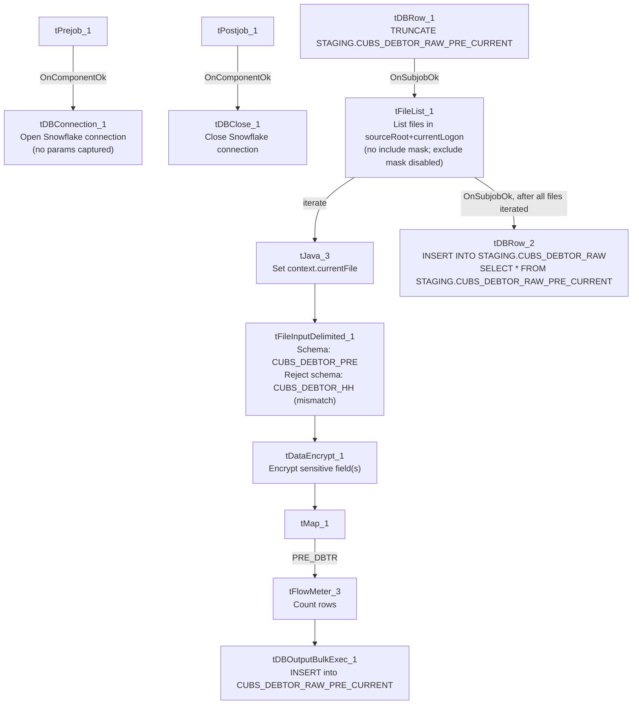

# Talend Job: CUBS_Raw_PRE_Debtor_Load

## Overview

This is the "PRE" site's variant of the project's per-site debtor-load template: it truncates a per-run staging table, reads every debtor export file found in a site-specific source folder, encrypts sensitive fields, maps the ~300-column wide debtor record, and bulk-loads it into a Snowflake staging table before appending the batch into the cumulative `CUBS_DEBTOR_RAW` history table. It is invoked as one of five (CHI/CO/DC/HH/PRE) sibling jobs from the `CUBS_Raw_Debtor_Load` orchestrator (see `06_dependency_matrix.md`) — the debtor record itself is a very wide, decades-accreted layout spanning collection, healthcare/UB92, insurance, skip-trace, and letter-history fields, consistent with a legacy collections-system export being loaded wholesale into the warehouse.

## Detail table

| Field | Value |
|---|---|
| Job name | CUBS_Raw_PRE_Debtor_Load |
| Version | 0.1 |
| Project | EDW2SF |
| Author | jmach@harriscollect.com |
| Created | 2022-05-06T09:15:29.214-0700 |
| Last Modified | 2022-06-13T14:33:39.417-0700 |

## Step-by-step data flow

**Setup subjob:** `tPrejob_1` →(`OnComponentOk`)→ `tDBConnection_1` opens the job's Snowflake connection. This component's parameters are entirely empty in this job's own metadata (no captured hand-set LABEL, host, or schema) — see Issues observed.

**Teardown subjob:** `tPostjob_1` →(`OnComponentOk`)→ `tDBClose_1` closes the Snowflake connection.

**Main subjob:**

1. `tDBRow_1` runs `TRUNCATE TABLE STAGING.CUBS_DEBTOR_RAW_PRE_CURRENT;` to clear the per-run current-batch staging table.
2. On success (`SUBJOB_OK`), `tFileList_1` lists every file (no include filemask configured; an `EXCLUDEFILEMASK` of `*.txt` is set but `IFEXCLUDE=false`, so nothing is actually excluded) in `context.sourceRoot + context.currentLogon`.
3. For each file (`ITERATE`), `tJava_3` sets `context.currentFile` from the current file path and prints a "Processing file ..." line to the log.
4. `tJava_3` →(`ITERATE`)→ `tFileInputDelimited_1` reads the file using the repository schema `CUBS_DEBTOR_PRE` (a ~304-column debtor layout) as its main schema, with row/field separators and encoding driven by `context.EXPORT_DEBTOR_*` context variables and `DIE_ON_ERROR=false`. Its configured reject schema is `CUBS_DEBTOR_HH`, not `CUBS_DEBTOR_PRE` — see Issues observed.
5. `tFileInputDelimited_1` →(`FLOW`, row name `row1`)→ `tDataEncrypt_1` encrypts sensitive field(s) in the record using a redacted password/secret and `ALGO_VERSION=2`; which specific column(s) are encrypted is not captured in this job's metadata (no `FIELDS`-style parameter present).
6. `tDataEncrypt_1` →(`FLOW`, row name `row2`)→ `tMap_1` passes the record through (no field-level mapping expressions are captured in this metadata beyond the schema shapes; `DIE_ON_ERROR=true` on the map, so a mapping failure fails the job outright).
7. `tMap_1` →(`FLOW`, row name **`PRE_DBTR`** — a job-specific, hand-named output row, unlike the generic `row1`/`row2`/`row3` names elsewhere in this same job)→ `tFlowMeter_3` counts rows passing through.
8. `tFlowMeter_3` →(`FLOW`, row name `row3`)→ `tDBOutputBulkExec_1` bulk-inserts the rows into Snowflake table `CUBS_DEBTOR_RAW_PRE_CURRENT` (`outputAction=INSERT`, `tableAction=NONE`).
9. Separately, once the `tFileList_1` iteration subjob completes successfully (`SUBJOB_OK`, not gated on any single file's success/failure), `tDBRow_2` runs `INSERT INTO STAGING.CUBS_DEBTOR_RAW SELECT * FROM STAGING.CUBS_DEBTOR_RAW_PRE_CURRENT;`, appending the whole batch just loaded into the cumulative history table.

## Settings tables

### Staging reset: `tDBRow_1` (`tSnowflakeRow`)

| Setting | Value | What it means |
|---|---|---|
| Query | `TRUNCATE TABLE STAGING.CUBS_DEBTOR_RAW_PRE_CURRENT;` | Empties the per-run current-batch staging table before the file iteration begins, so `CUBS_DEBTOR_RAW_PRE_CURRENT` only ever holds the rows from the current run at bulk-load time. |

### File discovery: `tFileList_1`

| Setting | Value | What it means |
|---|---|---|
| DIRECTORY | `context.sourceRoot + context.currentLogon` | Directory is built from two context variables, neither of which appears in `_shared_context.json`'s captured context groups — their actual runtime values can't be confirmed from metadata. See Issues observed. |
| LIST_MODE | `FILES` | Lists files only (no subdirectories; `INCLUDSUBDIR=false`). |
| Include filemask | Not set | No filemask restricts which files are picked up — every file in the directory is listed. |
| EXCLUDEFILEMASK / IFEXCLUDE | `"*.txt"` / `false` | An exclusion for `.txt` files is configured but disabled, so it has no effect — combined with no include mask, this job would iterate over any file dropped in that directory, not just debtor export files. |

### Source: `tFileInputDelimited_1`

| Setting | Value | What it means |
|---|---|---|
| FILENAME | `context.currentFile` | The file currently being iterated by `tFileList_1`/`tJava_3`. |
| FIELDSEPARATOR / ROWSEPARATOR / HEADER / ENCODING | `context.EXPORT_DEBTOR_FieldSeparator` / `context.EXPORT_DEBTOR_RowSeparator` / `context.EXPORT_DEBTOR_Header` / `context.EXPORT_DEBTOR_Encoding` | Delimiter/encoding settings sourced from the shared `EXPORT_DEBTOR_0.1` context group (defaults there are tab-delimited, `\n` row separator, header row present, `US-ASCII` — see `_shared_context.json`). |
| SCHEMA (main) | Repository schema `CUBS_DEBTOR_PRE` (~304 business columns) | The expected wide debtor layout for the PRE site — includes identity fields (`LOGON`, `DEBTOR`, `CLIENT`, `NAME1/2`, `SSN`, `DOB`), balance/collection fields, letter-history fields, and a large block of healthcare/UB92 and insurance fields (`ADMIT_DIAG`, `FINL_CLASS`, `POLICY`, etc.), reflecting a legacy collections-system export. |
| SCHEMA_REJECT | Repository schema `CUBS_DEBTOR_HH` | **Mislabeled for this job** — `CUBS_Raw_PRE_Debtor_Load`'s reject schema points to the HH site's debtor schema, not PRE's. See Issues observed. |
| DIE_ON_ERROR | `false` | Malformed rows don't fail the job... |
| Reject flow | Not wired | ...but (per `connections`) no connection carries rejected rows anywhere — they are silently dropped with no record of count or content. |
| TEMP_DIR | `"C:/Talend-Studio-20211109_1610-V8.0.1/workspace"` | Hardcoded developer-workstation path — see `05_operational_runbook.md`'s project-wide finding (210 of 289 jobs share this exact path). |

### Transform: `tDataEncrypt_1`

| Setting | Value | What it means |
|---|---|---|
| PASSWORD_M1 | `***REDACTED***` | Encryption key/passphrase — preserved as redacted, not guessable from metadata. |
| SECRET_TYPE | `***REDACTED***` | Also redacted in source metadata. |
| CRYPTO_FILE_PATH | `context.cryptoPath` | Path to a cryptographic key/config file; `cryptoPath` is not defined in any captured context group in `_shared_context.json` — its actual value is unknown from this metadata. |
| ALGO_VERSION | `2` | Encryption algorithm version. |
| Which column(s) are encrypted | Not captured | This job's metadata doesn't include a field-selection parameter for `tDataEncrypt_1`; likely candidates given the schema are `SSN`/`SSN1`, but this is not confirmed — verify directly in Talend Studio. |

### Target: `tDBOutputBulkExec_1` (`tSnowflakeOutputBulkExec`)

| Setting | Value | What it means |
|---|---|---|
| Table | `CUBS_DEBTOR_RAW_PRE_CURRENT` | Destination staging table for the current run's batch (no explicit schema prefix on this component, unlike the `STAGING.`-prefixed queries elsewhere in this job — consistent with the connection's default schema already being `STAGING`, though that isn't directly confirmed by this job's own metadata since `tDBConnection_1` has no captured parameters). |
| outputAction | `INSERT` | Appends rows; relies on the earlier `TRUNCATE` (`tDBRow_1`) to prevent duplicate accumulation across runs. |
| tableAction | `NONE` | Table is not recreated/altered by this job. |

### History append: `tDBRow_2` (`tSnowflakeRow`)

| Setting | Value | What it means |
|---|---|---|
| Query | `INSERT INTO STAGING.CUBS_DEBTOR_RAW SELECT * FROM STAGING.CUBS_DEBTOR_RAW_PRE_CURRENT;` | Appends the entire just-loaded current-batch staging table into the cumulative `CUBS_DEBTOR_RAW` table. Runs once per job execution (wired off `tFileList_1`'s subjob-ok, after all files have iterated), not per file. |

## Dependencies & configuration

- **Triggered by:** `CUBS_Raw_Debtor_Load`, which calls this job as one of five site-specific debtor loads (`CUBS_Raw_CHI_Debtor_Load`, `CUBS_Raw_CO_Debtor_Load`, `CUBS_Raw_DC_Debtor_Load`, `CUBS_Raw_HH_Debtor_Load`, `CUBS_Raw_PRE_Debtor_Load`) — see `06_dependency_matrix.md`. This job's own `runjob_targets` is empty — it does not call any other job.
- **Context variables used:** `EXPORT_DEBTOR_Encoding`, `EXPORT_DEBTOR_FieldSeparator`, `EXPORT_DEBTOR_Header`, `EXPORT_DEBTOR_RowSeparator` (all from the shared `EXPORT_DEBTOR_0.1` context group), plus `cryptoPath`, `currentFile`, `currentLogon`, and `sourceRoot` — none of these last four appear in `_shared_context.json`'s captured context groups, so their runtime values/defaults can't be confirmed from the metadata available to this documentation effort.
- **1 hardcoded developer-workstation path** in `tFileInputDelimited_1.TEMP_DIR` (`C:/Talend-Studio-20211109_1610-V8.0.1/workspace`) — same portability risk documented project-wide in `05_operational_runbook.md`.

## Glossary

| Component type | Plain-English meaning |
|---|---|
| `tFileList` | Lists files in a directory for the job to iterate over one at a time. |
| `tFileInputDelimited` | Reads a delimited (CSV/tab-style) text file according to a schema. |
| `tDataEncrypt` | Encrypts one or more field values in the row using a configured algorithm and key/passphrase. |
| `tMap` | Maps/transforms columns from one schema to another. |
| `tFlowMeter` | Counts rows passing through a point in the flow, for logging/monitoring. |
| `tSnowflakeOutputBulkExec` | Bulk-loads rows into a Snowflake table (a higher-throughput variant of `tSnowflakeOutput`, typically staging data via an internal file/stage before a `COPY INTO`). |
| `tSnowflakeRow` / `tSnowflakeConnection` / `tSnowflakeClose` | Run an arbitrary SQL statement against Snowflake / open and close the Snowflake connection shared by the job's other components. |
| `tPrejob` / `tPostjob` | Standard Talend setup/teardown subjobs that run once before and after the main job logic, regardless of which main-subjob branches execute. |

## Issues observed

- **The reject schema on `tFileInputDelimited_1` is labeled `CUBS_DEBTOR_HH`, not `CUBS_DEBTOR_PRE`.** This is `CUBS_Raw_PRE_Debtor_Load`; its main input schema is correctly the PRE-site debtor layout, but the reject schema appears to point at the HH site's debtor schema instead — the same class of copy-paste/schema-mislabel issue seen in `ADP_Payroll_Load`. Since the reject flow isn't wired anywhere (see next finding), this mismatch has no visible runtime effect today, but it would surface immediately if someone tried to wire up reject-row handling for this job without first fixing the schema reference.
- **No reject flow is wired from `tFileInputDelimited_1`.** `DIE_ON_ERROR=false`, so malformed rows in the input file don't fail the job, but there is also no connection carrying rejected rows anywhere (no file, no log, no table) — they are silently dropped with no record of how many rows, or which ones, failed to parse against the ~304-column `CUBS_DEBTOR_PRE` schema.
- **`tFileList_1` has no include filemask, and its exclude filemask (`*.txt`) is disabled (`IFEXCLUDE=false`).** Combined, this means the job will attempt to process *every* file present in `context.sourceRoot + context.currentLogon`, not just debtor export files — if any unrelated file (a log, a lock file, a partial upload) lands in that directory, it would be fed into `tFileInputDelimited_1` against the `CUBS_DEBTOR_PRE` schema and most likely rejected row-by-row (silently, per the previous finding) rather than causing an obvious job failure.
- **`context.cryptoPath`, `context.currentLogon`, and `context.sourceRoot` are referenced but not defined in any context group captured in `_shared_context.json`.** Their actual runtime values (and therefore the real source directory and encryption key file location this job uses in production) cannot be determined from the metadata available here — verify directly in Talend Studio or the relevant context environment files.
- **`tDBConnection_1`'s parameters are completely empty in this job's own metadata** — no hand-set connection LABEL, host, or schema is captured, unlike most other Snowflake-connected jobs in this project. This job's queries reference the `STAGING` schema by name, which is consistent with the project's `LEGACY_STAGING` Snowflake connection convention documented in `01_system_architecture.md`, but that identification is inferred from the SQL text, not confirmed from this job's own connection component.
- Beyond the above, this job follows the same truncate-load-append shape as its CO/CHI/DC/HH siblings with no additional project-wide risk patterns beyond what's already documented in `05_operational_runbook.md` (e.g. the shared hardcoded workspace path).
