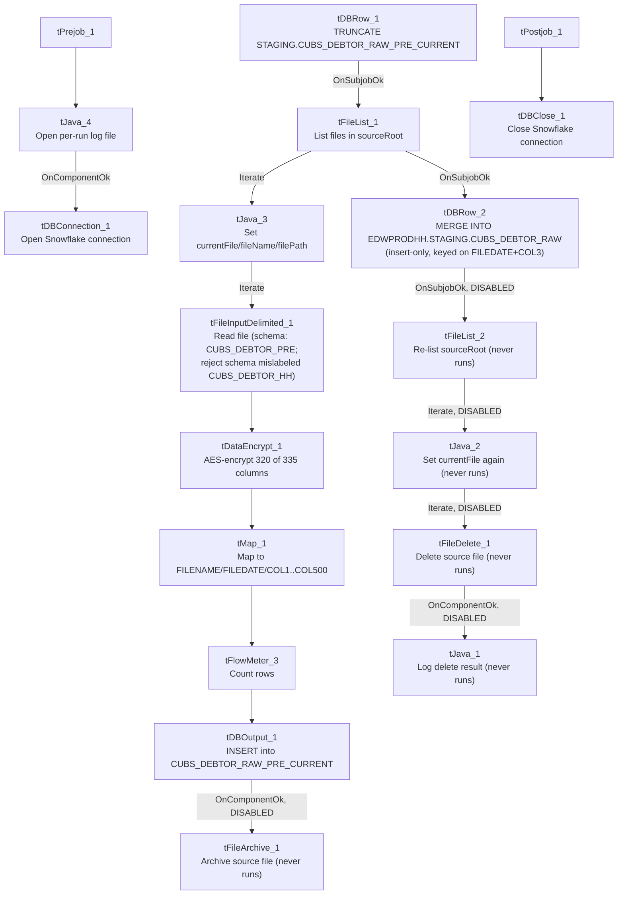

# Talend Job: CUBS_Raw_PRE_Debtor_Load_No_Delete

## Overview

Loads a raw debtor-account export file for the "PRE" site (see `01_system_architecture.md` on site codes) from a local/mounted source directory into Snowflake. The job reads a delimited file against a `CUBS_DEBTOR_PRE` repository schema (335 unique debtor name/address/phone/employer/letter/collection-status columns), AES-encrypts a subset of those columns, remaps everything down to a generic `FILENAME`/`FILEDATE`/`COL1`...`COL500` layout, inserts it into the Snowflake staging table `CUBS_DEBTOR_RAW_PRE_CURRENT`, then merges the new rows (insert-only, no update/delete) into the shared `EDWPRODHH.STAGING.CUBS_DEBTOR_RAW` table used by all site loads. It is one of (at least) three job variants for PRE debtor loading found in this metadata (`CUBS_Raw_PRE_Debtor_Load`, this `_No_Delete` variant, and `_Upsert`) that differ in whether post-load file cleanup runs — see Issues observed.

## Detail table

| Field | Value |
|---|---|
| Job name | CUBS_Raw_PRE_Debtor_Load_No_Delete |
| Version | 0.4 |
| Project | EDW2SF |
| Author | jmach@harriscollect.com |
| Created | 2022-12-06T15:16:11.298-0800 |
| Last Modified | 2026-07-07T12:12:16.157-0700 |

## Step-by-step data flow

**Setup subjob:** `tPrejob_1` → `tJava_4` opens a per-run log file at `context.logDir + context.currentLogon + "_" + jobName + "_" + <timestamp> + ".log"` and redirects `System.out` to it (code truncated in the source metadata after this point — see Issues observed) → on success (`COMPONENT_OK`), `tDBConnection_1` opens the job's Snowflake connection (`tSnowflakeConnection`, no parameters captured to identify which named connection this points to — see Issues observed).

**Main subjob:**

1. `tDBRow_1` runs `TRUNCATE TABLE STAGING.CUBS_DEBTOR_RAW_PRE_CURRENT;` — clears the PRE-specific current-load staging table before this run.
2. On success (`SUBJOB_OK`), `tFileList_1` lists files in `context.sourceRoot` with no explicit ordering applied (`ORDER_BY_NOTHING=true`).
3. For each file (`ITERATE`), `tJava_3` sets `context.currentFile`, `context.fileName`, and `context.filePath` from the `tFileList_1` iteration variables (code truncated in the source metadata — see Issues observed).
4. `tFileInputDelimited_1` reads the current file using the repository schema `CUBS_DEBTOR_PRE` (335 unique columns; the metadata records the schema twice for a raw total of 668 entries — see Settings tables), with `DIE_ON_ERROR=false` — malformed rows do not fail the job. **Its configured reject schema is `CUBS_DEBTOR_HH`, not a PRE schema** — see Issues observed. No connection carries rejected rows anywhere.
5. `tDataEncrypt_1` receives 320 of the 335 unique input columns (15 columns — including `errorCode`/`errorMessage` and business fields such as `CLT_XFER_DT`, `GUARANTOR_EMP`, `HDSP_ST_DT`, `HDSP_ENDDT`, `PKT_TOTAL_60`, `PKT_BAL`, `PMT_PCT_BAL`, `SIG_PMT`, `SIG_PROC_DT`, `LETTERABLE`, `EMAILABLE`, `TEXTABLE`, `PV_FLAG` — are dropped at this step) and AES-encrypts them, writing its crypto-controller file to `context.cryptoPath`. Secret type, secret key, and password are all `***REDACTED***` in the source metadata.
6. `tMap_1` maps the 320 encrypted columns into a generic 502-column target schema (`FILENAME`, `FILEDATE`, `COL1`...`COL500`); `DIE_ON_ERROR=true` here, so a mapping/lookup failure fails the job outright. The exact column-to-`COLn` mapping expressions are not captured in this metadata.
7. `tFlowMeter_3` counts rows passing through (labeled `"MyLabel"`, not renamed for this job — same un-renamed default seen elsewhere in the project).
8. `tDBOutput_1` inserts the mapped rows into Snowflake table `CUBS_DEBTOR_RAW_PRE_CURRENT` (`INSERT`, `tableAction=NONE`).
9. On success (`COMPONENT_OK`), `tFileArchive_1` would zip the source file to `context.archiveDir + "/" + <CCYYMMDD> + "/" + context.fileName + ".tar.gz"` — **but this component is disabled (`ACTIVATE=false`)**, so archiving does not actually happen. See Issues observed.
10. After the entire `tFileList_1` iteration subjob completes (`SUBJOB_OK`), `tDBRow_2` runs a `MERGE INTO EDWPRODHH.STAGING.CUBS_DEBTOR_RAW` from `STAGING.CUBS_DEBTOR_RAW_PRE_CURRENT`, matching on `FILEDATE` + `COL3`, with a single `WHEN NOT MATCHED THEN INSERT` clause covering `FILENAME`/`FILEDATE`/`COL1`...`COL500` — rows already present in the target (by that key) are left untouched; there is no update or delete branch, consistent with the job's `_No_Delete` name.
11. On success (`SUBJOB_OK`), `tFileList_2` would re-list `context.sourceRoot`, iterate (`tJava_2`) and delete each file (`tFileDelete_1`) with an `ACTIVATE=false`-gated `tJava_1` logging the delete result afterward — **the entire second listing/delete subjob (`tFileList_2`, `tJava_2`, `tFileDelete_1`, `tJava_1`) is disabled.** See Issues observed.

**Teardown subjob:** `tPostjob_1` → `tDBClose_1` closes the Snowflake connection.

## Settings tables

### Setup: `tFileList_1`

| Setting | Value | What it means |
|---|---|---|
| DIRECTORY | `context.sourceRoot` | Source directory scanned each run. Note: `sourceRoot` does not appear in the `StandardFolders_0.1` shared context group (which defines `sourceDir`/`sourceDCDir` instead) — unable to confirm its actual default value from the extracted shared context; verify with team. |
| LIST_MODE | `FILES` | Lists files only (no subdirectories; `INCLUDSUBDIR=false`). |
| ORDER_BY_NOTHING | `true` | No ordering is applied to the file listing, despite `ORDER_ACTION_ASC=true` also being set — since `ORDER_BY_NOTHING` takes precedence, files are processed in whatever order the filesystem/OS returns them. |
| EXCLUDEFILEMASK / IFEXCLUDE | `"*.txt"` / `false` | An exclusion mask is configured but `IFEXCLUDE=false` means it is **not actually applied** — every file in the directory is picked up regardless of extension. |

### Source: `tFileInputDelimited_1`

| Setting | Value | What it means |
|---|---|---|
| FILENAME | `context.currentFile` | The file currently being iterated by `tFileList_1`. |
| FIELDSEPARATOR / ROWSEPARATOR / HEADER / ENCODING | `context.EXPORT_DEBTOR_FieldSeparator` / `context.EXPORT_DEBTOR_RowSeparator` / `context.EXPORT_DEBTOR_Header` / `context.EXPORT_DEBTOR_Encoding` | Per the shared `EXPORT_DEBTOR_0.1` context group these default to tab-separated, `\n` row separator, 1 header row, `US-ASCII` encoding. |
| SCHEMA (main) | Repository schema `CUBS_DEBTOR_PRE` (335 unique columns; captured twice in this job's extracted metadata for a raw count of 668) | Full raw debtor-record layout for the PRE site. |
| SCHEMA_REJECT | Repository schema `CUBS_DEBTOR_HH` | **Mislabeled** — this is a PRE job but its reject schema is named for HH, matching the same cross-site copy-paste mismatch documented in the CHI debtor-load job family. |
| DIE_ON_ERROR | `false` | Malformed rows do not fail the job... |
| Reject flow | Not wired | ...but no connection routes rejected rows anywhere — they are silently dropped with no count or record. |
| TEMP_DIR | `"C:/Talend-Studio-20211109_1610-V8.0.1/workspace"` | Hardcoded developer-workstation path — see Dependencies & configuration. |

### Transform: `tDataEncrypt_1`

| Setting | Value | What it means |
|---|---|---|
| SECRET_TYPE / SECRET_KEY / PASSWORD_M1 | `***REDACTED***` | Encryption key material is redacted in the source metadata and preserved as-is here — do not guess actual values. |
| CRYPTO_METHOD / ALGO_VERSION | `AES` / `2` | AES encryption, algorithm version 2. |
| CRYPTO_FILE_PATH | `context.cryptoPath` | Where the crypto-controller file is written. |
| Schema | 320 of 335 unique input columns | This component drops 15 input columns before encrypting the rest: `errorCode`, `errorMessage`, `CLT_XFER_DT`, `GUARANTOR_EMP`, `HDSP_ST_DT`, `HDSP_ENDDT`, `PKT_TOTAL_60`, `PKT_BAL`, `PMT_PCT_BAL`, `SIG_PMT`, `SIG_PROC_DT`, `LETTERABLE`, `EMAILABLE`, `TEXTABLE`, `PV_FLAG`. Which specific remaining columns are actually encrypted (vs merely passed through) is not distinguishable from this metadata. |

### Transform: `tMap_1`

| Setting | Value | What it means |
|---|---|---|
| Target schema | `FILENAME`, `FILEDATE`, `COL1`...`COL500` (502 columns) | Generic, site-agnostic landing layout shared by the whole `CUBS_Raw_*_Debtor_Load` job family, letting different sites' differently-shaped source files land in the same staging table structure. |
| DIE_ON_ERROR | `true` | A mapping/lookup error here fails the job (unlike the upstream file-read step). |
| ROWS_BUFFER_SIZE | `2000000` | Large in-memory row buffer, consistent with a wide (500+ column) schema. |

### Target: `tDBRow_1` / `tDBOutput_1` (staging load)

| Setting | Value | What it means |
|---|---|---|
| `tDBRow_1` query | `TRUNCATE TABLE STAGING.CUBS_DEBTOR_RAW_PRE_CURRENT;` | Clears the PRE current-load staging table at the start of each run. |
| `tDBOutput_1` table / outputAction / tableAction | `CUBS_DEBTOR_RAW_PRE_CURRENT` / `INSERT` / `NONE` | Appends the mapped rows into the just-truncated staging table. |

### Final merge: `tDBRow_2`

| Setting | Value | What it means |
|---|---|---|
| Query | `MERGE INTO EDWPRODHH.STAGING.CUBS_DEBTOR_RAW AS tgt USING STAGING.CUBS_DEBTOR_RAW_PRE_CURRENT AS src ON tgt.FILEDATE = src.FILEDATE AND tgt.COL3 = src.COL3 WHEN NOT MATCHED THEN INSERT (FILENAME, FILEDATE, COL1...COL500) VALUES (...)` | Inserts rows from the PRE staging table into the shared, all-sites `CUBS_DEBTOR_RAW` table only when no existing row matches on `FILEDATE`+`COL3`. There is no `WHEN MATCHED` clause, so existing rows are never updated or deleted by this job — consistent with the "No_Delete" job name. |
| Target qualification | `EDWPRODHH.STAGING.CUBS_DEBTOR_RAW` (fully qualified) vs. unqualified `STAGING.CUBS_DEBTOR_RAW_PRE_CURRENT` (source) | Suggests the job's active Snowflake connection's default database is not `EDWPRODHH`, requiring the target to be explicitly qualified — same pattern noted in `CO_Master_Load`'s merge steps. |

### Disabled cleanup: `tFileArchive_1`, `tFileList_2` / `tJava_2` / `tFileDelete_1` / `tJava_1`

| Setting | Value | What it means |
|---|---|---|
| `tFileArchive_1.ACTIVATE` | `false` | Configured to zip the processed file to `context.archiveDir + "/" + <CCYYMMDD> + "/" + context.fileName + ".tar.gz"`, but disabled — no archive is produced. `tFileArchive_1.PASSWORD` is `***REDACTED***` (preserved as-is). |
| `tFileList_2.ACTIVATE` / `tJava_2.ACTIVATE` / `tFileDelete_1.ACTIVATE` / `tJava_1.ACTIVATE` | all `false` | The entire second file-listing-and-delete subjob (which would delete the processed source file from `context.sourceRoot` and log the result) is disabled. |
| `tFileDelete_1.DIRECTORY` / `PATH` | `"C:/Talend-Studio-20211109_1610-V8.0.1/workspace/delete_folder"` / `"C:/Talend-Studio-20211109_1610-V8.0.1/workspace/delete_folder or delete_file"` | Hardcoded developer-workstation paths — see Dependencies & configuration. Pose no immediate runtime risk since the component is disabled. |

## Dependencies & configuration

- **Triggers/depends on other jobs:** `runjob_targets` is empty for this job (no `tRunJob` components) — it does not call any other job. In `06_dependency_matrix.md`, the project's `CUBS_Raw_Debtor_Load` orchestrator calls the plain `CUBS_Raw_PRE_Debtor_Load` (no suffix), not this `_No_Delete` variant, and no other orchestrator entry references it either. This job therefore appears to run standalone/manually rather than as part of the documented orchestration chain — verify with the team how (or whether) it is actually scheduled.
- **Context variables used:** `EXPORT_DEBTOR_Encoding`, `EXPORT_DEBTOR_FieldSeparator`, `EXPORT_DEBTOR_Header`, `EXPORT_DEBTOR_RowSeparator` (all defined in the shared `EXPORT_DEBTOR_0.1` context group), `archiveDir`, `logDir` (defined in `StandardFolders_0.1`, which carries two different sets of values in the extracted shared context — the one actually applied at runtime is not determinable from this job's own metadata), `cryptoPath`, `currentFile`, `currentLogon`, `fileName`, `filePath`, and `sourceRoot` (this last one is **not found** in any shared context group captured in `_shared_context.json` — likely a job-local context default; verify with the team).
- **4 hardcoded developer-workstation paths**, all `C:/Talend-Studio-20211109_1610-V8.0.1/workspace/...`: `tFileInputDelimited_1.TEMP_DIR`, `tFileArchive_1.SOURCE_FILE`, `tFileDelete_1.DIRECTORY`, `tFileDelete_1.PATH` — same project-wide portability risk documented in `05_operational_runbook.md`. Three of these (`tFileArchive_1`, `tFileDelete_1` x2) sit on components that are currently disabled, so they pose no immediate runtime risk, but would need correcting if the archive/delete subjobs are ever re-enabled.

## Glossary

| Component type | Plain-English meaning |
|---|---|
| `tFileList` | Lists files in a directory for the job to iterate over one at a time. |
| `tFileInputDelimited` | Reads a delimited (CSV/TSV-style) text file according to a schema. |
| `tDataEncrypt` | Encrypts the values of selected columns (here, using AES) before they continue downstream. |
| `tMap` | Maps/transforms columns from one schema to another. |
| `tFlowMeter` | Counts rows passing a point in the flow, for logging/monitoring. |
| `tSnowflakeOutput` / `tSnowflakeRow` / `tSnowflakeConnection` / `tSnowflakeClose` | Write rows to a Snowflake table / run an arbitrary SQL statement (including `MERGE`) against Snowflake / open and close the Snowflake connection used throughout the job. |
| `tFileArchive` / `tFileDelete` | Zip a processed file to an archive location, then delete the original from the source directory (both disabled in this job — see Issues observed). |
| `tJava` | Runs custom Java code at a point in the flow (here, used to set context variables from file-list iteration state and to open the per-run log file). |
| `tPrejob` / `tPostjob` | Run once before/after the rest of the job, regardless of which main subjobs exist. |

## Issues observed

- **The entire post-load file-cleanup path is disabled.** Both `tFileArchive_1` (archive the processed file) and the second `tFileList_2`/`tJava_2`/`tFileDelete_1`/`tJava_1` subjob (delete the processed file) have `ACTIVATE=false`. This means source files in `context.sourceRoot` are never archived or removed by this job. Combined with `tFileList_1`'s `ORDER_BY_NOTHING=true` (no ordering, and no filter excluding already-processed files), **every run will re-read, re-encrypt, and re-insert every historical file still sitting in that directory into the staging table** — the final `MERGE` step's insert-only, `FILEDATE`+`COL3`-keyed logic should prevent duplicate rows from accumulating in the final `CUBS_DEBTOR_RAW` table, but the job still does the full read/encrypt/map/insert work for every old file on every run, and the source directory will grow unbounded over time. Given the job's name (`_No_Delete`), this looks like an intentional "don't delete source files" design — but doing so via disabling the *entire* archive-and-delete subjob rather than just the delete step means archiving is also skipped, which may not be intended. Verify with the team.
- **The reject schema on `tFileInputDelimited_1` is labeled `CUBS_DEBTOR_HH`, not a PRE schema.** This job is PRE-specific; its main input schema is correctly `CUBS_DEBTOR_PRE`, but the reject schema appears to have been copied from an HH-site job and never repointed — the same cross-site mismatch pattern already documented for the CHI debtor-load job family. Whether it causes an actual failure on a rejected row depends on how similar the two repository schemas are — unable to determine from this metadata.
- **No reject flow is wired from `tFileInputDelimited_1`.** `DIE_ON_ERROR=false`, so malformed rows don't fail the job, but there is also no connection carrying rejected rows anywhere — they are silently dropped with no record of how many, or which, rows failed to parse.
- **`tDataEncrypt_1` silently drops 15 of the 335 unique input columns** (including the file-read component's own `errorCode`/`errorMessage` columns and business fields — `CLT_XFER_DT`, `GUARANTOR_EMP`, `HDSP_ST_DT`, `HDSP_ENDDT`, `PKT_TOTAL_60`, `PKT_BAL`, `PMT_PCT_BAL`, `SIG_PMT`, `SIG_PROC_DT`, `LETTERABLE`, `EMAILABLE`, `TEXTABLE`, `PV_FLAG`) before mapping. Unable to determine from metadata whether this is intentional column pruning or an out-of-date schema that hasn't been reconciled with the source file layout; verify with the team whether those dropped fields are needed downstream.
- **`context.sourceRoot`, referenced by both `tFileList_1` and `tFileList_2`, is not defined in any context group captured in `_shared_context.json`** (which has `sourceDir`/`sourceDCDir` under `StandardFolders_0.1` instead). It may be a job-local context default not visible in this extraction — verify its actual value with the team before assuming it matches another job's `sourceDir`.
- **The `CODE` text captured for `tJava_3`, `tJava_1`, and `tJava_4` all end mid-statement with a literal `...` in the source metadata** (truncated during extraction, not by this documentation), so the full log-message wording and any code beyond what's shown here (e.g., in `tJava_1`'s delete-status logging or `tJava_4`'s log-file setup) cannot be verified from this job's own metadata — verify directly in Talend Studio if the exact behavior matters.
- **`tDBConnection_1` (`tSnowflakeConnection`) has no captured parameters**, so which named Snowflake connection/environment this job actually connects to cannot be confirmed from this job's own metadata alone — cross-reference `01_system_architecture.md`'s connection-label table or verify directly in the Talend repository.
- No other notable job-specific issues beyond the project-wide hardcoded-path pattern already documented in `05_operational_runbook.md`.
