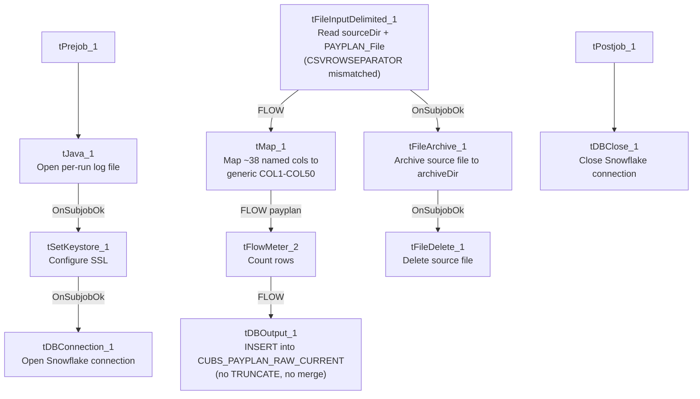

# Talend Job: CUBS_Raw_Payplan_Load

## Overview

Loads CUBS payment-plan records (debtor payment-plan setup and status: original plan amount, balloon, payment amounts/frequency, missed-payment counts, plan balance, letter-series and due-date tracking, "IGNITE" flag) from a single fixed export file into the Snowflake `CUBS_PAYPLAN_RAW_CURRENT` staging table, then archives and deletes the source file. Structurally it follows the same single-file "Client_Load"-style shape used by `CUBS_Raw_CO_Client_Load` (one file read, `FLOW` into a generic staging table, archive+delete off the read's own success) rather than the directory-iteration shape used by the `_ETL_Load` family. It is not called by any `tRunJob` link visible in `06_dependency_matrix.md` — see Issues observed.

## Detail table

| Field | Value |
|---|---|
| Job name | CUBS_Raw_Payplan_Load |
| Version | 0.1 |
| Project | EDW2SF |
| Author | jmach@harriscollect.com |
| Created | 2022-10-21T10:38:12.621-0700 |
| Last Modified | 2025-11-04T11:08:10.922-0800 |

## Step-by-step data flow

**Setup subjob:** `tPrejob_1` → `tJava_1` (`OnComponentOk`) opens a per-run log file at `context.logDir + context.currentLogon + "_" + jobName + "_" + <timestamp> + ".log"` → on `SUBJOB_OK`, `tSetKeystore_1` configures SSL trust/keystore from `context.keystorePath` (passwords redacted) → on `SUBJOB_OK`, `tDBConnection_1` opens the Snowflake connection.

**Main subjob:**

1. `tFileInputDelimited_1` reads a single file at `context.sourceDir + context.PAYPLAN_File` (not a directory loop — one fixed export file per run). Separators/header are context-driven (`context.PAYPLAN_RowSeparator`, `context.PAYPLAN_FieldSeparator`, `context.PAYPLAN_Header`), **except `CSVROWSEPARATOR`, which is set to `context.EXPORT_TRANS_RowSeparator`** instead of a `PAYPLAN_*` variable (only relevant if `CSV_OPTION` is ever turned on — currently `false`). `TRIMALL=true`. The main schema is labeled `"...- payplan"` (~38 named payment-plan business columns: `LOGON`, `PPLAN`, `PPLAN_IDX`, `ORIG_PLAN_AMT`, `BALLOON`, `PLAN_BALANCE`, `PMT_AMT`, `NBR_PMTS`, `FREQ`, `LTR_SERIES`, `IGNITE`, etc.). The reject schema is labeled `"...- CUBS_TRANSACTION"` — a transaction-shaped schema, not payplan-shaped (same mismatched-reject-schema pattern documented in `ADP_Payroll_Load` and `CUBS_Raw_CO_Client_Load`). `DIE_ON_ERROR=false`, no reject flow wired.
2. On `SUBJOB_OK` (i.e., as soon as the file read succeeds — not gated on the Snowflake insert), `tFileArchive_1` archives `context.sourceDir` to `context.archiveDir + "/" + <CCYYMMDD> + "/" + context.PAYPLAN_File + ".tar.gz"` (password redacted, `ENCRYPT_FILES=false`), then on `SUBJOB_OK`, `tFileDelete_1` deletes `context.sourceDir + context.PAYPLAN_File`.
3. On `FLOW`, `tMap_1` maps the ~38 named business columns to a generic output schema of `FILENAME`, `FILEDATE`, `COL1`–`COL50` (52 columns) — meaningful column names are not preserved past this point.
4. `tFlowMeter_2` counts rows passing through (link labeled `"payplan"` — one of the few flow labels in this batch actually renamed from the Talend default).
5. `tDBOutput_1` inserts the rows into Snowflake table `CUBS_PAYPLAN_RAW_CURRENT` (`INSERT`, `tableAction=NONE` — no `TRUNCATE` step anywhere in this job and no merge call afterward, despite the `_RAW_CURRENT` table name).

**Teardown subjob:** `tPostjob_1` → `tDBClose_1` closes the Snowflake connection.

## Settings tables

### Source: `tFileInputDelimited_1`

| Setting | Value | What it means |
|---|---|---|
| FILENAME | `context.sourceDir + context.PAYPLAN_File` | A single, fixed export file per run — no directory iteration. Per `_shared_context.json`, `PAYPLAN_File` defaults to `Q:/HH_PAYPLAN.TXT` (an `HH`-named file even though the job is site-agnostic in name — see Issues observed). |
| ROWSEPARATOR / FIELDSEPARATOR / HEADER | `context.PAYPLAN_RowSeparator` / `context.PAYPLAN_FieldSeparator` / `context.PAYPLAN_Header` | Correctly scoped to the `PAYPLAN_0.1` context group. |
| CSVROWSEPARATOR | `context.EXPORT_TRANS_RowSeparator` | **Mismatched** — references the Trans export's row separator instead of a `PAYPLAN_*` variable; only takes effect if `CSV_OPTION` is enabled (currently `false`). Same class of copy-paste leftover documented in `CUBS_Raw_CO_Client_Load`. |
| TRIMALL | `true` | All field values are trimmed of leading/trailing whitespace. |
| Main schema | Repository `"...- payplan"` (~38 named columns) | Payment-plan specific field names: `PPLAN`, `ORIG_PLAN_AMT`, `PLAN_BALANCE`, `NBR_PMTS_MADE`, `LTR_SERIES`, `IGNITE`, etc. |
| Reject schema | Repository `"...- CUBS_TRANSACTION"` | Mislabeled — a transaction-shaped reject schema for a payplan-shaped main schema, same issue class as `ADP_Payroll_Load` and `CUBS_Raw_CO_Client_Load`. |
| TEMP_DIR | `"C:/Talend-Studio-20211109_1610-V8.0.1/workspace"` | Hardcoded developer-workstation path. |

### Transform: `tMap_1`

| Setting | Value | What it means |
|---|---|---|
| Output schema | `FILENAME`, `FILEDATE`, `COL1`–`COL50` (52 columns) | Named business columns are not preserved past this point. |

### Target: `tDBOutput_1` (`tSnowflakeOutput`)

| Setting | Value | What it means |
|---|---|---|
| Table | `CUBS_PAYPLAN_RAW_CURRENT` | Destination staging table. |
| Output action / Table action | `INSERT` / `NONE` | Appends rows; no `TRUNCATE` precedes it and no merge stored procedure follows it, despite the `_RAW_CURRENT` naming convention. |
| Schema width | 61 columns (52 from `tMap_1` + 9 Snowflake reject-metadata columns: `columnName`, `rowNumber`, `category`, `character`, `errorMessage`, `byteOffset`, `line`, `sqlState`, `code`). | |

### Archive / Delete: `tFileArchive_1` / `tFileDelete_1`

| Setting | Value | What it means |
|---|---|---|
| SOURCE / TARGET (`tFileArchive_1`) | `context.sourceDir` / `context.archiveDir + "/" + <CCYYMMDD> + "/" + context.PAYPLAN_File + ".tar.gz"` | Archives under a date-stamped subfolder; `PASSWORD` redacted, `ENCRYPT_FILES=false` (password not actually applied). |
| Trigger | Off `tFileInputDelimited_1`'s `SUBJOB_OK`, not off `tDBOutput_1` | Archive+delete happens as soon as the file is read, before the Snowflake insert is confirmed — a downstream failure in `tMap_1`/`tFlowMeter_2`/`tDBOutput_1` would still result in the source file being archived and deleted. |
| FILENAME (`tFileDelete_1`) | `context.sourceDir + context.PAYPLAN_File` | The actual value used; `DIRECTORY`/`PATH` hardcoded defaults (`.../workspace/delete_folder`) are present but not used. |

## Dependencies & configuration

- **Triggers/depends on other jobs:** none — `runjob_targets` is empty.
- **Called by:** no job appears as a caller of `CUBS_Raw_Payplan_Load` in `06_dependency_matrix.md`'s `tRunJob` table — see Issues observed. (`05_operational_runbook.md` separately lists a `PaymentPlan_Load` job with explicit `tDie`/`tWarn` merge-result logic; that is a distinct job name from this one and is not confirmed to be related — do not assume they are the same job.)
- **Context variables used:** `PAYPLAN_File`, `PAYPLAN_Header`, `PAYPLAN_RowSeparator`, `PAYPLAN_FieldSeparator`, `PAYPLAN_Encoding`, `EXPORT_TRANS_RowSeparator` (mismatched — see Issues observed), `archiveDir`, `currentLogon`, `keystorePath`, `logDir`, `sourceDir`.
- **5 hardcoded developer-workstation path findings** (`tFileInputDelimited_1.TEMP_DIR`, `tFileArchive_1.SOURCE_FILE`, `tFileDelete_1.DIRECTORY`/`PATH`, `tSetKeystore_1.SSL_TRUSTSERVER_TRUSTSTORE`) — same project-wide pattern documented in `05_operational_runbook.md` (210 of 289 jobs).

## Glossary

| Component type | Plain-English meaning |
|---|---|
| `tFileInputDelimited` | Reads a delimited (CSV-style) text file according to a schema. |
| `tMap` | Maps/transforms columns from one schema to another. |
| `tFlowMeter` | Counts rows passing through a point in the flow, for logging/monitoring. |
| `tSnowflakeOutput` / `tSnowflakeConnection` / `tSnowflakeClose` | Write rows to a Snowflake table / open and close the shared Snowflake connection. |
| `tFileArchive` / `tFileDelete` | Zip a processed file to an archive location, then delete the original from the source directory. |
| `tSetKeystore` | Configures the SSL keystore/truststore used by subsequent secure connections. |
| `tPrejob` / `tPostjob` | Run once before/after the rest of the job. |
| `tJava` | Runs a block of custom Java code — here, opening a per-run log file. |

## Issues observed

- **No caller found for this job in `06_dependency_matrix.md`.** Unlike `CUBS_Raw_CO_Client_Load` (called by `CO_Master_Load`), `CUBS_Raw_Payplan_Load` has no incoming `tRunJob` link in the project-wide dependency table, and its own `runjob_targets` is also empty — this job appears to run standalone, triggered by an external scheduler not captured in this metadata. Verify with the team how/when it is actually invoked.
- **`PAYPLAN_File`'s documented default value (`Q:/HH_PAYPLAN.TXT`, per `_shared_context.json`) is HH-specific**, even though this job's name has no site suffix (unlike the `CUBS_Raw_<Site>_Client_Load`/`_ETL_Load` families). Whether this job is actually HH-only, or the context default is simply stale/unused in favor of a per-environment override, cannot be determined from this metadata; verify with the team before assuming which site's payment-plan data this job loads.
- **`CSVROWSEPARATOR` on `tFileInputDelimited_1` references `context.EXPORT_TRANS_RowSeparator`**, not a `PAYPLAN_*` variable, while every other separator/header setting on the same component is correctly scoped to `PAYPLAN_*`. Only matters if `CSV_OPTION` is ever switched on (currently `false`) — same copy-paste-leftover class as `CUBS_Raw_CO_Client_Load`.
- **The reject schema is labeled `"...- CUBS_TRANSACTION"`, not a payplan-shaped schema** — same mislabeling pattern as `ADP_Payroll_Load` and `CUBS_Raw_CO_Client_Load`. Unable to determine whether a rejected payplan row would parse cleanly against a transaction-shaped schema.
- **No `TRUNCATE` step and no merge call anywhere in this job**, despite the target table being named `CUBS_PAYPLAN_RAW_CURRENT` — same missing-refresh-step concern documented in `CUBS_Raw_CO_Client_Load`. Repeated runs without an intervening truncate/merge would accumulate duplicate rows in the staging table.
- **Archive and delete are triggered by the file read succeeding, not by the Snowflake insert succeeding** — a downstream failure after `tFileInputDelimited_1` would still result in the source file being archived and removed from `sourceDir`, potentially losing the only copy of an unprocessed file outside the archive.
- **Named business columns do not survive past `tMap_1`** — `CUBS_PAYPLAN_RAW_CURRENT` only stores generic `COL1`–`COL50` positional columns; interpreting any given column requires an external mapping back to this job's `tMap_1` configuration.
