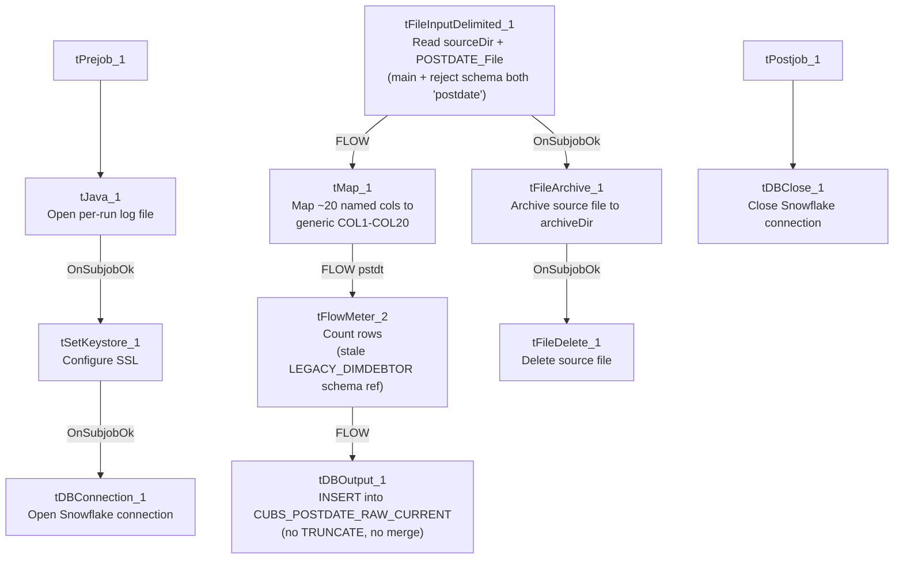

# Talend Job: CUBS_Raw_PostDate_Load

## Overview

Loads CUBS post-dated-check records (check number, deposit date, check amount, letter/notice tracking, NSF flag, plan-completion and check-post dates) from a single fixed export file into the Snowflake `CUBS_POSTDATE_RAW_CURRENT` staging table, then archives and deletes the source file. Structurally near-identical to `CUBS_Raw_Payplan_Load` (single-file read, `FLOW` into a generic staging table, archive+delete off the read's own success, `tPostjob`/`tDBClose` teardown). Per `06_dependency_matrix.md`, this job is called 5 times by the `CUBS_PostDates_Load` parent job — see Issues observed for what "5 times" likely implies.

## Detail table

| Field | Value |
|---|---|
| Job name | CUBS_Raw_PostDate_Load |
| Version | 0.1 |
| Project | EDW2SF |
| Author | jmach@harriscollect.com |
| Created | 2022-11-08T09:19:38.566-0800 |
| Last Modified | 2025-11-04T11:08:11.839-0800 |

## Step-by-step data flow

**Setup subjob:** `tPrejob_1` → `tJava_1` (`OnComponentOk`) opens a per-run log file at `context.logDir + context.currentLogon + "_" + jobName + "_" + <timestamp> + ".log"` → on `SUBJOB_OK`, `tSetKeystore_1` configures SSL trust/keystore from `context.keystorePath` (passwords redacted) → on `SUBJOB_OK`, `tDBConnection_1` opens the Snowflake connection.

**Main subjob:**

1. `tFileInputDelimited_1` reads a single file at `context.sourceDir + context.POSTDATE_File` (not a directory loop). Separators/header are context-driven (`context.POSTDATE_RowSeparator` for both `ROWSEPARATOR` and `CSVROWSEPARATOR` — correctly scoped, unlike the `PAYPLAN_Load`/`CO_Client_Load` mismatch — `context.POSTDATE_FieldSeparator`, `context.POSTDATE_Header`). `TRIMALL=false`. The main **and** reject schema are both labeled `"...- postdate"` — this is one of the few jobs in this batch where the reject schema is correctly matched to the main schema rather than copied from an unrelated job. Main schema has ~20 named columns (`LOGON`, `PDCHK`, `PDCHK_IDX`, `CHECK`, `DEPOSIT_DATE`, `CHECK_AMT`, `COMMENT`, `DATE_REC`, `LETTER_SENT`, `NSF_FLAG`, `PLAN_COMP_DATE`, `CHK_POST_DATE`, `Q_CHECK_FLG`, `XEMP_INIT`, etc.). `DIE_ON_ERROR=false`, no reject flow wired despite the (correctly labeled) reject schema existing.
2. On `SUBJOB_OK`, `tFileArchive_1` archives `context.sourceDir` to `context.archiveDir + "/" + <CCYYMMDD> + "/" + context.POSTDATE_File + ".tar.gz"` (password redacted, `ENCRYPT_FILES=false`), then on `SUBJOB_OK`, `tFileDelete_1` deletes `context.sourceDir + context.POSTDATE_File`.
3. On `FLOW`, `tMap_1` maps the ~20 named columns to a generic output schema of `FILENAME`, `FILEDATE`, `COL1`–`COL20` (22 columns).
4. `tFlowMeter_2` counts rows passing through (link labeled `"pstdt"`). This component also carries a leftover `NOT_SYNCHRONIZED_SCHEMA` reference to a repository schema labeled `"...- LEGACY_DIMDEBTOR"` — a debtor-dimension schema unrelated to post-dated checks, almost certainly a copy-paste artifact from a different job's `tFlowMeter` — see Issues observed.
5. `tDBOutput_1` inserts the rows into Snowflake table `CUBS_POSTDATE_RAW_CURRENT` (`INSERT`, `tableAction=NONE` — no `TRUNCATE` and no merge call afterward).

**Teardown subjob:** `tPostjob_1` → `tDBClose_1` closes the Snowflake connection.

## Settings tables

### Source: `tFileInputDelimited_1`

| Setting | Value | What it means |
|---|---|---|
| FILENAME | `context.sourceDir + context.POSTDATE_File` | A single, fixed export file per run — no directory iteration. Per `_shared_context.json`, `POSTDATE_File` defaults to `X:/CHI_POSTDATE.TXT` (a `CHI`-named file even though the job is site-agnostic in name — see Issues observed). |
| ROWSEPARATOR / CSVROWSEPARATOR / FIELDSEPARATOR / HEADER | all `context.POSTDATE_*` | Correctly and consistently scoped to the `POSTDATE_0.1` context group — unlike `CUBS_Raw_Payplan_Load`'s `CSVROWSEPARATOR` mismatch. |
| Main schema / Reject schema | Both repository `"...- postdate"` | Correctly matched — unlike `ADP_Payroll_Load`, `CUBS_Raw_CO_Client_Load`, and `CUBS_Raw_Payplan_Load`, whose reject schemas are mislabeled from a different job. |
| DIE_ON_ERROR | `false` | Malformed rows don't fail the job... |
| Reject flow | Not wired | ...but even with a correctly-shaped reject schema available, no connection routes rejected rows anywhere — they are still silently dropped. |
| TEMP_DIR | `"C:/Talend-Studio-20211109_1610-V8.0.1/workspace"` | Hardcoded developer-workstation path. |

### Transform: `tMap_1` / `tFlowMeter_2`

| Setting | Value | What it means |
|---|---|---|
| `tMap_1` output schema | `FILENAME`, `FILEDATE`, `COL1`–`COL20` (22 columns) | Named business columns are not preserved past this point. |
| `tFlowMeter_2` NOT_SYNCHRONIZED_SCHEMA | Repository `"_m9AtkGRHEeyH09yzpUroLA - LEGACY_DIMDEBTOR"` | A stale schema reference Talend retained from when this component's schema was last edited against a different (debtor-dimension) job — see Issues observed. Does not affect runtime behavior of this job's actual columns. |

### Target: `tDBOutput_1` (`tSnowflakeOutput`)

| Setting | Value | What it means |
|---|---|---|
| Table | `CUBS_POSTDATE_RAW_CURRENT` | Destination staging table. |
| Output action / Table action | `INSERT` / `NONE` | Appends rows; no `TRUNCATE` precedes it and no merge stored procedure follows it, despite the `_RAW_CURRENT` naming convention. |
| Schema width | 31 columns (22 from `tMap_1` + 9 Snowflake reject-metadata columns). | |

### Archive / Delete: `tFileArchive_1` / `tFileDelete_1`

| Setting | Value | What it means |
|---|---|---|
| SOURCE / TARGET (`tFileArchive_1`) | `context.sourceDir` / `context.archiveDir + "/" + <CCYYMMDD> + "/" + context.POSTDATE_File + ".tar.gz"` | Archives under a date-stamped subfolder; `PASSWORD` redacted, `ENCRYPT_FILES=false` (password not actually applied). |
| Trigger | Off `tFileInputDelimited_1`'s `SUBJOB_OK`, not off `tDBOutput_1` | Archive+delete happens as soon as the file is read, before the Snowflake insert is confirmed. |
| FILENAME (`tFileDelete_1`) | `context.sourceDir + context.POSTDATE_File` | The actual value used; `DIRECTORY`/`PATH` hardcoded defaults are present but not used. |

## Dependencies & configuration

- **Triggers/depends on other jobs:** none — `runjob_targets` is empty.
- **Called by:** `CUBS_PostDates_Load`, 5 times, per `06_dependency_matrix.md` — the repeated call count is consistent with a parent job that invokes this same child once per site (e.g. CHI/CO/DC/HH/PRE or similar), overriding `context.POSTDATE_File`/`sourceDir` per call; the actual per-call context overrides are not visible in this job's own metadata. `05_operational_runbook.md` separately notes `CUBS_PostDates_Load` (the parent, not this job) as one of the 16 jobs with explicit `tDie`/`tWarn` merge-result logic — that logic lives in the parent, not in this child job, which has no `tDie`/`tWarn` components of its own.
- **Context variables used:** `POSTDATE_File`, `POSTDATE_Header`, `POSTDATE_RowSeparator`, `POSTDATE_FieldSeparator`, `POSTDATE_Encoding`, `archiveDir`, `currentLogon`, `keystorePath`, `logDir`, `sourceDir`.
- **5 hardcoded developer-workstation path findings** (`tFileInputDelimited_1.TEMP_DIR`, `tFileArchive_1.SOURCE_FILE`, `tFileDelete_1.DIRECTORY`/`PATH`, `tSetKeystore_1.SSL_TRUSTSERVER_TRUSTSTORE`) — same project-wide pattern documented in `05_operational_runbook.md` (210 of 289 jobs).

## Glossary

| Component type | Plain-English meaning |
|---|---|
| `tFileInputDelimited` | Reads a delimited (CSV-style) text file according to a schema. |
| `tMap` | Maps/transforms columns from one schema to another. |
| `tFlowMeter` | Counts rows passing through a point in the flow, for logging/monitoring. |
| `tSnowflakeOutput` / `tSnowflakeConnection` / `tSnowflakeClose` | Write rows to a Snowflake table / open and close the shared Snowflake connection. |
| `tFileArchive` / `tFileDelete` | Zip a processed file to an archive location, then delete the original from the source directory. |
| `tSetKeystore` | Configures the SSL keystore/truststore used by subsequent secure connections. |
| `tPrejob` / `tPostjob` | Run once before/after the rest of the job. |
| `tJava` | Runs a block of custom Java code — here, opening a per-run log file. |

## Issues observed

- **`tFlowMeter_2` carries a stale `NOT_SYNCHRONIZED_SCHEMA` reference to `"...- LEGACY_DIMDEBTOR"`**, a debtor-dimension repository schema unrelated to post-dated checks. This is Talend's own bookkeeping of a component's previously-bound schema before it was last changed, and does not itself affect this job's actual runtime columns (which are the `COL1`-`COL20` shape defined elsewhere in the component) — but it is evidence this `tFlowMeter` was copied from a debtor-load job rather than built fresh for `PostDate_Load`. No functional impact confirmed; flagged for awareness only.
- **`POSTDATE_File`'s documented default value (`X:/CHI_POSTDATE.TXT`, per `_shared_context.json`) is CHI-specific**, even though the job name has no site suffix. Given `CUBS_PostDates_Load` calls this job 5 times (likely once per site), the actual per-call `POSTDATE_File` values are almost certainly overridden per invocation — the `X:/CHI_POSTDATE.TXT` value visible here is probably just the design-time default context value, not what every call actually uses. Verify the per-call context overrides with the team before assuming any one site's data.
- **Even with correctly-matched main/reject schemas** (a rarer state of affairs in this project — contrast `ADP_Payroll_Load`, `CUBS_Raw_CO_Client_Load`, `CUBS_Raw_Payplan_Load`), **no reject flow is wired**, so malformed rows are still silently dropped with no record of how many, or which ones, failed to parse.
- **No `TRUNCATE` step and no merge call anywhere in this job**, despite the target table being named `CUBS_POSTDATE_RAW_CURRENT`. Since this job is called 5 times by its parent without any visible truncate between calls, each of the 5 calls' rows would simply accumulate in the same staging table unless the parent job or a downstream process handles deduplication/truncation itself (not visible in this job's own metadata).
- **Archive and delete are triggered by the file read succeeding, not by the Snowflake insert succeeding** — a downstream failure after `tFileInputDelimited_1` would still result in the source file being archived and removed from `sourceDir`.
- **Named business columns do not survive past `tMap_1`** — `CUBS_POSTDATE_RAW_CURRENT` only stores generic `COL1`–`COL20` positional columns.
