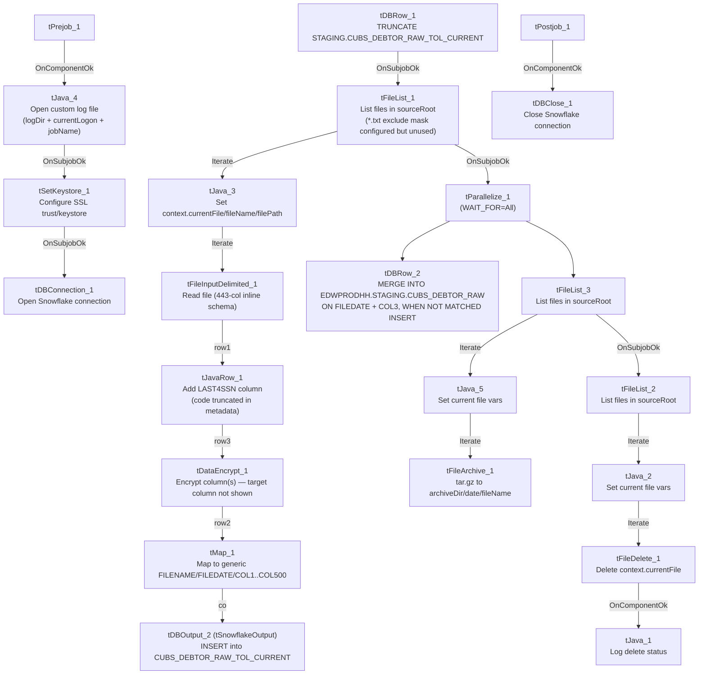

# Talend Job: CUBS_Raw_TOL_Debtor_Load

## Overview

Loads raw debtor (collections-account) extract files for the "TOL" site out of a source directory into the Snowflake staging table `CUBS_DEBTOR_RAW_TOL_CURRENT`, then merges that batch into the shared cumulative table `EDWPRODHH.STAGING.CUBS_DEBTOR_RAW`, and finally archives and deletes the processed source files. Each source file carries 443 named debtor columns (identity, address, phone, balances, legal/violation fields, letter/notice tracking, etc.) from the legacy CUBS system; a `LAST4SSN` column is computed before one or more fields are passed through an encryption step, and the target schema stores the data under generic `COL1`...`COL500` names rather than the original business names. This is one of (at least) six per-site siblings named `CUBS_Raw_<Site>_Debtor_Load` (CHI/CO/DC/HH/PRE/TOL), but unlike the CHI/CO/DC/HH/PRE variants — which are called once each by the orchestrator `CUBS_Raw_Debtor_Load` (`06_dependency_matrix.md`) — this job is **not** among that orchestrator's `tRunJob` targets and is also structurally the most developed of the family (SSL client-certificate setup, an extra column-derivation step, a `MERGE` instead of a plain append, and file archive/cleanup steps not present in the CHI sibling). See Issues observed.

## Detail table

| Field | Value |
|---|---|
| Job name | CUBS_Raw_TOL_Debtor_Load |
| Version | 0.4 |
| Project | EDW2SF |
| Author | jmach@harriscollect.com |
| Created | 2024-04-18T09:17:20.561-0700 |
| Last Modified | 2026-05-18T11:08:49.610-0700 |

## Step-by-step data flow

**Setup subjob:** `tPrejob_1` →(`OnComponentOk`)→ `tJava_4` opens a custom log file at `context.logDir+context.currentLogon+"_"+jobName+"_"+<timestamp>+".log"` and redirects `System.out`/presumably `System.err` to it (the code is truncated in the extracted metadata after ~250 characters, so the full body — including any `System.setErr` redirection — isn't fully visible). →(`OnSubjobOk`)→ `tSetKeystore_1` configures SSL trust/keystore settings for the upcoming database connection. →(`OnSubjobOk`)→ `tDBConnection_1` opens the job's Snowflake connection (no connection-name/label parameters were captured in this job's own metadata).

**Main load subjob** (no explicit trigger link feeds `tDBRow_1`; like the CHI sibling, it begins as soon as Talend's built-in prejob-then-everything-else ordering allows):

1. `tDBRow_1` runs `TRUNCATE TABLE STAGING.CUBS_DEBTOR_RAW_TOL_CURRENT;` against Snowflake.
2. On `SUBJOB_OK`, `tFileList_1` lists files (non-recursive) in `context.sourceRoot` — note this job does **not** append `context.currentLogon` to the directory the way the CHI sibling does (`context.sourceRoot+context.currentLogon`); here the directory is `context.sourceRoot` alone. An `EXCLUDEFILEMASK` of `"*.txt"` is configured but `IFEXCLUDE=false`, so — same as CHI — the exclusion is **not actually applied**; every file in the directory is picked up.
3. For each file (`ITERATE`), `tJava_3` sets `context.currentFile`, `context.fileName`, and `context.filePath` from `tFileList_1`'s globalMap entries and logs a "Processing file..." message (code truncated in metadata).
4. `ITERATE` continues to `tFileInputDelimited_1`, which reads `context.currentFile` against an inline 443-column schema (no repository schema name is captured in this job's metadata, unlike the CHI job's cited `"CUBS-DEBTOR-CHI"` reference — this extraction shows only the raw column list for this component). Row separator `\n`, field separator `\t`, `HEADER=1`, encoding `ISO-8859-15`, `DIE_ON_ERROR=false`. A reject schema is present on the component (446 columns: the same 443 main columns plus `LAST4SSN`, `errorCode`, `errorMessage`) but, as in CHI, no `REJECT` connection is wired anywhere in this job.
5. `FLOW` (link `row1`) to `tJavaRow_1`, a custom Java row transform whose output schema (444 columns) is the 443-column input schema plus one new column, `LAST4SSN`. The visible code assigns `output_row.LOGON = input_row.LOGON`, `DEBTOR`, `DEBTOR_IDX`, `CLIENT`, `NAME1`, etc., but is truncated in the extracted metadata after ~250 characters — the statement that actually populates `LAST4SSN` (plausibly derived from the input `SSN` field, which exists in the source schema) is not visible. Unable to determine from metadata; verify with team.
6. `FLOW` (link `row3` — note the out-of-sequence link naming: `row1` → `row3` → `row2`, see Issues observed) to `tDataEncrypt_1`, which passes the 444-column row through an encryption routine (`SECRET_TYPE`, `SECRET_KEY`, and `PASSWORD_M1` all `***REDACTED***`; `CRYPTO_METHOD=AES`, `ALGO_VERSION=2`; crypto key file at `context.cryptoPath`). As with CHI, the specific target column(s) for encryption are not identifiable from this metadata (the component's schema is a full pass-through) — most likely `SSN` and/or the newly-added `LAST4SSN`, but that cannot be confirmed.
7. `FLOW` (link `row2`) to `tMap_1`, which maps the (partly encrypted) 444-column debtor row onto a generic 502-column target schema: `FILENAME`, `FILEDATE`, `COL1`...`COL500`. `DIE_ON_ERROR=true`. The per-field mapping expressions are not captured in this metadata.
8. `FLOW` (link `co` — the only non-default link name in this job's main data path; see Issues observed) to `tDBOutput_2` (`tSnowflakeOutput`, **not** the `tSnowflakeOutputBulkExec` used by the CHI sibling), which inserts (`outputAction=INSERT`, `tableAction=NONE`) rows into `CUBS_DEBTOR_RAW_TOL_CURRENT`.
9. After `tFileList_1` finishes iterating every file, `SUBJOB_OK` triggers `tParallelize_1` (`WAIT_FOR=All`, `DIE_ON_ERROR=false`), which forks into two concurrent branches:
   - **Merge branch:** `tDBRow_2` runs a `MERGE INTO EDWPRODHH.STAGING.CUBS_DEBTOR_RAW AS tgt USING STAGING.CUBS_DEBTOR_RAW_TOL_CURRENT AS src ON tgt.FILEDATE = src.FILEDATE AND tgt.COL3 = src.COL3 WHEN NOT MATCHED THEN INSERT (...)` — unlike CHI's plain `INSERT ... SELECT`, this only inserts rows whose `(FILEDATE, COL3)` pair doesn't already exist in the cumulative table, giving it natural re-run/duplicate protection that CHI's variant lacks. Note the target is fully qualified with the database name `EDWPRODHH`, while every other SQL statement in this job (the `TRUNCATE`, and `tDBOutput_2`'s implicit table reference) uses only `STAGING.<table>` and relies on the connection's default database — see Issues observed.
   - **Archive/cleanup branch:** `tFileList_3` lists files in `context.sourceRoot` again →(`ITERATE`)→ `tJava_5` sets `context.currentFile`/`fileName`/`filePath` and logs an "Arch..." message (truncated) →(`ITERATE`)→ `tFileArchive_1` archives `context.filePath` (the `SOURCE_FILE` parameter is a hardcoded placeholder, `"C:/Talend-Studio-.../workspace/source.csv"`, but is overridden by `SOURCE=context.filePath`) to `context.archiveDir+"/"+<today's date CCYYMMDD>+"/"+context.fileName+".tar.gz"`, `OVERWRITE=true`, `ENCRYPT_FILES=false` (a `PASSWORD` value is still configured and `***REDACTED***` despite encryption being disabled). Then, on `SUBJOB_OK` (after all files are archived), `tFileList_3` triggers `tFileList_2`, which lists files in `context.sourceRoot` a third time →(`ITERATE`)→ `tJava_2` sets `context.currentFile`/`fileName`/`filePath` →(`ITERATE`)→ `tFileDelete_1` deletes `context.currentFile` (`FOLDER=false`, `FOLDER_FILE=false`, so the delete acts on the single file named by `FILENAME=context.currentFile`; the component's separate `DIRECTORY`/`PATH` parameters are hardcoded placeholder values that are not the actual deletion target in this mode — see Issues observed) →(`OnComponentOk`)→ `tJava_1` logs the delete status/target/error pulled from `tFileDelete_1`'s globalMap entries.

**Teardown subjob:** `tPostjob_1` →(`OnComponentOk`)→ `tDBClose_1` closes the Snowflake connection.

## Settings tables

### Setup: `tSetKeystore_1`

| Setting | Value | What it means |
|---|---|---|
| SET_TRUSTSTORE / SET_TRUSTSTORE_KEYSTORE | `false` / `false` | Truststore-related toggles left off; the truststore path below is configured but these flags suggest it may not actually be applied — unable to confirm from metadata. |
| SSL_TRUSTSERVER_TRUSTSTORE | `"C:/clientTrustStore.trustStore"` | Hardcoded developer-workstation path to a trust store file. |
| SSL_TRUSTSERVER_PASSWORD | `***REDACTED***` | Truststore password — preserved as redacted. |
| KEYSTORE_TYPE | `PKCS12` | Client keystore format. |
| SSL_KEYSTORE | `context.keystorePath` | Resolves via the `StandardFolders_0.1` context group in `_shared_context.json` (candidate values seen: `/etc/keys/keystore.p12` and `C:/users/jmach/.ssl/keystore.p12` — two different values are present for this variable in the shared context data, suggesting separate environment/user contexts rather than a single resolved value). |
| SSL_KEYSTORE_PASSWORD / NEED_CLIENT_AUTH | `***REDACTED***` / `***REDACTED***` | Both redacted in the source data. |
| VERIFY_NAME | `true` | Hostname verification is enabled for the TLS connection. |
| This component is unique to this job among the sibling set documented so far** — CHI's job goes straight from `tPrejob_1` to `tDBConnection_1` with no SSL/keystore setup step. |

### Source: `tFileList_1` / `tFileList_2` / `tFileList_3`

| Setting | Value | What it means |
|---|---|---|
| DIRECTORY | `context.sourceRoot` | Same directory scanned by all three `tFileList` instances (initial load, then re-listed for archive, then re-listed for delete). Unlike the CHI job, this job does **not** append `context.currentLogon` to the path. |
| LIST_MODE | `FILES` | Lists files only. |
| EXCLUDEFILEMASK / IFEXCLUDE | `"*.txt"` / `false` | Configured but never applied — every file in the directory is picked up, all three times it's listed. Same non-functional pattern as CHI. |
| CASE_SENSITIVE | `YES` | Case-sensitive matching (no practical effect since no mask is applied). |

### Source: `tFileInputDelimited_1`

| Setting | Value | What it means |
|---|---|---|
| FILENAME | `context.currentFile` | The file currently being iterated by `tFileList_1`. |
| Main schema | Inline 443-column debtor schema (name, address, phone, balances, legal/violation, letter/notice tracking, `SSN`, `SSN1`, `_8_TEC_SSN`, `ASSND_AMT`, etc.) | No repository schema name is captured in this job's metadata (only the raw column list), unlike CHI's cited `"CUBS-DEBTOR-CHI"` reference. |
| Reject schema | Inline 446-column schema (the 443 main columns + `LAST4SSN`, `errorCode`, `errorMessage`) | Structurally close to a superset of the main schema (adds `LAST4SSN` plus the two standard reject-tracking columns) rather than a different site's schema entirely (contrast with CHI, whose reject schema pointed at the wrong site, `CUBS_DEBTOR_HH`). No mismatch of that kind is evident here from the column lists alone. |
| ROWSEPARATOR / FIELDSEPARATOR / HEADER / ENCODING | `\n` / `\t` / `1` (header row present) / `ISO-8859-15` | Hardcoded directly on the component (not driven by an `EXPORT_DEBTOR_*` context group as in CHI). |
| DIE_ON_ERROR | `false` | Malformed rows don't fail the job... |
| Reject flow | Not wired | ...but no connection carries rejected rows anywhere — same silent-drop pattern as CHI. |
| TEMP_DIR | `"C:/Talend-Studio-20211109_1610-V8.0.1/workspace"` | Hardcoded developer-workstation path — part of the 210/289-job project-wide pattern in `05_operational_runbook.md`. |

### Transform: `tJavaRow_1`

| Setting | Value | What it means |
|---|---|---|
| Output schema | 444 columns = the 443-column input schema + `LAST4SSN` | This step derives a new `LAST4SSN` field before encryption. |
| CODE | Truncated in extracted metadata at ~250 characters | Only the first several `output_row.<X> = input_row.<X>` pass-through assignments are visible (`LOGON`, `DEBTOR`, `DEBTOR_IDX`, `CLIENT`, `NAME1`, ...). The statement that computes `LAST4SSN` (plausibly `substring` of `SSN`) is not visible in this extraction. Unable to determine from metadata — verify with team. |

### Transform: `tDataEncrypt_1`

| Setting | Value | What it means |
|---|---|---|
| SECRET_TYPE | `***REDACTED***` | Encryption secret-type setting — preserved as redacted. |
| SECRET_KEY | `***REDACTED***` | Encryption key — redacted; not present as a separate parameter in the CHI sibling's documented settings. |
| PASSWORD_M1 | `***REDACTED***` | Encryption password — redacted. |
| CRYPTO_METHOD | `AES` | Explicit algorithm name (CHI's documented settings didn't list this parameter). |
| CRYPTO_FILE_PATH | `context.cryptoPath` | `context.cryptoPath` is not defined in any context group present in `_shared_context.json` — same gap flagged for CHI. |
| ALGO_VERSION | `2` | Encryption algorithm version. |
| GEN_CRYPTO_FILE_CONTROLLER | `false` | Does not regenerate the crypto controller file this run. |
| Target column(s) | Not visible in metadata | The component carries the full 444-column pass-through schema; the specific encrypted field(s) — most plausibly `SSN` and/or the new `LAST4SSN` — can't be confirmed from this extraction. |

### Transform: `tMap_1`

| Setting | Value | What it means |
|---|---|---|
| DIE_ON_ERROR | `true` | A mapping/lookup failure here fails the job outright. |
| Output schema | `FILENAME`, `FILEDATE`, `COL1`...`COL500` (502 columns) | Same generic-column target pattern as CHI. Field-level mapping expressions are not captured in this metadata. |
| ROWS_BUFFER_SIZE | `2000000` | tMap disk-mode buffer threshold. |

### Target: `tDBOutput_2` (`tSnowflakeOutput`)

| Setting | Value | What it means |
|---|---|---|
| Table | `CUBS_DEBTOR_RAW_TOL_CURRENT` | Snowflake staging table for this run's TOL-site batch — the same table truncated by `tDBRow_1` at job start. |
| outputAction | `INSERT` | Appends rows; relies on the earlier `TRUNCATE` to avoid duplicate accumulation within a run. |
| tableAction | `NONE` | Table is not recreated/altered by this job. |
| Component type | `tSnowflakeOutput`, not `tSnowflakeOutputBulkExec` | The CHI sibling uses the bulk-load variant for this same step; this job uses the plain row-oriented output component instead — a throughput-relevant difference for large files, and possibly just an artifact of when each job variant was last touched (this job's version is 0.4 vs. CHI's 0.1). |
| Schema | `FILENAME`, `FILEDATE`, `COL1`...`COL500`, plus a reject/error schema (`columnName`, `rowNumber`, `category`, `character`, `errorMessage`, `byteOffset`, `line`, `sqlState`, `code`) | As with CHI's bulk-output component, an error schema is defined but no `REJECT` connection is wired in this job's connections — output-level rejects are not captured. |

### Truncate / merge steps: `tDBRow_1` / `tDBRow_2` (`tSnowflakeRow`)

| Setting | Value | What it means |
|---|---|---|
| Query 1 (`tDBRow_1`) | `TRUNCATE TABLE STAGING.CUBS_DEBTOR_RAW_TOL_CURRENT;` | Clears the TOL-site staging table before the file loop starts. |
| Query 2 (`tDBRow_2`) | `MERGE INTO EDWPRODHH.STAGING.CUBS_DEBTOR_RAW AS tgt USING STAGING.CUBS_DEBTOR_RAW_TOL_CURRENT AS src ON tgt.FILEDATE = src.FILEDATE AND tgt.COL3 = src.COL3 WHEN NOT MATCHED THEN INSERT (FILENAME, FILEDATE, COL1...COL500) VALUES (src.FILENAME, ..., src.COL500);` | Inserts only rows whose `(FILEDATE, COL3)` combination isn't already present in the cumulative table — a genuine dedup/upsert-style guard, unlike CHI's plain `INSERT ... SELECT *` append. Note the fully-qualified `EDWPRODHH` database prefix here, versus the unqualified `STAGING.<table>` references used everywhere else in this job (see Issues observed). |

### Archive/cleanup: `tFileArchive_1` / `tFileDelete_1`

| Setting | Value | What it means |
|---|---|---|
| SOURCE / TARGET (`tFileArchive_1`) | `context.filePath` / `context.archiveDir+"/"+<CCYYMMDD>+"/"+context.fileName+".tar.gz"` | Archives each processed file into a date-stamped folder under `context.archiveDir` (resolves via `StandardFolders_0.1` — candidate values `/archive/` or `C:/Data/`). |
| SOURCE_FILE | `"C:/Talend-Studio-20211109_1610-V8.0.1/workspace/source.csv"` | A hardcoded placeholder value for this parameter; overridden at runtime by `SOURCE=context.filePath`, so it appears to be inert leftover configuration rather than an active hardcoded path. Still flagged per `hardcoded_path_findings`. |
| ENCRYPT_FILES / PASSWORD | `false` / `***REDACTED***` | Archive encryption is disabled, but a password value is still configured (redacted) — vestigial/unused setting. |
| OVERWRITE | `true` | An existing archive at the target path is overwritten rather than causing an error. |
| FILENAME (`tFileDelete_1`) | `context.currentFile` | The actual file deleted, since `FOLDER=false` and `FOLDER_FILE=false` put the component in single-file-delete mode. |
| DIRECTORY / PATH (`tFileDelete_1`) | `"C:/Talend-Studio-.../delete_folder"` / `"C:/Talend-Studio-.../delete_folder or delete_file"` | Hardcoded placeholder-looking values (the `PATH` value literally reads "delete_folder or delete_file", Talend's own default hint text) that appear inactive in this component's current mode (`FOLDER=false`), but are still flagged as hardcoded paths per `hardcoded_path_findings` since they are present on the component. |
| FAILON | `false` | A delete failure does not fail the job. |

## Dependencies & configuration

- **Called by:** Not called by any job's `runjob_targets` visible in this extraction. Per `06_dependency_matrix.md`, the orchestrator `CUBS_Raw_Debtor_Load` calls the CHI, CO, DC, HH, and PRE debtor-load siblings, but **not** `CUBS_Raw_TOL_Debtor_Load` — this job appears to run outside that orchestration chain (independently scheduled, or triggered by a Master job not present in this export). This matches the project-wide caveat already flagged in `06_dependency_matrix.md`: "If those sites are triggered some other way... that's undocumented here — verify with team." This job's own `runjob_targets` is empty — it does not call any other jobs itself.
- **Context variables used:** `archiveDir`, `logDir`, `keystorePath` (all resolve via the `StandardFolders_0.1` context group in `_shared_context.json`, each with two candidate values — e.g. `archiveDir` = `/archive/` or `C:/Data/` — suggesting separate environment entries rather than one settled value); `currentFile`, `fileName`, `filePath` (set internally by this job's own `tJava` steps from `tFileList` globalMap entries, not sourced from a context group); `cryptoPath`, `currentLogon`, `sourceRoot` (**not found in any context group in `_shared_context.json`**, same gap noted for the CHI sibling — presumably supplied by an external caller or a CUBS-specific context group outside this extraction's scope). Unable to determine from this job's own metadata — verify with team, particularly `cryptoPath` since an unresolved encryption key path would fail the job at `tDataEncrypt_1`.
- **Hardcoded paths:** `tFileInputDelimited_1.TEMP_DIR`, `tFileDelete_1.DIRECTORY`, `tFileDelete_1.PATH`, `tSetKeystore_1.SSL_TRUSTSERVER_TRUSTSTORE`, `tFileArchive_1.SOURCE_FILE` — five findings total per this job's `hardcoded_path_findings`, all pointing at the same developer workstation (`C:/Talend-Studio-20211109_1610-V8.0.1/...` or `C:/clientTrustStore.trustStore`). Part of the 210/289-job project-wide pattern in `05_operational_runbook.md`.

## Glossary

| Component type | Plain-English meaning |
|---|---|
| `tFileList` | Lists files in a directory for the job to iterate over one at a time. |
| `tFileInputDelimited` | Reads a delimited (CSV-style) text file according to a schema. |
| `tJavaRow` | Runs custom Java code to transform one row into another row, column by column (like a code-based `tMap`). |
| `tDataEncrypt` | Encrypts one or more fields of a row using a configured algorithm/key before it continues downstream. |
| `tMap` | Maps/transforms columns from one schema to another. |
| `tSnowflakeOutput` | Inserts rows into a Snowflake table (plain/row-oriented, as opposed to the bulk-load variant). |
| `tSnowflakeRow` | Runs an arbitrary SQL statement against Snowflake (here, `TRUNCATE` and a `MERGE`). |
| `tSnowflakeConnection` / `tSnowflakeClose` | Open and close the Snowflake connection shared by other components in the job. |
| `tSetKeystore` | Configures SSL/TLS trust store and client keystore settings used by a subsequent database connection. |
| `tFileArchive` | Compresses one or more files into an archive (here, `.tar.gz`) at a target location. |
| `tFileDelete` | Deletes a file, folder, or path. |
| `tParallelize` | Forks the flow into multiple branches that run concurrently, optionally waiting for all/any to finish before continuing. |
| `tJava` | Runs a block of custom Java code once (here, to capture the current file path into context variables and log status/errors). |

## Issues observed

- **This job is absent from the `CUBS_Raw_Debtor_Load` orchestrator's `tRunJob` targets**, even though its four other per-site siblings (CHI, CO, DC, HH) plus PRE are all called from there once each (`06_dependency_matrix.md`). This job's own `runjob_targets` is also empty. It's unclear from this metadata whether TOL is triggered by a separate scheduled task, a different orchestrator not present in this export, or is simply not currently wired into any orchestration — worth confirming with the team so the TOL pipeline isn't assumed to run automatically alongside the others.
- **Out-of-sequence and copy-paste-suggestive link naming in the main data path.** The `FLOW` links from `tFileInputDelimited_1` through to `tDBOutput_2` are named `row1` → `row3` → `row2` → `co`, rather than the sequential `row1`/`row2`/`row3` pattern seen in CHI. The final link name, `co`, exactly matches the `CO` site code used elsewhere in this project's job-naming convention — strongly suggesting this job's main pipeline (or at least its final output link) was copy-pasted from a `CUBS_Raw_CO_Debtor_Load`-style template and not fully renamed for TOL, similar in kind to the `CHI_DBTR`-labeled link documented for the CHI sibling, but here the artifact is a leftover site code from a *different* site's job rather than a purpose-relabeled name.
- **`tDBRow_2`'s `MERGE` target is fully qualified with the database name `EDWPRODHH`, while every other SQL/table reference in this job (`tDBRow_1`'s `TRUNCATE`, `tDBOutput_2`'s implicit table) uses only `STAGING.<table>` and relies on the active connection's default database.** If this job is ever pointed at a differently-named Snowflake database (e.g., a non-prod or QA environment), the hardcoded `EDWPRODHH` prefix in the `MERGE` statement would silently target the wrong database (or fail if that database doesn't exist there) while the rest of the job's statements would correctly follow the connection. This is a more serious environment-portability risk than the workstation-path hardcodes, since it lives inside SQL text rather than an obviously-overridable file-path parameter.
- **`tJavaRow_1`'s code that derives the new `LAST4SSN` column is truncated in the extracted metadata** (cut off after ~250 characters, consistent with all `tJava`/`tJavaRow` code blocks in this job). The actual source expression can't be confirmed — it's plausible this pulls the last four digits of the input `SSN` field (which exists in the source schema), but that is an assumption, not a confirmed fact. Verify directly in Talend Studio.
- **No reject flow is wired anywhere in this job** — neither from `tFileInputDelimited_1` (`DIE_ON_ERROR=false`, rows silently dropped) nor from `tDBOutput_2` (which defines a full error-info schema but has no `REJECT` connection routing rows to it). Same pattern as CHI and the project-wide finding in `05_operational_runbook.md`.
- **`tFileList_1`'s exclude mask is configured but never applied** (`EXCLUDEFILEMASK="*.txt"`, `IFEXCLUDE=false`) — every file in `context.sourceRoot` is picked up regardless of extension, the same non-functional pattern seen in CHI and `ADP_Payroll_Load`.
- **`tFileDelete_1` carries hardcoded `DIRECTORY`/`PATH` placeholder values** (`.../delete_folder`, and literally `"delete_folder or delete_file"` — Talend's own default hint text) that appear inert given the component's current single-file-delete mode (`FOLDER=false`, `FOLDER_FILE=false`, actual target `FILENAME=context.currentFile`). These are still flagged as hardcoded-path findings and are worth cleaning up so a future change to the component's mode doesn't silently start deleting from/at those literal paths.
- **The final target schema uses fully generic `COL1`...`COL500` column names** rather than the 443 named business columns read from source — same materially-higher documentation risk noted for CHI: anyone querying `CUBS_DEBTOR_RAW_TOL_CURRENT` or `EDWPRODHH.STAGING.CUBS_DEBTOR_RAW` downstream needs to open `tMap_1` in Talend Studio to know what a given `COLn` actually contains.
- **`context.sourceRoot`, `context.cryptoPath`, and `context.currentLogon` are not defined in any context group present in `_shared_context.json`** — same gap flagged for CHI. `context.archiveDir`, `context.logDir`, and `context.keystorePath` are defined (in `StandardFolders_0.1`), but each has two different candidate values in the shared context data (e.g., `archiveDir` = `/archive/` vs. `C:/Data/`), so which one actually applies for a TOL production run can't be determined from this metadata alone.
- Beyond the items above, this job's remaining risk profile (hardcoded developer-workstation paths, unresolved encrypted-field targets, generic column naming) matches the project-wide patterns already catalogued in `05_operational_runbook.md`.
