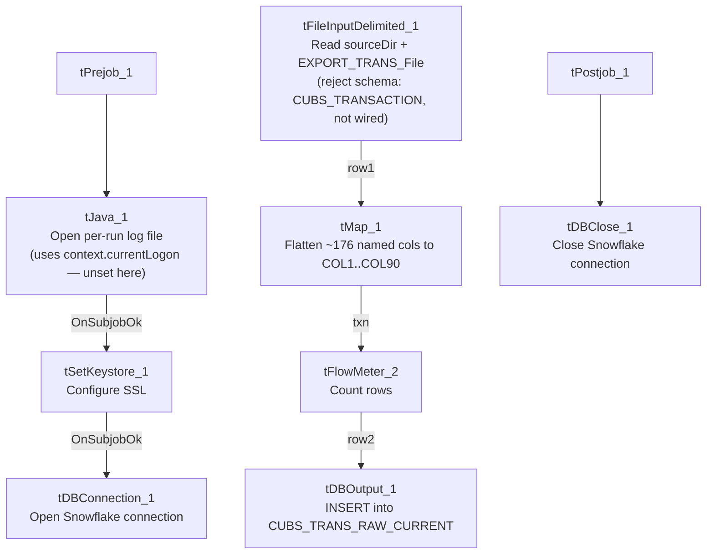

# Talend Job: CUBS_Raw_Trans_Load

## Overview

Loads a single CUBS transaction export file (payments, adjustments, and other posted transaction activity — logon, transaction ID, debtor, transaction code, amount, date, status, client, letter, and campaign fields, ~176 named source columns) from a fixed, context-defined path into the Snowflake raw landing table `CUBS_TRANS_RAW_CURRENT`. Unlike the per-site `CUBS_Raw_<Site>_ETL_Load` family, this job has no site suffix and does not loop over a directory of files — it reads exactly one file per run, whose name and format are entirely driven by the `EXPORT_TRANS_*` context group. Per `06_dependency_matrix.md` and `job_CO_Master_Load.md`, it is called once by `CO_Master_Load`, which afterward calls two Snowflake stored procedures to merge its output into downstream fact tables.

## Detail table

| Field | Value |
|---|---|
| Job name | CUBS_Raw_Trans_Load |
| Version | 0.1 |
| Project | EDW2SF |
| Author | jmach@harriscollect.com |
| Created | Unable to determine from metadata — not present in job JSON (see note below). |
| Last Modified | Unable to determine from metadata — not present in job JSON (see note below). |

*Note: this job's JSON did not include populated `created_date`/`modified_date` values (fields present but empty in the extraction, unlike every sibling job in this batch) — verify directly in Talend Studio if these dates are needed.*

## Step-by-step data flow

**Setup subjob:** `tPrejob_1` → `tJava_1` (`OnComponentOk`) opens a per-run log file at `context.logDir + context.currentLogon + "_" + jobName + "_" + <timestamp> + ".log"` (note the log filename includes `context.currentLogon`, which is not set anywhere in this job's own components — see Issues observed) and redirects `System.out`/`System.err` to it → `tSetKeystore_1` (`OnSubjobOk`) configures SSL trust/keystore from `context.keystorePath` (all passwords redacted) → `tDBConnection_1` (`OnSubjobOk`) opens the Snowflake connection.

**Main subjob** (no incoming trigger connection from the setup chain, so it runs as an independent top-level subjob alongside setup, per Talend's default parallel-subjob-start semantics):

1. `tFileInputDelimited_1` reads `context.sourceDir + context.EXPORT_TRANS_File` — a single, specific file path (not a directory listing) — using field separator, row separator, header-row count, and encoding all pulled from the `EXPORT_TRANS_*` context group rather than hardcoded values. `DIE_ON_ERROR=false`. A `SCHEMA_REJECT` is configured against repository schema `"...- CUBS_TRANSACTION"`, but no reject-flow connection exists from this component (see Issues observed).
2. `tMap_1` (`row1`, FLOW) re-maps the source row **positionally** onto a narrower target shape of `FILENAME`, `FILEDATE`, `COL1`...`COL90` (92 columns) — narrower than the ~176 named source columns (see Issues observed).
3. `tFlowMeter_2` (`txn`, FLOW) counts rows passing through (label left at the default `"MyLabel"`).
4. `tDBOutput_1` (`row2`, FLOW) inserts the rows into Snowflake `CUBS_TRANS_RAW_CURRENT` (`INSERT`, `tableAction=NONE` — no truncate/recreate from within this job).

**Teardown subjob:** `tPostjob_1` → `tDBClose_1` (`OnComponentOk`) closes the Snowflake connection.

## Settings tables

### Source: `tFileInputDelimited_1`

| Setting | Value | What it means |
|---|---|---|
| FILENAME | `context.sourceDir + context.EXPORT_TRANS_File` | Single fixed file, not a directory iteration — contrasts with the `CUBS_Raw_<Site>_ETL_Load` family's `tFileList` loop. |
| FIELDSEPARATOR / ROWSEPARATOR / HEADER / ENCODING | All driven by `context.EXPORT_TRANS_FieldSeparator` / `RowSeparator` / `Header` / `Encoding` | Fully context-driven format, unlike most other file-load jobs in this project which hardcode these settings. Per `_shared_context.json`'s default values: `\t` field separator, `\n` row separator, 1 header row, `US-ASCII` encoding. |
| SCHEMA (main) | Not a repository reference — 176 named columns supplied inline (e.g. `_LOGON`, `_TRANS_ID`, `_DEBTOR`, `_TCODE`, `_TRANS_AMT`, `_TRANS_DATE`, `_STATUS`, `_CLIENT`, `_LTR_ID`, `CAMPID`, `TRANS_REF_ID`, `REV_TRANS_ID`, `CANC_ROUTINE`, plus `errorCode`/`errorMessage`). |
| SCHEMA_REJECT | Repository schema `"...- CUBS_TRANSACTION"` | Correctly named for this job (unlike `ADP_Payroll_Load`'s mismatched reject schema) — but see Issues observed regarding it not being wired to anywhere. |
| DIE_ON_ERROR | `false` | Malformed rows don't fail the job... |
| Reject flow | Not wired | ...but no connection carries rejected rows anywhere — silently dropped, same pattern seen project-wide. |
| TEMP_DIR | `"C:/Talend-Studio-20211109_1610-V8.0.1/workspace"` | Hardcoded developer-workstation path — see Dependencies & configuration. |

### Target: `tDBOutput_1` (`tSnowflakeOutput`)

| Setting | Value | What it means |
|---|---|---|
| Table | `CUBS_TRANS_RAW_CURRENT` | Destination raw landing table. |
| Output action | `INSERT` | Appends rows; no truncate step precedes it in this job. |
| Table action | `NONE` | Table structure is not altered by this job. |

### `tSetKeystore_1`

| Setting | Value | What it means |
|---|---|---|
| SSL_KEYSTORE | `context.keystorePath` | Client keystore path is externalized to context. |
| SSL_TRUSTSERVER_TRUSTSTORE | `"C:/clientTrustStore.trustStore"` | Hardcoded truststore path — not context-driven, unlike the keystore itself. |
| SSL_TRUSTSERVER_PASSWORD / SSL_KEYSTORE_PASSWORD / NEED_CLIENT_AUTH | `***REDACTED***` | Preserved as redacted; real values not present in extracted metadata. |

## Dependencies & configuration

- **Triggers/depends on other jobs:** `runjob_targets` is empty — this job does not call any other job via `tRunJob`.
- **Called by:** `CO_Master_Load` (1 call), per `06_dependency_matrix.md` — `CO_Master_Load` runs this job as the start of its Branch B ("transactions") chain, and after it succeeds, calls `STAGING.MERGE_INTO_CUBS_TRANS_RAW()` and then `STAGING.MERGE_INTO_FACTTRANS()` against the table this job just loaded (note the merge procedure name `MERGE_INTO_CUBS_TRANS_RAW` vs. this job's actual target table `CUBS_TRANS_RAW_CURRENT` — a naming variation, not necessarily a mismatch, but worth confirming both refer to the same table).
- **Context variables used:** `EXPORT_TRANS_Encoding`, `EXPORT_TRANS_FieldSeparator`, `EXPORT_TRANS_File`, `EXPORT_TRANS_Header`, `EXPORT_TRANS_RowSeparator` (from the `EXPORT_TRANS_0.1` context group — used by 14 jobs project-wide per `06_dependency_matrix.md`), `currentLogon` (referenced in the log-file name but not set anywhere in this job's own components — see Issues observed), `keystorePath`, `logDir`, `sourceDir` (from `StandardFolders_0.1`).
- **2 hardcoded developer-workstation paths** (`tFileInputDelimited_1.TEMP_DIR`, `tSetKeystore_1.SSL_TRUSTSERVER_TRUSTSTORE`) — same project-wide portability risk documented in `05_operational_runbook.md`.

## Glossary

| Component type | Plain-English meaning |
|---|---|
| `tPrejob` / `tPostjob` | Talend's guaranteed-first / guaranteed-last subjobs for setup and teardown. |
| `tJava` | Runs a block of custom Java code once. |
| `tFileInputDelimited` | Reads a delimited (CSV/TSV-style) text file according to a schema. |
| `tMap` | Maps/transforms columns from one schema to another. |
| `tFlowMeter` | Counts rows passing through a point in the flow, for logging/monitoring. |
| `tSnowflakeOutput` / `tSnowflakeConnection` / `tSnowflakeClose` | Write rows to a Snowflake table / open and close the Snowflake connection used throughout the job. |
| `tSetKeystore` | Configures SSL client keystore/truststore settings ahead of an encrypted database connection. |

## Issues observed

- **The tMap output (90 generic `COL` slots plus `FILENAME`/`FILEDATE`) is narrower than the ~176 named source columns read by `tFileInputDelimited_1`.** This is the opposite situation from the `CUBS_Raw_<Site>_ETL_Load` family, where the target has *more* `COL` slots (80) than named source columns (~62), leaving room for everything. Here, if `tMap_1` maps source columns to `COL1`...`COL90` positionally in source-column order, roughly 86 named source columns (out of ~176) would never reach `CUBS_TRANS_RAW_CURRENT` at all. This job's own metadata does not capture the actual per-column mapping expressions inside `tMap_1`, so it is **unable to determine from this metadata** whether the drop is intentional (e.g., only the first 90 columns are business-relevant and the rest are legacy/unused) or an oversight that silently discards real transaction data every run. This should be verified directly in Talend Studio by inspecting `tMap_1`'s column mappings before assuming it's safe.
- **`context.currentLogon` is referenced in `tJava_1`'s log-filename expression but is never set anywhere in this job's own components.** Since this job is called by `CO_Master_Load` with `TRANSMIT_ORIGINAL_CONTEXT=true` (per `job_CO_Master_Load.md`), the value must be supplied by the caller or a scheduler-level default — unable to confirm its value or whether it's ever actually populated from this job's own metadata alone.
- **No reject flow is wired from `tFileInputDelimited_1`**, despite a correctly-named `CUBS_TRANSACTION` reject schema being configured. `DIE_ON_ERROR=false` means malformed rows don't fail the job, but they are also not written anywhere (no file, log, or table) — silently dropped with no record of how many, or which, transaction rows failed to parse.
- **This job's `created_date`/`modified_date` fields are empty in the extracted metadata**, unlike every other job documented in this batch. Unable to determine the job's actual creation/modification history from this metadata; verify directly in the Talend repository.
- **The `EXPORT_TRANS_File` context variable's default value in `_shared_context.json` is a specific, date-stamped, HH-site path** (`Z:/EDW/2021-11-27/HH/HH-EDW-EXPORT-TRANS.txt`), even though this job (per its lack of a site suffix, unlike the `CUBS_Raw_<Site>_ETL_Load` family) appears intended to be reusable across runs/sites via context override. Whether this default is a stale placeholder left over from initial development, or an environment-specific default that's always overridden before a real run, is unable to determine from metadata — worth confirming this value is never accidentally used in production.
- **No `tRunJob` calls out of this job**, and it is only called from one place (`CO_Master_Load`) in the entire 289-job project per `06_dependency_matrix.md` — if any of the other five site codes (CHI, DC, HH, PRE, TOL) need their own transaction load, this job alone doesn't show how that happens; consistent with the broader "only CO has a `_Master_Load` orchestrator" gap already flagged in `05_operational_runbook.md`.
