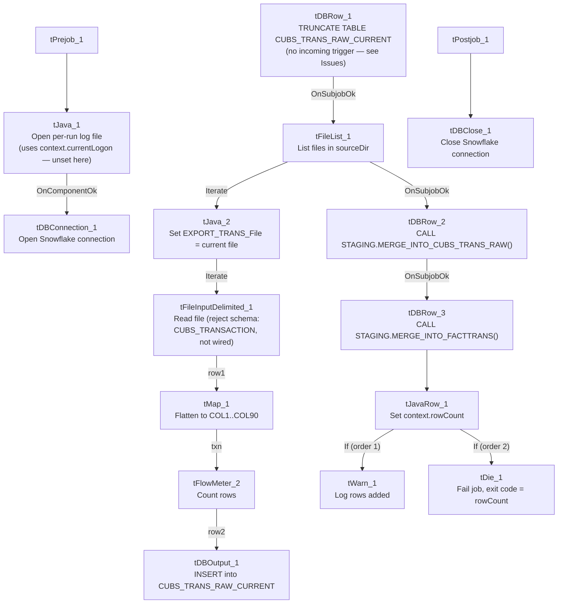

# Talend Job: CUBS_Raw_Trans_Load_Special

## Overview

This is a self-contained variant of `CUBS_Raw_Trans_Load`: it truncates the Snowflake `CUBS_TRANS_RAW_CURRENT` table, loads **every** transaction export file found in `context.sourceDir` (rather than one fixed file), and then — unlike the base job, which leaves merging to its caller (`CO_Master_Load`) — calls both `STAGING.MERGE_INTO_CUBS_TRANS_RAW()` and `STAGING.MERGE_INTO_FACTTRANS()` itself, dying or warning based on the final merge's result. It follows the classic truncate-load-merge pattern used elsewhere in this project (e.g. `ADP_Payroll_Load`), whereas the base `CUBS_Raw_Trans_Load` does not truncate or merge on its own at all. Per `06_dependency_matrix.md`, this job is not called by, and does not call, any other job in this project — it appears to run standalone, likely on its own schedule, as an alternate path for loading transaction data.

## Detail table

| Field | Value |
|---|---|
| Job name | CUBS_Raw_Trans_Load_Special |
| Version | 0.1 |
| Project | EDW2SF |
| Author | jmach@harriscollect.com |
| Created | Unable to determine from metadata — not present in job JSON (same gap as sibling `CUBS_Raw_Trans_Load`). |
| Last Modified | Unable to determine from metadata — not present in job JSON (same gap as sibling `CUBS_Raw_Trans_Load`). |

## Step-by-step data flow

This job starts **two independent top-level subjobs** (no explicit trigger connects them to each other), per Talend's default parallel-subjob-start semantics:

**Subjob A — setup:** `tPrejob_1` → `tJava_1` (`OnComponentOk`) opens a per-run log file at `context.logDir + context.currentLogon + "_" + jobName + "_" + <timestamp> + ".log"` (again referencing `context.currentLogon`, not set anywhere in this job — see Issues observed) → `tDBConnection_1` (`OnComponentOk`) opens the Snowflake connection. **There is no explicit trigger link from this subjob to Subjob B below** — see Issues observed regarding a possible race condition.

**Subjob B — truncate, load, merge:**

1. `tDBRow_1` runs `TRUNCATE TABLE CUBS_TRANS_RAW_CURRENT;` with no incoming trigger of its own — it is the second independent top-level entry point.
2. On success (`OnSubjobOk`), `tFileList_1` lists files in `context.sourceDir` (no explicit sort — `ORDER_BY_NOTHING=true`; an `EXCLUDEFILEMASK` of `*.txt` is configured but `IFEXCLUDE=false`, so it's never applied, same unapplied-mask pattern as elsewhere in this project).
3. For each file (`Iterate`), `tJava_2` sets `context.EXPORT_TRANS_File` to the current file name — reusing the same context variable the base `CUBS_Raw_Trans_Load` job uses for its one fixed file, but here overwritten once per loop iteration.
4. `tFileInputDelimited_1` (`Iterate`) reads `context.sourceDir + context.EXPORT_TRANS_File` using the `EXPORT_TRANS_*` context-driven format settings (same as the base job). `DIE_ON_ERROR=false`; a `SCHEMA_REJECT` of repository schema `"...- CUBS_TRANSACTION"` is configured but not wired to any reject flow.
5. `tMap_1` (`row1`, FLOW) re-maps the source row positionally onto `FILENAME`, `FILEDATE`, `COL1`...`COL90` (92 columns).
6. `tFlowMeter_2` (`txn`, FLOW) counts rows passing through (label left at default `"MyLabel"`).
7. `tDBOutput_1` (`row2`, FLOW) inserts rows into Snowflake `CUBS_TRANS_RAW_CURRENT` (`INSERT`, `tableAction=NONE`).
8. Once every file has been processed (`tFileList_1`'s `OnSubjobOk`), `tDBRow_2` runs `CALL STAGING.MERGE_INTO_CUBS_TRANS_RAW()`.
9. On success, `tDBRow_3` runs `CALL STAGING.MERGE_INTO_FACTTRANS();`.
10. `tJavaRow_1` reads its `RETVALUE` into `context.rowCount`.
11. Two ordered `RUN_IF` branches follow: `tWarn_1` ("`<rowCount>` rows added to FACTTRANS", a warning, order 1) or `tDie_1` ("`<rowCount>`: an error occurred during MERGE", exit code = `context.rowCount`, order 2) — the branch conditions themselves aren't captured in this metadata, but the message wording and component types make the success/failure intent clear.

No file archive or delete step exists anywhere in this job — processed files remain in `context.sourceDir` after the run (see Issues observed).

**Teardown subjob:** `tPostjob_1` → `tDBClose_1` (`OnComponentOk`) closes the Snowflake connection.

## Settings tables

### Source: `tFileInputDelimited_1`

| Setting | Value | What it means |
|---|---|---|
| FILENAME | `context.sourceDir + context.EXPORT_TRANS_File` | `context.EXPORT_TRANS_File` is overwritten per file by `tJava_2`, so this reads a different file on each loop iteration — contrast with the base `CUBS_Raw_Trans_Load`, which reads one fixed file per run. |
| FIELDSEPARATOR / ROWSEPARATOR / HEADER / ENCODING | All from `context.EXPORT_TRANS_*` | Same context-driven format settings as the base job. |
| SCHEMA (main) | Inline (not repository) — 174 named business columns + `errorCode`/`errorMessage` | **Missing `CANC_ROUTINE`** compared to the base `CUBS_Raw_Trans_Load` job's otherwise identical 176-column schema — see Issues observed. |
| SCHEMA_REJECT | Repository schema `"...- CUBS_TRANSACTION"` (same GUID as base job) | Correctly named, but not wired to a reject flow. |
| DIE_ON_ERROR | `false` | Malformed rows don't fail the job... |
| Reject flow | Not wired | ...but rejected rows are silently dropped, same as the base job. |
| TEMP_DIR | `"C:/Talend-Studio-20211109_1610-V8.0.1/workspace"` | Hardcoded developer-workstation path. |

### `tFileList_1`

| Setting | Value | What it means |
|---|---|---|
| DIRECTORY | `context.sourceDir` | Same shared source directory as many other jobs. |
| ORDER_BY_NOTHING | `true` | Files are processed in whatever order the filesystem returns them — no explicit sort by name/date, unlike the `CUBS_Raw_<Site>_ETL_Load` family's modified-date-ascending order. |
| EXCLUDEFILEMASK / IFEXCLUDE | `"*.txt"` / `false` | Exclusion configured but never applied — every file in the directory is picked up, same unapplied-mask pattern flagged elsewhere in this project. |

### Truncate & merge steps: `tDBRow_1` / `tDBRow_2` / `tDBRow_3`

| Setting | Value | What it means |
|---|---|---|
| `tDBRow_1` query | `TRUNCATE TABLE CUBS_TRANS_RAW_CURRENT;` | Clears the raw landing table before reloading — a step the base `CUBS_Raw_Trans_Load` job does **not** perform itself. |
| `tDBRow_2` query | `CALL STAGING.MERGE_INTO_CUBS_TRANS_RAW()` | Same procedure name `CO_Master_Load` calls after running the base `CUBS_Raw_Trans_Load` — here it's invoked from inside this job instead. |
| `tDBRow_3` query | `CALL STAGING.MERGE_INTO_FACTTRANS();` | Merges into the `FACTTRANS` fact table; `RETVALUE` is captured into `context.rowCount` and drives the final warn/die branch. |

### Target: `tDBOutput_1` (`tSnowflakeOutput`)

| Setting | Value | What it means |
|---|---|---|
| Table | `CUBS_TRANS_RAW_CURRENT` | Same destination table as the base `CUBS_Raw_Trans_Load` job. |
| Output action / Table action | `INSERT` / `NONE` | Appends rows; relies on the preceding `TRUNCATE` (step 1) to prevent duplicate accumulation, unlike the base job which has no truncate at all. |

### Result handling: `tJavaRow_1` / `tWarn_1` / `tDie_1`

| Setting | Value | What it means |
|---|---|---|
| `tJavaRow_1` | `context.rowCount = input_row.RETVALUE;` | Captures the `FACTTRANS` merge's return value. |
| `tWarn_1` | `context.rowCount + " rows added to FACTTRANS"` (severity code 42) | Logged on the success branch — a warning, not a failure signal on its own. |
| `tDie_1` | `context.rowCount + ": an error occurred during MERGE"`, exit code = `context.rowCount.intValue()`, `EXIT_JVM=false` | On the failure branch, this **does** fail the job (unlike `CO_Master_Load`'s equivalent `FACTTRANS`-merge check, which only warns) — see `05_operational_runbook.md`, which lists this job among the 16 with explicit `tDie`/`tWarn` merge-result logic. |

## Dependencies & configuration

- **Triggers/depends on other jobs:** `runjob_targets` is empty — this job does not call any other job via `tRunJob`.
- **Called by:** none found in `06_dependency_matrix.md` — unlike its sibling `CUBS_Raw_Trans_Load` (called once by `CO_Master_Load`), this job does not appear in the project's `tRunJob` orchestration graph at all. It likely runs on its own independent schedule outside the `CO_Master_Load` pipeline — unable to confirm from metadata; verify with the team.
- **Context variables used:** `EXPORT_TRANS_Encoding`, `EXPORT_TRANS_FieldSeparator`, `EXPORT_TRANS_File` (here reassigned per loop iteration, not read from its context-group default), `EXPORT_TRANS_Header`, `EXPORT_TRANS_RowSeparator`, `currentLogon` (referenced but not set in this job), `logDir`, `rowCount` (set internally from the merge result), `sourceDir`.
- **1 hardcoded developer-workstation path** (`tFileInputDelimited_1.TEMP_DIR`) — same project-wide portability risk documented in `05_operational_runbook.md`.

## Glossary

| Component type | Plain-English meaning |
|---|---|
| `tPrejob` / `tPostjob` | Talend's guaranteed-first / guaranteed-last subjobs for setup and teardown. |
| `tJava` / `tJavaRow` | Run custom Java code once, or once per input row. |
| `tFileList` | Lists files in a directory for the job to iterate over one at a time. |
| `tFileInputDelimited` | Reads a delimited (CSV/TSV-style) text file according to a schema. |
| `tMap` | Maps/transforms columns from one schema to another. |
| `tFlowMeter` | Counts rows passing through a point in the flow, for logging/monitoring. |
| `tSnowflakeOutput` / `tSnowflakeRow` / `tSnowflakeConnection` / `tSnowflakeClose` | Write rows to a Snowflake table / run an arbitrary SQL statement or stored-procedure call / open and close the Snowflake connection. |
| `tDie` / `tWarn` | End the job with a specific failure message and exit code (`tDie`), or log a warning without stopping the job (`tWarn`). |

## Issues observed

- **The truncate-and-load subjob (`tDBRow_1` → `tFileList_1` → ...) has no explicit trigger connection from the setup subjob that opens the Snowflake connection (`tDBConnection_1`).** Both start as independent top-level subjobs per this job's own wiring. If Talend's runtime doesn't otherwise guarantee the connection is established before `tDBRow_1`'s `TRUNCATE` executes, there's a theoretical race condition on startup — unable to determine from this metadata whether Talend's shared-connection component model prevents this in practice; verify directly in Talend Studio.
- **This job's input schema is missing the `CANC_ROUTINE` column** that the otherwise-identical base `CUBS_Raw_Trans_Load` job's schema includes (both jobs reference the same `CUBS_TRANSACTION` reject-schema GUID, and every other business column matches). Whether the real "special" source files genuinely lack this column, or the schema here is simply out of sync with the base job's, is unable to determine from metadata — verify with the team, since a source file that *does* include `CANC_ROUTINE` would shift all subsequent columns by one position in this job's positional `tMap_1`.
- **No file archive or delete step anywhere in this job.** Every other file-processing job in this project's documented set (`ADP_Payroll_Load`, `CUBS_Raw_CO_ETL_Load`, `CUBS_Raw_TOL_ETL_Load`) either zips-and-deletes or deletes the source file after a successful load; this job does neither. Combined with `ORDER_BY_NOTHING` (no defined processing order) and no incremental filtering, rerunning this job would truncate the table and reprocess every file still sitting in `context.sourceDir`, including ones already loaded in a prior run — unless something outside this job's own metadata (e.g., an external process) moves or deletes files after they're picked up. Verify with the team before assuming reruns are safe or idempotent.
- **`context.currentLogon` is referenced in the log-filename expression but never set anywhere in this job**, same gap as the base `CUBS_Raw_Trans_Load` job.
- **No reject flow wired from `tFileInputDelimited_1`** despite the correctly-named `CUBS_TRANSACTION` reject schema — malformed rows are silently dropped with no record, same pattern as the base job.
- **This job overlaps significantly in purpose with `CUBS_Raw_Trans_Load` + `CO_Master_Load`'s post-load merge steps**, but is not wired into that orchestration at all (`06_dependency_matrix.md` shows no caller). Whether this job is a deprecated predecessor, an intentional alternate/ad-hoc path (e.g. for a manual reload of multiple files at once), or a currently-scheduled parallel process to `CO_Master_Load`'s transaction chain is unable to determine from metadata — worth confirming with the team, since if both jobs' schedules ever overlap and target the same `CUBS_TRANS_RAW_CURRENT` table, one job's `TRUNCATE` could wipe out data the other is mid-way through loading.
