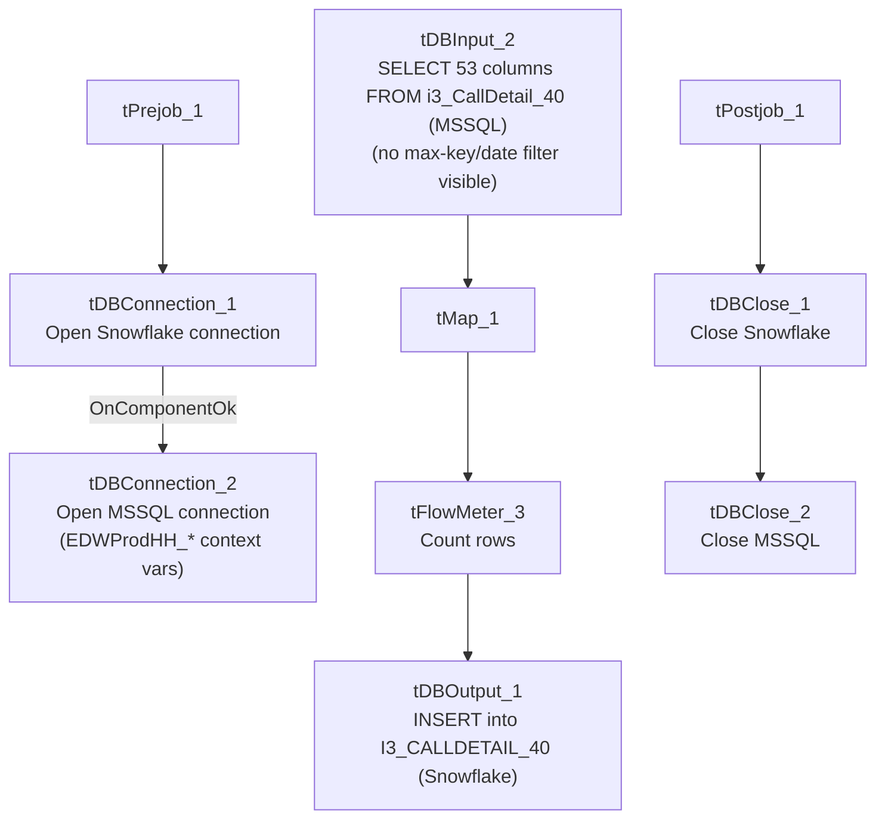

# Talend Job: CallDetail_40_Load_History

## Overview

Loads call-detail records (campaign, site, call timing, `i3_identity`, agent/logon and debtor-linkage fields) from the I3 telephony system's `i3_CallDetail_40` MSSQL table into the Snowflake `I3_CALLDETAIL_40` table — the **same source and target tables** used by `i3_CallDetail_40_Load`, but this job has no incremental max-key check, no `tWarn`/`tDie` logic, and only Talend's built-in statistics/flow-meter catchers alongside the main flow. Its name ("`_History`") and the absence of any incremental filtering logic strongly suggest this is a one-time or occasional full-table backfill/history load, run separately from the ongoing incremental `i3_CallDetail_40_Load` job — but since both write to the identical target table with a plain `INSERT` and no truncate, running both against overlapping data would duplicate rows (see Issues observed).

## Detail table

| Field | Value |
|---|---|
| Job name | CallDetail_40_Load_History |
| Version | 0.1 |
| Project | EDW2SF |
| Author | jmach@harriscollect.com |
| Created | 2022-01-24T09:53:10.617-0800 |
| Last Modified | 2025-09-24T10:59:47.477-0700 |

## Step-by-step data flow

**Setup subjob:** `tPrejob_1` → `tDBConnection_1` (`OnComponentOk`) opens the Snowflake connection → `tDBConnection_2` (`OnComponentOk`) opens the MSSQL connection to `context.EDWProdHH_Server`/`Port`/`Schema`/`Database`/`Login` (password redacted; same `EDWProdHH_*` context-variable naming used by `i3_CallDetail_40_Load`, even though this reads I3 telephony data, not EDWProdHH data — see that job's own Issues observed for the same naming question).

**Main subjob** (no incoming trigger from the setup chain, so it runs as an independent top-level subjob alongside setup):

1. `tDBInput_2` (reusing the shared `tDBConnection_2`) runs a fixed `SELECT` against table `i3_CallDetail_40`, pulling 53 named columns (campaign name, site ID, `i3_identity`, call timing fields, agent/debtor logon-linkage columns `LogOn_New`/`DimLogOn_New`/`ClientNumber_New`/`LogOn_O`/`DimLogOn_O`/`ClientNumber_O`, `PACKET`, `PRIMY_DEBTOR_NUMBER`, etc.). The captured query text is truncated in this metadata after the first several columns, so the full column list and any `WHERE` clause are not fully visible — no max-key or date-range filter is visible in the captured portion, and there is no preceding max-key lookup component in this job (unlike `i3_CallDetail_40_Load`'s `tDBInput_1`/`tJavaRow_1` pair) — see Issues observed.
2. `tMap_1` passes the 53 source columns through to a same-shaped, uppercase-named target schema.
3. `tFlowMeter_3` counts rows passing through (label left at the default `"MyLabel"`; `TSTATCATCHER_STATS` enabled, feeding the job's stats/log-catcher components).
4. `tDBOutput_1` inserts the rows into Snowflake table `I3_CALLDETAIL_40` (`INSERT`, `tableAction=NONE` — no truncate/recreate).

Separately, `tStatCatcher_1` and `tFlowMeterCatcher_1` (Talend's built-in job-statistics/flow-meter catchers) feed `tLogRow_1`/`tLogRow_2`, which print job statistics and flow-meter counts to the log — these run automatically alongside the main flow and aren't part of the business data path.

**Teardown subjob:** `tPostjob_1` → `tDBClose_1` (close Snowflake) → `tDBClose_2` (close MSSQL).

## Settings tables

### Source: `tDBInput_2` (`tMSSqlInput`)

| Setting | Value | What it means |
|---|---|---|
| Connection | Shared `tDBConnection_2` (`USE_EXISTING_CONNECTION=true`) | Reuses the job's single MSSQL connection rather than opening a new one. |
| Table | `i3_CallDetail_40` | Same source table read by `i3_CallDetail_40_Load`. |
| Query | Fixed `SELECT` of 53 named columns (call timing, `i3_identity`, logon/debtor-linkage fields, etc.), with two columns explicitly `CAST(... AS numeric(38,0))` | The captured query text is truncated after the visible column list — no `WHERE` clause is visible in this metadata; see Issues observed. |

### Target: `tDBOutput_1` (`tSnowflakeOutput`)

| Setting | Value | What it means |
|---|---|---|
| Table | `I3_CALLDETAIL_40` | Same destination table as `i3_CallDetail_40_Load` — see Issues observed regarding the shared-table/no-truncate risk. |
| Output action | `INSERT` | Appends rows — there is no `TRUNCATE`/staging step in this job. |
| Table action | `NONE` | Table is not recreated/altered by this job. |

## Dependencies & configuration

- **Triggers/depends on other jobs:** none — `runjob_targets` is empty, no `tRunJob` links found.
- **Called by:** none found in `06_dependency_matrix.md` — this job does not appear as a target of any `tRunJob` link in the project, consistent with it being a standalone/manually-run backfill rather than part of a scheduled orchestration chain.
- **Context variables used:** `EDWProdHH_Server`, `EDWProdHH_Port`, `EDWProdHH_Schema`, `EDWProdHH_Database`, `EDWProdHH_Login` (MSSQL connection details — same naming-convention question flagged in `i3_CallDetail_40_Load`).
- No hardcoded developer-workstation paths found in this job.

## Glossary

| Component type | Plain-English meaning |
|---|---|
| `tSnowflakeConnection` / `tSnowflakeClose` | Open/close a Snowflake database connection shared by other components in the job. |
| `tMSSqlConnection` / `tMSSqlInput` / `tMSSqlClose` | Open a Microsoft SQL Server connection, run a query against it, and close it. |
| `tSnowflakeOutput` | Writes rows to a Snowflake table. |
| `tMap` | Maps/transforms columns from one schema to another. |
| `tFlowMeter` | Counts rows passing a point in the flow for logging/monitoring. |
| `tStatCatcher` / `tFlowMeterCatcher` / `tLogRow` | Talend's built-in job-statistics and flow-meter capture components, which print execution stats to the log; not part of the business data flow. |

## Issues observed

- **This job and `i3_CallDetail_40_Load` write to the exact same Snowflake target table (`I3_CALLDETAIL_40`) from the exact same MSSQL source table (`i3_CallDetail_40`), both with a plain `INSERT` and no truncate step.** If this job is meant as a one-time historical backfill, that's a reasonable design as long as it's run before the incremental job starts (or the incremental job's max-key filter — itself unconfirmed, see `i3_CallDetail_40_Load`'s own Issues observed — genuinely excludes already-loaded rows). If both jobs are ever run against overlapping data (e.g., this history job re-run after the incremental job has already loaded recent data, or vice versa), rows would be duplicated in `I3_CALLDETAIL_40` with no dedup mechanism visible in either job's metadata. Unable to confirm the intended run order or frequency from metadata alone — verify with the team.
- **No `WHERE` clause is visible in the captured `QUERY` text**, and unlike `i3_CallDetail_40_Load`, this job has no preceding max-key lookup or any other filtering logic at all — consistent with a full-table historical pull, but also meaning every run (if repeated) would reload the entire `i3_CallDetail_40` source table. Unable to confirm from metadata whether this job is intended to run only once ("history" backfill) or is scheduled to run repeatedly; if the latter, it would produce full duplicate reloads every time.
- **No `tWarn`/`tDie`/`tSendMail` logic** — a load failure here would only surface as a generic Talend execution error, with no job-specific message to distinguish it in a shared log, and it is not among the 12 email-alerting or 16 explicit-`tDie`/`tWarn` jobs listed in `05_operational_runbook.md`.
- **Not referenced anywhere in the project's `tRunJob` orchestration graph** (`06_dependency_matrix.md`) — how and when this job is actually triggered (manual run, a scheduler entry outside this metadata, or a one-time historical load that's no longer run at all) is unable to determine from metadata; verify with the team.
