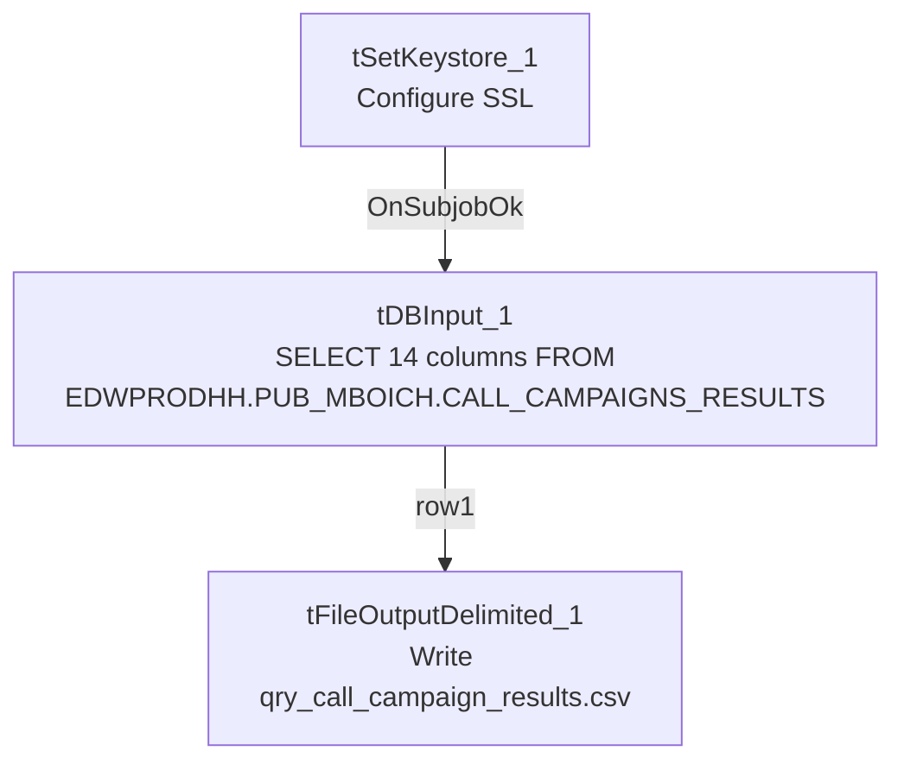

# Talend Job: Call_Campaign_Results_Extract

## Overview

This is a small, single-pass reporting extract: it queries a Snowflake table of call-campaign performance results (call date/hour, campaign name, call direction, CRC type/description, wrapup code, and aggregate counts of calls, connects, right-party-contacts, and promises) and writes the result straight to a CSV file for downstream consumption. Unlike most jobs in this project, it has no `tPrejob`/`tPostjob`, no explicit database-connection-open/close pair, and no `tMap` — it's a direct query-to-file passthrough with only 3 components total.

## Detail table

| Field | Value |
|---|---|
| Job name | Call_Campaign_Results_Extract |
| Version | 0.1 |
| Project | EDW2SF |
| Author | jmach@harriscollect.com |
| Created | 2023-08-22T15:55:40.993-0700 |
| Last Modified | 2025-11-12T06:51:25.242-0800 |

## Step-by-step data flow

1. `tSetKeystore_1` configures SSL trust/keystore settings from `context.keystorePath` (passwords redacted).
2. On success (`OnSubjobOk`), `tDBInput_1` (a `tSnowflakeInput`, with no visible connection-opening component of its own in this job — see Issues observed) runs a fixed `SELECT` of 14 columns from `EDWPRODHH.PUB_MBOICH.CALL_CAMPAIGNS_RESULTS`.
3. `tFileOutputDelimited_1` (`MAIN`, `row1`) writes the result directly to `context.outputDir + "qry_call_campaign_results.csv"` — comma-delimited, header row included, no `tMap` in between (schema flows straight through).

## Settings tables

### Source: `tDBInput_1` (`tSnowflakeInput`)

| Setting | Value | What it means |
|---|---|---|
| Query | `SELECT CALL_DATE, CALL_HOUR, SHORT_DESCRIPTION, CAMPAIGNNAME, PL_GROUP, CALLDIRECTION, AGE_FROM_MAX_PACKET_LIST_DATE_CATEGORY, CRCTYPE, WRAPUP_CODE, CRCDESCRIPTION, N_CALLS, CONNECTS, RPCS, PROMISES FROM EDWPRODHH.PUB_MBOICH.CALL_CAMPAIGNS_RESULTS;` | Reads from a Snowflake database named `EDWPRODHH` and a schema `PUB_MBOICH` — a "publish"-style schema whose name looks individually owned (initials-style, similar to `PUB_JCHANG` flagged in `01_system_architecture.md`), not one of the project's documented shared publish schemas (`SF_PUB_LW`). |
| Connection | Not captured in this job's own metadata (`parameters` is empty; no `tDBConnection`/keystore-linked connection component precedes it besides `tSetKeystore_1`) | Unable to determine from metadata which account/host this component actually connects with — see Issues observed. |

### Schema column naming vs. query column naming

| Query column | Declared schema column | What it means |
|---|---|---|
| `CALLDIRECTION` | `CALL_DIRECTION` | Renamed in the schema relative to the source column name. |
| `AGE_FROM_MAX_PACKET_LIST_DATE_CATEGORY` | `AGE_BRACKET` | Renamed to a shorter, friendlier label. |
| `CRCTYPE` | `CRC_TYPE` | Renamed with an added underscore. |

These renames work because the result set is bound to the schema **positionally**, not by name — but see Issues observed for the maintenance risk this creates.

### Target: `tFileOutputDelimited_1`

| Setting | Value | What it means |
|---|---|---|
| FILENAME | `context.outputDir + "qry_call_campaign_results.csv"` | Fixed output filename; no date-stamp in the name, so each run overwrites the previous file (`APPEND=false`). |
| FIELDSEPARATOR / INCLUDEHEADER | `,` / `true` | Standard comma-delimited CSV with a header row. |
| ENCODING | ISO-8859-15 | Latin-9 encoding. |

## Dependencies & configuration

- **Triggers/depends on other jobs:** `runjob_targets` is empty — this job does not call any other job via `tRunJob`.
- **Called by:** none found in `06_dependency_matrix.md` — this job does not appear in the project's `tRunJob` orchestration graph.
- **Context variables used:** `keystorePath`, `outputDir`.
- **1 hardcoded developer-workstation path** (`tSetKeystore_1.SSL_TRUSTSERVER_TRUSTSTORE` = `"C:/clientTrustStore.trustStore"`) — same project-wide portability risk documented in `05_operational_runbook.md`.

## Glossary

| Component type | Plain-English meaning |
|---|---|
| `tSnowflakeInput` | Runs a query against Snowflake and returns its result rows. |
| `tFileOutputDelimited` | Writes rows to a delimited (CSV-style) text file. |
| `tSetKeystore` | Configures SSL client keystore/truststore settings ahead of an encrypted database connection. |

## Issues observed

- **No `tDBConnection`/`tDBClose` pair, and `tDBInput_1`'s own `parameters` are empty in this metadata.** Every other Snowflake-reading job documented in this batch opens an explicit, named connection component (`tDBConnection_1`) before querying. Here, `tDBInput_1` runs directly after `tSetKeystore_1` with no visible connection-establishment step captured — either it opens its own inline connection whose settings simply weren't captured by this extraction, or it silently relies on some other project-level default. Unable to determine from metadata which Snowflake account/role this job actually authenticates as; verify directly in Talend Studio.
- **The query reads from `EDWPRODHH.PUB_MBOICH` — a Snowflake database/schema pairing whose schema name (`PUB_MBOICH`) reads as an individual's initials**, similar to the `PUB_JCHANG` connection flagged project-wide in `01_system_architecture.md` and `06_dependency_matrix.md` as looking individually owned rather than shared platform infrastructure. If this schema is tied to a specific person, this job (and its output file, ultimately used for reporting) could silently break if that person's account or schema access changes — worth confirming ownership with the team.
- **Three schema columns are declared with different names than the SQL query's underlying column names** (`CALLDIRECTION`→`CALL_DIRECTION`, `AGE_FROM_MAX_PACKET_LIST_DATE_CATEGORY`→`AGE_BRACKET`, `CRCTYPE`→`CRC_TYPE`). Since there's no `tMap` and the query has no explicit `AS` aliases for these three, the mapping from query result to schema is purely positional. This works today, but if the underlying `CALL_CAMPAIGNS_RESULTS` view/table's column order ever changes (even without a name change), this job would silently start writing the wrong values under the wrong column headers in the output CSV, with no error raised. Worth adding explicit `AS` aliases in the query, or a `tMap`, to make the mapping name-based and self-documenting.
- **No error handling, row-count logging, or completion signal specific to this job's business outcome** — no `tWarn`, `tDie`, or `tSendMail`. A query failure or empty result would only surface as a generic Talend execution error (or a silently near-empty CSV), consistent with the majority of jobs in this project per `05_operational_runbook.md`.
- **The output file has no date-stamp** (`qry_call_campaign_results.csv`, `APPEND=false`), so each run overwrites the prior file entirely, with no historical copies retained by this job itself.
