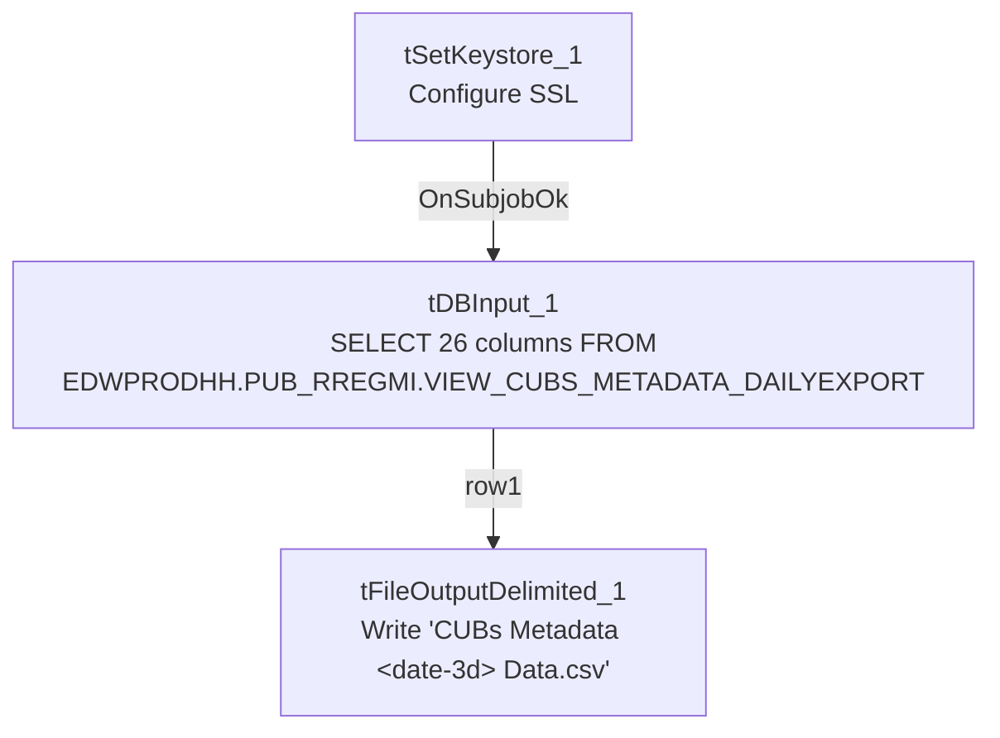

# Talend Job: Callminer_HH_Metadata_Daily_Extract

## Overview

Another small, single-pass reporting extract, structurally identical to `Call_Campaign_Results_Extract`: it queries a Snowflake view of daily call-metadata records for the "HH" site (agent, call duration/timing, client/account/file numbers, placement balance and days-since-placement, location, campaign/queue names, and result/wrap-up codes — likely sourced from or feeding a Callminer call-recording/analytics integration, per the job name) and writes the result to a dated CSV file for downstream (likely Callminer) consumption. Like `Call_Campaign_Results_Extract`, it has no `tPrejob`/`tPostjob`, no explicit connection-open/close pair, and no `tMap` — a direct query-to-file passthrough with only 3 components total.

## Detail table

| Field | Value |
|---|---|
| Job name | Callminer_HH_Metadata_Daily_Extract |
| Version | 0.1 |
| Project | EDW2SF |
| Author | jmach@harriscollect.com |
| Created | 2026-06-17T10:30:25.663-0700 |
| Last Modified | 2026-06-17T15:53:22.208-0700 |

## Step-by-step data flow

1. `tSetKeystore_1` configures SSL trust/keystore settings from `context.keystorePath` (passwords redacted).
2. On success (`OnSubjobOk`), `tDBInput_1` (a `tSnowflakeInput`, with no visible connection-opening component of its own in this job — see Issues observed) runs a fixed `SELECT` of 26 columns from `EDWPRODHH.PUB_RREGMI.VIEW_CUBS_METADATA_DAILYEXPORT`, with no `WHERE` clause visible in the query.
3. `tFileOutputDelimited_1` (`MAIN`, `row1`) writes the result directly to `context.outputDir + "CUBs Metadata " + <date 3 days before run date, M.d.YY format> + " Data.csv"` — comma-delimited, header row included, no `tMap` in between (schema flows straight through, column names matching exactly).

## Settings tables

### Source: `tDBInput_1` (`tSnowflakeInput`)

| Setting | Value | What it means |
|---|---|---|
| Query | `SELECT AGENTUSERNAME, HHCALLDURATION, CONNECTEDDATE, CONNECTEDDATETIME, CLIENTNUMBER, AGENTNAME, DEPT, DIRECTION, CITY, PLACEBALANCE, STATE, ACCOUNTNUMBER, PLACEDDATE, DAYSSINCEPLACEMENT, FILENUMBER, RPC, ZIP, RESULT, TEAMLEAD, CBRREPORTING, UNITMANAGER, CONVERSATIONID, CAMPAIGN, HHQUEUENAME, HHDIALERCAMPAIGNNAME, LATITUDERESULTCODE FROM EDWPRODHH.PUB_RREGMI.VIEW_CUBS_METADATA_DAILYEXPORT;` | Reads a pre-built "daily export" view from Snowflake database `EDWPRODHH`, schema `PUB_RREGMI` — another individually-initialed-looking publish schema, same pattern flagged in `Call_Campaign_Results_Extract` for `PUB_MBOICH` and project-wide for `PUB_JCHANG`. |
| No `WHERE` clause | — | The query has no date filter of its own; whatever "daily" scoping happens must occur inside the `VIEW_CUBS_METADATA_DAILYEXPORT` view itself (not visible in this job's metadata) — see Issues observed. |
| Connection | Not captured in this job's own metadata (`db` has no connection fields; no `tDBConnection` precedes it besides `tSetKeystore_1`) | Same gap as `Call_Campaign_Results_Extract` — unable to determine which Snowflake account/role this job authenticates as. |
| Column naming | Query column names match declared schema column names exactly (no renames) | Unlike `Call_Campaign_Results_Extract`, there is no name mismatch here to flag. |

### Target: `tFileOutputDelimited_1`

| Setting | Value | What it means |
|---|---|---|
| FILENAME | `context.outputDir + "CUBs Metadata " + TalendDate.formatDate("M.d.YY", TalendDate.addDate(TalendDate.getCurrentDate(), -3, "dd")) + " Data.csv"` | The output filename embeds a date **3 days before the job's actual run date** (e.g. a run on day N produces a file labeled for day N-3), not the run date itself — see Issues observed. |
| FIELDSEPARATOR / INCLUDEHEADER | `,` / `true` | Standard comma-delimited CSV with a header row. |
| APPEND | `false` | Each run creates/overwrites a file for that computed date; since the filename is date-based, re-running on a different day produces a different file rather than overwriting yesterday's. |
| ENCODING | ISO-8859-15 | Latin-9 encoding. |

## Dependencies & configuration

- **Triggers/depends on other jobs:** `runjob_targets` is empty — this job does not call any other job via `tRunJob`.
- **Called by:** none found in `06_dependency_matrix.md` — this job does not appear in the project's `tRunJob` orchestration graph.
- **Context variables used:** `keystorePath`, `outputDir`.
- **1 hardcoded developer-workstation path** (`tSetKeystore_1.SSL_TRUSTSERVER_TRUSTSTORE` = `"C:/clientTrustStore.trustStore"`) — same project-wide portability risk documented in `05_operational_runbook.md`.

## Glossary

| Component type | Plain-English meaning |
|---|---|
| `tSnowflakeInput` | Runs a query against Snowflake and returns its result rows. |
| `tFileOutputDelimited` | Writes rows to a delimited (CSV-style) text file. |
| `tSetKeystore` | Configures SSL client keystore/truststore settings ahead of an encrypted database connection. |

## Issues observed

- **The output filename is computed as "3 days before the run date," but the query itself has no date filter.** The 3-day offset is baked into `tFileOutputDelimited_1`'s filename expression only; whether `VIEW_CUBS_METADATA_DAILYEXPORT` (the Snowflake view being queried) independently filters its own rows to a matching 3-day-lagged window is not visible in this job's metadata. If the view's actual date logic ever drifts from this job's assumed 3-day lag (e.g., the view is changed to reflect a different lag, or no lag at all), the exported file's name would misrepresent the data it actually contains, with no validation in this job to catch the mismatch. Verify the view's definition directly in Snowflake.
- **No `tDBConnection`/`tDBClose` pair, and `tDBInput_1`'s own connection settings are not captured in this metadata** — same gap noted in `Call_Campaign_Results_Extract`; unable to determine which Snowflake account/role this job authenticates as from metadata alone.
- **The query reads from `EDWPRODHH.PUB_RREGMI` — a schema name that reads as an individual's initials**, the same individually-owned-looking pattern flagged for `PUB_MBOICH` (in `Call_Campaign_Results_Extract`) and `PUB_JCHANG` (project-wide, per `01_system_architecture.md`). This job depends on that schema remaining available and correctly populated; if ownership of that schema changes, this daily extract could silently break or go stale with no one else aware of the dependency.
- **No error handling, row-count logging, or completion signal specific to this job's business outcome** — no `tWarn`, `tDie`, or `tSendMail`. A query failure, an empty result, or the view returning the wrong day's data would all produce a CSV with no warning, consistent with the majority of jobs in this project per `05_operational_runbook.md`.
- **Both `Callminer_HH_Metadata_Daily_Extract` and `Call_Campaign_Results_Extract` were created and (for this job) last modified on the same day, 2026-06-17** — both are very recent additions, and both share the identical minimal 3-component structure (`tSetKeystore` → `tSnowflakeInput` → `tFileOutputDelimited`), suggesting a reusable template for simple Snowflake-to-CSV reporting extracts in this project.
