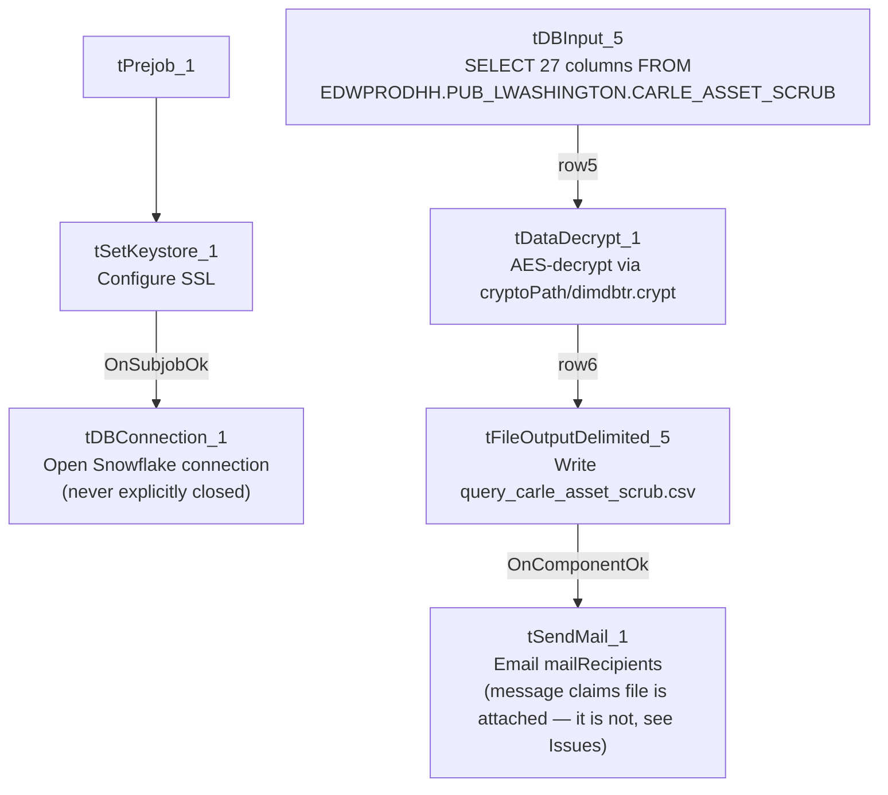

# Talend Job: Carle_Asset_Scrub

## Overview

Extracts a debtor-level "asset scrub" report for the Carle client — debtor number, name/address, phone, SSN, DOB, packet/desk, assigned/collected/balance amounts, admit/discharge dates, and employer contact fields — from a Snowflake view, decrypts one field via an AES-encrypted crypto file, writes the result to a CSV, and emails a completion notice to a distribution list. Per `05_operational_runbook.md`, this is one of the 12 jobs in this project that sends email on completion. The report includes Social Security Numbers in plain text in the output CSV, which is a sensitive-data handling point worth flagging to the team (see Issues observed).

## Detail table

| Field | Value |
|---|---|
| Job name | Carle_Asset_Scrub |
| Version | 0.1 |
| Project | EDW2SF |
| Author | jmach@harriscollect.com |
| Created | 2024-02-05T22:58:57.387-0800 |
| Last Modified | 2025-11-16T18:56:00.248-0800 |

## Step-by-step data flow

**Setup subjob:** `tPrejob_1` → `tSetKeystore_1` (`OnComponentOk`) configures SSL trust/keystore settings from `context.keystorePath` (all passwords redacted) → `tDBConnection_1` (`OnSubjobOk`) opens the Snowflake connection. **This job has no `tPostjob_1`/`tDBClose`** — the Snowflake connection is never explicitly closed within this job's own metadata, the same gap seen in other jobs in this batch.

**Main subjob** (no incoming trigger connection to `tDBInput_5`, so it runs as an independent top-level subjob alongside setup):

1. `tDBInput_5` runs a fixed `SELECT` of 27 columns (including two quoted/aliased source columns, `"C.D.#" AS CD_NUM` and `"MISC. 4" AS MISC_4`) from `EDWPRODHH.PUB_LWASHINGTON.CARLE_ASSET_SCRUB` — another individually-initialed-looking publish schema (`PUB_LWASHINGTON`), the same pattern flagged in the other extract jobs in this batch.
2. `tDataDecrypt_1` (`MAIN`, `row5`) decrypts data using AES (`ALGO_VERSION=2`) against a crypto key file at `context.cryptoPath + "dimdbtr.crypt"` (secret type, key, and password all redacted). `DIE_ON_ERROR=true` — a decryption failure fails the job outright. The specific column(s) being decrypted are not distinguishable from this metadata (the component acts on the whole row/schema, not a single named field).
3. `tFileOutputDelimited_5` (`FLOW`, `row6`) writes the result to `context.outputDir + "query_carle_asset_scrub.csv"` (comma-delimited, header included).
4. On success (`OnComponentOk`), `tSendMail_1` emails `context.mailRecipients` from `svc_analytics@harriscollect.com` ("H&H Analytics"), subject "Carle Asset Scrub Report", with message text "The daily Carle Asset Scrub report is attached." — **but no attachment is actually configured** (`CHECK_ATTACHMENT=false`, no file-list parameter present) — see Issues observed. `DIE_ON_ERROR=true` on the mail send.

## Settings tables

### Source: `tDBInput_5` (`tSnowflakeInput`)

| Setting | Value | What it means |
|---|---|---|
| Query | `SELECT DEBTORNUMBER, CLIENT, NAME1, ADD1, CITY, ST, ZIP, PACKET, PHONE, DOB, DESK, "C.D.#" AS CD_NUM, LST_PAY_DT, DT_ASSIGNED, SSN, STATUS, ASGN_AMT, ASGN_COLL, TOTAL_BAL, BALANCE_DIMDEBTOR_PACKET, ADMIT_DATE, DISCHARGE_DATE, EMP1_NAME, EMP1_ADDR, EMP1_CSZ, EMP1_PHN, "MISC. 4" AS MISC_4 FROM EDWPRODHH.PUB_LWASHINGTON.CARLE_ASSET_SCRUB;` | Reads a pre-built client-specific view; two source columns have special characters in their names and are explicitly aliased (`"C.D.#"`, `"MISC. 4"`). Includes `SSN` in plain column form. |
| Connection | Not captured in this job's own metadata beyond the shared `tDBConnection_1`/`tSetKeystore_1` chain | Standard for this batch's extract jobs. |

### `tDataDecrypt_1`

| Setting | Value | What it means |
|---|---|---|
| CRYPTO_METHOD / ALGO_VERSION | `AES` / `2` | Symmetric decryption of some portion of the row data. |
| CRYPTO_FILE_PATH | `context.cryptoPath + "dimdbtr.crypt"` | Key material comes from an external file, name suggests it's shared with/derived from a "dim debtor" encryption scheme used elsewhere in the project. |
| SECRET_TYPE / SECRET_KEY / PASSWORD_M1 | `***REDACTED***` | Preserved as redacted; real values not present in extracted metadata. |
| DIE_ON_ERROR | `true` | A decryption failure (e.g. wrong key, corrupted crypt file) fails the job outright rather than passing through unreadable data. |

### Target: `tFileOutputDelimited_5`

| Setting | Value | What it means |
|---|---|---|
| FILENAME | `context.outputDir + "query_carle_asset_scrub.csv"` | Fixed filename, no date-stamp — each run overwrites the previous file (`APPEND=false`). |
| Contents | Includes `SSN` and full name/address/employer-contact fields | This is a plain-text CSV containing PII, including Social Security Numbers — see Issues observed regarding handling. |

### `tSendMail_1`

| Setting | Value | What it means |
|---|---|---|
| TO / FROM | `context.mailRecipients` / `svc_analytics@harriscollect.com` ("H&H Analytics") | Sent from a shared service-account address, not an individual's mailbox. |
| SUBJECT / MESSAGE | "Carle Asset Scrub Report" / "The daily Carle Asset Scrub report is attached." | The message text explicitly claims a file attachment. |
| CHECK_ATTACHMENT | `false` | **No attachment is actually sent** — see Issues observed. |
| DIE_ON_ERROR | `true` | A failed send fails the job (unlike `Semaphore_Check`'s warn-then-continue-but-still-die-on-mail-failure pattern; here there's no `tWarn` fallback at all — the job simply fails). |
| AUTH_MODE / AUTH_USERNAME / AUTH_PASSWORD / TOKEN | `***REDACTED***` | Preserved as redacted. |

## Dependencies & configuration

- **Triggers/depends on other jobs:** `runjob_targets` is empty — this job does not call any other job via `tRunJob`.
- **Called by:** none found in `06_dependency_matrix.md` — this job does not appear in the project's `tRunJob` orchestration graph; presumably scheduled independently.
- **Context variables used:** `cryptoPath`, `keystorePath`, `mailRecipients`, `outputDir`.
- **1 hardcoded developer-workstation path** (`tSetKeystore_1.SSL_TRUSTSERVER_TRUSTSTORE` = `"C:/clientTrustStore.trustStore"`) — same project-wide portability risk documented in `05_operational_runbook.md`.

## Glossary

| Component type | Plain-English meaning |
|---|---|
| `tPrejob` | Talend's guaranteed-first subjob for setup (this job has no `tPostjob`). |
| `tSnowflakeInput` / `tSnowflakeConnection` | Runs a query against Snowflake and returns its result rows / opens the Snowflake connection used by the job. |
| `tDataDecrypt` | Decrypts data using a configured algorithm and key file — here, AES with an external `.crypt` key file. |
| `tFileOutputDelimited` | Writes rows to a delimited (CSV-style) text file. |
| `tSendMail` | Sends an email — used here as a completion notice, not (despite its message text) an attachment carrier. |
| `tSetKeystore` | Configures SSL client keystore/truststore settings ahead of an encrypted database connection. |

## Issues observed

- **The email's message text says "The daily Carle Asset Scrub report is attached," but `tSendMail_1.CHECK_ATTACHMENT` is `false` and no file-list/attachment parameter is present in this component's configuration.** As configured, the recipients receive only a plain-text email with no attachment — despite the report having just been written to `context.outputDir + "query_carle_asset_scrub.csv"` immediately beforehand. This is a concrete, functional mismatch between the job's stated behavior and its actual configuration: recipients expecting an attached report per the email text would not receive one from this job as built. Verify directly in Talend Studio whether attachment was intentionally disabled (e.g., the file is delivered by some other out-of-band process) or is a configuration gap that should be fixed.
- **The output CSV contains Social Security Numbers (`SSN`) and other PII (name, address, phone, DOB, employer contact info) in plain text, written to `context.outputDir` with no encryption on the output file itself** (only one upstream field passes through `tDataDecrypt_1`; the final CSV write is not encrypted). Given this data is collections/healthcare-adjacent (Carle is referenced elsewhere in the project as a health-system client) and includes SSNs, confirm the output directory's access controls and retention policy meet the organization's data-handling requirements for PII before assuming this file is adequately protected at rest.
- **No `tPostjob_1`/`tDBClose` in this job** — the Snowflake connection opened by `tDBConnection_1` is never explicitly closed, the same gap flagged in `CUBS_Raw_CO_ETL_Load` and `CUBS_Raw_TOL_ETL_Load` in this project.
- **The source query reads from `EDWPRODHH.PUB_LWASHINGTON`** — another schema name that reads as an individual's initials, consistent with the pattern already flagged for `PUB_MBOICH`, `PUB_RREGMI`, and project-wide `PUB_JCHANG`. If tied to a specific person's account, this job's data source could silently become unavailable if that person's access changes.
- **`tDataDecrypt_1`'s `DIE_ON_ERROR=true` means any decryption problem (bad key, corrupted `.crypt` file, or a schema/row that doesn't actually need decryption) fails the whole job**, with no fallback path — appropriate for preventing garbled sensitive data from reaching the output file, but it does mean this report has zero tolerance for a stale or misconfigured crypto key file.
