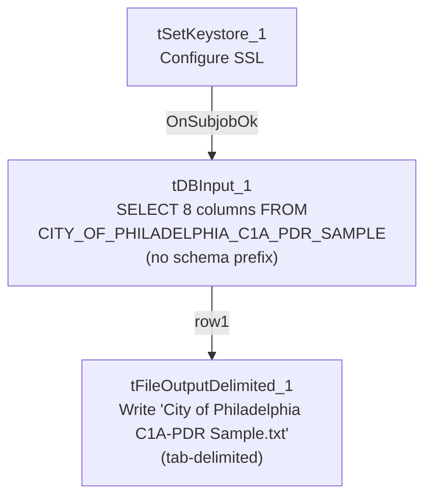

# Talend Job: City_of_Phi_C1A_PDR_Extract

## Overview

A small, single-pass reporting extract for the City of Philadelphia partner, following the same minimal shape as `Call_Campaign_Results_Extract` and `Callminer_HH_Metadata_Daily_Extract`: it queries a Snowflake table of "C1A" letter print-date-request (PDR) records — print date, letter code/vendor, debtor number, and current/letter month-year fields — and writes the result to a tab-delimited text file. Both the source table name (`CITY_OF_PHILADELPHIA_C1A_PDR_SAMPLE`) and the output filename (`City of Philadelphia C1A-PDR Sample.txt`) explicitly include the word "Sample," which is worth confirming with the team (see Issues observed) before assuming this is the live production feed for this partner.

## Detail table

| Field | Value |
|---|---|
| Job name | City_of_Phi_C1A_PDR_Extract |
| Version | 0.1 |
| Project | EDW2SF |
| Author | jmach@harriscollect.com |
| Created | 2025-01-06T11:09:13.608-0800 |
| Last Modified | 2025-11-12T06:58:23.902-0800 |

## Step-by-step data flow

1. `tSetKeystore_1` configures SSL trust/keystore settings from `context.keystorePath` (passwords redacted).
2. On success (`OnSubjobOk`), `tDBInput_1` (a `tSnowflakeInput`, with no visible connection-opening component of its own in this job) runs a fixed `SELECT` of 8 columns from `CITY_OF_PHILADELPHIA_C1A_PDR_SAMPLE` — **no database/schema prefix**, unlike the fully-qualified `EDWPRODHH.PUB_<initials>.<table>` pattern used by the other single-query extract jobs in this batch (see Issues observed).
3. `tFileOutputDelimited_1` (`MAIN`, `row1`) writes the result directly to `context.outputDir + "City of Philadelphia C1A-PDR Sample.txt"` — **tab-delimited**, header row included, no `tMap` in between.

## Settings tables

### Source: `tDBInput_1` (`tSnowflakeInput`)

| Setting | Value | What it means |
|---|---|---|
| Query | `SELECT PRINT_DATE, LETTER_CODE, LETTER_VENDOR, DEBTORNUMBER, CURRENT_MONTH, CURRENT_YEAR, LETTER_MONTH, LETTER_YEAR FROM CITY_OF_PHILADELPHIA_C1A_PDR_SAMPLE;` | Table name has no `<database>.<schema>.` qualifier, unlike this batch's other extract jobs — depends entirely on the Snowflake session's default database/schema context at run time. See Issues observed. |
| Connection | Not captured in this job's own metadata (no `tDBConnection` besides `tSetKeystore_1`) | Same pattern as the other simple extract jobs in this batch. |

### Target: `tFileOutputDelimited_1`

| Setting | Value | What it means |
|---|---|---|
| FILENAME | `context.outputDir + "City of Philadelphia C1A-PDR Sample.txt"` | Fixed filename with no date-stamp; each run overwrites the previous file (`APPEND=false`). |
| FIELDSEPARATOR | `\t` (tab) | Tab-delimited, not comma — differs from `Call_Campaign_Results_Extract`/`Carle_Asset_Scrub`'s comma-delimited CSV output. |
| INCLUDEHEADER | `true` | Header row included. |
| ENCODING | ISO-8859-15 | Latin-9 encoding. |

## Dependencies & configuration

- **Triggers/depends on other jobs:** `runjob_targets` is empty — this job does not call any other job via `tRunJob`.
- **Called by:** none found in `06_dependency_matrix.md` — this job does not appear in the project's `tRunJob` orchestration graph.
- **Context variables used:** `keystorePath`, `outputDir`.
- **1 hardcoded developer-workstation path** (`tSetKeystore_1.SSL_TRUSTSERVER_TRUSTSTORE` = `"C:/clientTrustStore.trustStore"`) — same project-wide portability risk documented in `05_operational_runbook.md`.

## Glossary

| Component type | Plain-English meaning |
|---|---|
| `tSnowflakeInput` | Runs a query against Snowflake and returns its result rows. |
| `tFileOutputDelimited` | Writes rows to a delimited (tab- or comma-style) text file. |
| `tSetKeystore` | Configures SSL client keystore/truststore settings ahead of an encrypted database connection. |

## Issues observed

- **Both the source table name (`CITY_OF_PHILADELPHIA_C1A_PDR_SAMPLE`) and the output filename (`City of Philadelphia C1A-PDR Sample.txt`) contain the word "Sample."** This job's own name (`City_of_Phi_C1A_PDR_Extract`) does not, which raises the question of whether this is a genuine production extract that happens to read from a table with a leftover "sample/test" name, or whether this job itself is still a sample/proof-of-concept that hasn't been promoted to a final production table/file name. Unable to determine intent from metadata alone — confirm with the team whether `CITY_OF_PHILADELPHIA_C1A_PDR_SAMPLE` is the actual, current production source for the City of Philadelphia partner before relying on this job's output as a live feed.
- **The source table reference has no database/schema qualifier**, unlike every other single-query extract job documented in this batch (`Call_Campaign_Results_Extract`, `Callminer_HH_Metadata_Daily_Extract`, `Carle_Asset_Scrub`), all of which fully qualify their source as `EDWPRODHH.PUB_<schema>.<table>`. This job instead relies on whatever database/schema is the active default for the Snowflake session/role it connects as. If that default ever changes (e.g., a role or account-level default schema update), this job could silently start reading from the wrong table, or fail to find `CITY_OF_PHILADELPHIA_C1A_PDR_SAMPLE` at all — unable to confirm the session's default context from this metadata; verify directly in Talend Studio or with the Snowflake account admin.
- **No `tDBConnection`/`tDBClose` pair, and `tDBInput_1`'s own connection settings are not captured in this metadata** — same gap noted in the other simple extract jobs in this batch.
- **No error handling, row-count logging, or completion signal specific to this job's business outcome** — no `tWarn`, `tDie`, or `tSendMail`. A query failure or an unexpectedly empty result would produce no alert, consistent with the majority of jobs in this project per `05_operational_runbook.md`.
- **No date-stamp in the output filename** (`APPEND=false`), so each run overwrites the previous extract with no historical copies retained by this job itself.
