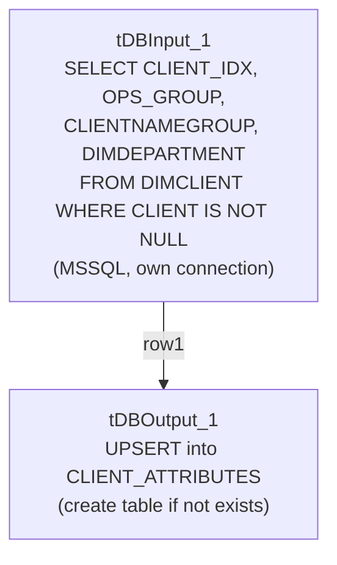

# Talend Job: Client_NonCUBS_Attributes

## Overview

A minimal, two-component reference-data sync: it reads client index, ops-group, client-name-group, and department attributes from the `EDWProdHH` MSSQL database's `DIMCLIENT` table (filtered to rows with a non-null `CLIENT`) and upserts them directly into a Snowflake `CLIENT_ATTRIBUTES` table, creating that table if it doesn't already exist. Unlike the truncate-then-insert pattern used throughout most of this project's load jobs, this one relies on Snowflake's `UPSERT` to merge changes in place, with no separate merge/stored-procedure step. The job's name implies a "Non-CUBS" client filter, but the query itself has no such condition beyond excluding null `CLIENT` values — see Issues observed.

## Detail table

| Field | Value |
|---|---|
| Job name | Client_NonCUBS_Attributes |
| Version | 0.1 |
| Project | EDW2SF |
| Author | jmach@harriscollect.com |
| Created | 2022-05-27T09:17:32.482-0700 |
| Last Modified | 2025-09-24T11:09:14.902-0700 |

## Step-by-step data flow

This job has no `tPrejob`/`tPostjob` and no separate connection-open/close components — both components manage their own connections inline.

1. `tDBInput_1` opens its own MSSQL connection (`USE_EXISTING_CONNECTION=false`) to `context.EDWProdHH_Server`/`Port`/`Schema`/`Database`/`Login` (password redacted) and runs `SELECT CLIENT_IDX, OPS_GROUP, CLIENTNAMEGROUP, DIMDEPARTMENT FROM DIMCLIENT WHERE CLIENT IS NOT NULL;`.
2. `tDBOutput_1` (`FLOW`, `row1`) upserts the 4 columns into Snowflake table `CLIENT_ATTRIBUTES` (`outputAction=UPSERT`, `tableAction=CREATE_IF_NOT_EXISTS`).

## Settings tables

### Source: `tDBInput_1` (`tMSSqlInput`)

| Setting | Value | What it means |
|---|---|---|
| Connection | Own inline connection (`USE_EXISTING_CONNECTION=false`) to `context.EDWProdHH_*` | Opens its own MSSQL connection rather than sharing one with another component — this job has no other MSSQL-using components. |
| Table / Query | `DIMCLIENT` / `SELECT CLIENT_IDX, OPS_GROUP, CLIENTNAMEGROUP, DIMDEPARTMENT FROM DIMCLIENT WHERE CLIENT IS NOT NULL;` | Pulls 4 client-reference attributes from the `EDWProdHH` operational database's client dimension table, excluding rows with a null `CLIENT` value. No other filter (e.g. nothing visibly restricting to "non-CUBS" clients specifically) is present in the captured query — see Issues observed. |

### Target: `tDBOutput_1` (`tSnowflakeOutput`)

| Setting | Value | What it means |
|---|---|---|
| Table | `CLIENT_ATTRIBUTES` | Destination table — note the table name itself doesn't include "NonCUBS" either, only the job's own name does. |
| Output action | `UPSERT` | Matches and updates existing rows / inserts new ones, rather than truncate-and-reload — implies rows are matched on some key (likely `CLIENT_IDX`, the only non-nullable column in the target schema) though the actual key column(s) used for the match are not captured in this metadata. |
| Table action | `CREATE_IF_NOT_EXISTS` | Creates the table automatically on first run if it doesn't already exist — unlike most other jobs in this project, which assume the target table is pre-created (`tableAction=NONE`). |

## Dependencies & configuration

- **Triggers/depends on other jobs:** `runjob_targets` is empty — this job does not call any other job via `tRunJob`.
- **Called by:** none found in `06_dependency_matrix.md` — this job does not appear in the project's `tRunJob` orchestration graph.
- **Context variables used:** `EDWProdHH_Server`, `EDWProdHH_Port`, `EDWProdHH_Schema`, `EDWProdHH_Database`, `EDWProdHH_Login` (from the `EDWProdHH_0.1` context group, used by 47 jobs project-wide per `06_dependency_matrix.md`).
- No hardcoded developer-workstation paths found in this job.

## Glossary

| Component type | Plain-English meaning |
|---|---|
| `tMSSqlInput` | Opens a Microsoft SQL Server connection and runs a query against it, returning result rows. |
| `tSnowflakeOutput` | Writes rows to a Snowflake table — here configured to upsert (update-or-insert) rather than plain insert, and to auto-create the table if missing. |

## Issues observed

- **The job's name (`Client_NonCUBS_Attributes`) implies a filter to non-CUBS clients specifically, but the captured query has no such condition** — it only excludes rows where `CLIENT IS NOT NULL`. Whether "non-CUBS" scoping happens implicitly (e.g., `DIMCLIENT` in `EDWProdHH` only ever contains non-CUBS clients by design, so no explicit filter is needed) or is missing from this job entirely is unable to determine from metadata alone. Verify with the team what "non-CUBS" is expected to mean here and whether `DIMCLIENT`'s population already guarantees it.
- **`UPSERT` is used without a captured key-column specification.** The target schema's only non-nullable business column is `CLIENT_IDX`, which is the most likely match key, but this job's own metadata does not explicitly record which column(s) Snowflake uses to determine "update" vs. "insert" for this component. If the actual key configuration in Talend Studio differs from `CLIENT_IDX` alone, rows could be merged incorrectly (e.g., duplicated or overwritten unexpectedly) — verify directly in Talend Studio.
- **No error handling, row-count logging, or completion signal specific to this job's business outcome** (no `tWarn`/`tDie`/`tSendMail`) — a load failure would only surface as a generic Talend execution error, consistent with the majority of jobs in this project per `05_operational_runbook.md`.
- **No `tPrejob`/`tPostjob` and no explicit logging setup** (unlike most other jobs in this batch, which open a per-run log file via a `tJava` component in a `tPrejob` chain) — this job produces no dedicated log file of its own; any diagnostic output would rely entirely on the Talend runtime's default logging.
