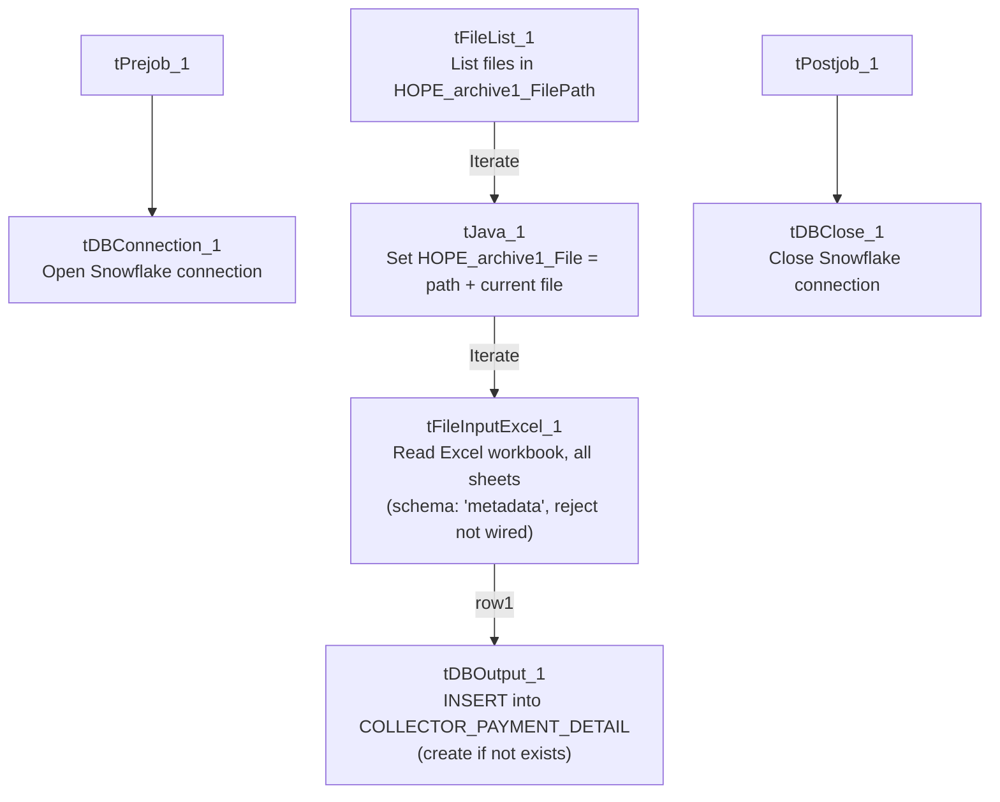

# Talend Job: Collector_Payment_Detail_Load

## Overview

Loads collector-level payment detail — transaction ID, date posted, transaction code, commission rate/amount, pay amount, collector initials, debtor, client ID, split percentage, and credit month/year — from an Excel workbook found in a dedicated "HOPE archive" directory into the Snowflake `COLLECTOR_PAYMENT_DETAIL` table, creating the table automatically if it doesn't already exist. This is the project's only job using the `HOPE_Archive1_0.1` context group (per `06_dependency_matrix.md`), and it reads an Excel file rather than a delimited text file or a direct database query — consistent with `HOPE` (a MySQL-based system per `01_system_architecture.md`) apparently being fed into this warehouse via a manually- or externally-produced spreadsheet export rather than a live database connection.

## Detail table

| Field | Value |
|---|---|
| Job name | Collector_Payment_Detail_Load |
| Version | 0.1 |
| Project | EDW2SF |
| Author | jmach@harriscollect.com |
| Created | 2022-02-18T13:02:08.242-0800 |
| Last Modified | 2025-09-24T11:07:58.699-0700 |

## Step-by-step data flow

**Setup subjob:** `tPrejob_1` → `tDBConnection_1` (`OnComponentOk`) opens the Snowflake connection.

**Main subjob** (no incoming trigger connection to `tFileList_1`, so it runs as an independent top-level subjob alongside setup):

1. `tFileList_1` lists files in `context.HOPE_archive1_FilePath`, ordered by modified date ascending. An `EXCLUDEFILEMASK` of `"*.txt"` is configured but `IFEXCLUDE=false`, so it's never applied (same unapplied-mask pattern seen project-wide).
2. For each file (`Iterate`), `tJava_1` sets `context.HOPE_archive1_File = context.HOPE_archive1_FilePath + "/" + <current file>`.
3. `tFileInputExcel_1` (`Iterate`) reads that file as an Excel 2007+ workbook, **all sheets** (`ALL_SHEETS=true`, `AFFECT_EACH_SHEET=false` — all sheets treated as one continuous input), with a password (redacted — the source file may be password-protected), header row count and first/last column range all driven by `context.HOPE_archive1_*`. Both the main and reject schemas reference the same repository schema, labeled simply `"...- metadata"`. `DIE_ON_ERROR=false`.
4. `tDBOutput_1` (`FLOW`, `row1`) inserts the 12 business columns into Snowflake `COLLECTOR_PAYMENT_DETAIL` (`INSERT`, `tableAction=CREATE_IF_NOT_EXISTS` — no truncate step precedes it).

No file archive or delete step exists anywhere in this job — processed files remain in `context.HOPE_archive1_FilePath` after the run (see Issues observed).

**Teardown subjob:** `tPostjob_1` → `tDBClose_1` (`OnComponentOk`) closes the Snowflake connection.

## Settings tables

### Source: `tFileInputExcel_1`

| Setting | Value | What it means |
|---|---|---|
| FILENAME | `context.HOPE_archive1_File` | The current file from `tFileList_1`'s iteration. |
| VERSION_2007 / ALL_SHEETS | `true` / `true` | Reads a modern `.xlsx`-style workbook, pulling data from every sheet in it. |
| PASSWORD | `***REDACTED***` | Source workbook may be password-protected; actual value not present in extracted metadata. |
| HEADER / FIRST_COLUMN / LAST_COLUMN / ENCODING / separators | All from `context.HOPE_archive1_*` | Fully context-driven read range and format, similar in spirit to `CUBS_Raw_Trans_Load`'s context-driven `EXPORT_TRANS_*` settings. |
| SCHEMA (main) & SCHEMA_REJECT | Both reference the same repository schema, labeled `"...- metadata"` | An unusually generic schema label for a payment-detail-specific job — see Issues observed. Using the identical schema for both main and reject (rather than a mismatched one, as seen in `ADP_Payroll_Load`) is logically consistent, since a reject row has the same columns plus error fields. |
| DIE_ON_ERROR | `false` | Malformed rows don't fail the job... |
| Reject flow | Not wired | ...but no connection carries rejected rows anywhere — silently dropped, same pattern seen project-wide. |

### Target: `tDBOutput_1` (`tSnowflakeOutput`)

| Setting | Value | What it means |
|---|---|---|
| Table | `COLLECTOR_PAYMENT_DETAIL` | Destination table. |
| Output action | `INSERT` | Appends rows; no truncate precedes it. |
| Table action | `CREATE_IF_NOT_EXISTS` | Table is created automatically on first run if missing. |

## Dependencies & configuration

- **Triggers/depends on other jobs:** `runjob_targets` is empty — this job does not call any other job via `tRunJob`.
- **Called by:** none found in `06_dependency_matrix.md` — this job does not appear in the project's `tRunJob` orchestration graph.
- **Context variables used:** `HOPE_archive1_DecimalSeparator`, `HOPE_archive1_Encoding`, `HOPE_archive1_File`, `HOPE_archive1_FilePath`, `HOPE_archive1_FirstColumn`, `HOPE_archive1_Header`, `HOPE_archive1_LastColumn`, `HOPE_archive1_ThousandSeparator` — all from `HOPE_Archive1_0.1`, a context group used by only this one job in the entire 289-job project (per `06_dependency_matrix.md`).
- No hardcoded developer-workstation paths found in this job.

## Glossary

| Component type | Plain-English meaning |
|---|---|
| `tPrejob` / `tPostjob` | Talend's guaranteed-first / guaranteed-last subjobs for setup and teardown. |
| `tJava` | Runs a block of custom Java code once. |
| `tFileList` | Lists files in a directory for the job to iterate over one at a time. |
| `tFileInputExcel` | Reads an Excel spreadsheet (one or more sheets) according to a schema. |
| `tSnowflakeOutput` / `tSnowflakeConnection` / `tSnowflakeClose` | Write rows to a Snowflake table / open and close the Snowflake connection used throughout the job. |

## Issues observed

- **No file archive or delete step, and no truncate before loading.** This job's `tDBOutput_1` is a plain `INSERT` with no preceding `TRUNCATE`, and there is no `tFileArchive`/`tFileDelete` component anywhere in the job. If a file is not removed from `context.HOPE_archive1_FilePath` by some external process after this job reads it, rerunning the job (or its next scheduled run finding the same file still present) would insert the same rows again into `COLLECTOR_PAYMENT_DETAIL` with no deduplication. Unable to confirm from this metadata whether an external process manages file cleanup — verify with the team before assuming reruns are safe.
- **The repository schema used for both the main and reject inputs is labeled simply `"metadata"`**, not something payment-detail-specific. This is not necessarily wrong (schemas can be legitimately shared/reused across similar Excel-import jobs), but it makes it harder to tell from the schema name alone whether this exact schema is dedicated to this job or shared with other, undocumented Excel-import jobs that might be affected by a schema change here. Verify in the Talend repository whether `"metadata"` is used elsewhere.
- **No reject flow wired from `tFileInputExcel_1`**, despite a reject schema being configured. `DIE_ON_ERROR=false` means malformed rows don't fail the job, but they're also not written anywhere (no file, log, or table) — silently dropped with no record of how many, or which, rows failed to parse.
- **`ALL_SHEETS=true` reads every sheet in the source workbook as one combined input.** If the source Excel file ever includes a summary/pivot/notes sheet in addition to the raw data sheet(s), that extra sheet's content would also be read against the same schema — likely producing malformed rows (silently dropped, per the point above) rather than a job failure, but worth confirming the source file's sheet layout is consistently just data sheets.
- **No error handling, row-count logging, or completion signal specific to this job's business outcome** (no `tWarn`/`tDie`/`tSendMail`) — a load failure would only surface as a generic Talend execution error, consistent with the majority of jobs in this project per `05_operational_runbook.md`.
