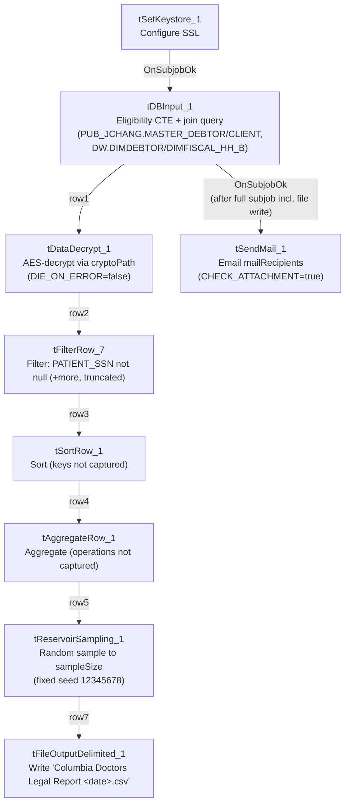

# Talend Job: Columbia_Doctors_Legal_Rpt

## Overview

Builds a monthly "legal collections" candidate list for the Columbia Doctors client: a Snowflake query joins debtor, client, and fiscal dimension tables to find active, non-cancelled, third-party accounts under age 65 that have been placed over 90 days, are not recently (within 6 months) placed, carry a balance over $2,500, and are not Medicare/Medicaid-related — then decrypts a field (almost certainly `PATIENT_SSN`), filters to rows with a non-null SSN, sorts, aggregates, and finally **randomly samples down to `context.sampleSize` rows** before writing the result to a dated CSV and emailing it to a distribution list. The random-sampling step at the very end of an eligibility pipeline is a significant, concrete finding worth flagging prominently — see Issues observed.

## Detail table

| Field | Value |
|---|---|
| Job name | Columbia_Doctors_Legal_Rpt |
| Version | 0.1 |
| Project | EDW2SF |
| Author | jmach@harriscollect.com |
| Created | 2024-01-10T13:01:58.191-0800 |
| Last Modified | 2026-06-03T11:07:54.129-0700 |

## Step-by-step data flow

1. `tSetKeystore_1` configures SSL trust/keystore settings from `context.keystorePath` (passwords redacted).
2. On success (`OnSubjobOk`), `tDBInput_1` runs a CTE-based query (`Eligibility` CTE joins `EDWPRODHH.PUB_JCHANG.MASTER_DEBTOR` and `EDWPRODHH.DW.DIMDEBTOR`, computing per-packet flags for age ≥65, non-active status count, 90+ days since placement, balance, Medicare/Medicaid debt type, and recent-placement-within-6-months) then joins that back to `MASTER_DEBTOR`, `MASTER_CLIENT`, `DIMDEBTOR`, and `DIMFISCAL_HH_B` to pull 23 columns of patient/debtor/legal detail (department, patient name/address, debtor/client/packet numbers, phone, DOB, DRL/CD numbers, `PATIENT_SSN`, status, original/assigned/current/packet balances, admit/discharge/last-payment dates) for accounts matching the eligibility criteria above, filtered to `Client_Name ilike 'Columbia D%'`, active, not cancelled, third-party (`Party ilike '3P%'`), and not Medicare-insured.
3. `tDataDecrypt_1` (`MAIN`, `row1`) decrypts data using AES (`ALGO_VERSION=2`) against `context.cryptoPath` (no filename suffix appended in code here, unlike `Carle_Asset_Scrub`'s `context.cryptoPath + "dimdbtr.crypt"` — see Issues observed). `DIE_ON_ERROR=false`, unlike `Carle_Asset_Scrub`'s equivalent step, which dies on a decryption error.
4. `tFilterRow_7` (`FLOW`, `row2`) filters rows using an advanced condition beginning `input_row.PATIENT_SSN != null && input_row.PATIE...` (truncated in this metadata) — at minimum, excludes rows with a null `PATIENT_SSN`.
5. `tSortRow_1` (`FILTER`, `row3`) sorts the filtered rows; the specific sort key(s) are not captured in this metadata (only buffer/tempfile settings are present) — see Issues observed.
6. `tAggregateRow_1` (`FLOW`, `row4`) aggregates the sorted rows; the specific group-by columns and aggregate functions are not captured in this metadata, and the schema is identical (same 23 columns) before and after this step — see Issues observed regarding what this step actually does.
7. `tReservoirSampling_1` (`FLOW`, `row5`) randomly samples the aggregated rows down to `context.sampleSize` records, using a **fixed random seed (`12345678`)** — see Issues observed.
8. `tFileOutputDelimited_1` (`FLOW`, `row7`) writes the sampled rows to `context.outputDir + "Columbia Doctors Legal Report " + <YYYYMMDD> + ".csv"`.
9. Once the entire chain above (steps 2–8) completes successfully (`tDBInput_1`'s `OnSubjobOk`, which in Talend fires after its whole downstream subjob finishes), `tSendMail_1` emails `context.mailRecipients` from `svc_analytics@harriscollect.com` ("H&H Analytics"), subject "Columbia Doctors Legal Collections Report," message "The monthly Columbia Doctors Legal Collections report is attached." `CHECK_ATTACHMENT=true` here (unlike `Carle_Asset_Scrub`, where it's `false`), though the specific attached file path is not captured in this component's extracted metadata. `DIE_ON_ERROR=true` on the mail send.

## Settings tables

### Source: `tDBInput_1` (`tSnowflakeInput`)

| Setting | Value | What it means |
|---|---|---|
| Query | Multi-table CTE query joining `EDWPRODHH.PUB_JCHANG.MASTER_DEBTOR`, `EDWPRODHH.PUB_JCHANG.MASTER_CLIENT`, `EDWPRODHH.DW.DIMDEBTOR`, `EDWPRODHH.DW.DIMFISCAL_HH_B` | Confirms `PUB_JCHANG` (flagged project-wide in `01_system_architecture.md` as looking individually owned) is a real, active dependency for this legal-reporting job — if that schema's ownership or access changes, this report would break. |
| Eligibility filters | Age <65, not recently placed (≤6 months), all packets "ACT" status, placed >90 days, balance >$2,500, not Medicare/Medicaid debt type, third-party (`Party ilike '3P%'`), active, not cancelled, not Medicare-insured | Encodes a specific legal-eligibility business policy — likely regulatory/compliance-driven (e.g., excluding elderly debtors, excluding Medicare accounts) though the underlying policy reasoning isn't documented in metadata. |

### `tDataDecrypt_1`

| Setting | Value | What it means |
|---|---|---|
| CRYPTO_METHOD / ALGO_VERSION | `AES` / `2` | Same decryption scheme as `Carle_Asset_Scrub`. |
| CRYPTO_FILE_PATH | `context.cryptoPath` (no filename appended) | Differs from `Carle_Asset_Scrub`'s `context.cryptoPath + "dimdbtr.crypt"` — either `context.cryptoPath` itself already resolves to a full file path for this job, or this job uses a different key-file convention. Unable to determine which from metadata; verify with the team. |
| DIE_ON_ERROR | `false` | A decryption failure does **not** fail this job, unlike `Carle_Asset_Scrub`'s equivalent step (`DIE_ON_ERROR=true`) — an inconsistency between two similar decrypt-then-report jobs. |

### `tSortRow_1` / `tAggregateRow_1` / `tReservoirSampling_1`

| Setting | Value | What it means |
|---|---|---|
| `tSortRow_1` sort keys | Not captured in metadata (only `TEMPFILE`/`EXTERNAL` buffer settings present) | Unable to determine which column(s) this report is sorted by; verify directly in Talend Studio. |
| `tAggregateRow_1` group/operations | Not captured in metadata; output schema is identical (same 23 columns) to the input schema | Unable to determine what, if anything, this step aggregates — it may perform a `GROUP BY` on all columns (effectively a de-duplication pass) or some other operation not visible here. See Issues observed. |
| `tReservoirSampling_1` SAMPLE_SIZE / RANDOM_SEED | `context.sampleSize` / `12345678` (fixed) | Randomly selects a fixed-size subset of the eligible rows for the final report, using the same random seed every run — see Issues observed for the business-impact question this raises. |

### Target: `tFileOutputDelimited_1`

| Setting | Value | What it means |
|---|---|---|
| FILENAME | `context.outputDir + "Columbia Doctors Legal Report " + <YYYYMMDD> + ".csv"` | Date-stamped output, one file per run day — unlike the other simple extract jobs in this batch, this one does retain historical copies by filename. |
| Contents | Includes `PATIENT_SSN` and other PII (name, address, phone, DOB) | Sensitive data, same handling consideration flagged in `Carle_Asset_Scrub`. |

### `tSendMail_1`

| Setting | Value | What it means |
|---|---|---|
| CHECK_ATTACHMENT | `true` | Unlike `Carle_Asset_Scrub` (`false`), this job's email is configured to actually send an attachment — though the specific attached file/path parameter is not captured in this component's extracted metadata, so the exact attachment content can't be confirmed from metadata alone. |
| DIE_ON_ERROR | `true` | A failed send fails the job. |

## Dependencies & configuration

- **Triggers/depends on other jobs:** `runjob_targets` is empty — this job does not call any other job via `tRunJob`.
- **Called by:** none found in `06_dependency_matrix.md` — presumably scheduled independently, likely monthly per the email's own wording ("The monthly Columbia Doctors Legal Collections report").
- **Context variables used:** `cryptoPath`, `keystorePath`, `mailRecipients`, `outputDir`, `sampleSize`.
- **2 hardcoded developer-workstation paths** (`tSortRow_1.TEMPFILE`, `tSetKeystore_1.SSL_TRUSTSERVER_TRUSTSTORE`) — same project-wide portability risk documented in `05_operational_runbook.md`.

## Glossary

| Component type | Plain-English meaning |
|---|---|
| `tSnowflakeInput` | Runs a query against Snowflake and returns its result rows. |
| `tDataDecrypt` | Decrypts data using a configured algorithm and key file. |
| `tFilterRow` | Keeps only rows matching a configured condition, discarding the rest. |
| `tSortRow` | Sorts rows by one or more configured columns. |
| `tAggregateRow` | Groups rows and computes aggregate values (sums, counts, etc.) per group. |
| `tReservoirSampling` | Randomly selects a fixed-size subset of rows from the input, using reservoir sampling — useful for a statistically representative sample, not for delivering a complete list. |
| `tFileOutputDelimited` | Writes rows to a delimited (CSV-style) text file. |
| `tSendMail` | Sends an email, optionally with a file attached. |
| `tSetKeystore` | Configures SSL client keystore/truststore settings ahead of an encrypted database connection. |

## Issues observed

- **This "Legal Report" randomly samples the eligible accounts down to `context.sampleSize` rows via `tReservoirSampling_1`, immediately before writing the file that's emailed to recipients as "the monthly ... report."** If the business intent is for legal counsel or a legal-collections team to receive the *complete* list of accounts meeting the eligibility criteria computed upstream, this sampling step would silently exclude most qualifying accounts from every month's report, with no indication in the email or file that this is a sample rather than the full list. Whether `context.sampleSize` is set large enough to always capture the full eligible population (making this a no-op safeguard) or genuinely truncates the list is unable to determine from this metadata — this is a business-critical question worth confirming directly with the team before assuming the report is complete.
- **`tAggregateRow_1`'s actual grouping/aggregation configuration is not captured in this metadata**, and its output schema is identical to its input schema (same 23 named columns, no new sum/count columns). This could mean it performs a `GROUP BY` on all columns (effectively de-duplicating identical rows) or that it's a no-op/placeholder left in the pipeline. Unable to determine its real effect from metadata; verify directly in Talend Studio, since an unintended aggregation could also silently merge or drop legitimate distinct records.
- **`tSortRow_1`'s sort key(s) are not captured in this metadata.** Combined with the aggregation step immediately following it, the exact processing order and effect of these two steps together can't be fully reconstructed from metadata alone — verify directly in Talend Studio if the report's row ordering or grouping ever needs to be debugged.
- **`tDataDecrypt_1.DIE_ON_ERROR=false` here, vs. `true` in `Carle_Asset_Scrub`'s equivalent step** — an inconsistency in how two similarly-structured decrypt-then-report jobs handle a decryption failure. In this job, a decryption problem would let processing continue (likely producing rows with unreadable/garbled decrypted data, later filtered out only if `tFilterRow_7`'s condition happens to catch them), rather than failing the job outright. Worth confirming this is the intended behavior.
- **The output CSV contains Social Security Numbers and other PII, written to `context.outputDir` in plain text**, the same sensitive-data handling consideration flagged in `Carle_Asset_Scrub` — confirm this meets the organization's data-handling requirements for PII given the legal/collections context.
- **The source query depends on `EDWPRODHH.PUB_JCHANG`**, the schema flagged project-wide in `01_system_architecture.md` and `06_dependency_matrix.md` as looking individually owned rather than shared infrastructure — this job is one of the concrete, confirmed dependents of that schema.
