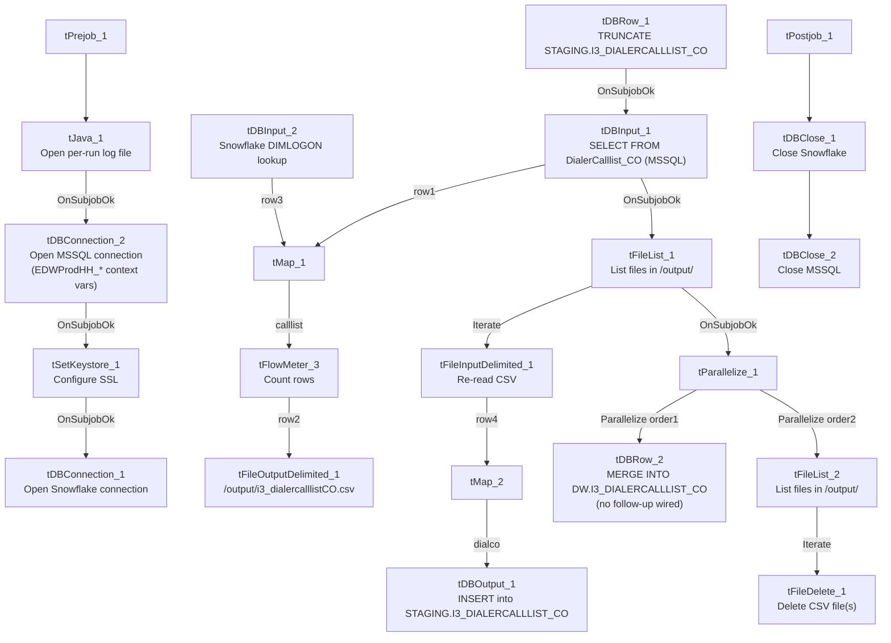

# Talend Job: Copy_of_i3_DialerCallListTOL_Load_Backup

## Overview

This job extracts dialer call-list assignment data (debtor, campaign, phone numbers, call-attempt counters, etc.) from an MSSQL table via a "EDWProdHH"-labeled connection, writes it to a local CSV file, re-reads that same file, enriches it with a `DIMLOGON` lookup from Snowflake, stages it, and merges it into a Snowflake warehouse table for the I3 dialer system. **Despite its name (`...TOL..._Backup`), every table, file, and target name in this job's own metadata references "CO", not "TOL"** — see Issues observed; this is very likely a backup/renamed copy of a CO-site job, not an actual TOL loader.

## Detail table

| Field | Value |
|---|---|
| Job name | Copy_of_i3_DialerCallListTOL_Load_Backup |
| Version | 0.2 |
| Project | EDW2SF |
| Author | jmach@harriscollect.com |
| Created | 2025-11-11T10:11:47.759-0800 |
| Last Modified | 2025-11-11T10:28:13.392-0800 (~17 minutes after creation) |

## Step-by-step data flow

**Setup subjob:** `tPrejob_1` → `tJava_1` opens a per-run log file at `context.logDir + jobName + "_" + <timestamp> + ".log"` → on success, `tDBConnection_2` opens the MSSQL connection using `context.EDWProdHH_*` variables (password and Active Directory auth redacted) → on success, `tSetKeystore_1` configures SSL trust/keystore from `context.keystorePath` (all passwords redacted) → on success, `tDBConnection_1` opens the Snowflake connection.

**Main subjob:**

1. `tDBRow_1` runs `TRUNCATE TABLE STAGING.I3_DIALERCALLLIST_CO;` on Snowflake.
2. On success, `tDBInput_1` runs a fixed (truncated in this metadata) `SELECT` against MSSQL table `DialerCalllist_CO`, pulling `I3_IDENTITY`, `ACCOUNT AS DEBTORNUMBER`, `LOGON`, a derived `DEBTOR_IDX`, `CAMPAIGN`, `DEBTORNAME`, address fields, phone fields, and call-history fields — 38 columns total.
3. `tMap_1` joins that MSSQL flow against `tDBInput_2` (`tSnowflakeInput` reading Snowflake table `DIMLOGON`, columns `DIMLOGON`/`LOGON`/`DESCRIPTION`) as a lookup, adding a `DIMLOGON` surrogate key column to the output.
4. `tFlowMeter_3` counts rows passing through (labeled "MyLabel", not renamed for this job).
5. `tFileOutputDelimited_1` writes the enriched rows to a hardcoded local file `/output/i3_dialercalllistCO.csv` (comma-delimited, no header, split every 10,000 rows).
6. On `tDBInput_1`'s subjob success (in parallel with the write above logically completing), `tFileList_1` lists files in the hardcoded directory `/output/` and, for each, `tFileInputDelimited_1` re-reads the just-written CSV (`DIE_ON_ERROR=true`).
7. `tMap_2` passes the re-read rows through to a wider 64-column target schema (adds `LOAD_DTTM`, `STATUS`, `ATTEMPTS`, `HHCUSTVAR1-3`, `HHCUSTINT1`, and a dozen `I3_ATTEMPTS*`/`I3_*` call-detail counters not present in the original 38-column extract — these appear to be defaulted/derived in the map, not sourced from the MSSQL query).
8. `tDBOutput_1` inserts the rows into Snowflake table `I3_DIALERCALLLIST_CO` (`INSERT`, no table-recreate action; lands in the `STAGING` schema truncated in step 1, based on `tDBRow_1`'s target).
9. On `tFileList_1`'s subjob success, `tParallelize_1` starts two branches concurrently:
   - `tDBRow_2` runs a `MERGE INTO DW.I3_DIALERCALLLIST_CO` from `STAGING.I3_DIALERCALLLIST_CO`, keyed on `I3_IDENTITY`, updating all columns on match and inserting on no-match (defaults `I3_UPLOAD_ID` to 0 via `COALESCE`). **This component has no outgoing connections and no result-capture/branch logic** — see Issues observed.
   - `tFileList_2` lists files in `/output/` again and `tFileDelete_1` deletes each one found (iterating the same directory the CSV was written to).

**Teardown subjob:** `tPostjob_1` → `tDBClose_1` (close Snowflake) → `tDBClose_2` (close MSSQL).

## Settings tables

### Source: `tDBInput_1` (`tMSSqlInput`)

| Setting | Value | What it means |
|---|---|---|
| Connection | Shared `tDBConnection_2` (EDWProdHH context vars) | Reuses the job's single MSSQL connection. |
| Table | `DialerCalllist_CO` | Source table name explicitly says "CO", reinforcing the site mismatch noted in Overview. |
| Query | Fixed `SELECT` of 38 named columns (identity, debtor/campaign identifiers, address, phone fields, call-history flags) — captured text is truncated after the visible column list | The full `WHERE` clause (if any) is not visible in this metadata. |
| ENCODING | `ISO-8859-15` | Non-UTF-8 encoding, consistent with other legacy-source jobs in this project. |

### Lookup: `tDBInput_2` (`tSnowflakeInput`)

| Setting | Value | What it means |
|---|---|---|
| Table | `DIMLOGON` | Small dimension table (`DIMLOGON`, `LOGON`, `DESCRIPTION`) joined in `tMap_1` to attach a `DIMLOGON` surrogate key based on `LOGON`. |

### Intermediate file: `tFileOutputDelimited_1` / `tFileInputDelimited_1`

| Setting | Value | What it means |
|---|---|---|
| FILENAME (write) | `"/output/i3_dialercalllistCO.csv"` | Hardcoded literal path (not a `context.*` variable), unlike most other jobs in this project which route through `context.sourceDir`/`context.archiveDir` (`StandardFolders_0.1` — see `06_dependency_matrix.md`). |
| SPLIT / SPLIT_EVERY | `true` / `10000` | Output may be split into multiple part-files if row count exceeds 10,000. |
| FILENAME (read) | `globalMap.get("tFileList_1_CURRENT_FILEPATH")` | Re-reads whatever file(s) `tFileList_1` found in `/output/` — not guaranteed to be only the file just written if other files are also present in that directory. |
| DIE_ON_ERROR (read) | `true` | A malformed row in the re-read step fails the job outright. |

### Target: `tDBOutput_1` (`tSnowflakeOutput`)

| Setting | Value | What it means |
|---|---|---|
| Table | `I3_DIALERCALLLIST_CO` | Loaded via `INSERT`, `tableAction: NONE`; lands in the `STAGING` schema per the preceding `TRUNCATE STAGING.I3_DIALERCALLLIST_CO`. |

### Merge step: `tDBRow_2` (`tSnowflakeRow`)

| Setting | Value | What it means |
|---|---|---|
| Query | `MERGE INTO DW.I3_DIALERCALLLIST_CO AS tgt USING STAGING.I3_DIALERCALLLIST_CO AS src ON (tgt.I3_IDENTITY = src.I3_IDENTITY)` — updates all columns on match, inserts on no-match, defaults `I3_UPLOAD_ID` via `COALESCE(src.I3_UPLOAD_ID,0)` | Standard staging→warehouse upsert, keyed on `I3_IDENTITY`. |
| Follow-up wiring | None — no outgoing connection from this component | Unlike this project's other merge steps (e.g. `ADP_Payroll_Load`, `CO_Master_Load`), the merge's success/failure is never captured or logged; see Issues observed. |

### Cleanup: `tFileDelete_1`

| Setting | Value | What it means |
|---|---|---|
| FILENAME | `globalMap.get("tFileList_2_CURRENT_FILEPATH")` | The actual file(s) deleted are whatever `tFileList_2` iterates in `/output/`. |
| DIRECTORY | `"C:/Talend-Studio-20211109_1610-V8.0.1/workspace/delete_folder"` | Hardcoded developer-workstation path — reads like leftover default/template text rather than a real target, since `FILENAME` is what actually drives the delete. |
| PATH | `"C:/Talend-Studio-20211109_1610-V8.0.1/workspace/delete_folder or delete_file"` | Same — the literal string even contains the word "or", suggesting an unedited placeholder value never replaced with a real path. |

## Dependencies & configuration

- **Triggers/depends on other jobs:** none — no `tRunJob` links found.
- **Context variables used:** `EDWProdHH_Server`, `EDWProdHH_Port`, `EDWProdHH_Schema`, `EDWProdHH_Database`, `EDWProdHH_Login` (MSSQL connection), `keystorePath`, `logDir`. Notably, **no `context.sourceDir`/`context.archiveDir`-style variable is used** — the working directory `/output/` is hardcoded instead (see Settings tables).
- **4 hardcoded paths** found: `tSetKeystore_1.SSL_TRUSTSERVER_TRUSTSTORE` (`C:/clientTrustStore.trustStore`), `tFileInputDelimited_1.TEMP_DIR`, and `tFileDelete_1.DIRECTORY`/`PATH` (all `C:/Talend-Studio-20211109_1610-V8.0.1/workspace/...`) — same portability risk documented project-wide in `05_operational_runbook.md`.

## Glossary

| Component type | Plain-English meaning |
|---|---|
| `tMSSqlConnection` / `tMSSqlInput` / `tMSSqlClose` | Open a Microsoft SQL Server connection, run a query against it, and close it. |
| `tSnowflakeConnection` / `tSnowflakeInput` / `tSnowflakeOutput` / `tSnowflakeRow` / `tSnowflakeClose` | Open/close a Snowflake connection, read a table, write rows to a table, or run an arbitrary SQL/merge statement against Snowflake. |
| `tMap` | Maps/transforms and optionally joins (lookup) columns from one or more input schemas to an output schema. |
| `tFlowMeter` | Counts rows passing a point in the flow for logging/monitoring. |
| `tFileOutputDelimited` / `tFileInputDelimited` | Write or read a delimited (CSV-style) text file according to a schema. |
| `tFileList` | Lists files in a directory for the job to iterate over one at a time. |
| `tFileDelete` | Deletes a file (or, per its own config fields, potentially a folder) from disk. |
| `tParallelize` | Runs its downstream branches at the same time rather than one after another. |
| `tSetKeystore` | Configures SSL trust/keystore settings used by subsequent secure connections. |

## Issues observed

- **The job name says "TOL" and "Backup", but every table and file name in this job's own metadata says "CO".** The source table is `DialerCalllist_CO`, the output CSV is `i3_dialercalllistCO.csv`, and the staging/warehouse targets are `STAGING.I3_DIALERCALLLIST_CO` / `DW.I3_DIALERCALLLIST_CO`. Nothing in this job's metadata references TOL at all. This is almost certainly a backup/renamed copy of a CO-site dialer-call-list job — if run as scheduled under its current name, it would reload **CO's** call-list data, not TOL's. Verify with the team whether this job is intentionally inert (a kept-around backup, not meant to run), or whether it's mistakenly live and duplicating/conflicting with whatever job actually loads CO's dialer call list on its own schedule.
- **The `MERGE INTO DW.I3_DIALERCALLLIST_CO` step (`tDBRow_2`) has no outgoing connection and no result-capture logic** — unlike this project's other merge steps (`ADP_Payroll_Load`, `CO_Master_Load`) which capture `RETVALUE` and branch to a `tWarn`/`tDie`, a failure here would only surface as a generic Talend execution error with nothing job-specific logged.
- **`tFileDelete_1`'s `DIRECTORY` and `PATH` parameters read like unedited default/template text** (`".../delete_folder"` and `".../delete_folder or delete_file"`), not real paths — the actual file(s) deleted are driven by the `FILENAME` parameter instead. This is consistent with the job being a hastily-made "Copy_of_..." backup rather than a carefully configured production job.
- **The working directory `/output/` is a hardcoded literal**, not a `context.*` variable — unlike the vast majority of file-handling jobs in this project which route through `StandardFolders_0.1`'s shared context variables (see `06_dependency_matrix.md`). If `/output/` doesn't exist or isn't writable on whatever host runs this job, it would fail immediately.
- **The MSSQL connection is configured via `context.EDWProdHH_*` variables** even though the source table (`DialerCalllist_CO`) is I3 dialer/telephony data, not EDWProdHH operational data — the same naming ambiguity already flagged in `i3_CallDetail_40_Load`'s doc; verify with the team which physical database `context.EDWProdHH_Database` points to here.
- **Created and last modified about 17 minutes apart on the same day** (2025-11-11), consistent with this being a quick one-off copy/backup operation rather than an iteratively developed job — supports treating it as a snapshot rather than an actively maintained pipeline component.
