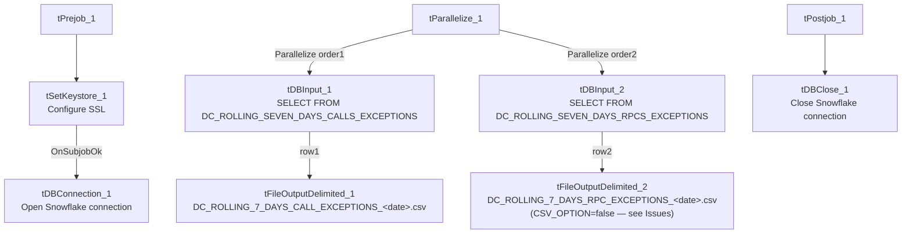

# Talend Job: DC_Call_Contact_Exceptions_1

## Overview

Queries two "rolling 7 days" exception views in Snowflake for the DC site — one tracking call-attempt-count exceptions, one tracking right-party-contact (RPC) exceptions — and writes each result set to its own timestamped CSV file in `context.outputDir`. This is the report-generation half of a two-job pair: the companion job `DC_Call_Contact_Exceptions_2` (documented separately) archives, emails, and cleans up the files this job produces, though no direct `tRunJob` link ties the two together in this metadata.

## Detail table

| Field | Value |
|---|---|
| Job name | DC_Call_Contact_Exceptions_1 |
| Version | 0.1 |
| Project | EDW2SF |
| Author | jmach@harriscollect.com |
| Created | 2023-12-07T10:51:00.908-0800 |
| Last Modified | 2025-11-16T21:34:34.339-0800 |

## Step-by-step data flow

**Setup subjob:** `tPrejob_1` → `tSetKeystore_1` configures SSL trust/keystore from `context.keystorePath` (all passwords redacted) → on success, `tDBConnection_1` opens the Snowflake connection. (Unlike most other jobs in this project, there is no `tJava` step opening a dedicated per-run log file.)

**Main subjob** — `tParallelize_1` starts two independent branches:

1. **Call-exceptions branch:** `tDBInput_1` runs `SELECT DATE, PACKET_IDX, COUNT_OF_COMMUNICATION_ATTEMPTS, ROLLING_SEVEN_DAYS_COMMUNICATION_ATTEMPTS FROM EDWPRODHH.PUB_MBOICH.DC_ROLLING_SEVEN_DAYS_CALLS_EXCEPTIONS;` → `tFileOutputDelimited_1` writes the 4-column result to `context.outputDir + "DC_ROLLING_7_DAYS_CALL_EXCEPTIONS_" + <CCYYMMDD> + ".csv"` (comma-delimited, header included, `CSV_OPTION=true`).
2. **RPC-exceptions branch:** `tDBInput_2` runs `SELECT DATE, PACKET_IDX, COUNT_OF_RPC, ROLLING_SEVEN_DAYS_RPCS FROM EDWPRODHH.PUB_MBOICH.DC_ROLLING_SEVEN_DAYS_RPCS_EXCEPTIONS;` → `tFileOutputDelimited_2` writes the 4-column result to `context.outputDir + "DC_ROLLING_7_DAYS_RPC_EXCEPTIONS_" + <CCYYMMDD> + ".csv"` (comma-delimited, header included, but **`CSV_OPTION=false`**, unlike its sibling — see Issues observed).

Both source queries reference `EDWPRODHH.PUB_MBOICH.<view>` — a Snowflake database/schema pair reached over this job's Snowflake connection, not the MSSQL `EDWProdHH` connection label used elsewhere in this project (see `01_system_architecture.md`); this appears to be a published Snowflake copy/mart named after the source system rather than the source system itself.

**Teardown subjob:** `tPostjob_1` → `tDBClose_1` closes the Snowflake connection.

## Settings tables

### Source 1: `tDBInput_1`

| Setting | Value | What it means |
|---|---|---|
| Query | `SELECT DATE, PACKET_IDX, COUNT_OF_COMMUNICATION_ATTEMPTS, ROLLING_SEVEN_DAYS_COMMUNICATION_ATTEMPTS FROM EDWPRODHH.PUB_MBOICH.DC_ROLLING_SEVEN_DAYS_CALLS_EXCEPTIONS;` | Reads a pre-computed exception view (call-attempt counts vs. a rolling 7-day threshold) rather than computing the rolling window itself. |

### Source 2: `tDBInput_2`

| Setting | Value | What it means |
|---|---|---|
| Query | `SELECT DATE, PACKET_IDX, COUNT_OF_RPC, ROLLING_SEVEN_DAYS_RPCS FROM EDWPRODHH.PUB_MBOICH.DC_ROLLING_SEVEN_DAYS_RPCS_EXCEPTIONS;` | Same pattern, for right-party-contact exceptions. |

### Output files: `tFileOutputDelimited_1` / `tFileOutputDelimited_2`

| Setting | Value | What it means |
|---|---|---|
| FILENAME | `context.outputDir + "DC_ROLLING_7_DAYS_CALL_EXCEPTIONS_" + date + ".csv"` / `context.outputDir + "DC_ROLLING_7_DAYS_RPC_EXCEPTIONS_" + date + ".csv"` | Dated filenames distinguish the two reports. |
| INCLUDEHEADER | `true` (both) | Both files include a header row. |
| CSV_OPTION | `true` (report 1) / **`false`** (report 2) | Inconsistent between the two otherwise-identical output components — see Issues observed. |

## Dependencies & configuration

- **Triggers/depends on other jobs:** none — no `tRunJob` links found. This job's output is consumed by `DC_Call_Contact_Exceptions_2`, but that relationship is not expressed via `tRunJob` in either job's metadata — presumably an external scheduler runs them in sequence.
- **Context variables used:** `keystorePath`, `outputDir`.
- **1 hardcoded path**: `tSetKeystore_1.SSL_TRUSTSERVER_TRUSTSTORE` (`C:/clientTrustStore.trustStore`) — same pattern documented project-wide in `05_operational_runbook.md`.

## Glossary

| Component type | Plain-English meaning |
|---|---|
| `tSnowflakeConnection` / `tSnowflakeInput` / `tSnowflakeClose` | Open a Snowflake connection, run a query and return its rows, and close the connection. |
| `tFileOutputDelimited` | Writes rows to a delimited (CSV-style) text file according to a schema. |
| `tParallelize` | Runs its downstream branches at the same time rather than one after another — here, the two report queries run concurrently. |
| `tSetKeystore` | Configures SSL trust/keystore settings used by the subsequent Snowflake connection. |

## Issues observed

- **The two output components have inconsistent `CSV_OPTION` settings** — `tFileOutputDelimited_1` (call exceptions) has `CSV_OPTION=true` while `tFileOutputDelimited_2` (RPC exceptions) has `CSV_OPTION=false`, despite both otherwise being configured identically (comma separator, header row, `ISO-8859-15` encoding). Depending on how Talend's CSV mode differs from its plain delimited mode for quoting/escaping special characters, the two sibling reports could be formatted subtly differently — verify this is intentional.
- **No dedicated per-run log file is opened** (no `tJava` step in the setup subjob), unlike the majority of other jobs in this project (e.g. `ADP_Payroll_Load`, `CO_Master_Load`) — this job's own execution detail relies entirely on whatever the scheduler's own log captures.
- **No `tDie`/`tWarn`/`tSendMail` logic in this job** — a query or file-write failure here would only surface as a generic Talend execution error; per `05_operational_runbook.md`, this job is not among the 16 with explicit `tDie`/`tWarn` logic.
- **No `tRunJob` link connects this job to `DC_Call_Contact_Exceptions_2`**, which archives, emails, and deletes the very files this job writes. If the two are meant to run back-to-back, that sequencing is enforced entirely outside Talend (a scheduler); verify with the team, since a timing gap or out-of-order run could cause `_2` to archive/email stale or partial files.
