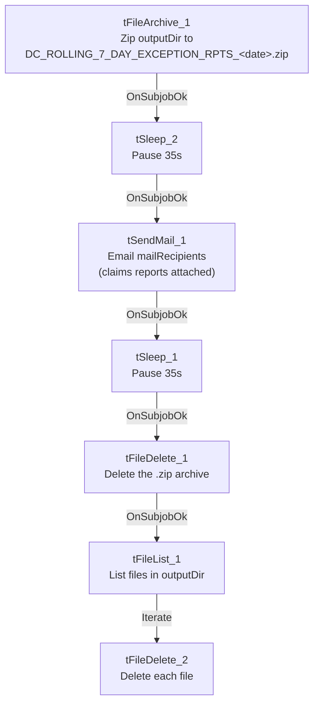

# Talend Job: DC_Call_Contact_Exceptions_2

## Overview

This is the archive/email/cleanup half of a two-job pair for the DC site's rolling-7-day call and RPC exception reports: it zips whatever is in `context.outputDir` into a dated archive, emails a notification (claiming the reports are attached) to `context.mailRecipients`, then deletes the archive and every remaining file in `context.outputDir`. The companion job `DC_Call_Contact_Exceptions_1` (documented separately) is presumably what populates `context.outputDir` with the actual report CSVs, though no `tRunJob` link ties the two together in this metadata.

## Detail table

| Field | Value |
|---|---|
| Job name | DC_Call_Contact_Exceptions_2 |
| Version | 0.1 |
| Project | EDW2SF |
| Author | jmach@harriscollect.com |
| Created | 2023-12-08T13:55:11.260-0800 |
| Last Modified | 2025-08-28T08:57:16.221-0700 |

## Step-by-step data flow

This job is a single linear chain with no explicit `tPrejob`/`tPostjob`/database connection components:

1. `tFileArchive_1` zips `SOURCE=context.outputDir` (with `SOURCE_FILE` hardcoded to a literal `C:/Talend-Studio-.../workspace/source.csv` and `ALL_FILES=false` — see Issues observed) to `TARGET=context.archiveDir + "DC_ROLLING_7_DAY_EXCEPTION_RPTS_" + <CCYYMMDD> + ".zip"`.
2. On success, `tSleep_2` pauses for 35 seconds.
3. On success, `tSendMail_1` emails `context.mailRecipients` (from `svc_analytics@harriscollect.com`, display name "H & H Analytics") with subject "DC Rolling 7 Days Exception Reports" and body text claiming "Today's DC rolling 7-day call and contact exception reports are attached." `DIE_ON_ERROR=true`, so a failed send fails the job.
4. On success, `tSleep_1` pauses for another 35 seconds.
5. On success, `tFileDelete_1` deletes the archive file just created (`globalMap("tFileArchive_1_ARCHIVE_FILEPATH")`); `FAILON=false`, so a failed delete does not fail the job.
6. On success, `tFileList_1` lists files in `context.outputDir`, and for each one found, `tFileDelete_2` deletes it (`FAILON=false`).

## Settings tables

### Archive: `tFileArchive_1`

| Setting | Value | What it means |
|---|---|---|
| SOURCE | `context.outputDir` | The directory presumably populated by `DC_Call_Contact_Exceptions_1`. |
| SOURCE_FILE | `"C:/Talend-Studio-20211109_1610-V8.0.1/workspace/source.csv"` | Hardcoded literal filename that does not match the actual report filenames (`DC_ROLLING_7_DAYS_CALL_EXCEPTIONS_<date>.csv` / `DC_ROLLING_7_DAYS_RPC_EXCEPTIONS_<date>.csv`) produced by `DC_Call_Contact_Exceptions_1` — see Issues observed. |
| ALL_FILES | `false` | Archives a specific file (per `SOURCE_FILE`), not everything in `SOURCE` — makes the `SOURCE_FILE` mismatch potentially consequential. |
| TARGET | `context.archiveDir + "DC_ROLLING_7_DAY_EXCEPTION_RPTS_" + date + ".zip"` | Dated archive filename. |
| OVERWRITE | `true` | Re-running the job replaces any existing archive of the same name. |

### Email: `tSendMail_1`

| Setting | Value | What it means |
|---|---|---|
| TO / FROM | `context.mailRecipients` / `svc_analytics@harriscollect.com` | |
| SUBJECT / MESSAGE | "DC Rolling 7 Days Exception Reports" / "Today's DC rolling 7-day call and contact exception reports are attached." | Body text asserts an attachment. |
| CHECK_ATTACHMENT | `false` | Talend's own attachment-existence check is disabled; this extraction's captured parameters show no separate attachment-file list — unable to determine from this metadata whether any file is actually attached to the email. See Issues observed. |
| DIE_ON_ERROR | `true` | A failed send fails the job outright (this job would surface as a Talend job failure, not silently skip ahead to cleanup). |

### Cleanup: `tFileDelete_1` / `tFileList_1` + `tFileDelete_2`

| Setting | Value | What it means |
|---|---|---|
| `tFileDelete_1` FILENAME | `globalMap("tFileArchive_1_ARCHIVE_FILEPATH")` | Deletes the zip archive just created (after both sleeps and the email have completed). |
| `tFileList_1` DIRECTORY | `context.outputDir` | Lists whatever remains in the output directory. |
| `tFileDelete_2` FILENAME | `globalMap("tFileList_1_CURRENT_FILEPATH")` | Deletes each file found — presumably the original report CSVs, now that they're archived and (allegedly) emailed. |
| FAILON (both deletes) | `false` | A failed delete does not fail the job — stale files could silently persist. |

## Dependencies & configuration

- **Triggers/depends on other jobs:** none — no `tRunJob` links found. This job consumes files that `DC_Call_Contact_Exceptions_1` is presumably responsible for producing, but that dependency is not expressed via `tRunJob` in either job.
- **Context variables used:** `outputDir`, `archiveDir`, `mailRecipients`.
- **5 hardcoded paths**: `tFileArchive_1.SOURCE_FILE`, and `DIRECTORY`/`PATH` on both `tFileDelete_1` and `tFileDelete_2` (all `C:/Talend-Studio-20211109_1610-V8.0.1/workspace/...`) — same portability risk documented project-wide in `05_operational_runbook.md`. Per that runbook, this job is also one of the 12 project-wide jobs that send email on completion.

## Glossary

| Component type | Plain-English meaning |
|---|---|
| `tFileArchive` | Zips a file or directory to a target archive path. |
| `tSendMail` | Sends an email. |
| `tSleep` | Pauses execution for a fixed number of seconds before continuing. |
| `tFileDelete` | Deletes a file (or, per its own config fields, potentially a folder) from disk. |
| `tFileList` | Lists files in a directory for the job to iterate over one at a time. |

## Issues observed

- **`tFileArchive_1`'s `SOURCE_FILE` is a hardcoded literal (`.../workspace/source.csv`) that doesn't match the actual report filenames** the companion job `DC_Call_Contact_Exceptions_1` writes (`DC_ROLLING_7_DAYS_CALL_EXCEPTIONS_<date>.csv`, `DC_ROLLING_7_DAYS_RPC_EXCEPTIONS_<date>.csv`). With `ALL_FILES=false`, this could mean the archive step is silently not capturing the intended report files at all (or the field is vestigial and Talend's actual runtime behavior differs from what this static parameter suggests) — verify directly in Talend Studio whether the resulting `.zip` actually contains the day's reports.
- **The email body claims "reports are attached," but no attachment-file parameter is visible in this job's extracted `tSendMail_1` metadata.** `CHECK_ATTACHMENT=false` only disables an existence check; it doesn't confirm whether an attachment list is configured elsewhere (a table-type parameter that may not have been captured by this extraction). Unable to determine from metadata whether recipients actually receive the reports as files, or only the notification text — verify directly in Talend Studio.
- **Two fixed 35-second `tSleep` steps** with no explanatory comment in the metadata — likely intended to let the archive/SMTP operations settle before the next step, but a fixed sleep isn't robust if either operation takes longer than 35 seconds under load.
- **Both `tFileDelete` steps have `FAILON=false`**, so a failed delete doesn't fail the job — stale archive or report files could silently accumulate in `outputDir`/`archiveDir` without anyone being alerted.
- **No `tRunJob` link connects this job to `DC_Call_Contact_Exceptions_1`.** If an external scheduler doesn't guarantee `_1` fully completes before `_2` starts, this job's cleanup step (`tFileDelete_2`, deleting everything in `outputDir`) could delete files a still-running `_1` is mid-write on, or its archive step could zip an incomplete set of reports. Verify the actual scheduling relationship with the team.
