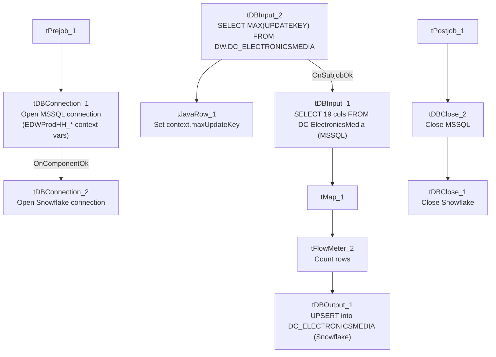

# Talend Job: DC_E_Media_Load

## Overview

Loads electronic-media/letter-status tracking records (logon, media/letter ID, status, waterfall step, content, update timestamps) for the DC site from an MSSQL table (`DC-ElectronicsMedia`) into the Snowflake `DC_ELECTRONICSMEDIA` warehouse table, using a direct `UPSERT` rather than the truncate-stage-merge pattern used by most other loads in this project. It first checks the current maximum `UPDATEKEY` already in Snowflake, apparently intending an incremental load, though the source query's filter clause is not visible in this metadata.

## Detail table

| Field | Value |
|---|---|
| Job name | DC_E_Media_Load |
| Version | 0.1 |
| Project | EDW2SF |
| Author | jmach@harriscollect.com |
| Created | 2022-05-13T13:08:32.782-0700 |
| Last Modified | 2025-09-24T11:00:23.327-0700 |

## Step-by-step data flow

**Setup subjob:** `tPrejob_1` → `tDBConnection_1` opens the MSSQL connection using `context.EDWProdHH_*` variables (password and Active Directory auth redacted) → on success, `tDBConnection_2` opens the Snowflake connection.

**Main subjob:**

1. `tDBInput_2` runs `SELECT CAST(COALESCE(MAX(UPDATEKEY),0) AS VARCHAR(10)) AS MAXUPDATEKEY FROM DW.DC_ELECTRONICSMEDIA;` against Snowflake.
2. `tJavaRow_1` captures that value into `context.maxUpdateKey`.
3. On success, `tDBInput_1` runs a fixed `SELECT` of 19 columns against the MSSQL table `DC-ElectronicsMedia` (logon, EMID, letter name, status fields, waterfall, content, source, `UpdateKey`, etc.). **The captured query text is truncated after the column list and does not visibly reference `context.maxUpdateKey`** — see Issues observed.
4. `tMap_1` passes the row through unchanged in shape (19 columns, `UpdateKey` normalized to `UPDATEKEY`).
5. `tFlowMeter_2` counts rows passing through (labeled "MyLabel", not renamed for this job).
6. `tDBOutput_1` **upserts** the rows directly into Snowflake table `DC_ELECTRONICSMEDIA` (`UPSERT`, no table-recreate action) — no separate staging table or merge-procedure call is used in this job.

**Teardown subjob:** `tPostjob_1` → `tDBClose_2` (close MSSQL) → `tDBClose_1` (close Snowflake).

## Settings tables

### Source: `tDBInput_1` (`tMSSqlInput`)

| Setting | Value | What it means |
|---|---|---|
| Connection | Shared `tDBConnection_1` | Reuses the job's single MSSQL connection. |
| Table | `DC-ElectronicsMedia` | Source table name contains a hyphen — an unusual (though valid, if bracket-quoted) MSSQL identifier, consistent with a legacy-system naming convention. |
| Query | Fixed `SELECT` of 19 named columns (`LOGON`, `EMID`, `EMID_IDX`, `LETTER_NAME`, status/date fields, `WATERFALL`, `CONTENT`, `SOURCE`, `SRC_NAME`, `UpdateKey`) | Captured text is truncated after the column list; no `WHERE` clause is visible — see Issues observed. |

### Target: `tDBOutput_1` (`tSnowflakeOutput`)

| Setting | Value | What it means |
|---|---|---|
| Table | `DC_ELECTRONICSMEDIA` | Same table name referenced by the earlier max-key check (`DW.DC_ELECTRONICSMEDIA`), so this upsert writes directly to the warehouse table, not a staging table. |
| Output action | `UPSERT` | Updates matching rows (presumably keyed on `UPDATEKEY` or a similar identity column configured in the component's key settings, not visible in this metadata) and inserts new ones — no separate merge-procedure step is needed because the upsert itself reconciles new/changed rows. |
| Table action | `NONE` | Table is not recreated/altered by this job. |

## Dependencies & configuration

- **Triggers/depends on other jobs:** none — no `tRunJob` links found.
- **Context variables used:** `EDWProdHH_Server`, `EDWProdHH_Port`, `EDWProdHH_Schema`, `EDWProdHH_Database`, `EDWProdHH_Login` (MSSQL connection), `maxUpdateKey` (computed internally from the Snowflake max-key query).
- No hardcoded developer-workstation paths found in this job.

## Glossary

| Component type | Plain-English meaning |
|---|---|
| `tMSSqlConnection` / `tMSSqlInput` / `tMSSqlClose` | Open a Microsoft SQL Server connection, run a query against it, and close it. |
| `tSnowflakeConnection` / `tSnowflakeInput` / `tSnowflakeOutput` / `tSnowflakeClose` | Open a Snowflake connection, run a query and return its rows, upsert rows into a table, and close the connection. |
| `tMap` | Maps/transforms columns from one schema to another. |
| `tFlowMeter` | Counts rows passing a point in the flow for logging/monitoring. |
| `tJavaRow` | Runs custom Java code once per input row — here used to unpack a single query result into a context variable. |

## Issues observed

- **The incremental-load logic may not actually be applied.** As with `i3_CallDetail_40_Load`, this job computes `context.maxUpdateKey` from Snowflake before reading the MSSQL source, suggesting an intent to pull only rows with a higher `UpdateKey`. However, the `tDBInput_1.QUERY` text captured in this metadata is truncated after the column list and shows no `WHERE UpdateKey > ...` clause referencing `context.maxUpdateKey`. Because the target write is an `UPSERT` (not a plain `INSERT`), re-reading the entire source table every run would not create duplicate rows the way it would in an append-only job — but it would mean unnecessary full-table extraction and reprocessing on every run if the filter isn't actually applied. Unable to determine from this metadata whether the query is filtered; verify directly in Talend Studio.
- **No error/row-count logging specific to this job's business outcome** (no `tWarn`/`tDie`/`tSendMail`) — a load failure here would only surface as a generic Talend execution error, with no job-specific message to distinguish it in a shared log. Beyond this, no other issues distinct from the project-wide patterns in `05_operational_runbook.md` were found in this job's own metadata.
