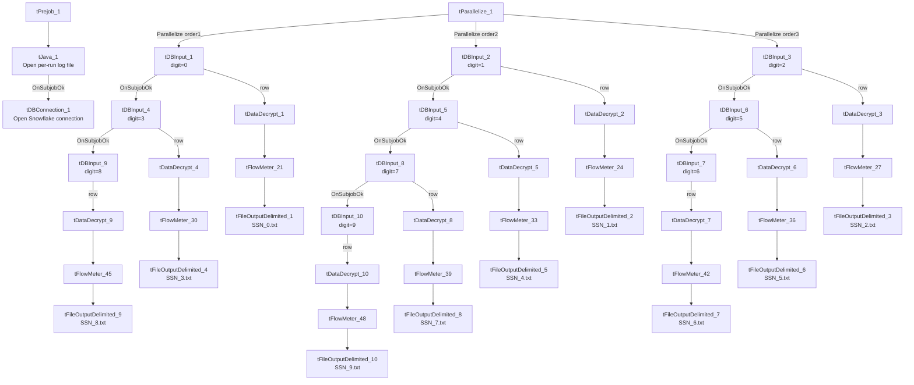

# Talend Job: DC_SSN_Extract

## Overview

This job extracts `DEBTOR_IDX` and decrypted Social Security Numbers from the Snowflake `DW.DIMDEBTOR` table for DC-site debtors assigned before a hardcoded cutoff date (`2025-08-21`), splitting the population into 10 buckets by the last digit of `DEBTOR_IDX` and writing each bucket's decrypted SSNs to its own plain, unencrypted tab-delimited text file (`SSN_0.txt` through `SSN_9.txt`). This reads as a one-time or ad hoc compliance/legal/backfill extract (built 2025-09-15) rather than a recurring warehouse load — it has no target table, no `tRunJob` links, and a literal date embedded in every query rather than a context variable. **Writing decrypted SSNs to plain flat files is a significant data-handling consideration** — see Issues observed.

## Detail table

| Field | Value |
|---|---|
| Job name | DC_SSN_Extract |
| Version | 0.1 |
| Project | EDW2SF |
| Author | jmach@harriscollect.com |
| Created | 2025-09-15T11:46:16.416-0700 |
| Last Modified | 2025-09-24T11:00:34.405-0700 |

## Step-by-step data flow

**Setup:** `tPrejob_1` → `tJava_1` opens a per-run log file at `context.logDir + jobName + "_" + <timestamp> + ".log"` → on success, `tDBConnection_1` opens the Snowflake connection. **No `tPostjob`/`tDBClose` exists anywhere in this job** — see Issues observed.

**Main subjob** — `tParallelize_1` starts 3 concurrent chains (rather than 10 fully parallel branches), each chain reading its digit-buckets one after another via `OnSubjobOk`:

- **Chain A:** digit `0` (`tDBInput_1`) → digit `3` (`tDBInput_4`) → digit `8` (`tDBInput_9`)
- **Chain B:** digit `1` (`tDBInput_2`) → digit `4` (`tDBInput_5`) → digit `7` (`tDBInput_8`) → digit `9` (`tDBInput_10`)
- **Chain C:** digit `2` (`tDBInput_3`) → digit `5` (`tDBInput_6`) → digit `6` (`tDBInput_7`)

For **each of the 10 digit buckets** (identical pattern, only the trailing-digit filter and output filename differ):

1. `tDBInput_<n>` runs `SELECT DEBTOR_IDX, SSN FROM DW.DIMDEBTOR WHERE LOGON='DC' AND DT_ASSIGNED < '2025-08-21' AND LEFT(REVERSE(TRIM(DEBTOR_IDX)),1) = '<digit>';` — the last-digit filter splits `DIMDEBTOR` into 10 roughly even slices.
2. `tDataDecrypt_<n>` decrypts the `SSN` column using an AES key file at `context.cryptoPath + "dimdbtr.crypt"` (secret type, key, and password all redacted; `ALGO_VERSION=2`; `DIE_ON_ERROR=false` — a decryption failure does not fail the job, see Issues observed).
3. `tFlowMeter_<n>` counts rows passing through (all labeled "MyLabel", not renamed per branch).
4. `tFileOutputDelimited_<n>` writes the decrypted `DEBTOR_IDX`/`SSN` pairs, tab-delimited, no header, to `context.outDir + "SSN_<digit>.txt"` (`FILE_EXIST_EXCEPTION=true` — see Issues observed).

## Settings tables

### Source pattern: `tDBInput_1` through `tDBInput_10` (`tSnowflakeInput`)

| Setting | Value | What it means |
|---|---|---|
| Query | `SELECT DEBTOR_IDX, SSN FROM DW.DIMDEBTOR WHERE LOGON='DC' AND DT_ASSIGNED < '2025-08-21' AND LEFT(REVERSE(TRIM(DEBTOR_IDX)),1) = '<0-9>';` | Identical across all 10 components except the literal trailing digit. The cutoff date `2025-08-21` is hardcoded into every one of the 10 queries individually — see Issues observed. |

### Decrypt pattern: `tDataDecrypt_1` through `tDataDecrypt_10`

| Setting | Value | What it means |
|---|---|---|
| CRYPTO_METHOD / ALGO_VERSION | `AES` / `2` | Symmetric decryption of the `SSN` column. |
| CRYPTO_FILE_PATH | `context.cryptoPath + "dimdbtr.crypt"` | Same key file used by all 10 branches. |
| SECRET_TYPE / SECRET_KEY / PASSWORD_M1 | `***REDACTED***` (all three) | Preserved as redacted; not guessable from this metadata. |
| DIE_ON_ERROR | `false` | A decryption failure on any row does not fail the job — see Issues observed. |

### Output pattern: `tFileOutputDelimited_1` through `tFileOutputDelimited_10`

| Setting | Value | What it means |
|---|---|---|
| FILENAME | `context.outDir + "SSN_<0-9>.txt"` | 10 separate flat files, one per digit bucket. |
| FIELDSEPARATOR | `\t` (tab) | Tab-delimited, not comma. |
| INCLUDEHEADER | `false` | No header row — a file is just raw `DEBTOR_IDX`/`SSN` pairs, one per line. |
| FILE_EXIST_EXCEPTION | `true` | Re-running the job without first clearing out the previous run's `SSN_*.txt` files will throw an exception — see Issues observed. |
| Content | Decrypted (plaintext) `SSN` values | See Issues observed regarding data sensitivity. |

## Dependencies & configuration

- **Triggers/depends on other jobs:** none — no `tRunJob` links found.
- **Context variables used:** `logDir`, `cryptoPath`, `outDir`.
- No hardcoded developer-workstation paths found in this job's own components (the sensitive value here is the hardcoded **date literal**, not a path — see Issues observed).

## Glossary

| Component type | Plain-English meaning |
|---|---|
| `tSnowflakeConnection` / `tSnowflakeInput` | Open a Snowflake connection and run a query, returning its rows. |
| `tDataDecrypt` | Decrypts an encrypted column's values using a key file and algorithm configured on the component. |
| `tFlowMeter` | Counts rows passing a point in the flow for logging/monitoring. |
| `tFileOutputDelimited` | Writes rows to a delimited (CSV/TSV-style) text file according to a schema. |
| `tParallelize` | Runs its downstream branches at the same time rather than one after another — here used to run 3 sequential digit-bucket chains concurrently rather than fully serializing all 10 reads. |

## Issues observed

- **This job writes decrypted, plaintext Social Security Numbers to 10 unencrypted flat files** (`SSN_0.txt` through `SSN_9.txt`) in `context.outDir`, with no header and no indication in this metadata of any subsequent encryption, secure transfer, or automated cleanup step. Per this project's data-handling expectations, SSNs are sensitive PII that should not persist in plaintext on disk longer than operationally necessary — confirm with the team what downstream process consumes these files and whether they are deleted/archived securely afterward (no such step is wired into this job itself).
- **The cutoff date `2025-08-21` is hardcoded as a literal string in all 10 of this job's queries individually**, rather than being driven by a single `context.*` variable. Re-running this extract for a different cutoff (or making it recurring) would require editing all 10 queries by hand — a copy-paste-prone maintenance burden, and a sign this job was built as a one-off rather than a reusable pipeline component.
- **`tDataDecrypt`'s `DIE_ON_ERROR=false` on all 10 branches** means a decryption failure on any row is silently tolerated rather than failing the job — unable to determine from this metadata what a failed-to-decrypt row looks like in the output file (blank, null, or the still-encrypted value); verify directly in Talend Studio.
- **No `tPostjob`/`tDBClose` exists anywhere in this job** — `tDBConnection_1` (Snowflake) is opened in the setup subjob but never explicitly closed within the job itself, unlike virtually every other job in this project (e.g. `ADP_Payroll_Load`, `DC_E_Media_Load`), which pair every connection open with a matching close in a teardown subjob. This likely relies on the Talend runtime/JVM shutdown to release the connection implicitly, which is a less controlled pattern than an explicit `tDBClose`.
- **`FILE_EXIST_EXCEPTION=true` on all 10 output files** means this job cannot be re-run against the same `outDir` without first manually removing the prior run's 10 output files — there is no cleanup or archive step for the previous run's outputs built into the job.
- **The 3-chain-of-10 parallelization pattern** (3 concurrent chains of length 3, 4, and 3) is an unusual, seemingly ad hoc way to split 10 independent digit-bucket queries — a straightforward 10-way `tParallelize` (as seen elsewhere in this project, e.g. `DC_Call_Contact_Exceptions_1`'s 2-way split) would have been simpler; unable to determine from metadata why this specific 3/4/3 grouping was chosen (possibly to cap concurrent Snowflake connections/load).
