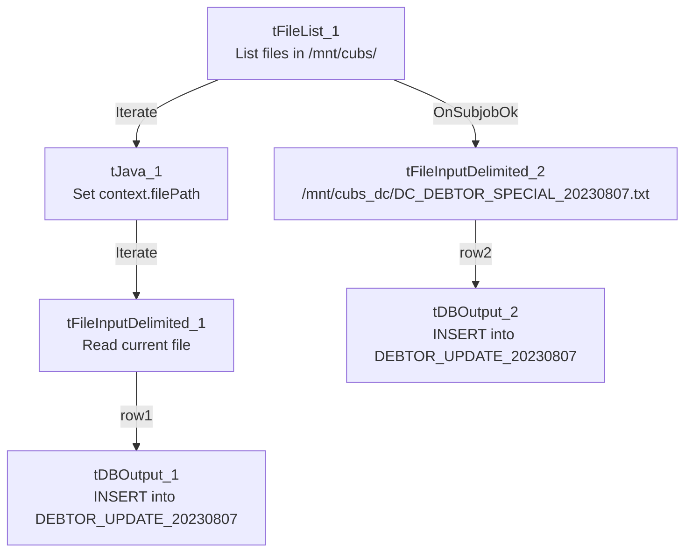

# Talend Job: DEBTOR_UPDATES_20230807

## Overview

This is a one-time, date-stamped debtor-field patch job (built and presumably run on 2023-08-07): it reads tab-delimited debtor update files — every file found in a hardcoded directory, plus one specific named file for the DC site — and inserts the rows (logon, debtor number, `DEBTOR_IDX`, and four legacy "misc"/date fields) into a Snowflake table named for the run date, `DEBTOR_UPDATE_20230807`. Both the date-stamped target table name and the complete absence of any connection-management components (`tPrejob`, `tDBConnection`, `tPostjob`, `tDBClose`) mark this as a single-use backfill/patch job rather than a recurring pipeline component.

## Detail table

| Field | Value |
|---|---|
| Job name | DEBTOR_UPDATES_20230807 |
| Version | 0.1 |
| Project | EDW2SF |
| Author | jmach@harriscollect.com |
| Created | 2023-08-07T11:27:18.302-0700 |
| Last Modified | 2025-09-24T11:08:59.083-0700 |

## Step-by-step data flow

This job has no `tPrejob`/`tPostjob` or explicit database connection component in its own metadata — see Issues observed.

1. `tFileList_1` lists files in the hardcoded directory `/mnt/cubs/`.
2. For each file found, `tJava_1` sets `context.filePath` to the current file path, then `tFileInputDelimited_1` reads it (tab-delimited, header row present, `DIE_ON_ERROR=false`) with columns `LOGON`, `DEBTOR`, `DEBTOR_IDX`, `_20_MISC3`, `_21_MISC4`, `_31_SRV_ST_DT`, `_1522_CLT_XFR_DT`.
3. `tDBOutput_1` inserts those rows into Snowflake table `DEBTOR_UPDATE_20230807` (`INSERT`, `tableAction=CREATE_IF_NOT_EXISTS`).
4. Separately, once `tFileList_1`'s subjob completes, `tFileInputDelimited_2` reads one specific hardcoded file, `/mnt/cubs_dc/DC_DEBTOR_SPECIAL_20230807.txt` (same 7-column schema).
5. `tDBOutput_2` inserts those rows into the **same** Snowflake table, `DEBTOR_UPDATE_20230807` (`INSERT`, `tableAction=CREATE_IF_NOT_EXISTS`).

Both file sources land in the same target table, so the table ends up holding the union of whatever files were in `/mnt/cubs/` plus the one DC-specific file.

## Settings tables

### Source 1: `tFileList_1` / `tFileInputDelimited_1`

| Setting | Value | What it means |
|---|---|---|
| DIRECTORY | `"/mnt/cubs/"` | Hardcoded literal path (not a `context.*` variable), unlike most file-driven jobs in this project. |
| FILENAME (read) | `context.filePath` (set from `tFileList_1`'s current file) | Reads whatever file(s) are found in `/mnt/cubs/` — no filter beyond the default file-list behavior. |
| Columns | `LOGON`, `DEBTOR`, `DEBTOR_IDX`, `_20_MISC3`, `_21_MISC4`, `_31_SRV_ST_DT`, `_1522_CLT_XFR_DT` | Legacy-numbered "misc" field names — their real business meaning is not documented in this metadata. |

### Source 2: `tFileInputDelimited_2`

| Setting | Value | What it means |
|---|---|---|
| FILENAME | `"/mnt/cubs_dc/DC_DEBTOR_SPECIAL_20230807.txt"` | A single, specifically named DC-site file, hardcoded to this one run date. |

### Target: `tDBOutput_1` / `tDBOutput_2` (`tSnowflakeOutput`)

| Setting | Value | What it means |
|---|---|---|
| Table | `DEBTOR_UPDATE_20230807` (both) | A date-stamped, one-off table name — not a standing warehouse table reused across runs. |
| Output action | `INSERT` | Appends rows; no truncate step exists in this job. |
| Table action | `CREATE_IF_NOT_EXISTS` | Creates the table on first run if it doesn't already exist. |

## Dependencies & configuration

- **Triggers/depends on other jobs:** none — no `tRunJob` links found.
- **Context variables used:** `filePath` (set internally by `tJava_1`).
- **2 hardcoded developer-workstation paths** in `tFileInputDelimited_1.TEMP_DIR` and `tFileInputDelimited_2.TEMP_DIR` (both `C:/Talend-Studio-20211109_1610-V8.0.1/workspace`) — same portability risk documented project-wide in `05_operational_runbook.md`. In addition, the source directories `/mnt/cubs/` and `/mnt/cubs_dc/...` are hardcoded Linux-style literals, not `context.*` variables.

## Glossary

| Component type | Plain-English meaning |
|---|---|
| `tFileList` | Lists files in a directory for the job to iterate over one at a time. |
| `tFileInputDelimited` | Reads a delimited (tab-separated, in this job) text file according to a schema. |
| `tSnowflakeOutput` | Writes rows to a Snowflake table. |
| `tJava` | Runs a small custom Java snippet — here, just captures the current file path into a context variable. |

## Issues observed

- **This job has no `tPrejob`/`tPostjob`, and no `tDBConnection`/`tDBClose` component anywhere in its metadata**, unlike essentially every other job in this project. How `tDBOutput_1`/`tDBOutput_2` actually connect to Snowflake (a shared/default connection, or settings not captured by this extraction) is unable to determine from this metadata — verify directly in Talend Studio.
- **The target table name (`DEBTOR_UPDATE_20230807`) is itself date-stamped**, and the second source file is hardcoded to `DC_DEBTOR_SPECIAL_20230807.txt` — both are tied to a specific one-time run date embedded in literal strings. This job cannot be meaningfully re-run for a different date without editing its hardcoded table/file names by hand; it is a historical patch job, not a recurring pipeline component, and should likely be treated as inert/archival rather than part of the active job inventory.
- **Both `tDBOutput` components target the same table with `CREATE_IF_NOT_EXISTS`**, meaning a re-run of this job (if the source files still exist) would append duplicate rows into `DEBTOR_UPDATE_20230807` rather than replace them — there is no truncate step. Given the job's one-off nature this is likely not a practical concern, but it's worth knowing if the table is ever queried under the assumption it reflects a single, deduplicated load.
- **Source directories (`/mnt/cubs/`, `/mnt/cubs_dc/`) are hardcoded Linux-style literals**, not `context.*` variables — inconsistent with the `StandardFolders_0.1`-driven pattern used by most other jobs in this project (see `06_dependency_matrix.md`).
