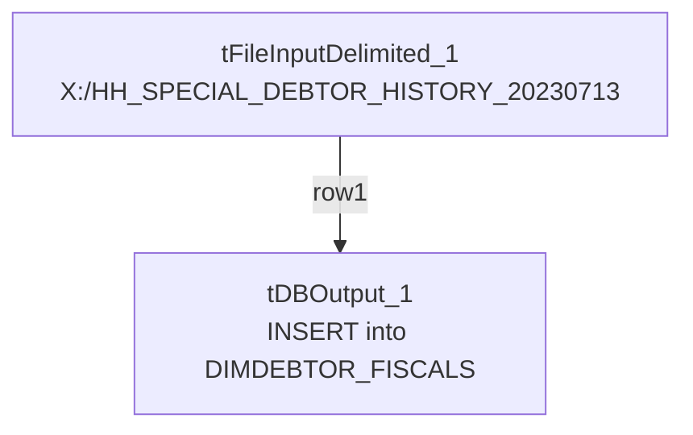

# Talend Job: DIMDEBTOR_FISCALS_20230713

## Overview

This is a one-time historical backfill job (built 2023-07-13): it reads a single fixed file of HH-site "special debtor" garnishment/warrant history (`X:/HH_SPECIAL_DEBTOR_HISTORY_20230713`) and inserts the rows directly into the standing Snowflake warehouse table `DIMDEBTOR_FISCALS`. Unlike its sibling one-off job `DEBTOR_UPDATES_20230807`, this job's target table is **not** date-stamped — it loads straight into the live `DIMDEBTOR_FISCALS` table, meaning it directly affected production warehouse data rather than a scratch/staging table.

## Detail table

| Field | Value |
|---|---|
| Job name | DIMDEBTOR_FISCALS_20230713 |
| Version | 0.1 |
| Project | EDW2SF |
| Author | jmach@harriscollect.com |
| Created | 2023-07-13T14:28:06.462-0700 |
| Last Modified | 2025-09-24T11:09:05.670-0700 |

## Step-by-step data flow

This job has no `tPrejob`/`tPostjob` or explicit database connection component in its own metadata — see Issues observed. It is a single two-component chain:

1. `tFileInputDelimited_1` reads the fixed file `X:/HH_SPECIAL_DEBTOR_HISTORY_20230713` (tab-delimited, header row present, `DIE_ON_ERROR=false`) with columns `LOGON`, `DEBTOR`, `DEBTOR_IDX`, `COUNTY_OF_WARRANT`, `GARN_WORK_DT`, `WARRANT_SRV_DT`.
2. `tDBOutput_1` inserts those rows into Snowflake table `DIMDEBTOR_FISCALS` (`INSERT`, `tableAction=NONE` — the table is expected to already exist).

## Settings tables

### Source: `tFileInputDelimited_1`

| Setting | Value | What it means |
|---|---|---|
| FILENAME | `"X:/HH_SPECIAL_DEBTOR_HISTORY_20230713"` | A fixed path on a mapped/network drive (`X:`), with no file extension — an unusual and clearly one-off, developer-specific reference rather than a repeatable operational path. |
| FIELDSEPARATOR / HEADER | `\t` / 1 header row | Tab-delimited with header. |
| Columns | `LOGON`, `DEBTOR`, `DEBTOR_IDX`, `COUNTY_OF_WARRANT`, `GARN_WORK_DT`, `WARRANT_SRV_DT` | Garnishment/warrant-related fiscal history fields for HH-site "special" debtors. |

### Target: `tDBOutput_1` (`tSnowflakeOutput`)

| Setting | Value | What it means |
|---|---|---|
| Table | `DIMDEBTOR_FISCALS` | The standing (non-date-stamped) warehouse table — this job inserted historical records directly into live production data. |
| Output action | `INSERT` | Appends rows; no truncate step exists in this job. |
| Table action | `NONE` | Table is not created/altered by this job — it must already exist. |

## Dependencies & configuration

- **Triggers/depends on other jobs:** none — no `tRunJob` links found.
- **Context variables used:** none — this job uses no `context.*` variables at all, consistent with being a hardcoded one-time run.
- **1 hardcoded developer-workstation path**: `tFileInputDelimited_1.TEMP_DIR` (`C:/Talend-Studio-20211109_1610-V8.0.1/workspace`) — same portability risk documented project-wide in `05_operational_runbook.md`. The source file path itself (`X:/HH_SPECIAL_DEBTOR_HISTORY_20230713`) is also a hardcoded, developer-machine-specific literal, though it wasn't flagged by the extraction's `hardcoded_path_findings` (which appears to target the `C:/Talend-Studio...` pattern specifically).

## Glossary

| Component type | Plain-English meaning |
|---|---|
| `tFileInputDelimited` | Reads a delimited (tab-separated, in this job) text file according to a schema. |
| `tSnowflakeOutput` | Writes rows to a Snowflake table. |

## Issues observed

- **This job has no `tPrejob`/`tPostjob`, and no `tDBConnection`/`tDBClose` component anywhere in its metadata** — the same pattern seen in `DEBTOR_UPDATES_20230807`. How `tDBOutput_1` actually connects to Snowflake is unable to determine from this metadata; verify directly in Talend Studio.
- **The source file path (`X:/HH_SPECIAL_DEBTOR_HISTORY_20230713`) is a hardcoded, developer-machine-specific literal on a mapped drive letter**, with no file extension and no `context.*` variable involved. This job cannot be re-run today unless that exact path still exists and is still mapped to `X:` on whatever machine runs it — strongly suggesting this was executed once, interactively, from a developer's own Talend Studio, rather than through the project's normal scheduled/context-driven execution pattern.
- **This job writes directly into the standing `DIMDEBTOR_FISCALS` table with no truncate/staging step and no de-duplication logic** — if it were ever accidentally re-run against the same source file, it would insert duplicate rows into a production dimension table. Given its one-off, historical nature this is a low ongoing risk, but it means this job should be treated as archival evidence of a past data fix, not as a component to schedule or re-trigger.
